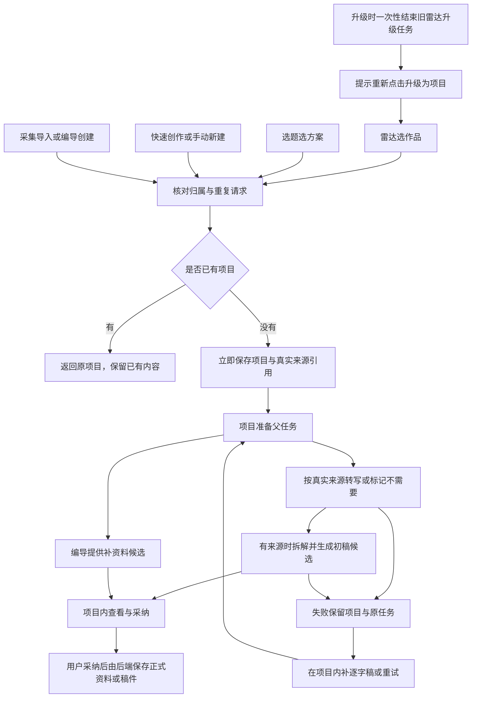

# T-1382：统一项目入口，把准备工作放回项目

日期：2026-10-20。版本：v2.1。状态：**用户已确认（方向 + Q-01..Q-12 默认值）；独立评审 PASS_WITH_CHANGES（0 阻塞）的 N-1..N-6（REV-001..REV-006）已合入；用户于 2026-10-20 23:00（北京时间）授权开工实施。**

月明于 **2026-10-20 22:26（北京时间）**确认本 SPEC 及第 12 节 Q-01..Q-12 的建议默认值，并指导：「很多兼容性的地方你不用考虑得过重。更新是有取舍的，而且我们现在用户量不多，很少。」本次按这一指导简化旧任务、旧入口和历史数据处理，具体取舍见第 6、8、12 节。

月明于 **2026-10-20 23:00（北京时间）**授权：「开工：合进 6 条意见出 v2.1，登记 T-1382，实现并跑测试」。独立评审见 [评审原文](t1382-unified-project-intake.review.md)，评审对象为 v2，结论 PASS_WITH_CHANGES、0 阻塞、6 条非阻塞建议；v2.1 的逐条作者处置追加在该文件末尾，不改写原评审或其哈希。

本文仍是设计，不是功能实施记录。**本次运行限定为文档修订与登记**：合入六条意见、登记 BACKLOG/DEC，并按 taskctl 的合法流程尝试 start；不改产品代码、不运行产品测试、构建、迁移、产品接口或真实模型。任务实际状态以 BACKLOG 与 taskctl 事件为准；用户授权和设计评审不等于 START 成功或功能 Gate 通过。下文 RED、Gate 和公共链路均为待执行计划。

## 1. 用户原话、目标与阶段路由

> 「雷达中心和选题仅负责选方案，只设立升级为项目按钮，转写、补全资料等所有工程在项目中完成；项目来源不单纯是雷达，要好好设计。」

大白话：选中了想做的内容，就先得到一个能打开、能保存的项目。素材从哪里来，项目里如实记着；转写、拆解、补资料、生成初稿都在项目里继续。机器处理失败，项目和已完成的内容仍在，可以处理原来的失败。AI 写出的资料和稿件先给人看，用户采纳后才进入正式内容。



v1 的静态阅读范围见第 14 节；本次复核看板、目标 SPEC、评审、`PROJECT.md`、`PROJECT_CONTEXT.md`、技能 `SKILL.md`、`prompts/stage-router.md`、taskctl/reviewctl 与物理架构，并只读核对相关代码。项目 manifest 的整体阶段为 `4-build`，不替代本任务的前置条件。本次为 **PLAN 修订与登记**，依赖为已确认的 v2 及独立评审六条意见，产物为 v2.1、作者处置、任务与 DEC；用户确认点已由 23:00 授权满足。start 只通过合法回执与状态工具推进，不代表本轮进入产品 BUILD 或完成测试 Gate。

本机技能 `VERSION=3.30.0`，项目 `orchestrator/process/.skill-version=3.29.0`。本次仅文档与登记，保护他人未提交改动，不扩大为脚手架升级；已运行只读 `context-plan --stage plan --task T-1382 --json`，其诊断为旧配置缺 `context_policy`、使用 compat-full，不修改配置。未运行 context-compile、reconcile 或 CodeGraph 索引；产品实现前仍须处理版本漂移及适用 Gate。完整 reconcile 受 T-1373 已知副作用限制，不借登记触发。实际产品宪法沿 `docs/产品定位.md` 并结合 T-1022/T-1332 的组归属约定；评审物理边界为 `orchestrator/SYSTEM_ARCHITECTURE.md`，不能拿旧账号口径取消纯组能力。

### 需求编号

| ID | 已确认目标 |
|---|---|
| FR-1382-01 | 雷达、选题负责选方案；选定后通过“升级为项目”进入项目工程。 |
| FR-1382-02 | 各来源共用幂等 `ensureProject`，立即保存项目、入口来源和原始素材引用，不等待转写或模型生成。 |
| FR-1382-03 | 新准备流程由项目持有持久父任务；状态来自服务端，失败保留项目，支持原准备任务恢复与项目内手工补逐字稿。 |
| FR-1382-04 | AI 拆解、初稿和资料补全只产候选；采纳由用户触发、backend service 写入。 |
| FR-1382-05 | 保留 T-1332 纯组端到端能力和既有项目数据/ID；升级时一次性结束旧雷达升级任务，用户重新点击走统一幂等入口。 |
| FR-1382-06 | 快速创作以引用加入准备流程；编导 `project.create` 的模型输入合同不增 `source/platformRef`。 |
| FR-1382-07 | 保留已发布导入语义、现有合法创作路径、LED-047/LED-053 和候选采纳边界。 |

## 2. 现状核实：逐来源的真实路径

以下为当前工作区源码阅读结论，不代表本轮已经运行产品，也不把用户提供的提交 `2022847c0`、`011942a58` 的历史效果当成新验收。

| 来源 | 前端与后端主路径 | 建项目前实际工作 | 建项目后实际行为 |
|---|---|---|---|
| 雷达“升级为项目” | `radar-upgrade-action.tsx` → `use-project-upgrade-queue.ts` → `intelligence.projects.enqueue` → `radar-project-queue.service.ts` → `radar-project.service.ts` | 先校验定位和作品；无稿则 `enqueueTranscripts`；随后 `startTopicPreview(strategyBacked:true)` 产拆解、策略、初稿；最后才建项目。父任务为 `radar_project_upgrade`，归属 item，预算为 continuous。 | 初稿保存在 `briefDetail.contentRadarEvidence.adaptedDraftSeed`；创建未传 `source`，实际为 `manual`。项目页因存在 evidence 推断 radar、把转写恒判完成。 |
| 选题“升级为项目” | `topics-interactive-region.tsx:1036` → `candidates.promote` → `candidate.service.ts:612–723` | 用候选卡、观众任务等拼 brief/briefDetail，调用 `createProject`；未传 `source:'topic'`。之后更新 candidate 并写 `topic_promotions`，跨步骤不是事务。 | 跳 `/projects/:id?from=topic`；组合根 `persistence-client.ts:4480` 事后 `attachFromPromotion`。URL 触发一次 `brief.fill`，前端用 sessionStorage 防重。 |
| 雷达选题→候选→升级 | `intelligence-workbench-api.ts` 的 `promoteCandidate` → 同一个 `candidates.promote` | 同选题路径；可携带雷达证据，不等于直接雷达升级。 | 同选题；现有 evidence 优先推断会把该项目显示成 radar。 |
| 带雷达素材的快速创作 | `/projects/create?sourceItemId=` → `quick-create-work.tsx` → `project-creation.ts` → `projects.create` | `prepareBrief` 在前端读取逐字稿或 `safeExtract`，最多截取 60000 字拼成 brief；无结构化来源引用，未传 source。 | 为用户选择的内容形式建立 outputs，进入项目页；会显示项目准备面板，但没有服务端准备流水线。 |
| 手动新建 | `new-project-dialog.tsx`、`/projects/new` → 同一创建会话 → `projects.create` | 常规保存标题、brief 等，没有后台准备任务。 | 同样显示项目准备面板；无抖音锚时转写“不需要”，补资料与初稿由本地数据推断。 |
| 编导 `project.create` | `chat-system-action-card.tsx` → `assistant-system-root.ts:146` 的采纳动作 → `projects.create` | 用户采纳系统动作后创建；宿主已有动作收据/事务机制。模型合同明确 omit `source/platformRef`。 | 默认 manual；无统一准备父任务。不能把模型提出创建候选当成已经创建。 |
| 采集导入 | `ingestion.service.ts:772–922` → publication 查找/合并，未命中再 `ensureImportedProject` | 优先以真实账号、platform、publication.externalId 找已发布项目，命中时合并且保留原 source；不是每次都新建 imported。未命中才按 imported/platformRef ensure。 | 新导入项目 source=imported，直接 review、进度 100；创建 output，采集回读 canonical publication owner 并处理竞争。现抖音转写走 `projects.transcribe`。 |
| 自动化 | 本轮未发现独立的新增项目入口；已见 `getProjectIdByOutput` 为读取 | 不将“未发现”写成系统绝无入口。 | 若既有自动化调用采集/创建服务，沿相应来源适配器；本轮不新增自动化建项目产品功能。 |

### 与背景材料不同、必须进入设计的事实

1. **来源引用不是现成的原始素材容器。** `schema/intelligence.ts:307` 及迁移 0050 要求 topic、item、snapshot、transform、transcriptHash；`project-reference.service.ts` 的 attach 要求已确认 transform 和已完成逐字稿，读取还核确认关系与 hash。转写前不能直接调用该口。现唯一索引 `(project_id,item_id,source_snapshot_id)` 还会阻止同源 raw/confirmed 两行共存。
2. **普通建项目已经有事务。** `projects.repository.ts:409` 的 `insertProjectWithChildren` 原子创建项目、阶段、平台关系与 activity；需补的是 intake、promotion、来源、准备任务之间的原子关联，不是重写全部创建逻辑。
3. **来源标记还会被读侧丢掉。** `draft-workbench-data.ts:677` 仅透传 topic/imported，其余转 manual；`types/domain.ts`、`project-overview-workspace-data.ts` 和 `projects.service.ts` 也有三值窄类型。`source==='topic'` 仅在当前 promote 路径不可达，通用 create 合同本身允许 topic，不能说全系统不可达。
4. **“项目准备”是全来源面板，不是全来源后台任务。** `project-pipeline-panel.tsx:48–112` 的完成/进行中来自 origin、抖音锚、三个 brief 字段、脚本/seed 与 React 状态。其它来源只要有抖音锚也可显示转写；不是 imported 专属。聊天发起后本地 running 不足以证明实际任务运行。
5. **选题页仍有有效的 `topic.enrich` 调用。** `topics-interactive-region.tsx:1170–1222` 的“一句话起选题→编导起草”会创建候选并打开编导；详情 EnrichButton 已移除不等于所有补全行为已迁走。约 1259 行仍有“补全选题卡”死引用，约 1173 行注释也过时。选方案起草与项目资料补全的边界见第 12 节。
6. **雷达详情仍显示工程。** `radar-upgrade-action.tsx` 仍显示转写、拆解补全、创建三步和取消；未知转写的手工恢复仍在 `intelligence-workbench.tsx:1749`。迁移后删除雷达工程与手工补稿入口，手工补逐字稿只在项目转写步骤提供。
7. **项目转写有派生副作用。** `project-transcription-target.service.ts` 只认真实 `platformRef.platform==='douyin'`；结果保存为 output_script。`transcript-artifact.service.ts` 在没有主稿时还可能初始化 master_script，`execution-transcribe-workflow.service.ts` 的完成回调经组合根可能触发 `reconstruct.project`。准备流程不能仅复用按钮就声称“只产候选”。
8. **`topic_preview` 不能直接接任意 projectId。** 旧 `startTopicPreview` 要求 item、该 item 当前合法 snapshot、已完成逐字稿及策略模式定位；产物归 transform。导入的 platformRef/文字没有这些实体，必须增加可信来源适配，不能虚构 item、transform、topic。
9. **父子任务机制也要适配。** `persistent-task.service.ts:439` 的 `modelRouteParent` 目前仅接 share_import/radar_project_upgrade→item 转写，而且不等于完整预算继承。retry_wait、waiting_user、调度及冻结模型身份有 kind/owner 白名单。
10. **公开任务 GET 不能想当然复用。** `intelligence-workbench-api.ts:19–27` 明确 V2 原任务目前经 `execution.tasks.list` 按 owner 分页查找；不能因 GET 合同是 union 就认定 by-id 已走持久任务服务。

## 3. 范围与非范围

本设计一次覆盖六种来源的入口、原始引用、持久准备、项目内恢复、候选采纳、旧雷达升级任务一次性收尾、读侧来源透传、选题死文案和所列回归，不以版本切块缩减已确认范围。

非范围：自动发布；自动采纳资料或稿件；新建外部素材搜索产品；支持尚未存在的平台转写能力；替换 Pi/执行账本；全局任务系统重写；删除既有项目或历史任务记录；批量重跑历史模型；历史 source 回填或分类工程；旧升级执行器并存、旧链接/旧二进制兼容垫片；改变脚本/复盘主干；新增视觉主题或 OilUI 门。设计已获实施授权，本次交付仅文档与登记，不提前执行后续产品代码与测试工作。

## 4. 目标入口与项目页面

### 4.1 来源语义与触发

`projectSource` 扩为 `manual | topic | radar | imported | assistant | quick_create`。它表示**项目从哪个入口建立**，不是素材的平台，也不是当前页面，更不是发布状态。含雷达素材的选题项目仍为 topic，带雷达素材的快速创作仍为 quick_create。

| 来源 | 建项与引用 | 自动执行默认 | 需保留的已有行为 |
|---|---|---|---|
| radar | 按真实 item 幂等 ensure；马上返回项目；保存 raw intelligence 引用和定位版本 | 用户点击授权启动转写与拆解/初稿；复用可信已有产物 | 同作品重复点击返回原项目；批量独立处理；纯组不补账号 |
| topic | 按 candidate 幂等 ensure；保存原卡快照、promotion；真实雷达来源另建引用 | 有来源时启动准备；已有完整可信候选则复用；补资料需要时通过项目编导发起一次持久候选请求 | 已采纳的选题字段可作为用户选定输入保存；新生成建议不得自动回填 |
| quick_create | 显式区分共享 helper 的入口；保存 sourceItemId 引用，移除前端正文抓取/60000 字拼接 | 有来源时同项目准备；无来源时按手动创作 | 原 outputs 选择、失败只补失败 output、scope 离开保护均保留 |
| manual | 按本次用户创建动作的幂等键 ensure；无来源就保存空引用 | 不凭空转写或拆解；用户可在项目中发起补资料/写稿 | 允许标题与空 brief 建项；不强迫填写完整资料 |
| imported | 优先返回 publication 的 canonical 项目；新建才标 imported；保存真实 platform 工作引用 | **不因后台采集自动发起付费 AI**；项目内明确启动准备后，抖音复用转写，有可用正文则拆解/初稿 | review、已发布、进度与原 output 保持；命中 manual 项目不改其 source |
| assistant | 用户采纳创建动作后由可信宿主 ensure，动作收据作为幂等锚 | 无来源按手动；后续项目编导候选须真实执行 | 模型 `project.create` 输入仍拒绝 source/platformRef；后端按可信入口标 assistant，不向模型开放来源声明 |

建项只做权限、归属、真实 ID、事务与幂等，不以模型配置缺失、定位待补、转写失败或资料未齐为阻止建项的理由。明确传入越权/不存在的来源不能静默吞掉；快速创作页面若预读来源失败，可以让用户明确以无来源继续，不能在服务器把失败来源冒充已挂接。

**N-3 / REV-003：** `/projects/create?sourceItemId=` 按合法 workspace 预读来源，不能以 `session.ctx.accountId` 非空作为来源读取前提。账号平台信息另按真实账号可用性读取；纯组 `accountId=null` 仍读取真实 sourceItemId、显示成功或具体失败。越权/不存在来源拒绝挂接；用户明确选择无来源继续时，去掉该引用并保存这一明确选择，不能静默降级。直接测试纯组快速创作页面，不以雷达按钮的纯组用例代替。

上表自动执行默认适用于本次新建项目；复用既有项目时保留原准备状态，无 preparation 的旧项目只返回原项目，由用户在项目内手动启动。

### 4.2 每种来源的步骤矩阵

面板沿已有“来源素材→项目准备→稿面”布局，使用现有 tokens、Button、Dialog、编导栏。建议把“拆解选题与补全资料”拆成可区分的事实：转写、来源拆解/初稿候选、资料补全；同一初稿仅生成一次，不能既由 topic_preview 生成又再开一次写稿。

下表的“需要”表示待处理；**进行中、失败、完成均只取服务端记录**，不是根据来源预置。

| 来源/条件 | 转写 | 来源拆解与初稿 | 资料补全 | 项目可见的完成事实 |
|---|---|---|---|---|
| radar，有原始引用 | 需要；已有可信逐字稿可完成 | 需要；已有同来源候选可复用 | 已有用户资料则完成，否则需要编导候选 | “逐字稿就绪”“初稿候选已生成，待采纳”；不称已采纳 |
| topic，有雷达引用 | 同 radar | 先核原候选；真实可复用则完成，否则需要 | 原选题字段已采纳且齐备则完成，否则候选待处理 | 来源显示“选题”，雷达作为素材列出 |
| topic，无外部素材 | 不需要 | 来源拆解不需要；普通初稿由用户在项目编导发起 | 需要时编导候选 | 无素材不算失败，不以缺转写卡住写稿 |
| quick_create，有引用 | 同引用能力 | 同 radar 或合法文字来源 | 需要时编导候选 | 来源显示“快速创作”，保原 output |
| quick_create，无引用 | 不需要 | 来源拆解不需要；普通初稿按需 | 按已有资料/编导候选 | 不显示虚构的来源或完成数 |
| manual | 不需要 | 来源拆解不需要；普通初稿按需 | 按需；已有保存值可完成 | 手写和保存始终可用 |
| imported，抖音真实锚 | 需要但默认未启动；已有真实转写则完成 | 有正文后按需启动；结果为候选 | 已发布项目默认不强制补齐，可按需请求 | 准备状态不改变“已发布/复盘”事实 |
| imported，其它平台 | 自动转写不需要，并说明当前能力不适用；可补正文 | 已有真实文字则按需；无正文显示“待补充来源正文” | 按需 | 不把“不支持转写”说成“没有素材”或“转写失败” |
| assistant，无来源 | 不需要 | 同 manual | 同 manual | 创建动作已采纳不等于新稿已采纳 |

任何“需要”的步骤均可进入 `queued → running → done`，或 `failed/blocked/unknown_result`；候选产生后显示“待采纳”，用户采纳完成另有持久回执。没有 taskId 时不得显示“进行中”。已有手工填写/正式稿只能显示“已有资料/已有稿件”，不能补造 AI 成功记录。

### 4.3 页面交互与异常

- 新雷达卡只提供“升级为项目”，完成 ensure 后显示“已建项目”或“处理中”并可“查看项目”。准备失败时用“已建项目·准备需处理”提示；全部工程按钮进入项目。不把 source 页面改成后台控制台。
- 新选题升级直接打开 `/projects/:projectId`。直接移除 `?from=topic` 的生成、读取、透传和自动补全逻辑，以及对应 sessionStorage 标记，不保留导航或执行兼容垫片；其它合法操作的请求恢复存储不在删除范围。
- 旧项目无 preparation 记录时显示“未登记准备流程”，允许在项目内手动启动；不推断旧 AI 步骤完成，也不自动补建任务。
- 项目显示真实来源、适用步骤、原任务状态和错误原因。队列等待、暂停、失败、结果待确认分开；读取失败显示“状态暂时无法读取”，保留已知项目/任务，不把未读到当不存在。
- 失败步骤提供“重试本步骤”；已完成步骤不重做。未知供应商结果先查原回执，不提供等价于盲目重发的普通重试。需要手工逐字稿时在项目转写步骤粘贴或上传，提交后读回原来源与原任务状态。
- 补资料在同一项目编导栏显示“现值→建议值”；用户点采纳才写项目资料。新准备初稿在候选卡展示，不能自动作为编辑器初值触发自动保存。既有正式稿、脏稿和用户主动保存的空稿均不能被旧 seed 回灌。
- 准备失败不禁用项目标题、手写稿、保存或其它无关创作动作。可用正文或用户明确补稿足够时继续合法处理；不得因审美、完整度、可选元数据缺失新增整单 hard-fail。
- 未确认候选、来源详情、大正文按需展开。轮询同一 scope 最多一个在途请求；切组/卸载停止前端观察并拒绝旧响应，不取消后台任务。真实项目跳转仍走路由；同页打开编导/手工稿弹层使用本地路径。
- 保留实际改动前视觉基线，之后检查正常/空/加载/错误/权限/长内容/部分失败，以及 1366×900、1280×800、宿主最小窗口和 200% 缩放。本文没有渲染原型或截图，不冒实际视觉验收。

## 5. 合同设计

以下为已独评并合入六条意见的合同设计；不是声称仓内已有这些端点，具体实现与验收仍待执行。

### 5.1 入口、读取与恢复

| 操作 | 拟定合同及边界 |
|---|---|
| 新 `projects.ensure`，`POST /projects/ensure` | 来源判别联合；manual/quick_create 接用户创建字段与 `idempotencyKey`，quick_create 可带已核实 `sourceItemId`；topic 接 `candidateId`；radar 接 `itemId`、可选定位版本及幂等键。服务端从真实来源补字段，不能让 caller 提交完成态/lease/任意用户。imported/assistant 由可信内部适配器调用同服务，不接受客户端伪装其来源。 |
| ensure 响应 | `{project, preparationTaskId, sourceReferences, reused}`，返回前项目已提交；无准备记录时 preparationTaskId 为 null。取消 `legacy_pending` 变体及空 projectId 占位，不因 HTTP 等待结束制造第二次提交。 |
| 原 `projects.create`，`POST /projects` | 服务内部委派 ensure；新增可选 `idempotencyKey`，本次受控入口必须复用稳定动作键。原手动创建无键请求仍表示一次独立创建。source 请求 schema 只保留原三值 `manual/topic/imported`，不随资源六值枚举扩大；公开调用实际可自行选择 manual/topic，省略沿 manual。imported 仅可信 ingestion 内部入口可赋值，普通公开调用自报 imported 拒绝；详见下述 N-4。platformRef 始终校验真实归属，不因声明来源授予发布事实。 |
| 原 `candidates.promote`，`POST /candidates/:candidateId/promote` | body/原 promotion 响应保留；服务原子委派 ensure，source=topic。必要时通过项目 preparation GET 读取任务，不改变模型侧 topic.promote 输入。 |
| 原 `intelligence.projects.enqueue` | 本次配套升级直接移除旧生产合同、transport 与调用，雷达改用 `projects.ensure`；不保留旧 tasks 响应适配或旧客户端垫片。历史任务仍可只读查看，不能恢复执行已退役 kind。 |
| 新 `projects.preparation.get`，`GET /projects/:projectId/preparation` | 返回入口来源、原始引用摘要、当前父 taskId/版本、steps、候选锚、可执行动作与真实错误；内部经持久任务 service 精确读取。无记录返回明确空态“未登记准备流程”和手动启动动作，不查旧父拼装虚假步骤。GET 无副作用、不开模型、无隐式建任务。 |
| 新 `projects.preparation.start`，`POST /projects/:projectId/preparation` | 显式按需启动/补建准备计划；body 含 `idempotencyKey` 和用户选定的适用步骤。已有在途父任务返回原任务；不能借 start 重放未知结果或续期。主要供 imported、手动资料/写稿及无父任务历史项目使用。 |
| 原 `execution.tasks.list/command` | kind 增 `project_preparation`；控制仍为 pause/resume/cancel/retry，命令带原 taskId 和幂等键。新父服务只对当前受阻且可恢复步骤行动；控制命令不重建项目。 |
| 新 `projects.preparation.transcript.provide`，`POST /projects/:projectId/preparation/transcript` | body 含原 parentTaskId、referenceId、预期来源/步骤版本、submissionKey 及 paste/file 形式。文件只接受既有受控上传引用，不接受任意本机路径。服务核 project→reference→item/platform→原子任务，委派原手工稿恢复能力；错误 scope 拒绝。 |
| 新 `projects.preparation.candidate.accept`，`POST /projects/:projectId/preparation/candidates/:candidateId/accept` | 接 `idempotencyKey`、预期项目/稿件版本或服务端基线 digest、候选来源 digest、用户编辑内容（可选）；重核原子任务、来源与当前业务版本；返回真实采纳收据与版本。准备流程中的 brief.fill 卡也经此受控适配，内部复用原项目/工件 service；普通独立编导卡的入口保留，不制造第二套领域写库逻辑。 |
| 原 `projects.transcribe` | 公开 attemptId/返回 taskId 保持；准备任务通过可信内部适配器复用其业务能力，附父执行证明与“不初始化主稿/不自动重组”策略，不向模型或普通浏览器开放策略覆盖字段。 |
| 原 `projects.intelligence.attach/list` | 现有已确认来源合同、存储和 hash 校验保持原样；原始来源走独立新表，由项目 service 的内部 `attachRawSource/getRawSourceContexts` 提供，preparation GET 投影。保留这一区分是为了不把未确认素材冒充用户已确认来源。 |

原始引用 DTO 至少含 `id/projectId/sourceKind`，真实 item/snapshot 或 platform 工作标识，展示链接及正文可用性；独立表不需要 raw/confirmed 兼容分型，未产生的 transcriptHash、候选 ID 保持空，不能占位。错误合同区分权限/来源不存在、相同幂等键输入冲突、来源版本变化、配置待补、已知执行失败、未知结果与原期限耗尽。

**N-4 / REV-004：公开创建白名单与可信赋值。** 资源/响应的 `projectSource` 是六值，`projects.create` 的请求白名单独立定义为原三值，不直接引用扩大的资源枚举。公开 create 自报 radar/assistant/quick_create 在合同层拒绝；自报 imported 即使通过三值 schema，也须在服务端因缺可信 ingestion 上下文拒绝，不能仅因 source=imported 就进入 review/进度 100 或生成已发布事实。ingestion 通过内部 service port，核真实账号、platform、externalId、publication/canonical owner 后才可创建 imported；浏览器、CLI、MCP、模型不得传一个 trusted 标记取得这一能力。

radar/quick_create 通过新 ensure 的受控动作分支，由服务端核 workspace、真实 item/sourceItemId（如有）及原始用户动作键后赋值；请求分支表达用户选择，不直接透传为可信来源字段。assistant 只由后端采纳宿主核原动作收据后赋值。manual/topic 的来源声明也不自动授予 publication 或候选 promotion 事实；相应关系仍核真实对象。无需新增身份系统或保留旧创建协议，仅收敛已有入口的权限语义。

### 5.2 合同文件与数据投影

- `contract/src/resources/projects.ts`：来源六值；新增准备摘要、step、原始来源与候选回执 schema。`projectBriefDetail` 继续允许空，历史 brief 内容原样保留，不另做来源识别分型。
- `contract/src/operations/projects.ts`：ensure、preparation GET/start/手工稿/采纳及 create 可选幂等键；create 使用独立原三值请求白名单，响应沿六值，导出与 operation registry 同步。
- `contract/src/resources/intelligence.ts`：增加执行 kind；旧 kind 只保历史记录解析，移除旧升级生产专用 schema。confirmed reference DTO 不改，原始引用 DTO 放 projects 资源合同。
- `contract/src/operations/intelligence.ts`：移除旧升级 operation；`contract/src/operations/candidate.ts` 的 promote 请求/响应不变，无需为内部事务调整而改动。
- `contract/src/internal/execution-worker.ts`：父子关联、预算与来源联合；ownerType 已有 project，不必再造一种 owner。`contract/src/operations/execution.ts` 复用 kind schema，list/command 不另扩兼容字段。
- `contract/src/index.ts`、`contract/src/cli-policy.ts`：导出新 DTO，登记新操作读写策略、移除旧操作。`contract/src/endpoints.ts` 已展开各 operation 集合，沿既有注册机制即可。
- `contract/src/resources/assistant-system.ts` 保持 `project.create` omit source/platformRef；`contract/src/assistant-system.test.ts` 拒绝这些输入的断言保留。
- 编导工具、CLI、MCP 和前端共用正式 operation registry。新增公共操作必须接真实 transport，不能只在页面调用私有函数；既有工具不因此获得额外创建/发布权限。
- **N-5 / REV-005：** 新手引导 `hasCreatedProject` 按真实已创建行为承认 manual/topic/radar/assistant/quick_create；imported 仍只触发原 `hasImportedWorks` 区别，不能用缺数据补完成信号。内容日历 `ScheduleProject.source` 与项目服务复用同一六值合同类型，完整透传六来源，不在端口重写三值联合。

## 6. 数据模型、原子性与迁移

### 6.1 项目与原始引用

`projects.source` 已是 text，扩枚举**不需要新增项目来源列，也不需要数据库 enum 改型**；同步 contract、service 类型和全部读侧即可。`platform_ref` 继续代表真实平台工作，`brief_detail` 继续代表用户资料/历史证据，不能把全部执行 checkpoint 塞进 brief。

仅扩 source 不足以完成本任务。采用下述最小数据增量；两张新表放在现有 `backend/src/schema/projects.ts`，复用现有数据库注册，不另增 schema 文件。

| 存储 | 变更 |
|---|---|
| 新 `project_source_references` | 按 `project_id` 归属，以 `(project_id,source_key)` 唯一。`source_kind` 仅分 `intelligence_item` 与 `platform_work`：前者保真实 item/snapshot，后者保真实 account/platform/externalId 及可得链接；只核各族必要字段，不伪造 topic/transform。正文版本/hash 在实际取得后登记。 |
| 原 `project_intelligence_references` | 不改结构、索引或历史行；继续保存已确认来源并沿原 confirmed/hash 校验。删除同表 raw/confirmed 分型、旧字段放宽、历史引用补值和索引重建方案。 |
| 新 `project_intakes` | 保存 user、非空的 `scopeKind/scopeId`、入口来源、稳定 intakeKey、请求摘要、真实 projectId、可空 preparationTaskId、时间。稳定键设唯一约束，不依赖 NULL account 防重；不再保存 legacyTaskId、空 projectId 或旧新协议映射。 |
| `execution_tasks` | 复用现表的 kind、owner、payload、checkpoint、租约/预算字段；不新建第二队列或步骤表。新父子关系沿受控内部协议关联。 |
| 候选存储 | 雷达候选引用真实 transform；无 item 的 project-owner topic_preview 将候选保存在执行 checkpoint，含来源/产物 digest；父只存 ID 和摘要。正式 brief/script 只在用户采纳时落库。 |

旧 confirmed 数据不迁移、不分类、不补造 hash 或确认状态；现有读取规则继续负责其完整性。新 raw 引用经项目权限和真实来源权限校验，不能借项目 ID 访问越权素材。信源删除须计入新引用并保留仍被使用的快照；项目迁组须校验新引用的活来源归属。这两项必须保留，因为已有项目不能因删除或迁组丢失素材、留下越权引用。

原始引用只用于准备输入，不等于用户认可拆解/策略。transcript 仍归原 item 或项目来源工件；父任务归项目。新候选保存实际使用的 snapshot、artifactVersion、transcriptHash/sourceDigest。来源改变时提示重新确认，不能悄悄换到最新版；这是候选与输入一致性的要求。

### 6.2 ensure 的提交边界

组合层以同一事务绑定各模块 service port；projects 模块不 import intelligence/candidate repository，frontend 只接线。事务内完成：

1. 重核当前用户、真实 workspace/member、来源对象与显式输入，锁稳定 intake 身份；先检查已有项目及 intake/promotion/publication 的真实关联；旧任务只可提供已有项目的事实指针，不再参与执行分流。旧父 checkpoint 尚无 projectId 时，必须按 §8.1 的只读找回规则核实已提交项目，不能直接视为不存在（N-6 / REV-006）。
2. 以已选中的真实 ID 创建或读取项目；复用 `insertProjectWithChildren`，不手工复制项目子表创建逻辑。
3. 新建项目时保存 raw 来源引用、必要的 promotion 关系、intake 回执，以及按授权适用的准备父任务/初始 checkpoint。复用既有项目只复用或登记真实幂等关联；已有准备任务返回原任务，无 preparation 的旧项目不自动补建，用户在项目内明确 start 后才预约。
4. 全部成功后提交，再唤醒执行器。唤醒失败由持久调度器重获原任务，不能删除项目或重建队列。

任何事务内引用/权限失败都整笔回滚；数据库已经提交但 HTTP 响应丢失时，同键查回同项目。输入摘要用于识别“同一个请求键却换了内容”，不做文字语义相似判断。实际存储适配若不能让任务 enqueue 与创建共享事务，必须在本 SPEC 复审中明确改成事务 outbox 及恢复验收，不能实现成无恢复的先 create、后 enqueue。

准备父任务预约不得要求模型已经可用。配置缺失时同事务保存项目、来源及 waiting_user 的真实准备状态，不虚构已冻结模型身份；用户补配置并明确继续时，按执行系统规则完成首次能力/模型冻结，再预约子调用。已经冻结的旧路由不能因重新点击静默替换，有限期限也不因此重算。这一规则需在新 kind 的 enqueue/admission 实现中明确支持，不能只在 UI 捕获错误后宣称项目已建。

### 6.3 旧项目与迁移

**旧项目 source 不回填**，按已存值显示；缺值沿合理默认 manual，不根据 evidence、URL 或标题猜来源。不为旧项目分类、重标记或自动创建准备任务。没有 preparation 记录时统一显示“未登记准备流程”，允许用户在项目内手动启动；已存资料、稿件、outputs 和来源照常读取、编辑，不追记历史 AI 成功。

迁移只追加两张新表及必要索引，并按第 8.2 节一次性结束旧雷达升级任务。迁移文件使用实施时分配的 `backend/drizzle/<新序号>_unified_project_intake.sql`，同步 `backend/drizzle/meta/_journal.json` 与 `backend/src/migration-convergence.ts` 的当前迁移登记；不重写 0008/0050/0051 或冻结历史谱系。保留当前迁移登记是为了让启动器正确识别新 schema，不承担旧二进制兼容。

PostgreSQL 与本地 PGlite 经 `backend/src/db.ts` 共用同一迁移目录；均需验证已有数据升级、全新初始化、重复启动不重复收尾，以及失败时不留下部分提交。迁移失败保留数据库并报告真实错误，修正后继续迁移；不增加降级读者矩阵、旧执行器回退或反向删表方案。本轮没有创建迁移或访问数据库。

## 7. 项目准备任务与执行适配

### 7.1 父任务与 checkpoint

新 kind 为 `project_preparation`，`ownerType='project'`、`ownerId=projectId`。不是 `project_tasks` 待办，不复用旧 radar 父伪装项目 owner。该新 kind 采用单一 payload 版本 `schemaVersion:1`，不再保留旧升级任务的 v1/v2 分派。

| 区域 | 必需内容 |
|---|---|
| 冻结 payload | `schemaVersion:1`、`projectId`、`intakeId`、`origin`、`sourceReferenceIds`、实际来源身份/digest、真实定位版本（可空）、用户授权的 requestedSteps、输入修订号；workspace/member/route/budget 使用执行系统可信字段，不允许模型自报 |
| 父 checkpoint | `schemaVersion`、`projectId`、`stage`、`revision`、`steps`、`activeStep`、`blockedChildId/blockedAtAttempt`、`lastError`、真实候选/采纳回执锚 |
| 每个 step | `required` 与 `reasonCode`、`status`、实际 `childTaskId`、必要的 `businessTaskId`、子 owner、复用/独占标记、原任务 attempt、输入 digest、输出引用、真实开始/结束时间、错误/恢复动作；未发生字段保持空 |
| 候选锚 | 类型 brief/draft/decomposition、来源子 taskId/transformId 或 checkpoint 路径、digest、当前待采纳/已采纳/已拒绝状态及真实采纳版本；候选正文按需读取 |

服务端 step 状态为 `not_required | pending | queued | running | waiting_user | candidate_ready | done | failed | blocked | unknown_result | paused | cancelled`。这是准备 DTO 的步骤状态，不随意新增 execution 根状态；执行内部 `retry_wait/waiting_user` 沿既有投影，精确区分 runtimeStatus。

`childTaskId` 指真实 execution task；项目转写公开返回的 taskId 可能是 ai_task 业务 ID，必须经既有提交/映射服务得到 execution ID，并分别记录，不能把两种 ID 互换控制。仅外层 status=succeeded 不足以认定候选完整；明确 runtimeStatus=partial/unknown_result 要显示真实部分完成/待核对，缺省 runtimeStatus 不可被误判为未知。

父阶段建议 `queued → resolving_sources → transcribing → generating → awaiting_user → completed`；适用性判断后可跳过步骤，阶段单调记录已完成事实。brief 候选可以与有来源的生成独立推进，不把“必须补齐三个字段”变成生成初稿的硬门。`completed` 表示本次已授权自动准备已完成/安全跳过；“候选已生成”与“用户已采纳”分别显示，不将自动任务 succeeded 当成全部创作完成。

### 7.2 子能力

| 步骤 | 实施约束 |
|---|---|
| 雷达转写 | 保留 item_transcripts 与 intelligence 转写 worker；项目父通过 raw 引用核 item/snapshot 后调用新受控父子端口。复用真实进行中或已完成任务；父 checkpoint 标记它是否共享。不得把雷达 URL 塞入 projects.platformRef 假装导入。 |
| 抖音项目转写 | 复用真实 project transcription target 与 transcribe.douyin 执行；持久记录准备来源、父证明、`skipMasterScript` 与禁自动重组策略，贯通完成回调。转写仅作为来源工件，不让 output_script 被新准备页面当成已采纳创作初稿。旧公开显式转写行为保留。 |
| 雷达拆解/初稿 | 复用旧 `topic_preview` 和三段 Skill；已有合法同来源候选可复用，否则在项目创建后启动。完成后从真实 child+transform 读取可用候选；不要求已有产物补齐可选 generationProgress，因为缺少进度元数据不代表内容无效。 |
| 无 item 的合法文字来源 | 扩 `topic_preview` 的可信来源联合，`ownerType=project`。来源联合为 `project_artifact`（真实 artifact/version/hash）或 `imported_text`（真实导入事实及冻结正文摘要）；复用生成能力，不能调用旧 startTopicPreview 并编造 item/transform。无可信正文时 waiting_user，不以标题猜完整正文。 |
| 资料补全 | `brief.fill` 仍是编导候选工具，不是确定性“补齐”服务。新增项目准备→既有持久 chat 提交适配，冻结 project selection，以父/步骤键登记 chatTaskId、conversation/候选回执。保选题升级需要时自动一次的体验，防重只由持久父/步骤键负责，直接删除旧 URL/sessionStorage 触发逻辑。其它来源按项目按钮发起；已有生成候选只打开原卡。 |
| 无来源的普通初稿 | 项目编导按真实 brief/用户材料提出候选；用户决定发起，不硬造 topic_preview 来源。其状态通过真实 chat/候选/采纳回执归入项目面板。 |

project-owner topic_preview 的 `getContext/saveCandidate/finish` 建议由新 `project-preparation-generation.service.ts` 提供。worker 根据内部判别联合读取来源，经同一生成逻辑产出 decomposition/topic/adaptedDraft，向 backend port 保存子 checkpoint；父只投影结果。不能因无 canonicalUrl 就伪造网址，也不能把所有 plain brief 当成已核实的外部原文。

抖音转写继续复用既有来源 output_script 工件时，新准备写入需带可信 `contentData.purpose='project_preparation_source'`、原项目/reference/task/版本锚及 `skipMasterScript`。只能创建或复用属于该来源的工件，不能向用户创作稿追加版本。正式稿选择、初稿完成判断及下游创作读取必须排除这类未采纳来源，只有显式来源读取口可以消费；仅关闭 master 初始化而保留“任意 output_script 即正式稿”的读法不满足本设计。已有旧转写工件不批量改标签，按旧事实读取。

**N-1 / REV-001：正式稿隔离必须覆盖读和写。** `confirmed-project-script.ts` 的默认选稿、`current-artifact.ts` 的创作上下文选择、`project-script-source.ts` 的默认及精确 artifact/version 读取，都不能把准备来源标为已保存正式稿；精确版本参数不能绕过 purpose 校验。`script-draft-target.service.ts` 的创建/复用目标同样排除来源工件，采纳写入真实正式稿目标且来源版本/正文不变。仅有准备来源时，正式稿仍空；用户主动保存的空稿是有效正式内容，不从来源或旧 seed 回灌。显式来源读取仍核归属、版本和 digest 后可用，不靠全局隐藏或删除来源工件解决。

### 7.3 租约、控制与恢复

本节适用于 `project_preparation` 及仍受支持的子能力；退役的 `radar_project_upgrade` 不恢复，统一按第 8.2 节处理。

- 父采用短 tick：claim、校验、预约/读取子任务、存 checkpoint、让出槽位。等待转写、模型或用户时不长期占 worker 执行槽；FIFO 与并发约束沿 execution 调度。
- 每次预约子任务、写候选/步骤或产生业务写入都核 taskId、attempt、fenceToken、leaseOwner、当前状态、冻结 workspace/member。父子关联还必须验证 project→reference→item/artifact 的授权链；只扩父 kind 白名单不足以授权。
- 默认保存原任务与 child ID。已知失败仅在用户显式 retry 后恢复失败步骤；paused/waiting_user 走 resume；unknown_result 先核账本，不自动新建子任务。某步成功不得因后续失败重新调用模型。
- **N-2 / REV-002：** `codex-read-recovery.ts` 增加 project-owner topic_preview 的原调用读取恢复判别，并核对 `model-call-recovery.ts`、persistent task resume/unknown-result 的实际消费者。核真实 task/owner/project、冻结 workspace/scope、模型路由身份、原 thread/turn 与来源联合；同一原调用可读回候选和真实结果，异项目/异 scope 或身份不符拒绝，零新增模型提交。读取恢复保留原 task/child ID 与原期限，不借恢复续期；账本不足时继续如实 unknown_result，不编造成功。
- pause/cancel 先持久命令、再让持租约者确认；停止新增子工作。父独占的子任务通过原控制协议同步停止，共享 item 转写仅解除本父等待，不取消别的消费者需要的任务。
- 失租约的旧 worker 不能回写。取消前已合法提交的候选/项目保留；取消后返回的结果只能沿原账本结算，不能自动采纳。重启由原 task/lease/checkpoint 恢复，不依赖浏览器仍在。
- 手工补稿只在项目转写步骤提交到真实来源/原转写恢复端口，再唤醒原准备父任务；必须处理 hash 变化和已生成候选失效，不能直接把 UI 步骤改 done。已确认引用不被手工稿静默覆盖。若新正文改变 sourceDigest，保留父/项目 ID 和旧回执，登记明确的新来源修订及子尝试身份；不能把新正文套进已经结算的旧模型调用，也不能以此扩大原期限。

### 7.4 LED-053 预算

保留来源既有预算政策：雷达新父延续 continuous；其它新准备执行使用现有普通任务默认预算（当前规范为 30 分钟）或真实调用方已经冻结的更长/continuous 预算。按需步骤尚未提交时不假装已计时执行。新的明确用户执行可建立关联的新准备 run；普通重试、页面刷新、恢复都不是新授权，不能借它们重置期限。

所有转写、生成、chat 子调用继承同一原父有限绝对期限及实际剩余量，continuous 明确传递，不转成隐式 120 秒总上限。单次新正执行/HTTP/有限观察至少 120 秒，原有更长值保留；共享 deadline 剩余不足 120 秒时沿原剩余值，到期立刻停止，不向上取整续期。

独立外层预算覆盖全部串行步骤、重试、退避、排队、启动和结算余量；若共享绝对 deadline 则明确共享，不给每个子任务重新 30 分钟。等待用户期间有限期限不自动暂停或延长；期限耗尽后显示停止原因，已生成候选仍可由用户经当前权限采纳。需要继续新的模型工作须明确发起新 run，保留旧失败与旧 ID。

租约 60 秒、tick 间隔、心跳、TTL 都不是执行总上限。现 `transcript-source-recovery.service.ts` 的旧 continuous 冷却恢复不能把新有限父清成 `deadlineAt=null`。前端观察到期只停止观察，保留 project/task ID 与真实状态，不自动重发或取消。

## 8. 幂等、ID 与旧任务一次性收尾

### 8.1 稳定身份

| 来源 | 幂等身份 |
|---|---|
| radar | 已核 workspace 内真实 itemId；同作品重复升级返回同一项目，定位改变不覆盖原冻结输入。已有旧项目的真实关联优先复用，原 ID 不变。 |
| topic | 当前可写 workspace 的真实 candidateId；已有 topic_promotions.projectId 优先，纳入组合事务，不新造第二项目。 |
| quick_create/manual | scope + 原始用户动作 idempotencyKey；同键同输入返回原项目，不按标题去重。同素材有意多次快速创作可用新的明确动作键。 |
| assistant | 原宿主提案/采纳动作收据与稳定 call 身份；不从模型任意字符串取得执行权。 |
| imported | 先查真实 publication 的 canonical owner；无记录才沿原账号/platform/externalId ensure。组内多个真实账号的不同作品不能因 externalId 相似而合并。 |

月明于 2026-10-21 17:25（北京时间）批准 bug 8：雷达 ensure 的 API/CLI/MCP 请求显式携带已授权 groupId；仅带 account 的一对一初始组请求在既有授权及 membership 锁内解析为同一 group scope，无法解析或无权限按现有错误拒绝，禁止退回 legacy-account 新建。同组同 item 返回原 projectId/回执且不重复准备；不同组独立，不迁移或合并已有项目。

intakeKey 使用结构化数组序列化和 SHA256，不用标题相似度、关键词或模糊 URL 判断。共享组创作身份以经授权的 group 为准，平台导入事实仍绑定真实账号。

对经统一 intake 新建的项目，包括新雷达项目，采用同一公式：

```text
projectId = "project-intake-" + sha256(JSON.stringify([userId, scopeKind, scopeId, origin, intakeKey])).slice(0, 32)
```

选择该方案是因为不必先预约 taskId，也不必保留有账号/纯组两种旧派生分支；唯一 intake 键即可保证新项目幂等。**所有已创建项目的 ID 均不变**，按真实关联返回原项目；不重算历史 ID，也不要求新旧公式一致。ID 只是标识，读取和写入仍核真实归属。

**N-6 / REV-006：保全“项目已提交、父回执未写”的窗口。** 旧 `radar-project.service.ts` 在事务内提交项目，队列稍后才单独写 checkpoint.projectId；两者之间崩溃不代表没有项目。在停止旧写入后，以当前授权的真实 item/workspace 查旧持久任务及项目来源事实，优先读取已有回执；回执缺失时，可用该旧任务已冻结的 `[userId, accountId, task.id]` 或纯组 `[userId, "group", groupId, task.id]` 按旧 `project-radar-` 哈希规则**仅定位并读取已有行**，再核真实项目归属和 item 来源关联。也可由项目已存的真实来源引用找回；不能按标题、URL 相似或 source=manual 猜测。这里的只读定位不重写已有 ID，不用旧公式创建新项目，也不保留旧建项执行器。

已核实存在的原项目在统一 intake 锁/事务下登记真实关联并返回原 ID，保留 brief/script/outputs/source；没有 preparation 不自动补跑。归属或来源冲突、读取失败不能当不存在后新建，应返回真实待核对/冲突；只有完成真实查找并确认没有既有项目，才使用新 intake 公式创建。账号与纯组均验证该崩溃窗口下的迁移、重新点击及并发 ensure：原项目不变、零第二项目、旧父不恢复。

并发同键由唯一约束与行锁收敛；同键换输入返回冲突。跨组、跨用户、成员变化仍重新鉴权。T-1332 的纯组 `accountId=null` 必须端到端通过；不得补假账号或调用 requireAccountId。归档/已删除项目按已有状态和合法动作处理，不因重复点击自动恢复或重建。

### 8.2 在途旧 radar_project_upgrade

升级采用一次性收尾，不让新旧升级流程并行运行：

1. 在新调度启动前停止旧 kind 接单与 claim；通过现有取消/结算机制使旧持租约者停止提交，再执行迁移收尾。全部非终态旧 `radar_project_upgrade` 统一置 `cancelled`；若现有存储只允许失败结算，则置 `failed`，均记录 `SYSTEM_UPGRADED` 和“系统已升级，请重新点击升级为项目”。不按旧业务阶段设计不同恢复路径。
2. 旧父的独占在途子工作停止并按原账本结算；共享转写不被连带取消。未知供应商结果保留原调用 ID 与账本，不标成成功、也不由迁移重发。必须保留这一点，因为取消父任务不能抹掉真实调用或让迟到结果再建项目。
3. 保留旧任务记录、已完成产物与全部已有项目，不改已有项目 ID、source 或稿件。旧任务只供查看；退役 kind 的 retry/resume 统一返回上述升级提示。已经创建的旧雷达项目照常可读可编辑；没有 preparation 时按第 6.3 节由用户在项目内手动启动。
4. 用户重新点击“升级为项目”只走 ensure：按 §8.1 核实既有项目，包含已提交但父未写 projectId 的窗口；已有项目返回原 ID，确认不存在才创建新项目及准备任务。若原子能力仍有未知调用结果，先建或复用项目并将对应准备步骤标为待核对，查询原账本后再决定继续；不恢复旧升级父，也不新增无项目等待分支。项目归属/关联无法核实仍按 §8.1 报冲突，不以“先建”绕过幂等保全。
5. **迁移确认不再有可运行旧任务后，删除旧 tick、旧 producer/dispatch、旧建项服务及其专属测试。** 新版本在恢复调度前完成这项迁移；只保留历史记录解析和退役 kind 的统一拒绝，不能留下可重启旧任务的入口。雷达页的手工补稿恢复入口同时删除，项目转写步骤是唯一手工补逐字稿入口。

contract/backend/worker/UI 配套更新，不建设旧二进制混跑、旧任务双协议或兼容回滚层。失败时保留数据并修正迁移/新版本；不以删数据或把新 schema 交给旧执行器来“回滚”。保留迁移前停止旧写入和迁移后的不可执行校验，是为了防止迟到写入与重复建项，而非维持旧功能路径。

## 9. 实施影响清单（仅计划）

按唯一文件路径计数，包含拟修改、新增和删除的实现文件；第 11 节测试计划、本 SPEC 及后续流程工件不计入本表。按职责将 worker 与现有组合根 `frontend/src/server/persistence-client.ts` 归入后端，不重复计数。**前端 23 个，后端 47 个（含 worker/组合根），contract 7 个，迁移 3 个，总计 80 个；其中拟新增 5 个、拟删除 2 个。** v2.1 比 v2 补 7 个现有消费者：N-1 后端 4 个、N-2 后端 1 个、N-5 前端 1 个及后端 1 个；N-3/N-4/N-6 落在已列文件。当前仅修订文档与登记，未修改上述实现文件。

### 9.1 前端（23 个）

| 文件（路径相对仓库） | 预期变更 |
|---|---|
| `frontend/src/features/intelligence/radar-upgrade-action.tsx` | 仅升级/查看项目，展示升级提示，删除旧工程控制 |
| `frontend/src/features/intelligence/use-project-upgrade-queue.ts` | 改读 ensure/preparation；单在途轮询与 scope 隔离，不保旧队列恢复分支 |
| `frontend/src/features/intelligence/intelligence-workbench-api.ts` | 改用 ensure/preparation 正式 client，去旧升级生产调用 |
| `frontend/src/features/intelligence/intelligence-workbench-types.ts` | 真实项目与准备投影，删除旧升级视图专用类型 |
| `frontend/src/features/intelligence/intelligence-workbench.tsx` | 删除雷达页手工补逐字稿与旧工程恢复入口 |
| `frontend/src/features/topics/topics-interactive-region.tsx` | 升级依真实回执；删除 from=topic、死文案/注释，选题只起方案 |
| `frontend/src/features/projects/project-creation.ts` | 删除前端正文拼接，传引用、入口与动作键；保 outputs 补齐 |
| `frontend/src/features/projects/quick-create-work.tsx` | 明确 quick_create 入口 |
| `frontend/src/components/overlays/new-project-dialog.tsx` | manual 动作键与共享创建 helper 接线 |
| `frontend/src/app/(creator)/projects/create/page.tsx` | N-3：合法 workspace 预读 sourceItemId；纯组同样读取/报错，账号平台信息单独按真实账号读取 |
| `frontend/src/app/(creator)/projects/[projectId]/page.tsx` | 删除 from/autoFillBrief 读取和透传，加载准备摘要 |
| `frontend/src/features/draft-workbench/project-pipeline-panel.tsx` | 服务端步骤与项目内恢复；删除旧自动补全 effect 和对应 sessionStorage 标记 |
| `frontend/src/features/draft-workbench/draft-workbench-page.tsx` | 删除 autoFillBrief 透传，新候选不自动灌稿 |
| `frontend/src/features/draft-workbench/draft-workbench-data.ts` | 六值来源和准备 DTO；来源转写与正式稿分开 |
| `frontend/src/features/draft-workbench/transcribe-now-button.tsx` | 准备步骤复用真实 child；显式转写保持可用 |
| `frontend/src/types/domain.ts` | 六值来源类型 |
| `frontend/src/features/project-overview/project-overview-workspace-data.ts` | 六值来源透传 |
| `frontend/src/features/projects/projects-page.tsx` | 来源展示/筛选，保持发布与归档事实 |
| `frontend/src/features/projects/project-row-menu.tsx` | 来源相关动作沿真实项目状态 |
| `frontend/src/features/onboarding/onboarding-data.ts` | N-5：manual/topic/radar/assistant/quick_create 均计为真实已创建；imported 保持仅导入信号，空数据不伪造完成 |
| `frontend/src/features/copilot/chat-brief-card.tsx` | 接准备候选真实归属与采纳回执 |
| `frontend/src/features/copilot/chat-script-draft-card.tsx` | 初稿候选采纳与版本校验 |
| `frontend/src/features/copilot/ai-copilot-content.tsx` | 向卡片传真实项目/候选锚，同页本地开栏 |

### 9.2 后端、执行与 worker（47 个）

| 文件（路径相对仓库） | 预期变更 |
|---|---|
| `backend/src/modules/projects/project-intake.service.ts` | 新：ensure 领域约束、收据及原始引用读写端口；N-6 只读找回旧已提交项目，含父未记 projectId |
| `backend/src/application/projects/project-intake.ts` | 新：跨来源事务组合，绑定各模块 service port |
| `backend/src/modules/projects/project-preparation.service.ts` | 新：父 tick、步骤读取、恢复及采纳关联 |
| `backend/src/modules/projects/project-preparation-generation.service.ts` | 新：project-owner 来源读取与候选写回端口 |
| `backend/src/modules/projects/projects.service.ts` | 统一建项、六值来源及事务端口；N-4 可信入口赋值、公开 imported 拒绝及真实发布事实隔离 |
| `backend/src/modules/projects/projects.repository.ts` | 复用原创建事务，接 intake/引用持久化 |
| `backend/src/modules/projects/projects.transport.ts` | 真实 ensure/preparation 公开操作；N-4 create 白名单及服务端来源校验，不透传可信标志 |
| `backend/src/modules/projects/index.ts` | 导出新 service，移除旧雷达建项服务导出 |
| `backend/src/modules/candidate/candidate.service.ts` | promote 同事务 ensure，source=topic |
| `backend/src/modules/candidate/candidate.repository.ts` | 原子 promotion 与稳定关联 |
| `backend/src/modules/intelligence/radar-project-queue.service.ts` | 删除：迁移后无可运行旧任务才移除旧队列/tick |
| `backend/src/modules/projects/radar-project.service.ts` | 删除：旧升级专属建项服务由 intake 替代 |
| `backend/src/modules/intelligence/intelligence.service.ts` | 删除旧生产接线；信源删除计入新 raw 引用保全 |
| `backend/src/modules/intelligence/intelligence.transport.ts` | 移除旧 enqueue，接当前来源能力 |
| `backend/src/modules/intelligence/index.ts` | 移除旧队列导出，保共享转写/生成服务 |
| `backend/src/modules/intelligence/topic-preview-runner.ts` | 真实来源联合与项目候选回执 |
| `backend/src/modules/intelligence/transcript-source-recovery.service.ts` | 项目父关联与有限期限保护 |
| `backend/src/modules/projects/project-transcription-target.service.ts` | 真实来源定位与已有转写复用 |
| `backend/src/modules/ai/project-transcription-submission.ts` | 持久准备策略、在途合并及业务/执行 ID 映射 |
| `backend/src/modules/projects/transcript-artifact.service.ts` | 准备来源工件与 skipMasterScript |
| `backend/src/modules/projects/transcript-artifact.ts` | 来源工件类型及真实版本锚 |
| `backend/src/modules/ai-runtime/transcribe-business-execution.service.ts` | 父预算/租约/结果归属透传 |
| `backend/src/modules/execution/execution-transcribe-workflow.service.ts` | 准备路径禁自动 reconstruct |
| `backend/src/modules/execution/persistent-task.service.ts` | 新 kind 调度/父子预算；旧 kind 一次性收尾及统一拒绝执行 |
| `backend/src/modules/execution/execution-lease.service.ts` | 项目父子 admission/结算与 fence 校验 |
| `backend/src/modules/execution/execution-model-identity.service.ts` | 新父子冻结模型身份 |
| `backend/src/modules/execution/codex-read-recovery.ts` | N-2：project-owner preview 原调用只读恢复，核冻结身份/thread/turn/期限，不重发 |
| `backend/src/modules/intelligence/intelligence-generation-bridge.ts` | 真实来源联合、task 与 budget |
| `backend/src/modules/intelligence/intelligence-transcript-bridge.ts` | 项目父证明与剩余预算 |
| `ai-worker/src/execution/intelligence-generation-worker-entry.ts` | 入口 schema 与来源联合同步 |
| `ai-worker/src/execution/intelligence-generation-worker.ts` | 复用原 Skill，经 backend port 保存候选 |
| `ai-worker/src/execution/intelligence-transcript-worker-entry.ts` | 真实转写任务、取消与剩余预算 |
| `backend/src/modules/ai-runtime/chat-tools.ts` | brief.fill 只产候选，与准备步骤关联 |
| `backend/src/modules/ai-runtime/chat-candidate-tool-host.ts` | 真实候选回执与准备锚 |
| `backend/src/application/chat/assistant-system-root.ts` | 采纳后可信 assistant intake，复用动作幂等 |
| `backend/src/modules/ingestion/ingestion.service.ts` | canonical 项目复用与按需准备，保 source/review |
| `backend/src/application/context/generation.ts` | 原始素材与已确认上下文分开读取 |
| `backend/src/application/context/confirmed-project-script.ts` | N-1：正式稿选择排除准备来源，保真实空稿 |
| `backend/src/application/context/current-artifact.ts` | N-1：创作上下文工件选择排除准备来源，显式来源读取仍可用 |
| `backend/src/application/project-script-source.ts` | N-1：默认及精确版本正式稿读取均校验 purpose |
| `backend/src/modules/artifacts/script-draft-target.service.ts` | N-1：写稿/采纳目标不复用来源工件，不改来源正文和版本 |
| `backend/src/modules/content-calendar/content-calendar.service.ts` | N-5：ScheduleProject.source 复用同一六值合同类型，不保三值窄类型 |
| `backend/src/modules/platform-account/group-migration.service.ts` | 只补新 raw 活引用归属校验，不做旧 confirmed 分型 |
| `backend/src/schema/projects.ts` | 六值说明与新 intake/raw 两表及唯一约束 |
| `backend/src/modules/projects/projects.db-schema.ts` | 导出新项目表 |
| `backend/src/index.ts` | 导出新项目表 |
| `frontend/src/server/persistence-client.ts` | 仅组合根：事务端口/新调度装配、移除旧 dispatch/事后 attach；不承载业务状态机 |

### 9.3 contract（7 个）

| 文件（路径相对仓库） | 预期变更 |
|---|---|
| `contract/src/resources/projects.ts` | 六值来源、原始引用、准备步骤和候选回执 DTO |
| `contract/src/operations/projects.ts` | ensure/preparation 操作与创建幂等键；N-4 create 原三值请求白名单独立于六值资源枚举 |
| `contract/src/resources/intelligence.ts` | 新 kind；旧 kind 仅供历史解析，去旧升级专用 schema |
| `contract/src/operations/intelligence.ts` | 移除旧升级生产 operation |
| `contract/src/internal/execution-worker.ts` | 真实父子证明、预算与来源联合 |
| `contract/src/cli-policy.ts` | 新操作读写策略及旧操作清理 |
| `contract/src/index.ts` | 导出新 DTO |

### 9.4 迁移（3 个）

| 文件（路径相对仓库） | 预期变更 |
|---|---|
| `backend/drizzle/<新序号>_unified_project_intake.sql` | 新：追加两表/索引与旧任务一次性终态登记；实施时分配序号 |
| `backend/drizzle/meta/_journal.json` | 登记新迁移 |
| `backend/src/migration-convergence.ts` | 登记当前迁移、SQL 与 catalog，不改冻结历史谱系 |

不再为兼容单列旧 confirmed schema/索引改造、引用服务分型、独立 intake schema/数据库注册、旧 URL 适配器或旧二进制适配文件。`contract/src/endpoints.ts`、candidate/execution 原 operation、assistant 模型合同与 `backend/src/db.ts` 沿已有集合/schema 注册机制只读核对，无需机械修改；冻结历史迁移谱系不改。第 11 节保留正确性验证，但不保留被删除执行器的旧业务状态交叉矩阵。若独立评审查出真实必改消费者，实施前同步修订具体写集与计数，不用模糊“相关文件”充当已盘点。

## 10. 架构边界核对

与 `orchestrator/SYSTEM_ARCHITECTURE.md` 一致：contract 定义协议；frontend 展示并调用 client；backend 持有项目、引用、事务与任务权；worker/ai-runtime 执行 AI/转写且经 backend service port 回传。新项目准备不引入新数据库、Redis、前端队列或第二套模型生命周期。

跨模块只经 service port；跨模块事务在 application composition 绑定，不直接 import 对方 repository。执行证明由宿主生成，模型参数不能包含可用的 taskId/fence/owner 权限。后台自动保存的内容限运行账、来源工件与候选；正式资料/稿件仍需用户采纳。

按真实 source kind 判定“该调用哪个转写能力”、校验 ID/hash/时间/唯一键属于机械协议；是否适合改编、内容拆解、风格与表达仍交给可配置 Skill/模型。确需确定性去重等代码使用 `SEMANTIC_BOUNDARY_ALLOW:` 说明其不做创作选择并配测试，不复制现有字符串相似度裁判作为新准备门。

当前仅静态对照，没有运行 boundary/semantic/orphan。正式实施需证明无新增 R1/R2/R3/R5 违规；不通过修改 baseline、删除旧检查或关闭合法流程“修绿”。若需要改变物理拓扑，应先重新确认设计，而不是直接更新架构文件掩盖越界。

## 11. 测试计划与验收

以下均 **未执行**。既有测试只说明当前行为，不是新方案证据。删除旧升级执行器后，其专属 FIFO、各业务阶段恢复和旧 ID 派生测试不再保留；正确性要求改由新入口、迁移和现有项目保护用例覆盖。新行为须记录当场 RED 与实施后的 GREEN，不能补造历史红测。

### 11.1 需调整及保留的现有测试

| 测试文件 | 要求 |
|---|---|
| `backend/src/modules/intelligence/radar-project-queue.service.test.ts`、`backend/src/modules/projects/radar-project.service.test.ts` | 随已退役服务删除，不再维护旧状态交叉矩阵与旧派生公式断言；必要的纯组/幂等/项目保护转入新公共链测试 |
| `backend/src/modules/intelligence/transcript-source-recovery.service.test.ts` | 项目内手工补稿使用真实来源/任务，未知账本与取消正确，新有限父不续期 |
| `backend/src/modules/intelligence/project-reference.service.test.ts` | 保已有 confirmed/hash 校验；不加 raw/confirmed 同表共存、历史分型或索引迁移用例 |
| `backend/src/integration/model-routing-mixed-execution.integration.test.ts` | 新父及 project-owner preview 的模型身份与真实结果 |
| `backend/src/integration/intelligence-source-workspace.test.ts` | 纯组、来源删除保全、归属转移/快照篡改负项 |
| `backend/src/modules/execution/persistent-task.service.test.ts`、`backend/src/modules/execution/execution-lease.service.test.ts` | 新 kind 调度/控制/恢复与预算，拒绝旧 fence；退役 kind 不再 claim/retry/resume |
| `backend/src/modules/execution/execution-model-identity.service.test.ts`、`backend/src/modules/intelligence/topic-preview-runner.test.ts` | 来源联合、冻结模型身份与生成回执 |
| `backend/src/modules/ai/project-transcription-submission.test.ts`、`frontend/src/server/projects-transcribe-wrap.test.ts` | 真实业务/执行 ID 映射、在途合并与准备策略，显式项目转写仍可用 |
| `backend/src/modules/projects/transcript-artifact.service.test.ts`、`backend/src/modules/ai-runtime/transcribe-business-execution.service.test.ts` | 新准备不初始化主稿/不重组，不覆盖已有稿件 |
| `frontend/src/features/draft-workbench/project-pipeline-panel.test.tsx` | 六来源、真实状态/候选；无 preparation 显示“未登记准备流程”并可手动启动 |
| `frontend/src/features/intelligence/use-project-upgrade-queue.test.tsx` | 新 ensure/preparation 读取、单在途、卸载/scope；升级提示后重新点击只走新入口 |
| `frontend/src/features/intelligence/group-radar-scope.test.tsx`、`frontend/src/features/intelligence/intelligence-workbench-api.test.ts` | 纯组与真实项目回执，无旧队列等待分支 |
| `frontend/src/features/topics/topics-interactions.test.tsx` | 唯一升级动作和直接项目 URL、删除死文案；不再测试旧 from=topic 兼容 |
| `frontend/src/features/projects/project-creation.test.ts`、`frontend/src/features/projects/quick-create-work.test.tsx` | 不拼来源正文；outputs 部分失败只补失败，scope 隔离与请求幂等 |
| `frontend/src/features/projects/projects-page.test.tsx` | 六来源透传，保持归档/已发布优先级，不分类回填历史 source |
| `frontend/src/features/draft-workbench/draft-workbench-data.test.ts`、`frontend/src/features/draft-workbench/draft-workbench-transcript-state.test.ts`、`frontend/src/features/draft-workbench/transcribe-now-button.test.tsx` | 来源工件与正式稿分开，无记录不伪完成，保留用户主动保存的空稿 |
| `frontend/src/components/overlays/new-project-dialog.prefill.test.tsx` | manual 不被共享 helper 错标 quick_create |
| `frontend/src/server/__module_integration__/radar-project-upgrade-group.persistence-client.test.ts` | 替换退役队列断言；验证真实纯组 intake→项目→引用→准备→候选完整链 |
| `contract/src/assistant-system.test.ts` | 保持拒绝 source/platformRef 的模型输入断言 |
| `backend/src/application/context/confirmed-project-script.test.ts`、`backend/src/application/project-script-source.test.ts`、`backend/src/modules/artifacts/script-draft-target.service.test.ts` | N-1：默认/精确版本不读来源为正式稿；仅来源时正式稿为空，保存空稿不回灌，采纳目标不复用来源且来源版本不变 |
| `backend/src/modules/execution/codex-read-recovery.test.ts`、`backend/src/modules/execution/codex-read-recovery.integration.test.ts` | N-2：project-owner 原调用读取恢复；真实 thread/turn 与冻结身份一致，跨项目/scope 拒绝；零新增模型提交、原期限不变 |
| `backend/src/modules/projects/projects.contract.test.ts` | N-4：直接公开 create 保 manual/topic；拒绝 radar/assistant/quick_create 与伪报 imported，不只测模型 omit 字段；可信导入行为由集成链验证 |
| `frontend/src/features/onboarding/onboarding-data.test.ts`、`frontend/src/features/onboarding/group-onboarding-data.test.ts`、`backend/src/modules/content-calendar/content-calendar.service.test.ts` | N-5：五种创作入口真实信号与 imported 区别；账号/纯组及空数据；日历六值透传 |

### 11.2 新增 RED 与公共链路

1. 无逐字稿且模型不可用的雷达 item：公共 ensure 立即返回已持久项目；随后准备等待/失败真实可见，不等生成后才建项。
2. 同用户同 scope 并发、响应丢失后同键重读、应用重启：一项目、一 intake、一准备父任务，已成功子调用不重复；同键不同输入冲突。
3. T-1332 纯组 `accountId=null` 经过 transport→application→service→数据库→调度→worker port；新统一 ID 稳定、已有项目 ID 与内容不变；跨组/失 lease 写入拒绝。
4. 引用或父任务预约失败整笔回滚；提交后唤醒失败仍能恢复原任务。不能只 mock 最终 projects service 为成功。
5. 升级一次性收尾验证：旧非终态统一取消/失败并提示，重复启动不重做；旧 tick 不再可执行，迟到旧写入被拒；用户重新点击走新 ensure。已有旧项目可读可编辑，共享转写及未知调用账本不丢失。只测统一终态规则与写入竞争，不保 v1 各业务阶段×新点击矩阵或旧恢复入口。
6. 新 raw 无 transcript/transform/topic 可创建；旧 confirmed 行与索引不变；来源删除/迁组不丢项目素材、不留下越权引用。PostgreSQL/PGlite 均验证新装、已有数据升级、重复启动和失败无部分提交；不做历史来源分类回填或旧二进制矩阵。
7. imported publication 已指向 manual 项目：重复采集仍同项目、同 source/归属/已发布状态；新 imported 保 review，采集本身不暗发模型。
8. 新准备抖音转写保存来源工件但不初始化 master_script、不触发 reconstruct、不覆盖用户稿；已有显式转写链仍可用。
9. project-owner topic_preview 处理真实导入文字/版本；雷达与文字来源均产出可读、待采纳的候选；可选进度元数据不成为已有合法内容的阻断门。
10. 资料/初稿生成后，未采纳前 brief 与正式脚本不变；用户采纳读回一致；双采纳幂等，过期基线/异项目候选拒绝。
11. 六来源页面进入、刷新、回退、切组、关闭页面/重启：来源按真实值，准备状态由服务端恢复；无 preparation 显示统一空态并能手动启动。旧 source 不改，已有稿件不被 seed 回灌，准备失败仍可手写/保存。
12. LED-053 公共链以受控时钟覆盖慢成功、串行重试/排队余量、原 deadline 耗尽、continuous 与即时取消，同时核实际 worker/IPC/HTTP 消费者，不仅测预算 helper。
13. LED-047 覆盖慢轮询单在途、过期响应、卸载、同页弹层本地打开、真实页面导航和长正文按需展开。
14. **N-1：** 仅有 preparation 来源 output_script 时，从正式稿默认选择、创作上下文及精确 artifact/version 三条入口均不能读成正式稿；显式来源读取仍可用。用户保存空稿不回灌，用户采纳后正式稿可读回，来源正文/版本不变；不能仅测一个 purpose helper。
15. **N-2：** project-owner preview 的 unknown_result/resume 经公共持久任务恢复链读取同一原 Codex thread/turn；分别覆盖真实同 owner/scope 成功、异项目/异 scope/冻结身份不符拒绝，新增模型提交计数为 0，原期限与原调用 ID 不变。使用受控原账本/读取端口，不联网提交真实模型。
16. **N-3：** 直接进入纯组 `/projects/create?sourceItemId=`，成功预读并 ensure 保存真实来源；不存在及越权 sourceItemId 显示失败且不挂接。明确选择无来源继续才可去除引用建项；账号平台信息可空，不跳过来源读取。验证刷新/切组后旧响应不回写。
17. **N-4：** 直接调用公开 projects.create，manual/topic 及省略 source 的合法请求通过；radar/assistant/quick_create 在请求合同拒绝；普通调用者伪报 imported 或 trusted 标志也拒绝，不能创建 review/已发布事实。可信 ensure/采纳/ingestion 各入口只赋其真实来源，ingestion 核 publication 并复用 canonical owner，未触发真实模型。
18. **N-5：** onboarding 对 manual/topic/radar/assistant/quick_create 的实际项目置 hasCreatedProject，对 imported 保留 hasImportedWorks 区别；空列表均不伪完成。内容日历及项目端口逐一读回六值，账号与纯组信号均验证。
19. **N-6：** 在隔离迁移夹具中保存旧已提交项目及内容，但旧父 checkpoint 无 projectId；账号与纯组两族迁移后重点击、并发 ensure 都找回原 ID，项目总数不增加，brief/script/outputs/source 不变，不恢复旧 tick。同 ID 错归属/来源矛盾拒绝，不按父空回执再建；确实未提交项目的对照样例仍能正常新建。

计划新增 **7 个测试文件**：`backend/src/modules/projects/project-intake.service.test.ts`、`backend/src/modules/projects/project-preparation.service.test.ts`、`backend/src/modules/projects/project-preparation-generation.service.test.ts`、`backend/src/integration/project-intake.integration.test.ts`、`backend/src/integration/project-intake-migration.integration.test.ts`，以及 N-1 的 `backend/src/application/context/current-artifact.test.ts`、N-3 的 `frontend/src/app/(creator)/projects/create/page.test.tsx`；其余准备状态/采纳、合同与 N-1..N-6 用例补入上表现有测试。N-6 的实际旧项目找回必须覆盖新 intake 公共链与迁移，不因删除旧服务测试而删除该保护。本轮测试文件新增 **0**、删除 **0**、执行 **0**。旧 confirmed 完整性、来源归属、现有项目保全和新任务租约/幂等测试必须保留，因为它们验证数据安全与当前功能正确性。

### 11.3 后续 Gate

在授权实施后，按实际写集运行 contract/backend/worker Vitest、前端 Vitest 与类型检查、真实持久层公共链，保留当场失败与修复证据。执行上表适用的保留/调整测试，退役服务的删除测试不再运行；LED-047 沿 `orchestrator/process/reconcile.config.json` 的原回归清单，不因测试数量多删减相关路径。

后续命令（本轮未运行）：

```bash
pnpm --filter @creatoros/contract exec vitest run src/assistant-system.test.ts
pnpm --filter @creatoros/backend exec vitest run src/application/context/confirmed-project-script.test.ts src/application/project-script-source.test.ts src/modules/artifacts/script-draft-target.service.test.ts src/modules/execution/codex-read-recovery.test.ts src/modules/execution/codex-read-recovery.integration.test.ts src/modules/projects/projects.contract.test.ts src/modules/content-calendar/content-calendar.service.test.ts
pnpm --filter creatoros-frontend exec vitest run src/features/draft-workbench/project-pipeline-panel.test.tsx src/features/intelligence/use-project-upgrade-queue.test.tsx src/features/intelligence/group-radar-scope.test.tsx src/features/intelligence/intelligence-workbench-api.test.ts src/features/topics/topics-interactions.test.tsx src/features/onboarding/onboarding-data.test.ts src/features/onboarding/group-onboarding-data.test.ts
pnpm --filter @creatoros/contract typecheck
pnpm --filter @creatoros/backend typecheck
pnpm --filter @creatoros/ai-worker typecheck
pnpm --filter creatoros-frontend typecheck
node tools/timeout-policy/verify.mjs
node orchestrator/process/boundary-scan.mjs --quiet
node orchestrator/process/semantic-boundary-scan.mjs
node orchestrator/process/orphan-scan.mjs
```

命令只是已存在入口示例，不替代新增合同/集成/迁移和所有受影响测试。单个测试命令最长 15 分钟，按文件合理分批，观察等待不自动重发；全部验证外层预算遵守 LED-053。迁移只在 PGlite/测试库运行，禁止触碰真实用户数据；禁止联网调用真实模型/平台、打包或安装应用。真实模型、桌面 UI 与恢复旅程如需外部权限另行处理，不把受控替身视为供应商/安装版通过。完整 reconcile 的既有 T-1373 副作用问题与本任务测试分开处理，未获相应权限前不运行；任何全局旧债与本任务新失败分别保留。

### 验收标准

| ID | 可验收结果 |
|---|---|
| AC-1382-01 | 新雷达/选题/快速入口在模型或转写未完成时已可读同一项目及真实来源；无旧任务等待例外，前端不再拼 60000 字。纯组快速创作直接入口成功预读 sourceItemId，越权/不存在明确拒绝，不静默吞来源（N-3）。 |
| AC-1382-02 | 六来源正确保存/透传；topic 带雷达素材仍为 topic；assistant 模型输入合同未扩；导入不改已有项目 source/发布事实。公开 create 独立原三值 schema 拒绝新增三值，普通 caller 伪报 imported 拒绝；仅可信入口赋相应来源（N-4）。onboarding 识别五种已创建入口、保 imported 区别，日历使用同一六值合同（N-5）。 |
| AC-1382-03 | preparation 展示真实步骤、候选和失败；刷新/切页/重启不丢任务。无记录显示“未登记准备流程”，可在项目内手动启动。 |
| AC-1382-04 | 已知失败原任务恢复，只执行未完成步骤；未知结果不盲重发；手工补稿在新项目内可完成并读回。project-owner preview 沿原 Codex task/thread/turn 只读恢复，核冻结身份，异项目/scope 拒绝、0 新模型提交、原期限不变（N-2）。 |
| AC-1382-05 | 未采纳前正式 brief/script 不因新 AI 结果改变；采纳可读回且幂等；新准备转写不触发主稿初始化或自动重组。正式稿默认/精确版本与写入目标均排除准备来源；仅来源时正式稿为空、保存空稿不回灌，采纳后来源正文/版本不变且仍可显式读取（N-1）。 |
| AC-1382-06 | accountId=null 纯组完整公共链通过，含快速创作带 sourceItemId 成功/拒绝（N-3）；新 intake ID 幂等，已有项目 ID/数据不变，含项目已提交但旧父未记 projectId 的账号/纯组找回（N-6）；来源/成员/lease/fence 负项拒绝越权写。 |
| AC-1382-07 | 并发与响应丢失只产生一个项目/父任务；来源/预约失败整笔回滚；提交后唤醒失败可找回原任务。 |
| AC-1382-08 | 旧 radar_project_upgrade 一次性取消/置失败并清晰提示；无可运行旧任务后删除旧 tick，雷达无手工补稿入口。重新点击走新 ensure，已有旧项目可读可编辑；父无 projectId 的已提交项目仍返回原 ID、并发不多建（N-6）；PostgreSQL/PGlite 测试库迁移干净且可重复启动。 |
| AC-1382-09 | 雷达新路径只选方案/升级/查看；选题死引用消失；项目沿稳定风格，真实操作和异常状态可用，无假按钮。 |
| AC-1382-10 | LED-047/LED-053、contract、适用前端、公共链、迁移、boundary/orphan 有真实结果；未执行项明确待验，不用局部测试冒完整交付。 |

## 12. 已确认默认值与实施风险

月明已于 **2026-10-20 22:26（北京时间）**确认本 SPEC 与 Q-01..Q-12 的建议默认值，并于 **23:00** 授权实施；下表按同次“更新有取舍、不必过重考虑兼容”的指导收敛。独立评审 PASS_WITH_CHANGES（0 阻塞）的六条意见已合入 v2.1，不把确认、评审或登记冒充功能验证或真实用户数据操作授权。

| 问题/风险 | 确认状态 | 已确认默认值与独评核对点 |
|---|---|---|
| Q-01 六值 source 与 assistant 合同 | 已确认（默认） | 采用六值；assistant 由可信后端采纳入口标记，模型 `project.create` 输入不增加 source/platformRef。 |
| Q-02 raw 引用与已确认来源 | 已确认（默认） | 新 raw 引用独立表，旧 confirmed 结构/索引/数据不动；不做同表 nullable 分型或历史引用回填。保留 hash/来源权限校验，因为未确认素材不能冒充已确认输入。 |
| Q-03 幂等与原子创建 | 已确认（默认） | intake 收据、项目、来源、promotion 与准备预约同事务；新项目统一 intake ID，已有 ID 不变。保留唯一键/事务，因为并发或丢响应不能多建项目。 |
| Q-04 历史 source | 已确认（默认） | 不回填、不做只读分类工程；存量沿已存值/合理默认读取。无 preparation 显示“未登记准备流程”，允许项目内手动启动。 |
| Q-05 采集是否自动花费 AI | 已确认（默认） | 只保存导入事实与按需准备计划，用户在项目内明确发起才运行；不因采集批量改写历史作品。 |
| Q-06 无雷达 item 的来源怎么生成 | 已确认（默认） | 复用 topic_preview 生成能力，增加 project-owner 可信来源联合与候选 checkpoint，不建伪 item/transform；保留模型身份与 bridge/worker 贯通，因为结果必须归真实项目与输入。 |
| Q-07 旧无项目任务与手工恢复 | 已确认（默认） | 在途旧 radar_project_upgrade 一次性取消/置失败，提示“系统已升级，请重新点击升级为项目”；删除过渡雷达补稿入口，手工补逐字稿只在项目转写步骤。旧任务不可运行后删除旧 tick。 |
| Q-08 一句话起选题的 topic.enrich | 已确认（默认） | 保留提出备选方案能力，不能承担已选项目的转写/资料补全。若实际工具只能工程补全，改为只保存候选再升级项目，不仅更换文案。 |
| Q-09 候选 seed 与转写自动入稿 | 已确认（默认） | 新准备候选待采纳；关闭初始化主稿/自动重组副作用。现存稿件保留，不给旧未采纳 seed 补造确认；保留采纳边界，因为 AI 不能自行写正式内容。 |
| Q-10 定位未配/文字不全 | 已确认（默认） | 先建项目，相关步骤 waiting_user；手写和保存可用。可安全继续就继续，不凭审美/完整度门截断合法创作，不编造正文。 |
| Q-11 有限期限与人工等待 | 已确认（默认） | 继承原期限，重试不续期；过期保候选可采纳，新模型工作须用户明确发起新 run。continuous 守心跳/控制/归属；这是 LED-053 的必需执行边界。 |
| Q-12 部署与迁移 | 已确认（默认） | contract/backend/worker/UI 配套更新，旧任务一次性收尾，不保旧二进制混跑或回退适配层。验证 PostgreSQL 与 PGlite 新装/升级/重复启动和数据保全；停旧写入与防迟到提交必须保留，因为不能丢数据或重复建项。 |

主要风险为“先建项目但准备失败”、重复建项/调用、来源越权、候选误成正式稿及迁移残留旧执行权。分别用真实状态与项目内恢复、intake 幂等及原调用账本、来源权限校验、用户采纳、升级时一次性收尾解决。来源只按入口写入，发布/归档继续按真实业务事实判断。没有生产规模与耗时测量，不承诺延迟数字或已验证性能提升。

## 13. 决策：DEC-138201

**标题：先保存项目，再由项目持有准备执行。**

状态：**用户已确认，独立评审 PASS_WITH_CHANGES（0 阻塞）意见已合入，已授权实施。** 月明于 2026-10-20 22:26（北京时间）确认方向、23:00 授权实施；正式决策记录见 [DECISION_LOG.md 的 DEC-138201](../../orchestrator/DECISION_LOG.md#dec-1382012026-10-20先保存项目再由项目持有准备执行)。本节说明设计依据，实际状态转换只认 taskctl。

来源：用户原话、已确认方向与简化兼容性指导。本决定取代 DEC-RUNTIME-062 对**新入口**“转写→拆解/初稿→最后创建项目”的时序；不撤销其用户点击授权后台工作、文案保留候选、后台持久排队、等待子任务让出执行槽和幂等恢复原则，也不宣称旧代码已被替换。

决定：

1. 所有受控创建入口委派 backend `ensureProject`；新 intake 立即保存项目和真实来源，再运行 `project_preparation`。source 描述入口，引用描述素材，发布事实另按真实 publication 保存。
2. 雷达与选题在选定后只升级/查看项目；转写、拆解、补资料、初稿候选和故障恢复由项目承接。快速创作不再前端拼素材正文。
3. 复用 execution task、lease、checkpoint、原 Skill 与转写能力；新增受控项目父子适配，不让前端编排，不让 worker 直连数据库。
4. 原始引用用独立新表，旧已确认来源结构和数据不改；AI 候选、来源转写与正式稿分开。用户采纳后经 backend service 保存，不自动覆盖已有资料/稿件。
5. source 资源扩六值，公开 create 使用独立原三值请求白名单，普通 caller 不可自报 imported；radar/assistant/quick_create 及 imported 由对应可信服务入口赋值。编导模型创建合同不开放 source/platformRef；采集维持原 publication/canonical owner/review 语义，默认不自动付费准备历史项目。
6. 在途 radar_project_upgrade 升级时一次性取消/置失败并提示重新点击；迁移后无可运行旧任务即删除旧 tick，不保共存或雷达补稿入口。已有项目 ID/数据不变，旧父未记 projectId 时也须找回已提交项目；新项目统一 intake ID。T-1332 纯组 accountId=null 端到端可用，快速创作来源按 workspace 读取。
7. 历史 source 不回填，无 preparation 显示“未登记准备流程”并允许项目内手动启动；直接移除 from=topic 及对应 sessionStorage，不做兼容垫片。不追造测试、RED、评审或历史步骤；完整链路验收前不宣称实施/发布通过。

受影响工件：本 SPEC、BACKLOG/正式 DEC/合法评审回执、contract、项目/intelligence/candidate/ingestion/execution service、worker、项目与选方案页面，以及第 11 节回归。本次仅文档与登记；后续产品实现沿已有授权及用户每次运行的明确范围推进，不擅自扩写。

## 14. 本轮证据边界与主要阅读文件

v2.1 本轮产物为本文、原 review 末尾作者处置、BACKLOG 新任务行及 DEC-138201；若 start 要求评审回执，只通过合法流程补齐并保留原评审全文。源码核对属于静态证据；v2 原独评的时间、哈希及 PASS_WITH_CHANGES 结论不被改写成 v2.1 已验结果。没有产品代码变更、产品测试/类型检查、数据库迁移、构建、产品/模型/平台调用或打包安装；没有 Git 暂存、提交、推送、合并或分支变更。流程命令与 start 成败以实际终端输出及生成回执/事件为准，失败不手改状态、不补造事件。

v1 记载的主要阅读范围如下；本次复核以第 1 节及第 9 节真实路径为准，不把旧阅读清单冒成本次重跑证据：

- `AGENTS.md`、`BACKLOG.md`、`PROJECT.md`、`PROJECT_CONTEXT.md`、`docs/产品定位.md`。
- 技能 `SKILL.md`、`VERSION`、`prompts/stage-router.md`、`prompts/change-control.md`、`prompts/spec-reviewer.md`；`orchestrator/process/.skill-version`。
- `orchestrator/ARTIFACT_MANIFEST.yaml`、`SYSTEM_ARCHITECTURE.md`、`DECISION_LOG.md` 的 DEC-RUNTIME-062 等相关段、`process/reconcile.config.json`。
- `docs/features/t937-radar-project-queue.md`、`t1332-group-radar-topic-upgrade.md`、`t1378-observability-http-422-registry-diagnosis.md`、`t1022-account-group-workspace/UI_RULES.md`、`docs/engineering/timeout-policy.md`。
- 第 2、5、9、11 节列出的前后端、contract、worker 现有主路径及相关测试；另核 `backend/drizzle/0008_project_source_platformref.sql`、`0050_content_intelligence.sql`、`0051_content_intelligence_project_provenance.sql` 与来源引用 schema。

文件路径、字段与用户目标可据此复核；没有读取或不存在的未来文件均标“新”或“拟定”，不作为已有能力证明。

## 15. 修订记录

**v1（2026-10-20 22:14 初稿）→ v2（历史修订，按用户确认与简化指导）。** 用户确认时间为 2026-10-20 22:26（北京时间）。以下为当时范围记录。

- 写入月明确认与指导原话；主状态及 Q-01..Q-12 均改为已确认，DEC-138201 改为“用户已确认，待独立评审”，不登记到其它文件。
- 删除旧 radar_project_upgrade v1/v2 并存、legacy_pending、旧父优先等待和逐状态恢复路径；改为升级时一次性取消/置失败、清晰提示并由用户重新点击走新 ensure。迁移后无可运行旧任务才删除旧 tick/专属服务与测试。
- 删除雷达页过渡手工补逐字稿入口；只保项目转写步骤。保留已有项目与任务记录，不把取消任务写成删除数据。
- 删除 from=topic 的生成/读取/透传、旧自动补全 effect 与对应 sessionStorage 标记，不建兼容垫片，也不清理无关操作的恢复存储。
- 删除历史 source 回填方案、证据分类与冲突清单；旧值/合理默认读取，无 preparation 统一显示“未登记准备流程”并允许项目内手动启动。
- 新项目统一由 intake 身份派生 ID，取消依赖 taskId 的新雷达双公式；已有项目 ID 不变，纯组 accountId=null 与幂等保留。
- 将 raw 引用改为独立表，删除旧 confirmed 的 nullable 分型、历史补值与索引重建；仅保当前引用正确性、来源删除和迁组保护。
- 删除旧二进制混跑、降级读者矩阵及兼容回滚层；仅保 PostgreSQL/PGlite 干净迁移、停止旧写入和防迟到提交。
- 同步删减旧流程专属测试/AC、范围与风险；保留当前幂等、数据安全、用户采纳、前后端/worker 边界、LED-047/LED-053 和真实证据要求。
- 第 9 节改为明确路径清单，补齐实际候选卡、contract 策略/导出和迁移登记，校正两处 bridge 路径；实施文件数为前端 22、后端 41、contract 7、迁移 3，合计 **73 个**（拟新增 5、拟删除 2；测试计划另列）。本次实际只修订本 SPEC。

**v2 → v2.1（本轮，依据 2026-10-20 23:00 授权）。** 独立评审 PASS_WITH_CHANGES、0 阻塞的六条意见逐条合入，原评审不改写：

- N-1 / REV-001：§7.2、§9.2、§11.1/11.2 第 14 项、AC-05 补来源工件与正式稿的默认/精确读取、写入目标隔离及空稿/采纳保护。
- N-2 / REV-002：§7.3、§9.2、§11.1/11.2 第 15 项、AC-04 补 Codex project-owner 原调用只读恢复、冻结身份、0 新提交与原期限测试。
- N-3 / REV-003：§4.1、§9.1、§11.2 第 16 项及新增页面测试、AC-01/06 明确纯组 workspace 来源预读，账号信息分开读取，失败不静默吞来源。
- N-4 / REV-004：§5.1/5.2、§9.2/9.3、§11.1/11.2 第 17 项、AC-02 明确公开 create 原三值白名单及可信入口赋值，含伪报 imported 的公共负项。
- N-5 / REV-005：§5.2、§9.1/9.2、§11.1/11.2 第 18 项、AC-02 补 onboarding 与内容日历六值来源消费者及信号验证。
- N-6 / REV-006：§6.2、§8.1/8.2、§9.2、§11.2 第 19 项、AC-06/08 补旧项目已提交但父未记 projectId 的只读找回、账号/纯组并发保全与负项。
- §9 实现计划校正为前端 23、后端 47、contract 7、迁移 3，合计 **80 个**（比 v2 补 7 个现有消费者；拟新增 5、拟删除 2 不变）。§11 测试计划新增 7 个文件，删除计划仍只限 2 个旧执行器专属测试；本次均未创建/删除测试。
- 同步确认/授权/路由与证据边界，登记 T-1382 和 DEC-138201；阶段 1 仅文档与登记，不冒实现或测试已通过。
