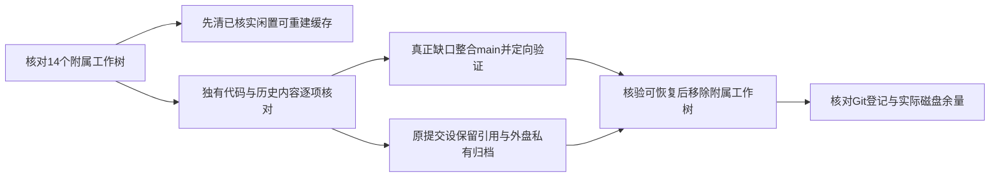

# T-1384：整合工作树独有代码并清理多余工作树

用户已授权：「优先清理工作树，不需要这么多工作树，如果工作树有没合并的代码，合并进去即可。」

本任务是既有代码整合与磁盘维护，承接T-1383实际占用及T-1375历史整合结论。主仓有T-1382正在修改的源码，必须保留其原内容与执行。维持当前产品方向与合同，不将取消的T-1380方案或已被新版替代的旧代码重新引入，不因清理把原产品任务签完成；不推送、安装或发布。

范围为当前主仓 `git worktree list` 所列的14个附属工作树：5个Codex内盘工作树、3个系统临时工作树、6个T7构建源码树。主仓保留。已核实无活动使用、Git忽略且无跟踪文件的 `.next`、Rust `target`、`.codegraph` 可先清理，避免磁盘告急阻断保全；不得因此删除源码、未提交文件、正式数据库、登录资料或历史验收原件。

将用户“无需这么多工作树”的偏好写入项目入口：无隔离需要不新增，必要临时树在代码整合与证据保全后回收，不改变并行写入安全边界。

Root为唯一写入与整合者，三个只读代理按Codex树、临时树、T7树并行核查。实际祖先、路径差异、T-1375已完成整合及用户取消记录共同决定真正缺口；单凭“HEAD不是main祖先”不能倒灌整个旧分支。独有源码若碰到主仓正在修改路径，先保全双方并按当前合同解决，不覆盖他人改动。

删除前：记录工作树HEAD及状态；为未被引用的HEAD建立保留引用；未提交/未跟踪与不可再生ignored文件私有归档到T7，核实归档可读与条目/哈希。可重建依赖、编译缓存及索引不为释放空间重新复制。只有安全保全完成、独有代码已整合或有明确后继/取消证据、未见活动使用后才移除工作树。受应用工具管理且本聊天可操作的工作树使用其archive接口；无可操作attachment的普通注册工作树使用Git移除。保留Git分支历史与外盘归档，不另造工作树。

验收：逐树记录代码处置与归档；本次实际需要合入的代码按影响验证；最终附属工作树登记收敛，主仓原在途内容保留；前后`df`给出实际空间变化，不将`du`候选量冒实际回收。没有发生的测试、完整对账和产品验收保持未执行。T-1373既有完整reconcile副作用限制仍有效，不借清理触发重型构建/联网/真实模型验证；只运行适用只读控制面检查。产品流程技能已加载，本次不扩大为脚手架升级。
