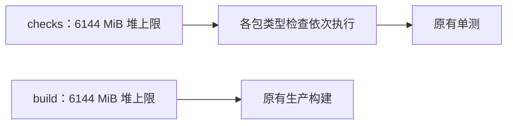

# T-1385 修复 Verify 的 Node 堆内存耗尽

2026-10-21 用户授权在 `ci-fix-2026-10-21` 最小修改 Verify，跳过缺失的 product-to-code-orchestrator；不 push、不写 .git、不改许可、激活、verdict 或签名代码。

阶段：既有 CI 配置修复与本地回归。没有产品方向、服务契约、数据归属或架构变更；前置独立评审未发生，不补记 PASS。

DEC-CI-20261021-01：按用户明确建议，两个 job 的 NODE_OPTIONS 设置为 `--max-old-space-size=6144`，全 workspace typecheck 使用 `--workspace-concurrency=1`。保留既有 lint 非阻塞行为，不增加 continue-on-error、不跳检查、不放宽断言。ai-worker tsconfig 仅包含 src/smoke，无明显误收录，保持不变。

大白话：给单个 Node 进程更多堆空间，同时一次只检查一个包，避免几个类型检查一起争内存。

验收：pnpm boundary；6144 MiB 串行全 workspace typecheck；frontend lint（记录非阻塞结果）；contract/backend/ai-worker/mcp-server/frontend 五包单测；临时 PGLITE_DATA_DIR 下 frontend build；用 /usr/bin/time -l 测 ai-worker typecheck 峰值。已知 T-767 与 SPEC §13 路由断言如实报告，非明确微小修正不扩范围。

本机结果不能证明 GitHub Linux runner 已通过。完整 reconcile 沿既有 T-1373 安全限制核对，不执行已知未隔离的真实 CLI 副作用。最终交付 `/tmp/ci-fix.patch`、`/tmp/ci-fix-commit.sh` 和 `/tmp/ci-fix-RESULT.md`，原始日志保存在 `/tmp/ci-fix-logs/`。
