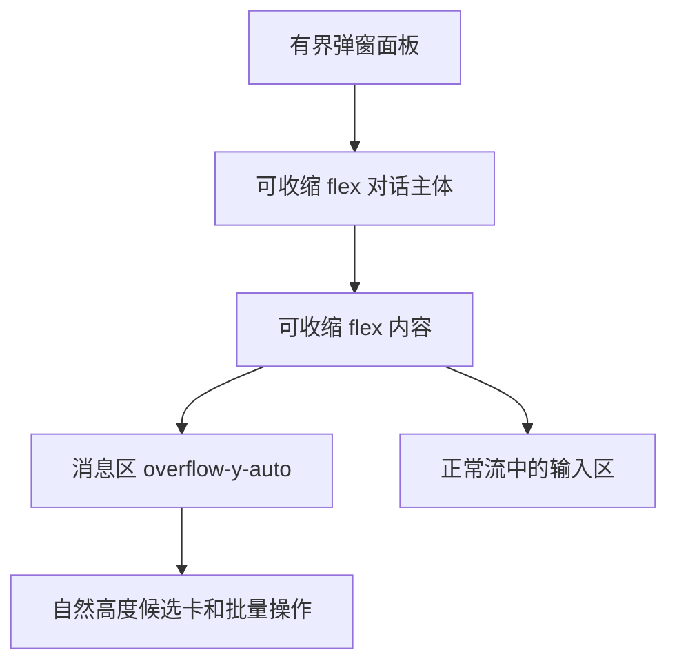

# T-1396 选题采纳滚动修复

用户授权：四种出题来源共用 Copilot 的长候选卡必须可滚动到逐条及批量操作，覆盖 1440×900、1280×800 和亮暗主题；禁止生产路由视觉夹具、真实模型调用、许可/激活/verdict/签名改动、push。使用 ui-ux-pro-max 与 CreatorOS MASTER；按用户要求跳过缺失编排技能。

范围：overlay-controller.tsx、ai-copilot-dialog.tsx、ai-copilot-content.tsx、chat-candidate-card.tsx 及对应测试；仅布局与换行，不改采纳契约与业务行为。选题四入口仅打开 Copilot，无另一个内联采纳面板。

验收：在真实对话组件内 mock topic.generate tool result，四来源、多候选、长标题及展开评论；断言高度传递、动态视口上限、滚动容器、卡片无固定高度裁切、逐条和批量按钮结构。运行指定 shell/copilot/overlays/topics vitest 与 frontend typecheck，不 full build。jsdom 不证明几何可见性，浏览器未运行时如实记录。遵循既有 T-1395 安全边界，不运行可能触发真实 CLI/模型的全局 reconcile。

交付：/tmp/ui2-fix.patch、/tmp/ui2-fix-commit.sh、/tmp/ui2-fix-RESULT.md。脚本核对分支与完整基线 SHA，仅 add 明确文件，分两次中文提交，不push、不跳 hook。

## 本轮证据

- 新增16组结构测试先红后绿；最终指定76文件：75通过，1个既有失败，1019测试通过/1失败。失败为 chat-system-action-card.test.tsx:218 回调参数数量2/3不符，在 HEAD 基线的全部5个本次产品源码恢复后独跑同样失败；随后完整恢复本次修改。不修改该无关测试。
- frontend typecheck退出0；LED-047完整8文件189测试通过；boundary无新增、5条基线；diff --check通过。
- 已pmem sync；context-compile缺task binding，回退本SPEC与BACKLOG。完整reconcile及LED-053超时全链条沿用既有真实CLI副作用阻断，未执行。不补记浏览器几何、截图、独立前置评审或真机证据。taskctl按实际阻断，不标全绿。
