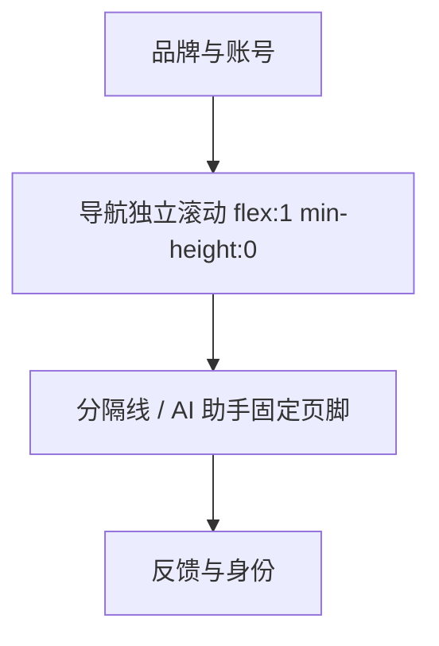

# T-1399 侧栏 AI 助手页脚

用户授权：仅调整 AI 助手卡片与必要样式、测试；使用 ui-ux-pro-max 和 design-system/creatoros/MASTER.md；跳过缺失 product-to-code-orchestrator。不修改导航、门控、分组折叠、持久化键或 Copilot 查询参数；不修改许可、激活、verdict、签名，不调用付费模型，不 push。

方案：沿用现有 flex 侧栏与独立导航滚动区，助手位于不收缩的页脚，以结构分隔线与导航分开；图标使用导航列宽，标题与副文同列，副文最多两行。展开 CTA 与收拢图标链接均保留 ?copilot=open&scope=global，焦点可见，操作高度44px。亮暗色只使用现有 tokens。

验收：shell 测试覆盖展开、收拢、可访问名称、原打开参数、全部导航与分组；运行用户指定 vitest 与 typecheck，不运行 full build。实际浏览器核验未发生时明确记未验。完整 reconcile 延续 T-1373 已知未隔离 CLI 副作用阻断，禁止为凑全绿触发真实 CLI；不补记前置评审或真机证据。

交付：/tmp/sidebar-fix.patch、/tmp/sidebar-fix-commit.sh、/tmp/sidebar-fix-RESULT.md。提交脚本核对分支与完整基线 HEAD，仅暂存本任务文件，中文提交，不push。

## 实际验证

- 指定 shell vitest：17文件、191测试通过；指定 typecheck（next typegen + tsc --noEmit）退出0。
- boundary-scan：0新增违规、5条既有基线；git diff --check通过。
- pmem sync已执行；context-compile因缺task binding失败，按规则回退阅读BACKLOG任务行与本SPEC。前置独立评审、TDD红测及浏览器截图/几何/主题实测未发生，不追记PASS。
- 完整reconcile未执行：process/reconcile.config.json中LED-053仍调用真实timeout verify，延续T-1373副作用阻断；taskctl已如实block。导航与超时执行路径未修改。
- 无commit、push或full build，无付费模型调用；所有原有未跟踪文件保持原样。

## 2026-10-22 紧凑化续任务

用户要求删除问候副标题，将展开卡合并为图标 + AI 助手单行链接；aria-label 保留“打开 AI 助手”，收拢图标态及原 href 不变。更新 shell 断言，随 T-1400 指定测试及 /tmp/ui2-fix-* 交付。
