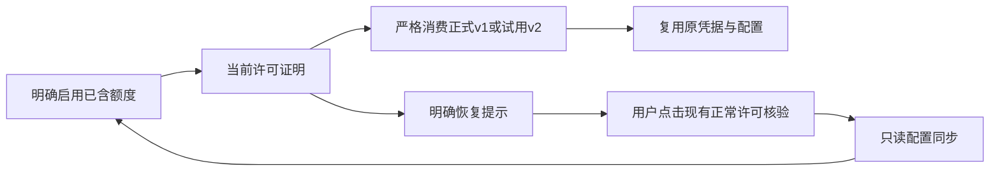

# T-1401 试用设备一次模型权益的 Creator 消费与明确恢复

2026-10-23。承接 T-1278 和 Growth T-250，当前为契约与隔离实现准备，尚未签实现或线上验收通过。

## 用户确认与职责

用户重申所有新旧激活码自带官方模型，明确试用“每台试用设备只送一次 5 元”。同一设备跨 TRIAL、DEVICE_TRIAL、换码及重试不重复首赠，已有账户余额保留，过期试用不恢复。正式 TIME/COUNT 仍按原授权权益处理，不改成每设备一次。

用户随后明确批准 [Activity 具体范围](/Users/zyongzhu/terminals/growth-credit-20261023/ACTIVITY_CHANGE_SCOPE.md)的“本地实现与测试”。该许可仅供对应 Activity 作者执行，不授权本任务写 Activity、真实发款、激活换绑、部署或解除维护锁。Growth 拥有模型账户和账本，Activity 拥有当前许可与设备主体，Creator 只消费验签结果和保存原凭据。

跨端真相为 [Growth T-250 合同](/Users/zyongzhu/Workbase/Thirdspace-growth/docs/contracts/T-250-trial-device-model-benefit-contract.md)。本任务不自动同步其未审改动；开工前绑定独评通过的确切合同哈希及真实生成的受控向量。独立评审不能以草案或手填 fixture 代签发行端兼容。

## 用户结果与最小改动

1. 当前正式 proof/policy/DTO v1 保持原字段、校验和本地 scope 摘要。仅精确增加试用 proof v2、试用 policy 及 directory/credential v2。拒绝未知版本、混搭 policy、额外字段、错误签名、nonce、原码 hash、subject、epoch 或截止。
2. 本地 licenseMode 只用于选择请求协议，不能授予资格。TRIAL/DEVICE_TRIAL 请求 v2；正式走 v1；模式缺失或旧快照兜底 TIME 被权威拒绝时停止当前模型请求，不能按任意错误盲切协议。
3. 试用本地 scope/cache 纳入 policy、trialDeviceSubjectHash、当前原码 hash、原 scope 和授权版本。Growth 的内部经济 hash、旧别名不进入 Creator DTO。相同 subject 跨码可复用远端 Key/钱包，但当前码变化仍触发原身份与在途任务隔离。
4. proof、directory、credential 的期限不能越过当前设备的实际试用截止；精确边界到期停止缓存使用。保留原当前身份校验、取消、generation 和凭据写入 service port。
5. 仅白名单的 `TRIAL_MODEL_PROOF_REQUIRED`、`TRIAL_SUBJECT_RECOVERY_REQUIRED` 或明确模式缺失结果可以产生安全 `recoveryAction`。不透出上游任意 action、内部端点、原始码、设备身份、Key 或签名全文。
6. 采用真实的**明确用户恢复**：当前请求停止，设置页复用现 `ChannelConfigRetryButton` 的正常许可核验入口。用户独立点击后走 Tauri `license_check` 的 Rust 验签/落 `.license` 和 `manual_revalidate` 只读同步；用户再明确启用已含额度。核验仍失败、离线保留旧模式或主体仍缺失时准确提示，不循环、不重放履约。缺主体必须与普通复校分开：`TRIAL_SUBJECT_RECOVERY_REQUIRED` 在设置页提供明确用户打开的恢复对话框，复用现 `ActivateForm` 输入原码并走既有 `license_activate`；提交前明确提示保存工作、成功后应用会重新启动，不自动填入或读取原码。`/activate` 页面会把已 allowed 用户重定向回首页，不作为此类用户的恢复链接。只读 status 不创建主体。对话框取消、换组或旧身份失效后清理原恢复状态，不发自动激活请求。
7. Node `license-client.status()` 不具有现 Rust nonce/签名决策链，不作为替代。此次不创建服务端自动 status 验签能力，不修改 Rust、不增加每次启动经济履约。
8. 新动作保持用户个人自配/Codex 选择；不调用 PUT 改路由，不为恢复创建模型任务。当前 Mac 原授权已经有 Key/钱包/首赠，绑定缺失的 T-249 恢复单列，本任务不重赠或改绑定。

## 准确写集

- `frontend/src/server/activation/model-benefit.server.ts`
- `frontend/src/server/activation/model-benefit.server.test.ts`
- `frontend/src/app/api/v1/local/client-config/route.ts`
- `frontend/src/app/api/v1/local/client-config/route.test.ts`
- `frontend/src/features/settings/channel-model-configuration.tsx`
- `frontend/src/features/settings/settings-interactive-region.test.tsx`
- `docs/verification/t1401/`：跨端受控向量、真实 RED/GREEN、独审与交付结果。

控制面只记录本任务：本 SPEC、BACKLOG、DECISION_LOG、modules.config、progress、context、events/review-events 及该任务评审文档。现真实恢复组件只读复用，若其实际接口不足，必须先核明并增补准确写集，不能借本任务改 Rust 或整套设置流程。旧同页路由 store 陈旧缺陷不绑定进本次试用协议变更。

## 验收

- 原正式 v1 合法及负向回归、scope 固定向量保持；新试用两类型、assigned/null、同主体跨码与不同主体隔离真实消费。
- v1/v2 交叉、subject/hash/epoch/policy 混搭、extra、旧签名、过期和实际到期边界拒绝；取消/换组/换许可的迟到结果不落仓。
- 缺主体、旧 TIME 兜底、明确恢复错误沿真实按钮与正常核验路径；普通失败不出现假恢复按钮；读请求和恢复核验不新增经济 fulfill；用户明确启用才调用原履约链。
- 部分成功/失败不丢已知状态，不展示虚假 ready；任何测试均不能靠修改断言或跳过既有测试完成。
- 聚焦 frontend 三文件与相关现回归、6144 MiB 堆且 workspace 并发 1 的适用 typecheck、quality、timeout-policy、boundary 和独立代码评审。受控界面旅程验证实际按钮接线，不调用真实模型、账户、授权或钱包。
- Growth 真实隔离 PG 的一次赠额/并发/unknown 及 Activity 真实隔离签发证据须分列。Creator 模拟测试不代签跨端、真实设备或生产交付；未执行的 Gate 保留未验。

## 隔离与交付边界

Creator 使用本任务独立 worktree，保持主目录已有未提交内容及 CI 待推修复原状。禁止修改 `~/.codex/config.toml`、设置 `T1332_APPROVED`、绕过 T1246、force push 或 `--no-verify`。本任务不推送、不打包发布、不自动运行生产数据迁移；本地候选、测试及准确补丁先形成可审交付。
