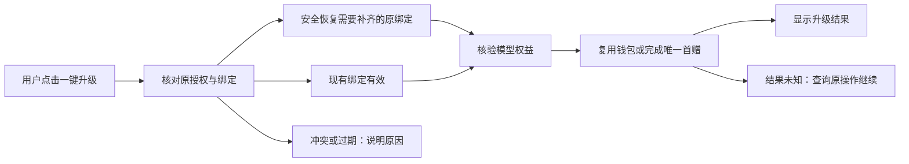

# T-1402 历史激活码无感升级模型权益与原授权恢复

2026-10-23。状态：既有一键链已安装、Activity 受限恢复接口已按单独授权上线；本机实际恢复和原钱包复用已证。用户最新要求无感升级，本次生命周期与展示变更待独立契约复审。下方“无感升级修订”优先于历史一键/继续按钮条款；既有安全与数据边界继续生效。

## 用户结果与授权

用户明确所有新旧激活码自带模型，特别要求历史永久激活码可由其他用户在自己设备上“一键升级”，不依赖维护者远程操作或手工改库。升级是给现有合法授权补齐模型权益，不把永久许可变成限时，不发新激活码替代原码。

用户已明确允许本机恢复当前保存的原授权并释放已查明的一份失效旧绑定，保留业务数据、原到期时间、现有钱包与唯一首赠，可补客户端入口并重新打包安装重启。该本机实操授权不等于可替其他用户批量换绑、批量发款或自动部署服务端。

已有经济规则保持：正式码按原授权权益；未领且符合既有政策的首次模型权益由 Growth 幂等履约；已有钱包/Key/已赠额度复用，不重复首赠，不把余额补齐到固定金额。试用每台设备一次5元，跨试用码不重复、过期不恢复，沿 T-1401 合同实现，不混淆正式永久码身份。

## 已核实的现有基础

- Activity 没有独立 PERMANENT 类型；历史永久授权是 `TIME` 且按 `getActualExpiresAt` 计算没有截止。`COUNT` 无截止仍是次数码，不能混为永久。
- 已发布正式政策 `creatoros-formal-model-20261017-v1` 已涵盖有效、已激活、未撤销的历史 TIME/COUNT，包括旧自配、无plan、空渠道。不需要批量换码或改原期限；Growth 0077 只扩展存储来源，不批量开户或发款。
- Growth 正式经济身份为 projectKey + 原 entitlementBindingHash + service，已有5元、30元和充值账户优先复用，不因 proof nonce/设备epoch 变化再发首赠。已有 unknown 预约只查询恢复原 Key。
- 当前本机失败是原设备绑定缺失；普通 activate 会释放同机同项目其他绑定，不区分有效与失效，客户端先查再调不能消除竞态。需要专用且旧服务器不能误执行的安全恢复合同；不把新参数加在可被旧服务器忽略的普通 activate 上。

证据见 `docs/verification/t1402/` 的客户端/Activity只读审计及 Growth `docs/contracts/T-243-growth-model-benefit-policy-v1.md`。旧 `upgrade-lifetime` 是管理端改期限，不用于这次模型权益升级。

## 统一产品旅程

1. 设置页给出“升级原激活码，启用模型权益”的明确操作，当前设备已保存原码时不要求用户寻找原码、操作编号或终端命令。成功状态显示已升级；模型费用/额度按既有真实规则，不暗示无限免费模型。
2. 使用原生可信许可存储、原生签名/nonce校验和正常服务端授权链，不把原码、机器标识、签名或Key交给前端展示、日志或剪贴板，不经 Node 内部 HTTP 绕过原生验签。
3. 先确认当前授权资格及当前绑定；已有效绑定直接取得证明和幂等权益。缺失的旧绑定恢复必须可由产品自己处理，不靠维护者先查库。若正常激活会影响另一有效授权，必须停止自动恢复并显示准确说明；不能无差别释放其他授权。服务端原子保护是否足够是实现前必核条件。
4. 用户一次明确操作后，按依赖完成核验/必要恢复、证明、权益履约和配置读回；已有钱包/已履约状态继续复用。保留原永久/原到期/原次数，保留现有模型来源偏好，不偷偷切换自配模型或Codex，不调用模型消费。
5. 双击、并发、断网、重启、响应丢失按原对象和幂等业务身份查询已知结果，不能创建新履约或伪报失败后盲重试。保留部分成功，错误给出可执行下一步，不把已知绑定问题统一显示成“服务暂时不可用”。
6. 用户自己的其他有效绑定、换机、多设备和已撤销/过期必须由权威许可规则裁决；本任务不放宽许可验证、有效绑定保护或试用期限。必要新增服务端合同先形成具体候选与独评，不因客户端急需就修改 Activity 锁定源/生产库。

## 实施边界与责任

Creator 负责用户入口、可信原生本地操作与结果展示；Activity 拥有许可/设备/有效期/绑定原子保护；Growth 拥有模型资格的已授权政策、钱包与首赠幂等账本。先核实历史永久码实际类型、既有迁移和服务端绑定合同，不能靠本地把类型硬改为永久或模型码。

本任务当前写集仅控制面、SPEC与诊断证据；审查完成后补齐准确产品写集并独立评审，再实施。独立 worktree 保留主目录未提交内容和 T-1401 冻结候选。本机验证不代表其他设备或生产发布完成。

禁止修改 ~/.codex/config.toml、设置 T1332_APPROVED、绕过 T1246、force push、--no-verify；本轮不push/tag/公开发布、不改 Activity 锁定源、不手写生产账本。未获得的生产部署权限不臆造，所需部署先形成具体可审结果。

## 验收

- 历史永久码、新正式码、已有钱包、未领权益、过期/撤销、缺绑定、冲突绑定均有明确真实状态；重复点击与未知结果不重复发款。
- 原生保存码不出可信边界；保存失败/验签失败不报成功。正常恢复保永久/原时间/次数和业务数据，不重置许可绕过校验。
- 聚焦 TDD、原许可和模型权益回归；6144 MiB堆且workspace并发1类型检查、quality、timeout-policy、boundary和独立代码审核。
- 本地固定打包入口，已提交干净源码；安装保数据，真实App启动与按钮验收。真实本机操作前后查证原授权、另一有效绑定0、仅已授权失效旧绑定1、原钱包与首赠复用。若该条件变化停止本机提交，不能扩大已授权释放范围。
- 隔离测试、源码读审、安装版验证、其他用户分发和生产部署分别报告；未发生证据不能标通过。

## 本地实施前的安全合同补充

独立联审发现既有原生许可支持 `strict_verify=false` 兼容分支。T-1402 新恢复入口必须无条件强验签和 nonce/target/date 校验，不继承该弱模式；许可原链不因此改变既有行为。新的 `POST /api/license/restore-current` 独立路径采用只读inspect与受限restore；完整闭合wire、状态摘要、拒绝枚举和绝对总截止独评通过前不写产品代码。Activity精确新增六文件及数据/回滚范围见 `/Users/zyongzhu/terminals/growth-credit-20261023/ACTIVITY_LEGACY_UPGRADE_SCOPE.md`；用户随后已明确批准该新增范围的本地实现与测试；生产部署/真实发款/解除仓库锁仍未授权。

### 未知结果的统一继续规则

| 当前事实 | 同一次点击内允许的下一步 | 必须停止的情况 |
|---|---|---|
| fresh proof确认原绑定有效 | 查询原凭据；未就绪沿原Growth幂等履约，再同步配置 | 当前身份变化或权威拒绝 |
| 精确绑定缺失，未提交过恢复 | 原生inspect，当前集合fence下restore一次，再强验签保存回读 | 无服务端支持/有效冲突/不可恢复/摘要变化 |
| restore已发出但结果未知 | 只读inspect、fresh proof及签名许可回读；already_bound时checked保存当前真实结果 | 仍缺绑定、事实变化、签名或保存仍不可确认 |
| unknown后仍缺绑定或集合已变 | 保留未知/冲突；用户明确点击“继续核对”后重新inspect，按新当前集合决定 | 不在旧观察内静默取新摘要再次释放；不回退普通activate |
| 原经济履约结果未知 | 查询原凭据或按Growth已有同权益/同service恢复原预约 | 不更换经济身份、不创建替代Key、不新增provider POST |
| 权益已就绪但配置失败 | 保留已知权益结果，只继续配置读回 | 不重复恢复授权或首赠 |

上述表消除只读审计候选中“unknown后重新提交”与“先只读停止”的歧义；当前状态收敛不等于声称原请求是否执行。完整wire仍需绑定该表完成独评。

## 2026-10-23 新增范围已获明确授权

用户对 `/Users/zyongzhu/terminals/growth-credit-20261023/ACTIVITY_LEGACY_UPGRADE_SCOPE.md` 原问题回复“允许上述本地实现与测试”。Activity仅该说明列明的三个新增源码、三个测试和必要工件在新隔离候选内允许写入；完整wire独评后实施。原本机恢复许可继续有效，不扩大成生产部署或任意绑定释放。

## 完整消费合同与实施落点

客户端闭合合同见 `docs/verification/t1402/CLIENT_WIRE.md`；Activity 合同为其独立候选 `docs/contracts/T-1402-license-restore-current-contract.md`。独立复审绑定二者实际 SHA，不能用此前范围审查代替。原生新增独立 `license_restore.rs`，旧 `license.rs` 仅公开已有双冗余时间点 helper 给同 crate 复用。TS 新增无秘密的闭合升级 DTO，沿本地 client-config 白名单 action 对接；不改业务库或金额规则。准确写集见本任务 Packet。

原生绝对执行预算 370000 ms 从命令入场起包含锁等待，UI 保持最初点击起的 730000 ms 观察截止。UI 停止等待不撤销已提交原生操作，原生互斥持到实际收尾。已绑定当前机器且目标合法时，只读 no-op 不释放其他授权；只有确实缺绑定时才核对其他有效冲突与精确失效集合。

初次明确“一键升级”遇既有凭据404，可对原权益和原服务调用既有 fulfill，由 Growth 判断首履约或恢复原预约；404本身不能证明从未开户。本次已观察到提交结果未知或权威明确 unknown，则只读仍未知时停止，明确“继续核对”才恢复原履约。只有原预约已存在时，才能承诺恢复 provider 创建 POST 为0；若首请求根本未到达服务器，明确继续可完成合法首次履约，仍不可换经济身份或补赠。

## 跨窗口切码保护的实现补充

代码联调确认，单次HTTP内部的身份检查无法覆盖“probe原授权A后，另窗口切换B，再调用原生/履约”的时间差。客户端合同§10因此用同一个不透明观察令牌贯穿原生和TS阶段：服务端只在显式新probe时创建，绑定原码/机器/项目/模式/渠道/原期限及真实账号上下文，原始730000ms截止不延长。令牌复用已有 `enc:v1` AES-GCM封包和独立purpose派生；原生仅接受该密文参数，在链锁下比对本地保存的同一原对象，并继续独立验证Activity签名。原无参IPC据此收紧为只接观察令牌，不允许JS传原码、机器或身份hash。

进程内观察和已消费ID集合均有界、过期停止，未知token不重建；不新增数据库、持久journal、经济身份或Activity路径。该更正只在现21路径内闭合既定同原对象要求，完整字节和合法组合以 `docs/verification/t1402/CLIENT_WIRE.md` §10 为准，补充独审后实施。原生保存前后到期检查及inspect前后原权益/次数/版本核对纳入TDD，不用服务端签名代替本次原对象一致性检查。

## 2026-10-23 无感升级修订（当前产品合同）

用户明确：“点了没反应而且我不希望点，我希望用户是无感的，不可能让用户还去点一下吧？”因此正常打开桌面 App 后，后台自动核对并完成历史合法原授权的模型权益升级；设置页不再以升级/继续按钮作为前提，也不弹逐阶段确认。此决定替代前文手动点击、明确继续才新观察的交互要求，不扩大服务端权限或经济政策。

事实：本机18:56的旧按钮链已恢复绑定并完成配置，18:58独立定时刷新也成功；服务端只读后检22项通过，原永久授权、Key、250000额度与唯一首赠未改变。用户看到的“无反应”不能归因为请求没执行；旧额度错误独立存储未随成功同步清除是已确认代码缺口。证据在 `/Users/zyongzhu/terminals/growth-credit-20261023/t1402/automatic-upgrade/` 及 Growth T-249 只读后检。本机不再二次恢复或补发。

### 自动入口与生命周期

- 复用已登录 desktop layout 的 `ChannelConfigBootstrap`，移入既有 workspace 初始化 provider 内，等待真实 workspace ready 与原生许可最近判定/事件 licensed 且未撤销后启动。web/SSR、未就绪、许可不符均不发自动升级请求；不轮询 `license_check`。
- 独立 client-only coordinator 承担原 probe → 必要原生恢复 → fresh probe → 原权益幂等履约 → sync → 路由只读刷新。设置页只是订阅状态；页面离开/StrictMode 不取消已发 native、不新造一次写流程。自动过程不 await 在首屏/导航、无整页 router.refresh、无 modal，不影响业务使用。
- 真实 cookie/user/account/group 沿既有 HTTP transport；切 scope 立即停止旧观察提交/显示，原生在途仍实际收尾。新 scope 必须由服务端重新核真实主体，不能接收旧结果。许可事件引发再次评估但不能重复启动已有 flight。
- 新增自动模式 header 精确值 `x-creatoros-upgrade-mode: automatic`，仅适用于现 `legacy_upgrade` trigger；旧显式调用没有此头仍按既有 token 合同。不得给正常 scheduled/bootstrap 刷新自动附加履约能力。Activity/Growth wire、金额、原生IPC不变。

### 自动去重与未知结果

- 本地 Node 在本次 sidecar 启动内，以真实 actor + boot + 当前稳定原许可身份绑定唯一 automatic 观察 token，创建过程原子复核。同一 WebView 模块内 StrictMode/重挂共用原 flight；首次无 token probe 原子占用后只向该首响应返回 token。其他窗口、重载或首响应丢失后再次无 token probe 只返回 proof/unknown/UPGRADE_SERVICE_UNAVAILABLE，不返回 token、不请求下游，不接管旧观察；不能凭重复请求、过期、换回旧 scope 重获写资格。自动索引最多256项，满则停止准入，不驱逐旧项后重复写；生命周期结束才清空。索引是控制去重而非许可/钱包真相。
- 730000ms 绝对观察预算和370000ms原生预算保持。单 token 原生最多一次、fulfill最多一次；自动索引在 token 过期或失效后保留墓碑，本次宿主不静默生成替代 token。token失联/身份变化按原规则停止，不能换摘要重放。
- transient 网络未就绪允许在同一观察/原截止内有限退避只读 probe；已提交恢复/履约后 unknown 只读核对原结果，不重发写，不假成功。已经权益 ready 的配置问题只续 sync，不再恢复或领额。原生持久化未知时本观察只读 probe，停止 sync 与整体 ready/successRevision；不得仅凭服务端 ready 宣称整个升级完成。
- 同一次宿主中变更 scope 也不取消真实在途原生互斥；没有证据证明已落盘时显示待核对。正常下次冷启动允许新自动观察：从当前可信原许可 fresh proof/原生 inspect 开始，按新权威事实和摘要最多恢复一次，依原 Growth 业务身份最多履约一次；不可沿用旧摘要、改经济身份、建立替代Key或补赠。这是用户无感目标下新的启动继续规则，不要求用户寻找“继续核对”。
- 新增脱敏阶段/结果记录只含固定枚举；不输出许可、机器、token、钱包明细或Key。设置页仅展示真实就绪/后台核对/暂未确认与实际冲突原因；不把未证成功显示成功，不迫使用户点击升级。

### 状态联动和验证

成功后广播既有安全配置同步事件、局部重新读取模型能力并清理额度中心已经失效的旧服务错误；正在打开额度中心的真实新错误不得被旧事件覆盖。个人模型来源保持原值，不偷偷切到官方模型、不触发模型消费。充值与查看额度仍是用户主动操作，不受本修订自动触发。

TDD 必须实际覆盖：无需打开设置/点击即完成、已有钱包零重复fulfill、首次合法权益唯一fulfill、缺绑定恢复一次、StrictMode/重挂共用flight、双窗口/重载不接管旧token、过期墓碑、unknown只读、冲突停止、scope切换/迟到回调、启动未就绪/撤销/web无副作用、旧红字在成功后消失、来源不变、无整页刷新。源代码候选通过独审和适用Gate后正常中文提交并固定本地打包安装，验证真实启动自动日志与现有钱包不变；不以已恢复本机替代缺绑定合成场景测试。

独评收紧：automatic唯一owner之外的无token请求保守pending至下一正常冷启动；此取舍避免重载丢失native持久化未知事实后误报成功，不要求用户操作升级按钮，不阻止既有普通只读配置刷新和业务页面。原owner持有token时继续原730000ms截止，Node每一stage将下游AbortSignal收紧到原entry剩余时间；不会因观察者加入另加120秒。automatic stage持有inFlight期间，普通model-benefit access在递增generation前用既有retryable MODEL_BENEFIT_REFRESH_PENDING延期；旧已开始普通读取仍遵守原generation/commit fence，不删除安全fence、不在事务中等待网络。自动阶段之间普通读取仍可运行。实现必须以受控交错测试证明普通startup/scheduled不能把唯一自动观察耗死。
