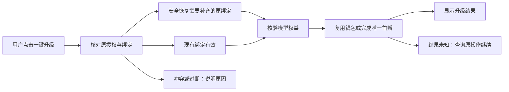

# T-1402 历史激活码一键升级模型权益与原授权恢复

2026-10-23。状态：通用契约核对中；未经独立评审不写产品代码，不宣称已上线。

## 用户结果与授权

用户明确所有新旧激活码自带模型，特别要求历史永久激活码可由其他用户在自己设备上“一键升级”，不依赖维护者远程操作或手工改库。升级是给现有合法授权补齐模型权益，不把永久许可变成限时，不发新激活码替代原码。

用户已明确允许本机恢复当前保存的原授权并释放已查明的一份失效旧绑定，保留业务数据、原到期时间、现有钱包与唯一首赠，可补客户端入口并重新打包安装重启。该本机实操授权不等于可替其他用户批量换绑、批量发款或自动部署服务端。

已有经济规则保持：正式码按原授权权益；未领且符合既有政策的首次模型权益由 Growth 幂等履约；已有钱包/Key/已赠额度复用，不重复首赠，不把余额补齐到固定金额。试用每台设备一次5元，跨试用码不重复、过期不恢复，沿 T-1401 合同实现，不混淆正式永久码身份。

## 已核实的现有基础

- Activity 没有独立 PERMANENT 类型；历史永久授权是 `TIME` 且按 `getActualExpiresAt` 计算没有截止。`COUNT` 无截止仍是次数码，不能混为永久。
- 已发布正式政策 `creatoros-formal-model-20261017-v1` 已涵盖有效、已激活、未撤销的历史 TIME/COUNT，包括旧自配、无plan、空渠道。不需要批量换码或改原期限；Growth 0077 只扩展存储来源，不批量开户或发款。
- Growth 正式经济身份为 projectKey + 原 entitlementBindingHash + service，已有5元、30元和充值账户优先复用，不因 proof nonce/设备epoch 变化再发首赠。已有 unknown 预约只查询恢复原 Key。
- 当前本机失败是原设备绑定缺失；普通 activate 会释放同机同项目其他绑定，不区分有效与失效，客户端先查再调不能消除竞态。需要专用且旧服务器不能误执行的安全恢复合同；不把新参数加在可被旧服务器忽略的普通 activate 上。

证据见 `docs/verification/t1402/` 的客户端/Activity只读审计及 Growth `docs/contracts/T-243-growth-model-benefit-policy-v1.md`。旧 `upgrade-lifetime` 是管理端改期限，不用于这次模型权益升级。

## 统一产品旅程

1. 设置页给出“升级原激活码，启用模型权益”的明确操作，当前设备已保存原码时不要求用户寻找原码、操作编号或终端命令。成功状态显示已升级；模型费用/额度按既有真实规则，不暗示无限免费模型。
2. 使用原生可信许可存储、原生签名/nonce校验和正常服务端授权链，不把原码、机器标识、签名或Key交给前端展示、日志或剪贴板，不经 Node 内部 HTTP 绕过原生验签。
3. 先确认当前授权资格及当前绑定；已有效绑定直接取得证明和幂等权益。缺失的旧绑定恢复必须可由产品自己处理，不靠维护者先查库。若正常激活会影响另一有效授权，必须停止自动恢复并显示准确说明；不能无差别释放其他授权。服务端原子保护是否足够是实现前必核条件。
4. 用户一次明确操作后，按依赖完成核验/必要恢复、证明、权益履约和配置读回；已有钱包/已履约状态继续复用。保留原永久/原到期/原次数，保留现有模型来源偏好，不偷偷切换自配模型或Codex，不调用模型消费。
5. 双击、并发、断网、重启、响应丢失按原对象和幂等业务身份查询已知结果，不能创建新履约或伪报失败后盲重试。保留部分成功，错误给出可执行下一步，不把已知绑定问题统一显示成“服务暂时不可用”。
6. 用户自己的其他有效绑定、换机、多设备和已撤销/过期必须由权威许可规则裁决；本任务不放宽许可验证、有效绑定保护或试用期限。必要新增服务端合同先形成具体候选与独评，不因客户端急需就修改 Activity 锁定源/生产库。

## 实施边界与责任

Creator 负责用户入口、可信原生本地操作与结果展示；Activity 拥有许可/设备/有效期/绑定原子保护；Growth 拥有模型资格的已授权政策、钱包与首赠幂等账本。先核实历史永久码实际类型、既有迁移和服务端绑定合同，不能靠本地把类型硬改为永久或模型码。

本任务当前写集仅控制面、SPEC与诊断证据；审查完成后补齐准确产品写集并独立评审，再实施。独立 worktree 保留主目录未提交内容和 T-1401 冻结候选。本机验证不代表其他设备或生产发布完成。

禁止修改 ~/.codex/config.toml、设置 T1332_APPROVED、绕过 T1246、force push、--no-verify；本轮不push/tag/公开发布、不改 Activity 锁定源、不手写生产账本。未获得的生产部署权限不臆造，所需部署先形成具体可审结果。

## 验收

- 历史永久码、新正式码、已有钱包、未领权益、过期/撤销、缺绑定、冲突绑定均有明确真实状态；重复点击与未知结果不重复发款。
- 原生保存码不出可信边界；保存失败/验签失败不报成功。正常恢复保永久/原时间/次数和业务数据，不重置许可绕过校验。
- 聚焦 TDD、原许可和模型权益回归；6144 MiB堆且workspace并发1类型检查、quality、timeout-policy、boundary和独立代码审核。
- 本地固定打包入口，已提交干净源码；安装保数据，真实App启动与按钮验收。真实本机操作前后查证原授权、另一有效绑定0、仅已授权失效旧绑定1、原钱包与首赠复用。若该条件变化停止本机提交，不能扩大已授权释放范围。
- 隔离测试、源码读审、安装版验证、其他用户分发和生产部署分别报告；未发生证据不能标通过。

## 本地实施前的安全合同补充

独立联审发现既有原生许可支持 `strict_verify=false` 兼容分支。T-1402 新恢复入口必须无条件强验签和 nonce/target/date 校验，不继承该弱模式；许可原链不因此改变既有行为。新的 `POST /api/license/restore-current` 独立路径采用只读inspect与受限restore；完整闭合wire、状态摘要、拒绝枚举和绝对总截止独评通过前不写产品代码。Activity精确新增六文件及数据/回滚范围见 `/Users/zyongzhu/terminals/growth-credit-20261023/ACTIVITY_LEGACY_UPGRADE_SCOPE.md`；用户随后已明确批准该新增范围的本地实现与测试；生产部署/真实发款/解除仓库锁仍未授权。

### 未知结果的统一继续规则

| 当前事实 | 同一次点击内允许的下一步 | 必须停止的情况 |
|---|---|---|
| fresh proof确认原绑定有效 | 查询原凭据；未就绪沿原Growth幂等履约，再同步配置 | 当前身份变化或权威拒绝 |
| 精确绑定缺失，未提交过恢复 | 原生inspect，当前集合fence下restore一次，再强验签保存回读 | 无服务端支持/有效冲突/不可恢复/摘要变化 |
| restore已发出但结果未知 | 只读inspect、fresh proof及签名许可回读；already_bound时checked保存当前真实结果 | 仍缺绑定、事实变化、签名或保存仍不可确认 |
| unknown后仍缺绑定或集合已变 | 保留未知/冲突；用户明确点击“继续核对”后重新inspect，按新当前集合决定 | 不在旧观察内静默取新摘要再次释放；不回退普通activate |
| 原经济履约结果未知 | 查询原凭据或按Growth已有同权益/同service恢复原预约 | 不更换经济身份、不创建替代Key、不新增provider POST |
| 权益已就绪但配置失败 | 保留已知权益结果，只继续配置读回 | 不重复恢复授权或首赠 |

上述表消除只读审计候选中“unknown后重新提交”与“先只读停止”的歧义；当前状态收敛不等于声称原请求是否执行。完整wire仍需绑定该表完成独评。

## 2026-10-23 新增范围已获明确授权

用户对 `/Users/zyongzhu/terminals/growth-credit-20261023/ACTIVITY_LEGACY_UPGRADE_SCOPE.md` 原问题回复“允许上述本地实现与测试”。Activity仅该说明列明的三个新增源码、三个测试和必要工件在新隔离候选内允许写入；完整wire独评后实施。原本机恢复许可继续有效，不扩大成生产部署或任意绑定释放。
