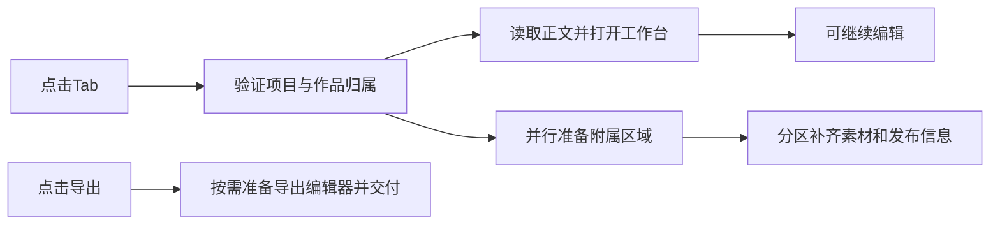

# T-1404 修复Tab切换读取和编辑器初始化开销

## 用户结果与授权

2026-10-24用户在阅读[源码调查](../research/2026-10-24-tab-switch-performance.md)后要求“类似的问题全部修复”。在同一修复中消除已确认的重复读取、无关列表读取、隐藏编辑器提前启动和正文等待附属数据；保留原有页面风格、真实导航、账号组隔离、未保存编辑、保存/导出和后台恢复能力。范围由本SPEC统一管理，不拆减已确认问题。安装/公开发布另有明确授权才执行。

## 实现约束

1. 文章`getArticle`一次请求只加载一次归属锚点及一次历史版本，当前正文从这次读取选择。每个请求仍重新验证真实归属，不跨请求缓存业务真值，不改变历史或CAS。
2. 默认文章的Doocs仅导出实例按用户点击初始化；按钮持续可点并给出准备反馈，一次点击完成原保存确认与导出，不要求用户猜测第二次点击。完整Doocs编辑与原版式预览保持原加载行为；旧版本恢复、迟到回执和跨scope保护保持。
3. NoteRelay图片使用有界并发，保持精确asset/file引用、原顺序、失败局部降级、卸载取消、改稿拒绝迟到回填及Blob类型/大小检查。不新增全局Blob缓存。核对原生协议后尽可能先显示正文；若协议需要完整图片批次，采用有界并发而不伪称增量加载。
4. 脚本及视频路由先按ID获取归属已验证项目，成功不扫描项目列表，只有兼容旧slug时分页回退；复用该请求已取得的项目。视频中独立脚本和制作状态读取并行，旧作品/无作品和跨组错误语义保持。
5. 脚本正文与附属数据分区返回。首屏只等待项目、当前脚本与必要准备信息；素材抽屉、论点素材名、发布包/封面/预测/审核和转写等附属读在独立Suspense区完成。不能把未完成读取伪装成已确认空态；读取失败显示可重试的现有降级或局部错误。延迟完成不能重挂脚本编辑器、覆盖期间输入；素材标签更新须保留本地编辑。
6. 文章正文尽早读取，避免服务端完整定位历史后才发客户端正文请求；已有作品的正文和定位信息并行，并将已验证的首读交给工作台，不在mount重复请求。定位选择和写作上下文默认行为保持，定位未就绪时不得静默以错误风格提交生成。
7. 后台争用仅为未证实候选，本轮保留恢复/调度语义、轮询期限及任务历史。通过隔离数据和计数证据区分前端等待与后台候选，不凭推断关闭后台或改变数据所有权。前端使用原contract端口，业务读优化归backend；不引入新公共API、数据库、队列或AI策略。

## 精确写集

- `backend/src/modules/articles/articles.service.ts`及对应新增/既有`articles.*test.ts`。
- `frontend/src/features/article/article-workbench.tsx`、`doocs-article-editor.tsx`及其测试。
- `frontend/src/features/reference-editors/noterelay/noterelay-editor.tsx`及其测试。
- `frontend/src/app/(creator)/projects/[projectId]/page.tsx`、`production/page.tsx`、`article/page.tsx`及新路由测试。
- `frontend/src/features/projects/project-route-data.ts`及其测试（请求内项目解析，不持久缓存）。
- `frontend/src/features/draft-workbench/draft-workbench-data.ts`、`draft-workbench-page.tsx`及对应测试；可新增`draft-workbench-deferred.tsx`及测试，承接分区读取。
- `frontend/src/features/script/script-structure-view.tsx`及对应测试，仅为延迟素材标签更新保持编辑器身份。
- 本SPEC、BACKLOG、DEC、任务配置/任务包/审核和`docs/verification/t1404/**`证据。除上述文件外不改产品；发现必须扩张时先更新本SPEC和独立复核。

## 验收

- 先独立复核完整SPEC，再针对真实缺陷记录RED→GREEN。
- 文章读：多历史版本的正文/历史/隔离不变，端口计数锚点及历史各一次；当前版本缺失仍诚实错误。
- Doocs导出：未点击不mount；点击一次准备并真实交付原版本；准备失败可重试；改稿/切scope期间不交付旧稿，编辑模式回归通过。
- 图片：首批受控慢下载最大并发大于1且不超过固定上限；保持顺序与局部失败；取消/改稿后拒迟到load；现有复制/PNG/ZIP及候选只读回归。
- 项目路由：明确ID不调用列表，旧slug分页兼容；跨组不泄漏，文章/图文/视频深链仍可达。视频独立读取同时开始。
- 脚本：阻塞素材/发布附属读时正文与编辑器仍可返回；附属区域明确加载态，迟到数据补齐不重挂/覆盖编辑；完整资料分页、历史、保存/恢复及发布门不回归。
- 文章：首读正文不在mount重复；定位和正文并行；保留项目/作品不匹配拒绝、空态、多作品选择及刷新。
- 执行范围内backend/frontend测试、前后端类型、LED-047、`node tools/timeout-policy/verify.mjs`、boundary；采用隔离库真实浏览器重复脚本/文章/图文/视频切换和保存/导出，记录同条件分段耗时和缺失证据，不能把模拟时间当安装版结果。
- 本轮不替换当前安装客户端或代签安装版最终体感；源码验收与安装版验收分别记录。`pmem sync → reconcile`保留范围外债务，不伪造全绿。
