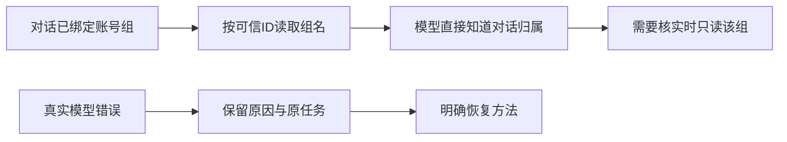

# T-1405 修复真实 CLI 对话组合暴露的问题

2026-10-24，用户阅读 T-1403 六组合实测后明确要求“有问题的那就修复”。沿用月明水清深账号组及本会话真实模型测试授权，不重复询问可恢复测试细节。

## 用户结果

修复当前对话拿不到自身账号组、上下文和工具开销过大、错误原因不明确的问题；核实官方额度错误的权威原因并修正错误归类或恢复缺陷。合法组合真实可用，不通过静默换来源、放开权限或伪造额度消除错误。

## 当前实施边界

先读取当前源码、T-1278 原路由合同和 T-1403 公开回执，公开 CLI 只读核实余额及原任务；不读用户库、密钥、内部连接文件，不重发旧未知模型任务，不修改钱包/首赠或生产服务。

当前写集仅本 SPEC、`docs/verification/t1405/**`、`BACKLOG.md` 和任务工具正常维护的控制面。确定最小产品写集、预期红测和验收后，在本 SPEC 补齐并完成项目要求的独立评审，再改产品实现。与 T-1401/T-1402 当前授权恢复范围保持独立，保留共享目录未提交改动。

## 已确认根因与修复合同

1. **FR-1405-1 对话组真值**：`chat-assembly.ts` 只有 `currentAccountBlock`，纯组 `accountId=null` 没有组锚。向已有 `ContextReaders` 增加可选 `getCurrentGroup(ctx)` 窄读端口；组合根只调用 `accountGroupService.get(ctx,ctx.groupId)` 并返回 `{id,name}`。装配从本次可信 ctx 复制 groupId，只接受同 ID 的返回，名称用现有 `wrapUserData` 包裹；提示本次对话所属组与界面当前筛选是两个事实，禁止按成员数/最近/默认值猜组或重复询问。名称读取失败或端口缺失时保留可信 groupId 及未核实名称，不猜、不让普通对话失败。模型需要工具核实时，沿现有 system.read 的 accountGroups.get 和这个真实 ID 读，不先全量列组。无 group 的旧平台账号对话保持原行为。
2. **FR-1405-2 错误可操作**：原 `AI_CREDIT_EXHAUSTED` 被 worker outcome 覆盖为泛称停止；在既有安全错误码映射中补额度不足及原任务继续说明，不透传上游正文。原 `MODEL_ROUTING_CONFLICT` 同时用于配置 revision 竞争与 Pi/Codex 冲突：仅改变 `CapabilityModelRoutingError` 对该引擎冲突的中文说明，保留 409/domainCode/routeKey 与零凭据读取。提示选择 Codex 引擎，或主动把该用途来源改为官方/自配后再选择 Pi；不猜来源、不放开禁止组合。
3. **FR-1405-3 不误判余额**：provider-factory 和诊断 helper 都把任意 402 判为余额不足；改为只有明确余额错误码/语义才输出 AI_CREDIT_EXHAUSTED。普通 402 保原渠道安全错误封装与状态，不猜实际钱包余额，不泄露响应正文；纯 429/超时等仍不误报。真实余额不足仍保持 waiting_user 与原任务 ID，不免费发款、不自动换源或重提。
4. **FR-1405-4 减少无效工具轮次**：本轮用真实对话组锚和精确 GET 消除为了猜“当前组”的目录遍历与失败调用，保留完整合法工具能力，不用关键词算法裁剪工具或减少用户功能。诊断全量原型为353538字符，最大项是有合法编辑目标时才挂载的 editor schema，不能把全量原型误称本轮实际请求或凭此删工具。复验同一第三轮问题的工具次数、回复与耗时，诚实报告未改善的基础模型延迟，不设伪造提速指标。

## 评审后允许的精确产品写集

- `backend/src/modules/ai-runtime/chat-assembly-types.ts`、`chat-assembly.ts`、新增 `chat-workspace-context.test.ts`：窄读端口、同组/空组/失效读/恶意名称与真实装配断言。
- `frontend/src/server/persistence-client.ts`：仅 chatRuntime.contextReaders 内绑定现有 accountGroupService.get；新增 `frontend/src/server/__module_integration__/chat-workspace-context.persistence-client.test.ts` 以隔离 PGlite 公开建组/创建对话/prepareChatReply 核实组合根接线、切组和跨用户拒绝，不访问本机用户库。
- `backend/src/modules/ai-runtime/capability-model-routing.ts` 及其测试：引擎冲突可操作文案，保冻结身份、禁止越源及配置 revision 冲突语义。
- `backend/src/modules/execution/model-engine-error.ts`、`execution-worker-outcome.service.test.ts`：额度安全提示及真实原任务等待状态。
- `ai-worker/src/runtime/provider-factory.ts`、`provider-factory.test.ts`、`error-diagnostics.ts` 及新增 `error-diagnostics.test.ts`：402非余额反例、明确余额正例和脱敏回归。
- 本 SPEC、`docs/verification/t1405/**`、BACKLOG、DEC、任务配置/任务包/正式评审记录；不扩大为公共 API、数据库迁移或许可/资金/原任务状态篡改。客户端真实安装按打包技能与已有授权另行核对，不以源码测试代签当前 App。

## 验收要求

2026-10-25 按真实改动与用户明确的 CLI 入口裁定：本任务没有 UI 组件或交互改动，`93a972b9cda4e72e385d098105ce6c797fc8d32d` 的 13 个实现文件均为 backend、worker 或 frontend server composition，因此 UI journey 不适用。原“CLI/页面冻结”是共享组归属不变量，继续以真实组合根与已安装 CLI 验收，不减少下列 AC。独立适用性证据见 [复核报告](../research/2026-10-25-t1405-t1407-frontend-gate-applicability.md)，DEC-140502；仅纠正本任务验收列误标的“待验”，不免除 T-1407 导入 UI 的真实验收，也不提前声称官方 Pi 恢复。

- CLI/页面冻结的真实对话组显式提供给模型，工具读取同组；多可见组时不按成员数推断、不泄漏其他组私有数据，不使用界面当前选择代替对话归属。
- 复用既有工具和上下文机制降低重复 token/无关读取，保留真实工具能力与已有候选/采纳边界；模型仍负责语义判断。
- 官方额度/上游错误能区分真实原因并给出准确恢复说明；不凭 HTTP 状态猜钱包事实，不静默花费其他来源。
- 源码已规定的不兼容引擎/来源组合保留安全拒绝，但给出具体可执行说明；不将错误提示改进写成该组合已支持。
- 真实 TDD、相关 backend/worker/frontend 类型及回归、LED-047/LED-053、boundary、独立复核和同组 CLI 再验；原失败记录保留，当前产品验证与安装版验证分别报告。

验收对应：AC-1405-1（FR1/4）多组/不同成员数、同名、读取失败/缺端口、返回错组、组名含伪指令均不误绑或泄漏；可信组锚进入实际 system，固定 group GET 的公开工具可用；AC-1405-2（FR2）真实 execution task 的额度失败读回 waiting_user、原ID及准确提示，未授权不自动重提；AC-1405-3（FR2/3）Pi+Codex 仍409且说明选项、未读取任何模型凭据，普通402不冒额度不足、明确余额错误仍正确且脱敏；AC-1405-4（FR4）CLI复验真实回复/记忆/工具与耗时，保官方无法完成的真实原因和恢复前提，不宣称所有模型全绿。

验证命令：backend 聚焦上述 workspace/routing/outcome 测试、ai-worker provider/error-diagnostics 测试、frontend 隔离组合根测试（retry0，test/hookTimeout>=120000，workspace并发1）；`NODE_OPTIONS=--max-old-space-size=6144 pnpm --workspace-concurrency=1 -r typecheck`；`node tools/timeout-policy/verify.mjs`；`node orchestrator/process/boundary-scan.mjs`；`node --test tools/quality/quality.test.mjs`；`git diff --check`。收尾 `pmem sync → reconcile --profile quick --read-only` 保留共享欠债，不伪造 full 通过。
