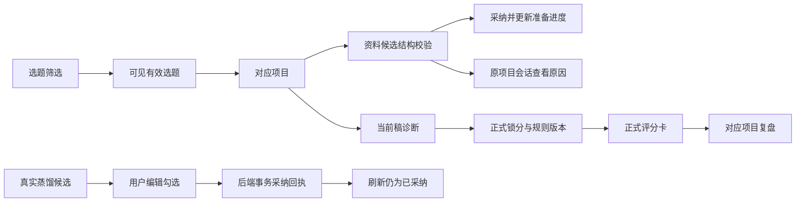

# T-1406 修复新版安装验收发现的八项缺陷

## 用户要求与范围

2026-10-25，用户在核对上次推送与本次八项缺陷的对应关系后明确要求“修复”。本任务以 `outputs/CreatorOS新版全功能验收-1.2.0-20261025/issues.json` 的 I-01 至 I-08 为实际故障依据，基于当前源码 `ae668c73`（产品来源 `6592b575`，包含 `3d741fc9`）修复实际分支，不重复以旧源码回归替代新版验证。沿用用户明确允许跳过缺失 product-to-code-orchestrator 技能的授权；保留任务、独立评审、数据兼容、回归与真实证据要求。

当前目录原有 T-1405 的 BACKLOG/events/SPEC 未提交内容必须保留。独立测试数据和运行目录不得指向原安装数据库；不读取模型密钥、Cookie、根私钥等内容。不删除已有规则、稿件、知识或会话，不重置配置、授权、签名根或保护门。不真实外发平台内容、不自动处理扫码或验证码。本轮不擅自把视觉审核服务、平台发布适配器或缺失外部资源纳入“已修复”。

## 实际行为与验收

|问题|修复后的行为与必要回归|
|---|---|
|I-01 选题零匹配残留详情|筛选、当前选中项、详情与立项动作使用同一份有效结果；0匹配没有旧详情/旧立项动作，部分匹配只能操作可见合法项；清搜索、来源刷新和项目切换不能误立旧题。|
|I-02 审稿规则跨组|新建自定义规则绑定真实当前组；同用户另一组不能列出、修改、删除或在审稿中使用该私有规则。系统种子规则与既有无组历史规则的兼容范围必须显式区分，不能把所有旧记录自动归入当前组，也不能隐藏旧active规则使既有审核静默失效；旧数据原样保留并明确其历史共享属性。列表、执行使用的active规则、CRUD与UI说明必须一致；跨用户保护仍成立。|
|I-03 连接测试与业务调用矛盾|定位到实际业务配置解析/执行入口并复用相同选择逻辑；配置失败、服务拒绝、超时与成功有准确脱敏结果，不用伪造成功或吞掉错误解决。缺省、指定配置、不同引擎/兼容地址和未配置路径有受控回归，不触碰真实密钥或给请求缩短预算。|
|I-04 空资料候选假成功|空/无有效结构的brief候选不能作为成功的可采纳提案，也不能算准备完成；保留可读错误与原任务身份，原有效候选采纳后3/3仍可用；代码只校验结构和边界，不把语义质量改成硬编码词表。|
|I-05 准备会话不可达|项目准备产生的真实会话使用项目编导能够读取的相同scope/项目绑定，错误入口能定位原会话；兼容既有旧scope会话，不伪造新会话或自动重发模型；组/项目隔离正确。|
|I-06 蒸馏重复入库|以真实组、聊天工具/任务结果身份和稳定候选标识形成服务端采纳回执；被用户选中的可编辑原子及可选原文归档在同一事务提交，刷新/重试/并发回读同一回执，部分失败不留下半份重复入库。允许正文编辑但不伪造真实任务/来源或跨组采纳；普通手工knowledge.create不受影响。|
|I-07 锁后旧评分卡|已锁定卡按真实predictionId与不可变rubric版本读取正式六维评分、加权分与来源；不能给初始五维贴“已锁定”标签。来源读取可返回正式预测及rubric的只读投影，保留旧响应兼容；正式结果缺失时说明无法读取，不拿旧分冒充。刷新、乱序响应、组切换、rubric新版本均不能串卡或变旧锁分。|
|I-08 看复盘误跳|从锁分回执的真实projectId直达对应项目review，保留组和预测上下文；不能硬编码旧/settings?tab=calibration或从无关页面VM猜项目。|

历史无组规则保持原记录与原有效性，只作为显式的“系统/历史共享”兼容层；新组私有规则不进入该层。本任务不批量迁移既有无组记录；任何后续归组都要有明确对象与用户选择。这是遵循当前group契约同时保全旧user域数据的兼容决策，独立评审必须核对其范围和用户可见说明，不以清空、全复制或默默改归属制造隔离。

历史共享规则的修改/删除必须清楚提示其共享影响并有显式确认，不能以普通组私有编辑直接影响其他组。系统种子和历史自定义都保持可读/原有效性，不对真实旧记录执行自动写入。该兼容选择是本次修复已有group契约的必要保全措施，不声称已知历史规则的原组归属。

空资料的恢复必须保留真实控制边界：无输入变化不得热循环消费同一个空回执，也不得自动重发。若用户明确补充资料/重试而创建新尝试，应保留原父任务、原执行deadline与已完成步骤、保存旧子任务来源锚，一次明确操作最多新建一次尝试。至少提供可达原会话、准确失败/待补充状态及可执行下一步，不以只改标签冒充完整恢复。

## 操作线路

## 写入边界

- `frontend/src/features/topics/**`：筛选状态与有效选择。
- `frontend/src/features/copilot/**`、既有知识蒸馏卡及其调用适配：正式评分投影、正确review链接、持久采纳回执。
- `backend/src/modules/ai/**`、`backend/src/modules/ai-runtime/**`、既有项目准备/会话读取应用装配：空候选、scope兼容及正式锁分只读投影。
- `frontend/src/lib/ai/**`、`frontend/src/server/**`、既有设置模型测试包装：复用正式模型路由与准确错误。
- `backend/src/modules/review/**`、`backend/src/modules/knowledge/**`、对应service port、`backend/src/db/**`、`backend/src/schema/**`、`backend/drizzle/**`及必要迁移/登记：组私有规则和蒸馏事务幂等；schema唯一属主仍在backend。
- `contract/src/resources/**`、`contract/src/operations/**`、`contract/src/cli-policy.ts`、`contract/src/workspace-operation-scope.ts`及必要注册/导出：向后兼容的组属性、正式评分投影、蒸馏采纳/回执契约。
- 以上路径的既有公共调用者、限定回归、任务文档可作最小改动。实际路径不符时先补SPEC和独立核对，不大范围改无关模块。
- 修复记录：`docs/verification/t1406/**`、`docs/research/2026-10-25-t1406-eight-defects-research.md`；私有运行证据 `work/creatoros-eight-defects-fix-20261025/**`；交付报告 `outputs/CreatorOS八项缺陷修复-1.2.0-20261025/**`。

## Gate与证据边界

先独立评审SPEC的数据兼容与范围，再实施。每个真实问题先有可重现红测，再有修复后公共路径绿测；夹具错误单列。以隔离PGlite/受控HTTP和组件交互覆盖真实service/transport/client，不能只测镜像实现的helper。必要类型检查、构建、LED-047/053与语义/边界门实际执行；既有104项CI欠账和控制契约问题单独列明，不改守卫或补造Gate通过。

报告区分源码修复、受控回归、构建、Windows安装版UI和真实供应商。源码改好不等于当前运行EXE已更新。普通签名构建需要既有Actions资源；先备好可评审提交、差异和测试结果，若仍需要新的远端推送/构建授权再明确提出，不以旧提交的推送授权冒充本次任意发布授权。禁止未验签热改现有安装包或替换信任链。

未发生的原生复验、模型输出、安装或签名不得写为PASS。正常启动/退出、断电恢复、真实平台与外部服务分别记录。收尾按真实证据更新问题状态，无法完成的门和安装边界明确保留。

## 2026-10-26 合并 main 授权与发布编排保全

用户在实时核对远端后明确要求“合并到main”。本次从已安装修复来源 `3ff74c16` / 公开签名传输 `ba2e74c1` 创建专用合并分支，保留先前流程修复；PR #10 后续 `c28cc1a8` 与本分支 `9cbb1487` 的 stable patch-id 及八个文件 blob 一致，不重复应用或遗漏修正。

T-1404 的候选构建分支曾临时替换 `.github/workflows/desktop-release.yml`，仅允许该构建分支运行，不能直接覆盖 main 原有 macOS / Windows 正式发布流程。本次额外写入边界仅为将该文件恢复到本次新获取 `origin/main` 的原始 blob，以及本 SPEC、BACKLOG 说明和 `docs/verification/t1406/MAIN_MERGE.md`。保全原 Verify 质量门、既有根和保护设置，不放宽候选构建守卫；历史 run、公开回执和制品仍只对应它们的精确源码，不宣称适用于新合并 SHA。

合并前独立核对该保全差异、产品源字节未变及新增 PR 当场 CI / 评审状态；真实受阻或范围外既有欠账如实记录，不自动将 T-1406 改为全量验收完成。此前整体 Windows 验收 PARTIAL、严格数据快照 FAIL、凭据内容未验和两项目 updatedAt 原因未明的结论保留。

PR #11 首轮实际 CI 又暴露本任务新增 0141 迁移后的一处测试库存遗漏：`frontend/src/server/legacy-frozen-source-read.integration.test.ts` 仍锁定止于 0140 的 114 条库存，三个历史升级 family 在 journal SHA 处失败。允许只补正此回归的明确 115 条库存及 0141 journal/SQL 身份，同时增加/保留旧 114 条与旧 111 条精确前缀锚，保留全部旧数据深等、冻结输入、真实 Worker、结算和同 source 重放断言。禁止动态接受最新库存、修改生产迁移 SQL、删除守卫或扩大 known-failures。复验采用合成旧 producer、独立 HOME/DB 与本地受控 HTTP，不使用用户原库或真实模型。

同一库存审查另发现 `backend/src/legacy-source-migration.test.ts` 仍按 114 条/old104+10 验证，以及 `backend/src/migration-convergence.test.ts` 的 115 条 raw hash 误取 Windows CRLF 工作文件而非 Git/CI LF 字节。允许限定补正这两个测试：显式固定 0141 / 新总数 / Git LF hash，保留所有旧 SQL 身份、旧库存前缀及领域保全断言；本机先将原 Git LF blob 原字节物化后复验，不扩大为兼容任意 hash，不修改生产 journal/SQL 或分类基线。

首轮 backend14/16 实际日志另显示 `backend/src/legacy-scheduled-job-migration.test.ts` 的当前库时间清单止于 0013，新增 0141 后实际多出 0014；允许只在这个测试的“当前库存”明确追加 0141/1791043200014 并保留旧前缀、冻结历史和锁并发测试。外部 PostgreSQL 前置未满足的用例继续如实列出，不以放宽前置制造通过。

同类当前全库升级回归 `backend/src/unified-project-intake-migration.test.ts` 的 old112→当前和 old113→当前尾项也需明确包含 0141；只补正追加计数与精确迁移时间清单，保留原项目/准备时钟深等、重启幂等及旧 SQL 守卫。首轮 frontend5/8 又实际发现 `frontend/src/server/__module_integration__/knowledge.persistence-client.test.ts` 的知识操作登记仍期待 13 个，本任务 I06 明确新增 `knowledge.distill.adopt` 与 `knowledge.distill.receipt` 后应为 15 个；只扩完整显式操作表并继续验证每个均为持久化实现，不使用动态长度或删掉真实实现断言。

Windows 本机历史测试另遇真实夹具前置差异：系统 tar 默认磁带设备、Git tar 不接受 Windows `-C` 路径、pnpm 缩短虚拟目录名，以及 Git 归档换行转换。实际仅在隔离运行环境设置 `TAPE=-`、建立已核同版本实物的忽略目录 alias、使用进程级 Git `core.autocrlf=false`；旧 104 个 SQL 与原 Git blob 逐一精确相等后，原测试命令和全部守卫不变，最终真实 4/4 通过。此前四轮失败/未执行日志原样保留，不以更换历史源或模型 mock 绕过前置。

首轮 frontend2/8 实际在 `frontend/src/server/script-review-worker-entry.integration.test.ts` 的 `reviewRules.create` 前置失败：旧测试仅有虚拟 accountId、没有 groupId。允许只补正此测试，以真实公共账号创建及其合法账号组构建隔离 RequestContext，再沿同组创建规则、触发实际 Worker、保存版本报告；保留全部原语义模型 HTTP 夹具、重试次数、冻结原文、lint/LLM 报告及无采纳候选断言。生产 group 守卫、模型调用及规则边界一律不改，不以假组 ID 或直接写数据库代替合法归属。
