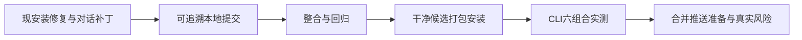

# T-1407 现有修复整合、本地安装与合并推送准备

2026-10-25，用户明确：“现在可以安装了，把代码都处理一下，然后准备合并推送了。”撤销上轮等待另一任务提交才安装的暂缓条件，准许整理与提交本地相关代码、解决集成冲突、准备本地合并候选、打包安装并完成原已授权 CLI 实测。当前为准备推送，不执行 git push、PR、tag、Release、生产部署或真实钱包修复。

## 来源与真实限制

- 主目录 `main` 基线 `cfd165baa`，包含已提交 T-1425 Tab 性能修复；另有本次 13 项 T-1426 产品变更及规则、规格、控制面工件。
- 本任务自己的独立修复提交 `93a972b9cda4e72e385d098105ce6c797fc8d32d` 已保留，不能重写为未发生的红测或真机通过。
- 现安装版 sidecar 为 `9db6e42887db0c469cea36e51351a9782baa1e26f874344c6ee2e6637290c3c8`，来源 `codex/cos-ux-closure` 的 `f7147fd71` 加 72 项冻结文件。公众号绑定已在公开 CLI 真实回读成功；旧来源整单仍保留视频号报表、自动恢复、剪辑耗时和部分筛选性能失败。
- 另一工作树的 Windows 来源保持 T-1403；本目录 CLI 测试原为 T-1403，现依 DEC-142801 映射为 T-1424。两者历史上重号；不覆盖同号看板或篡改其历史事件。本任务用来源路径、原 HEAD、hash 与报告追溯导入范围，保留未完成项，不替来源任务签绿。
- 本轮“代码都处理”允许把相关现安装修复整理为本地提交；这不将其他工作树的未完成验收变为完成，也不推定公开发布授权。

## 整合合同

1. 保全主目录及来源工作树原始改动。隔离目录只导入现安装冻结的 72 项和 T-1426 的 13 项，结合已提交 main/来源分支/可获取的 origin/main；普通 merge 处理冲突。记录每个导入文件、来源 hash、冲突处理和提交归属，禁止 reset --hard、rebase、force、跳过 hooks。源码未在冻结内的额外改动先核归属，不整体拷贝他任务脏树。
2. 文档与控制面只合并能追溯到已确认任务的改动；不照搬重号任务状态，不复制无证据的 PASS。需要保留的既有失败在集成报告中明确归属，不以本次局部测试代签全产品可发布。
3. 先独立审查本合同和候选清单，后整合；进入打包时使用干净、已提交且通过相关回归的候选，四版本一致，安全扫描和四项固定打包测试通过，运行原 `pnpm -C frontend desktop:package-local`。不使用上一轮源码 hash 冻结例外，也不在打包中修改产品或测试洗绿。
4. 安装前后校验源码、产物和当前 App 指纹；现安装若又发生更新，先纳入其已确认来源再构建。保留恢复能力和用户数据，公开 CLI 读回项目 ID 与模型选择，不访问用户库或密钥。
5. 沿“月明水清深”真实组，用公开 CLI 动态发现与描述能力。复验来源 codex/official/self × 引擎 codex/pi 的六组合，核回复、跨轮记忆、17×19 和只读账号组工具。保留失败、真实任务 ID 和耗时，原等待任务不重发；不兼容组合按合同拒绝，官方额度受限不伪造余额或发款。临时路由只改 text，CAS 核对并恢复原选择，遇并发变化不覆盖。
6. 整理可审查提交和合并差异、相关测试、安装证据、CLI 矩阵、剩余风险及确切待推送分支。若原产品关键验收仍未过，不宣称全产品可发布；可以完成本地集成与明确说明未就绪的推送条件。

## 范围与验收

允许写集：原 72 项冻结的产品/测试/内置编辑器来源工件，T-1426 的 13 项产品/测试，相关已确认任务的规格与规则修订、任务控制面和新增本 SPEC、`docs/verification/t1407/**`、本任务评审、任务绑定/任务包。精确清单在任务绑定中列出，未批准范围不借“全部整理”扩成新产品功能。不要改 Growth/Activity、许可经济政策、钱包、登录或密钥。

复用未变化的有效证据，新集成或冲突影响部分重跑相关 backend/worker/frontend 回归、串行 6144MiB 全 workspace typecheck、LED-047/LED-053、boundary、quality、diff check、独立候选审查和新安装版 CLI 复验。真实 RED/旧 FAIL 保留，无新增产品行为则不补造 TDD 红测。收尾 pmem sync、quick read-only reconcile 如实归类，再用 taskctl 管理状态；不绕过要求的 UI journey、既有质量门或完整发布条件。
