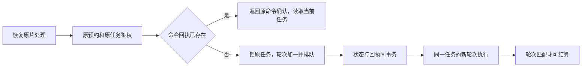

# T-850 原媒体探针任务恢复合同

2026-10-02 浏览器正式入口已验证媒体探针、采用与主轨渲染。失败处理必须恢复同一冻结任务，不能复制任务或伪造成功。本合同落实用户“全面落地并完成自测”及 T-850 原请求恢复范围。

仅开放 `exec.media.probe` 的确定性原任务恢复，仍由原 AI task owner 保存任务；不扩展模型重试、不重置模型调用、预算或成本账本。重试输入明确 taskId、原 sourceRequestId、独立 clientRequestId；source owner 校验原预约及 spec/fileDigest，execution owner 校验原 task 属主、类型及冻结输入。prepare 不隐式恢复 failed/cancelled。

复用 `execution_control_receipts`，命令 key 使用独立 `ai-deterministic-retry:` 命名空间。digest 包含 operation/taskId/taskType/原 requestFingerprint/冻结输入摘要。每次重新鉴权；事务锁原任务后先恢复同输入命令回执，再判断当前状态。原状态恢复与回执同事务，唯一冲突整体回滚、重读并校验赢家。同请求旧回执不能再次重置后来运行或完成的任务，不返回历史 queued 冒充当前状态。

为确定性探针添加单调执行轮次围栏。原 task 的运行轮次独立于冻结 input/spec；初始为 0。无旧回执的 failed/cancelled 恢复将轮次加一并 queued；原 ID/attemptId/input/requestFingerprint 全部不变。原 runner 使用其启动时的轮次，原 owner 的 queued→running 必须原子 claim；候选和失败结算必须同时匹配轮次、类型、属主、unbound 状态和运行状态。旧轮次迟到候选/错误不写新轮次，也不产出当前可采用探针。模型调用或绑定持久模型执行的任务拒绝此恢复入口。

每个成功 execution_manifest 持久记录 deterministicGeneration，executionService.get、source get/adopt 只选择当前轮次的 settled manifest。当前轮次尚无回执时明确未完成；历史轮次回执保留，不能被首条/最新条查找冒充当前候选。存量未标轮次探针仅按初始轮次 0 兼容，恢复后不得采用旧回执。运行轮次保存在原 owner 的私有 runtimeData.probeRunGeneration，默认 0；公开任务 DTO 只暴露无秘密的可选 deterministicGeneration，原 frozen input/spec 不变。

探针沙箱路径和在途 controller 使用 taskId+轮次隔离；旧轮次的 finally、prune、失败清理不得删除新轮次沙箱或 controller。取消原任务时可中止其所有在途轮次，新轮次的调度不被旧轮次 `inflight.has(taskId)` 吞掉。探针不产生用户资产，源文件、正式稿件与历史不受重试清理影响。恢复后显式唤醒同原任务，读取原 executionService.get 得到当前状态；回复丢失由原 clientRequestId 恢复。

必测：丢回复重放、后来再次失败后旧命令不重置、同命令并发、同 key 不同目标全回滚、跨账号零写入、其他 exec/model/bound 任务拒绝、旧取消轮次迟到结算零写入、旧沙箱清理不伤新轮次、inflight 不吞新轮次、原身份/输入/预算不变、旧 manifest 形成后取消重试的读侧隔离，以及真实 public source retry→probe→adopt。没有这些证据不标 Gate PASS。
