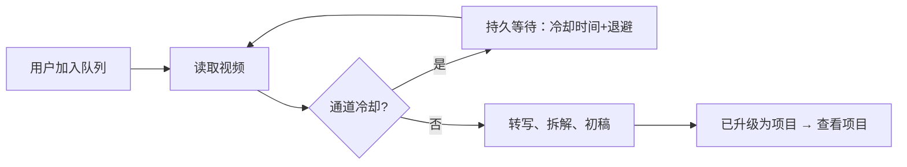

# T-938 雷达冷却自动续跑与项目直达

用户要求去掉页头受阻计数，升级完成后可一键进入对应项目，DouyinCooldownActiveError 不应作为转写终态失败。

沿用 T-937 持久任务与项目归属，不引入新引擎。冷却是等待条件：保存 retryAt、保留同任务、到期再调用，不紧密空转、不绕过站点验证。取消仍有效。永久输入错误与登录/验证码需如实保留，不承诺所有外部错误永不失败。旧冷却失败任务应可恢复，升级父任务等待子任务而非把冷却终结。

流程：作品 → 转写 → 冷却时等待原任务 → 到期续跑 → 拆解/初稿 → 已升级并可打开对应项目。

验收：针对性冷却分类/持久恢复检查；页头移除计数；已成功项项目链接；保留真实测试边界。此次为已有契约内恢复和界面修正，进入 BUILD；不改变数据归属及公开服务契约。

用户追加：离开返回恢复逐字稿/选题筛选、排序、搜索与来源范围，按账号持久保存。冷却恢复需退避，不把入队等同不限流。

独立复核：转写桥在 Pi 前读取视频，冷却绕过现有 sourceFailure 分类。恢复仅限当前租约、无付费调用账本的读取失败，冷却剩余时间为 retryAt 下限，连续失败指数退避并加正向抖动。旧失败只续接当前升级明确关联的冷却子任务，不扫描重放全部历史。主线程已评审该方案，保留取消与登录验证。

## 交付证据

候选81102ec5已通过固定本地打包入口安装并启动，PID36733，公开CLI connected/full。5项前端针对性检查（含返回恢复与账号隔离、真实项目href）通过，frontend tsc通过；新冷却恢复6项、既有队列7项通过，42项打包基础检查通过。旧transcript-runner默认10/期待25的既有断言失败保留，未宣称全局全绿；reconcile沿已有暂缓授权不扩大本次范围。

公开CLI显式恢复当前两父任务execution-task-bf64f03b-161/166，没有扫描历史。161引用的原转写execution-task-693b96ef-15352读回done、1020字、无错误；其后自动完成选题/初稿并创建project-radar-7fe17fb275c48409ee0b9163b25453fe，父任务succeeded。166仍按顺序在后台继续，不宣称完成。没有强制制造真实站点冷却；指数退避时序由隔离fixture验证，真实旧失败恢复由安装版验证。原生UI点击未自动验收。

安装包：/Users/zyongzhu/Downloads/CreatorOS-1.1.0.dmg；SHA256 d4477334d8ba197bfc9d3778d2824fd749747c43dbf5145c6bb3ff920f98a892。hdiutil verify、codesign --verify --deep --strict均通过。本地ad-hoc包未公证，不涉及Windows或公开发布。
