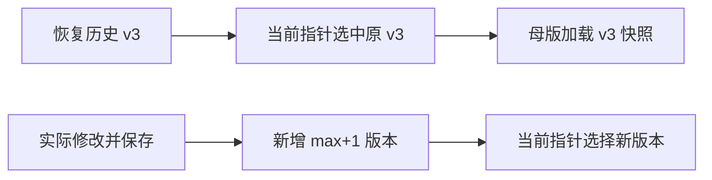

# T-939 定位恢复与双端更新

用户反馈每次恢复定位都会新增定位版本，希望修正；要求对照 /Users/zyongzhu/Workbase/nomifun-desktop 的 Windows/Mac 打包流水线和增量/远程更新机制。

先核对定位不可变历史与当前指针契约，再确定不制造重复版本的恢复行为，保留历史和账号归属。对标发布链只读来源，不复制凭据。列明现有实现、真实缺口与可落地修复；不将远程全量更新称为差分更新，不以workflow文件存在声称双平台构建成功。未授权公开发布、tag、生产放量。

## 经独立评审的定位修复

新增内部currentStatementId指针，NULL旧数据保留max>floor兼容；非NULL按账号/profile精准读取，不回退最大版本。恢复只覆盖当前profile快照并切换原statement ID，重复恢复不新增行；去掉恢复产生的复制/自动备份行。真实创建与采纳仍全历史max+1并切换指针，重置清指针并推进floor。历史重复版本不删除、历史项目引用不变。恢复加入现有账号锁，与创建/采纳串行；公开DTO保持不变。独立审查interrupt_diagnosis确认三处max查询（reset/restore/adoption CAS）必须统一读取。用户反馈构成本次恢复行为修正授权；进入BUILD。

## 双端发布与更新审计

只读对照nomifun-desktop，未读取密钥、执行发布或宣称线上链路通过。

| 能力 | 糯米饭 | CreatorOS |
|---|---|---|
| 构建调度 | 本机release-mac.sh/release-win.ps1；仓库禁止GitHub Actions | desktop-release.yml已有macOS ARM64/Windows x64，only=all才双端，默认/tag仅Mac |
| macOS/Windows | Universal Mac、公证/Gatekeeper；NSIS Windows未启用Authenticode | 正式Mac公证与启动检查；Windows安装启动卸载检查，未启用Authenticode |
| 应用内更新 | main.rs下载完整Tauri更新字节、验签缓存、安装缓存包 | desktop-updater.ts只读版本清单后打开固定下载页；没有同等内置下载安装链 |
| 更新元数据 | make-latest-json.mjs合并平台清单并发布完整包及签名 | 官方updater.endpoints为空；渠道构建会注入端点，但UI仍未走安装。用户artifact仅DMG/setup.exe，更新制品托管未接全 |
| 真正差分 | 未找到补丁生成、基线匹配、应用补丁链 | HEAD/ETag/Range探针与runtimeBaseUrl计划字段不构成差分执行链 |

源码依据：nomifun的.github/workflows/README.md、scripts/release-mac.sh、scripts/release-win.ps1、scripts/make-latest-json.mjs、apps/desktop/src/main.rs（下载/安装）；本仓.github/workflows/desktop-release.yml、frontend/src/lib/desktop-updater.ts、frontend/scripts/desktop/tauri-package-config.mjs、package-channel.mjs、collect-user-installers.mjs、update-hosting-probe.mjs。

已确认的局部流水线缺陷：draft-release下载全部artifacts后又拒绝非安装文件，会被验收JSON/log阻断。限定pattern:desktop-*保留独立证据artifact，相关配置测试通过；没有触发真实发布。

远程更新不等于差分：对标糯米饭应先形成包级清单+签名制品托管、检查→下载验签→保留包→停sidecar安装→重启的真实链，再做双端旧版升级测试。真正增量还需要旧版本基线、补丁生成、校验/失败回退，不能只添加Range或endpoint。此次审计未擅自开启生产远程更新或公开发布。
