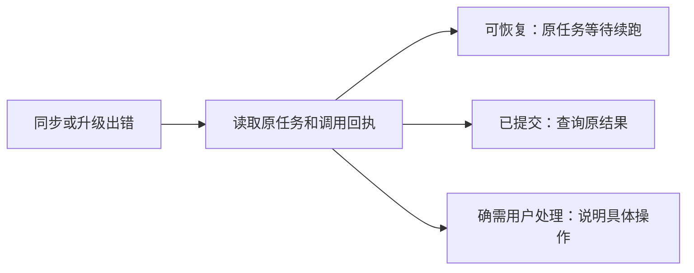

# T-942 雷达失败与结果未知恢复

用户截图中多个来源同步失败，升级作品显示“提交结果未知，须同键对账”。检查安装版同账号公开CLI任务与诊断日志，分别定位来源同步与升级子任务的失败事实。沿用现有持久任务、幂等和退避机制修复可恢复状态，不另建重复任务，不将未知外部付费提交直接变为可重放。对用户显示问题所在、系统正在做什么及确实需要的操作；内部编号对账不作为用户工作。

验收：真实错误归因、针对公共恢复路径的测试和状态展示回归。原任务恢复只通过公开CLI及其现有执行约束；无证据不宣称外部调用成功。

## 实际诊断

公开CLI：radar_project_upgrade共3项，2成功；Gemini作品原父任务execution-task-bf64f03b-166受阻于原转写execution-task-693b96ef-15537，runtimeStatus=unknown_result、errorCode=BOUND_ASR_RESULT_UNKNOWN。不得因父任务可retry而当作子任务可重放。

同账号source_sync样本100项中27项NO_VALID_RESPONSE，均attempt=1；日志2026-09-09T04:06:38.162出现BROWSER_PROFILE_BUSY，同批失败集中发生于此时。已证实failureEnvelope遗漏浏览器占用分类并将其降为NO_VALID_RESPONSE，applyAdapterBatch直接失败且次日才调度。不能断言27项全部由浏览器占用导致；旧记录缺明确分类时不自动批量翻转终态。

用户提示改为转写待确认、升级暂停、保留内容。点击检查先读取真实逐字稿，已补齐才恢复原父任务；没有正文不制造重试假动作。未知外部提交尚缺可验证的供应商恢复回执，本次不声称该原转写已恢复，不盲目重放付费调用。桥接层未知状态投影到blocked，避免继续显示提取中。

## 来源恢复实现

BROWSER_PROFILE_BUSY保留精确错误类型，同task/run自动退避5–60秒；仅本批零产物、无调用账本的source_sync进入等待，不抢浏览器锁。短期唤醒仅由execution.retryAt驱动，不用source.nextRunAt创建另一队列。旧失败运行只有原任务显式重试、新attempt和有效租约才可重新更新。

来源公共链路43项、未知结果前端3项、执行终态5项测试通过；各改动类型检查通过。原未知ASR仍待有证据的恢复，T-942保持进行中，不宣称所有失败已经根治。

## 安装与实际恢复

候选4215659c固定入口打包并替换/启动本机应用PID78821，CLI full。42项打包测试、合并tsc、hdiutil verify、codesign --verify --deep --strict通过。本地ad-hoc未公证，无远程发布。安装包/Users/zyongzhu/Downloads/CreatorOS-1.1.0.dmg，SHA-256 7988d1f20e72a45cec1ad2d8bf939afc232d12652292e0388c9069615d541462。

公开CLI同账号acct-ae1a8346-9，使用幂等键t942-original-sources-retry恢复原source_sync任务execution-task-1ecc18cd-{83,73,77,59,63}。最终五项全部succeeded、attempt=2、errorCode=null，对应Geo逸哥、Win先生、南吴、嘉弟干编导、天诺企业流量咨询。未新建替代任务，未改真实数据为假成功。原ASR未知仍保留，未再次提交；全局reconcile沿用用户暂缓要求，本任务因ASR自动核验缺口保持进行中。

## 用户继续反馈（正常子任务等待误报）

“暂时无法处理，系统会等待后自动继续”出现于新父任务execution-task-f1e15754-651；子转写execution-task-f1e15754-653为running，心跳正常。父任务无errorCode/errorMessage，只用retry_wait周期等待子任务，前端错误地将所有retry_wait视为故障。本轮明确只有带真实错误的退避显示恢复说明，正常等待沿stage显示转写/写稿中；跟踪原任务到业务产物后再报完成。

### 正常等待修复实证

同一原任务execution-task-f1e15754-651已succeeded，经公开CLI回读项目project-radar-e44ad83e3fe5fdf9b740708ceff97ca9，标题“AI 项目跑通过一次就别再手维护 Skill：让模型自己当配置管家”；候选intelligence-transform-f1e15754-826有1335字文案，转写done。未重复提交，待原任务完成后才替换安装。

候选936660b9已安装，PID85933，CLI full；4项提示/恢复测试、42项打包测试通过，DMG与codesign校验通过。本地包SHA-256 f9f831bc6379f1c5eb73072c2d2c583d089f8e81eebe3f958631963787da2f2e。旧Gemini未知转写未恢复，T-942继续保留此缺口。

## 用户再次催修：Gemini 原未知转写

用户最新截图明确要求修复这条原任务，不接受一直停在人工补稿提示。本轮复查原转写和供应商调用回执，先寻找可恢复的原结果；基于实际证据修复恢复路径，保留原父任务和已有内容。不得仅改文案、直接写数据库或虚报恢复。

实证缺口：公开 execution.tasks.list 显示原 transcribe 为 unknown_result/blocked，而 intelligence.items.get 返回同一 executionTaskId 的 transcript=running/text=null；uploadManualTranscript 会因此报 TRANSCRIPT_BUSY。最小修复在作品读取时校准已停止任务的逐字稿投影：同账号、同作品、kind=transcribe 且当前任务确实处于停止态才将 queued/running 改为 blocked/failed；持有任务行锁并比较原关联，防止与真实重试/新任务竞争。保留旧正文、任务关联和未知调用账本，不补假成功。活动任务仍拒绝人工覆盖。真实恢复用本地 Whisper 从原视频产生正文，经公开 uploadManual 上传，再恢复原升级父任务。

本轮新增 3 个停止态回归先红后绿；补充恢复竞争与迟到回调保护后，intelligence.service + radar-project-queue 共 36 测试通过，frontend 合并类型检查通过。人工上传在写事务锁关联任务并复查活动态；markTranscriptRunning/finishTranscript 最终写入比对 executionTaskId，旧 worker 不能覆盖已补入正文。独立评审指出并发两项已落实。

本地 douyin-transcribe 已从同一 externalId=7574748560332295460 的 542.6 秒原音频完成识别，faster-whisper small/cpu/int8，348 段、3967 字，耗时190.8秒。正文尚待更新安装版后经公开 API 写入与恢复原父任务；不将此本地识别结果记为旧云端请求成功。
