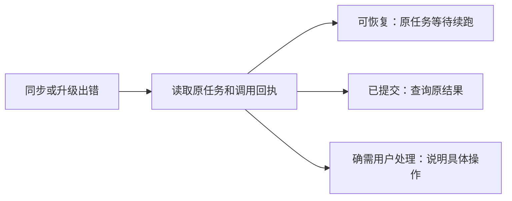

# T-942 雷达失败与结果未知恢复

用户截图中多个来源同步失败，升级作品显示“提交结果未知，须同键对账”。检查安装版同账号公开CLI任务与诊断日志，分别定位来源同步与升级子任务的失败事实。沿用现有持久任务、幂等和退避机制修复可恢复状态，不另建重复任务，不将未知外部付费提交直接变为可重放。对用户显示问题所在、系统正在做什么及确实需要的操作；内部编号对账不作为用户工作。

验收：真实错误归因、针对公共恢复路径的测试和状态展示回归。原任务恢复只通过公开CLI及其现有执行约束；无证据不宣称外部调用成功。

## 实际诊断

公开CLI：radar_project_upgrade共3项，2成功；Gemini作品原父任务execution-task-bf64f03b-166受阻于原转写execution-task-693b96ef-15537，runtimeStatus=unknown_result、errorCode=BOUND_ASR_RESULT_UNKNOWN。不得因父任务可retry而当作子任务可重放。

同账号source_sync样本100项中27项NO_VALID_RESPONSE，均attempt=1；日志2026-09-09T04:06:38.162出现BROWSER_PROFILE_BUSY，同批失败集中发生于此时。已证实failureEnvelope遗漏浏览器占用分类并将其降为NO_VALID_RESPONSE，applyAdapterBatch直接失败且次日才调度。不能断言27项全部由浏览器占用导致；旧记录缺明确分类时不自动批量翻转终态。

用户提示改为转写待确认、升级暂停、保留内容。点击检查先读取真实逐字稿，已补齐才恢复原父任务；没有正文不制造重试假动作。未知外部提交尚缺可验证的供应商恢复回执，本次不声称该原转写已恢复，不盲目重放付费调用。桥接层未知状态投影到blocked，避免继续显示提取中。

## 来源恢复实现

BROWSER_PROFILE_BUSY保留精确错误类型，同task/run自动退避5–60秒；仅本批零产物、无调用账本的source_sync进入等待，不抢浏览器锁。短期唤醒仅由execution.retryAt驱动，不用source.nextRunAt创建另一队列。旧失败运行只有原任务显式重试、新attempt和有效租约才可重新更新。

来源公共链路43项、未知结果前端3项、执行终态5项测试通过；各改动类型检查通过。原未知ASR仍待有证据的恢复，T-942保持进行中，不宣称所有失败已经根治。
