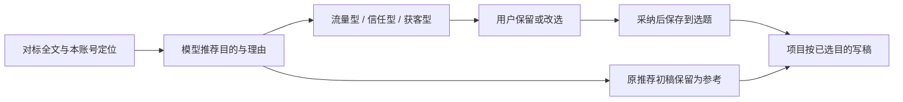

# T-944 编导方法与提示词优化

用户明确搁置数字人，反馈 CreatorOS 找对标、写文案、改写能力差，要求借鉴本地 `/Users/zyongzhu/Workbase/Hkm-Ip-agent` 专业编导思路优化提示词。

承接已独立评审的 T-929 适配设计。本轮检查参考方法与现有提示词/有效 Skill/上下文的消费路径，优化对标候选证据、针对目标观众的因果写作、改写保真与局部编辑。复用 Skill 管理、任务快照、候选采纳和稿件版本；不新增母题实体或必填流程，不改数据归属，不自动发布或打包安装。

验收：记录具体缺口与源码依据；优化进入真实模板/有效 Skill 消费路径，兼容用户覆盖；通过相关装配及编辑边界测试和类型检查。写作质量需用同输入模型产物对比或用户实测，未发生不记 PASS；规则文本测试不冒充写作效果验收。不得硬编码关键词替代语义判断，不加阻断保存的审美质量门。

## 用户补充与本轮契约设计

用户明确要求内置内容类型，依据不同对标自动推荐类型。当前已有 contentRole=traffic/trust/conversion，复用为“流量型/信任型/获客型”；不删除既有 trust，不另建分类系统。家乡情、段子、引导式表达属于 format 表现形式，保留自由文本，以 Skill 提供内置可选写法（地域共鸣、情景段子、引导式表达、知识演示、案例复盘、问题诊断）。类型推荐由模型结合对标拆解、当前受众与业务目标判断，不用关键词分类。不得承诺流量恢复或获客。

雷达选题结果新增可选 contentRole（复用枚举，可空）和 contentRoleReason（最多500字），旧结果缺失时显示“未推荐”，不能补默认假分类。推荐解释区分原作品作用与本账号采用理由。传入改写模型的 topicCandidate 必须保留该类型和理由；内容方法按不同目标写作。确认接口允许用户改选 contentRole，reason 只读保留原模型建议，避免把用户选择伪装模型推荐。确认后通过原候选服务写 contentRole；reason 放现有 card.proposal，format 仍走已有字段。项目继承到后续写稿上下文，避免只在卡片显示标签。

UI 在现有雷达选题卡显示三种目的和推荐理由，并允许改选，明确当前初稿按原推荐生成，改选用于后续项目写稿。不偷偷把已有初稿视为已按新类型重写；下一次写稿须读取用户所选类型。无推荐时可继续生成、确认和升级；不新增质量失败门。

验证覆盖模型结果解析、断点恢复保留类型、确认写入与回读、项目写稿上下文、旧卡无字段兼容及UI改选提交。范围扩展由用户当前消息明确授权，独立评审在更改契约代码前执行。

评审补齐：确认快照另存 recommendedContentRole，contentRole 为用户已选值；原理由始终关联 recommendedContentRole，确认后的选择控件禁用。card.proposal 明确记录原推荐角色、原理由和初稿生成角色仅作背景；项目升级以候选 contentRole 构造优先的内容目标。后续写稿将已有初稿标为参考稿，明确当前选择优先，目标不同需重新组织表达，不能照搬旧初稿。独立评审指出的三项均纳入实现与回归。

## DEC-T944-01：内置目的与用户选择

用户当前回复明确要求“内置好几种类型，针对不同对标自动推荐”，据此扩展本轮实现范围。复用既有三值枚举；推荐是模型候选，用户采纳后由候选服务保存。原推荐与用户选择分开；不新增必填流程或语义词表。独立评审 `review_content_types` 首轮提出原推荐保留、项目目标优先、确认后锁定三项问题；补齐设计后评审通过。实现复审发现同任务检查点刷新丢推荐/初稿，修复后复核通过。

## 参考依据与落实

参考工程 Hkm-Ip-agent 的提交为 `314101a736ee64cb9d04afcb1323e4c69cdf0257`，核心方法见 `migration-test-complete/work/person_dashboard-integration/Workbench/server/platform/prompt-catalog.mjs` 的 WRITING_METHOD、benchmark_breakdown、benchmark_rewrite、original_writing、script_revision；产品约束见同工程 PRODUCT_SPEC 的 FR-039～058。

借鉴的是编导判断方法：明确说话人、受众当前处境、单次目的；理解旧做法的价值和局限，再讲原因、新方法、证据与行动；拆对标时先提炼段落作用和因果关系，改写时换成本账号事实。没有复制其产品流程或强制用户经历额外阶段。

实际改动：

- `business-methods.ts` 是现有可编辑方法入口，更新研究、写稿、审稿方法，增加三种内容目的的不同写法与独立表现形式。注册版与管理端版本统一；聊天按需读取与结构化节点均可消费，保留用户自定义覆盖和历史任务快照。
- 清理写稿模板“少论证、多断言”、固定段落顺序、审美不符即废稿等互相冲突的要求。逐字分镜移除创意改写方法注入，继续要求原文保真。
- 对标拆解要求正文证据，标题/摘要只能作为待核实线索；高播放不能被写成已证实的因果解释。改写明确事实归属和局部编辑范围。
- 雷达生成与重试保留 contentRole/contentRoleReason，初稿模型收到推荐；确认接口只允许改选类型，原推荐角色和理由只读保留。候选→项目→实际写稿上下文以已选目的优先，并将旧初稿标为参考。
- 雷达卡显示三种目的、推荐理由及改选提醒，确认后禁用选择。同一 transform 的分段结果刷新未编辑字段，保留用户编辑；旧数据不补假分类。

## 本轮验证与限制

已发生的验证：

- AI 方法与模板、冻结快照、worker 安全路径相关 7 文件共 47 测试通过。这是装配与执行边界验证，不是模型写作质量评分。
- 后端确认/重试、候选升级与实际上下文、有效 Skill 装配、局部编辑工具、写稿 runner：5 文件 75 测试通过。
- 内容雷达契约：8 测试通过，覆盖三值/空值/旧输入以及拒绝伪造推荐理由。
- 新组件与关键升级路径筛选回归 5 测试通过；新组件完整 2 测试通过；雷达工作区 51 通过、5 失败，和从 HEAD 提取的原始目录基线完全相同。已有失败为 T-900 确认按钮旧断言、T-579 错误文案多元素、T-744 两项确认按钮旧断言、分享建档 refresh 旧断言。本轮新增改选→升级与已确认锁定断言通过。未为凑全绿改写这些历史断言。
- Playwright 真实 Chromium 运行真实 TopicCandidateEditor，检查增量结果到达、默认推荐、改选、旧稿提示、回调传值和确认锁定，通过且无 pageerror。使用示例数据与测试回调，仅代表组件交互验证；截图使用测试页面样式，不冒充正式界面视觉或完整应用 E2E。原始证据 `/tmp/t944-browser/result.json`、`/tmp/t944-browser/confirmed.png`。
- ai-worker 与 frontend TypeScript 通过。backend 全量类型检查仍有 13 个既有错误，涉及未改动的旧测试/已移除接口；本轮修改文件无新增类型错误。边界扫描仍报告 7 个既有违规（登记基线为 5 个），其中 live-chat-session 的两项相对旧基线被记为新增，已核对 HEAD 原本存在，与本轮无关。
- 原提示词矛盾用例曾发生 4 个真实红测并转绿；内容目的扩展的实现前红测缺失，不补记 TDD PASS。独立设计与实现评审均已实际发生。

本轮最终 reconcile 实测 233 errors、0 warnings，与此前基线一致；原始日志 `/tmp/t944-reconcile-final.log`。既有控制面/边界/历史证据欠债继续归 T-916，不能宣称全局全绿。本轮没有真实模型同输入 A/B、真实发布数据或已安装桌面包更新；因此只能验收源码行为和方法装配，稿件效果仍待模型对比或用户实测。

建议后续实测用相同账号事实与同一来源，分别要求流量、信任、获客三版，检查：是否真正改变受众任务和论证重点；是否误用原作者经历；获客稿是否回答决策顾虑；局部改写是否保留范围外原文。家乡情、段子等形式不能单独决定内容目的，也不构成流量承诺。

过程状态限制：`progress done T-944:build` 被全局既有复杂度账本缺项拒绝（ipc/runtime/credential_store 等历史项），build 步骤保留 pending，没有手工绕过或补造通过；此控制面欠债继续归 T-916。
