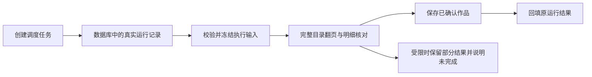

# T-951 自动化采集可靠性

用户报告自动化执行未完成，schema 的 jobRunId 收到 undefined；另有 1000 多条作品的账号持续采集失败。授权修复原任务链，保证可验证的可用性，不承诺第三方平台永不失败。

## 范围与设计

先查调度任务、job run、执行层冻结输入之间的权威绑定。当前调度器只向内存 dispatch input 加 jobRunId，而飞轮 prepare 从持久 ai_tasks 重读 inputData；重点验证此断裂，修复必须从真实 run 关系绑定并校验用户/账号/任务归属，不把字段改 optional 或捏造 ID。保持现有执行内核和数据归属。

大账号检查分页停止条件、作品数量截断、单页失败、整体超时与已完成数据保留。按已验证根因做最小变更；未有真实千条账号日志时区分静态风险、隔离回归与真实集成验证。

验收：隔离 fixtures 的真实调度→持久任务→执行 prepare 链；错误/跨号绑定拒绝；千条规模分页与单页故障测试；类型和边界检查。测试不得访问真实数据库、媒体目录、登录档案，不调用存储迁移或清理真实根。现有全局治理欠债单列，不伪报全绿。不擅自发布安装包或重放有外部副作用的历史任务。

## 已确认根因与修复

1. 本机公开 `jobRuns.listByJob`：`run-649424be-350`、`run-2368a14a-55` 与用户贴出的 jobRunId Zod 错误一致；历史 `run-185382ce-362` 成功写入 130 条。当前另有运行中任务，未取消或重复提交。
2. 调度器临时 dispatch input 带 run ID，但 prepare 重读持久任务丢失该字段。现在以 `jobRuns.aiTaskId` 唯一关系解析，校验作业/用户/账号，拒绝缺失、多 run、伪造引用和跨账号；运行时把已验证的冻结绑定传给采集 runner，保证终态回填也不丢 ID。没有让必填 schema 变 optional。
3. skipHeavyBackfill 从临时标志改为创建任务时保存到 target，恢复继续使用冻结输入。
4. 作品目录默认 40 轮改为 500 轮，保留原平台限速与取消；等响应 body 完成及 JSON 解析后再判断翻页进展。导出下载等待由 40 秒改为 180 秒。
5. 翻页预算、已知有更多但停滞、响应解析失败或中途限流时，返回已获取记录及 incomplete；自动化仍先通过既有可见性验证再保存，保留本轮数量并显示未完成、不缓存为完整成功、不启动剩余耗时补采。取消仍终止，不绕过权限或可见性。尚未实现平台游标跨进程断点续传，不宣称已实现；继续采集仍走现有幂等入库。

## 验证与交付边界

- 隔离 PGlite 的真实 trigger→prepare→claim→runner→run 终态闭环，四类兼容采集均通过；外部平台与模型不调用。恢复前夹具缺字段/未设置时间等测试准备错误已修正，不将其作为业务 RED 证据。随后完整复现用户的 jobRunId undefined，修复后通过。
- 后端 3 文件 60 项通过；前端 3 文件 153 项通过。包含 1200 条分页、慢响应、预算到顶与部分结果，及平台限速和可见性既有回归。模拟 1200 条只证明执行逻辑，不代表真实千条账号端到端验收。
- Frontend 全量 tsc 通过；Backend 全量 tsc 报告其他测试文件的 13 项既有错误，本次改动文件无报告错误。边界扫描报告 7 条存量违规，其中 live-chat-session 的 2 条相对其旧 baseline 属新增，但该文件本次未修改。不扩大 baseline。
- 脚手架按入口要求更新至 3.27.1；全局 reconcile 仍被既有任务/治理欠债阻断，沿用 T-916 跟踪，不伪报全绿。
- 未构建或替换用户安装包，未触发真实采集、模型调用、历史任务重放、媒体迁移或数据清理。仍需安装版和真实千条账号验收，不能承诺第三方平台永不风控/掉线。
