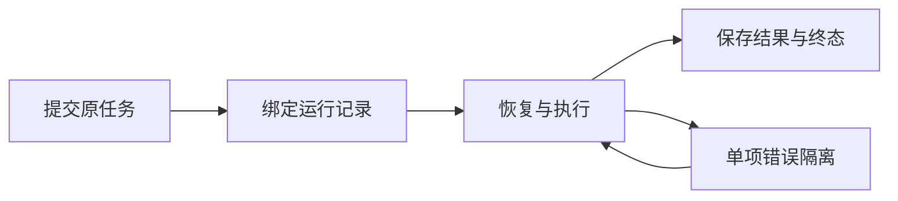

# T-952 关键链路阻断排查与修复

用户要求主动找出类似采集字段丢失的阻断性缺陷，可用性和稳定性优先。沿任务提交、恢复、分页与终态链路检查，以可复现证据确定修复范围；不更换架构或放松账号、幂等、权限和数据保护。

验证采用隔离内存数据库和浏览器 fixtures，不触碰真实媒体、登录档案和数据库，不重放外部收费任务。确认缺陷先写失败回归，再修复并运行相关调用链测试。记录源码与安装版的验证差别，已有全局治理欠债沿用 T-916，不伪报全绿。

## 已复现与修复

1. **刚提交即误判失败**：真实 trigger 的 createTask 已写入内存 PGlite，但 createRun 尚未执行；此时运行 recoverQueued，旧实现找不到 run 并调用失败处理。复用已有每日选题的冻结调度意图与事务行锁服务，为四类飞轮采集保存计划时刻。正常触发与恢复通过同一 ensureRunForTask 返回同一 run，避免恢复成功后触发端又新建第二条。旧任务已有唯一 run 仍可绑定；旧孤儿没有冻结意图、显式引用不存在的 run、跨账号或多 run 均拒绝猜测修复。
2. **任务已经结束，运行记录仍卡住**：采集器/排队包装器异常退出时，外层只写 ai_tasks 和 execution_tasks，job_runs 仍为 running；成功后最终回填端口异常也存在同一裂缝。终态现在在执行租约校验下同事务写入三个记录，保留已有计数。普通 runner 继续回填采集统计和清空进度。未改未知模型调用、暂停、取消的执行权规则。

首轮 RED：`/tmp/t952-red.log` 2 失败、8 通过，分别为创建间隙没有运行记录、异常后运行状态仍是 running。不是依赖缺失或夹具错误。

## 验证

- `/tmp/t952-final-tests.log`：4 文件 75 项通过，覆盖四种采集的真实 trigger→prepare→claim→runner→run 终态、创建间隙交错恢复、4 个并发恢复只建一条 run、旧孤儿/重复/伪造/跨账号拒绝、异常终态和成功后最终回填失败；包括每日选题原冻结意图回归。
- `/tmp/t952-expanded.log`：每日选题适配器和运行服务 2 文件 12 项通过。命令还列了一个不存在的 execution-flywheel-generation.service.test.ts 路径，Vitest 仅匹配前述两个真实文件；不存在的测试不计入验证。
- Frontend `tsc --noEmit` 通过。Backend 全量类型检查仍为上轮相同的 13 项既有测试错误，本次修改文件无报告错误；没有把全量检查报告为通过。
- CodeGraph 已刷新。boundary 仍是 7 条存量违规，其中未修改的 live-chat-session.ts 有两条相对旧 baseline 的新增；未扩大 baseline。全局 reconcile 结果见收尾记录，既有治理欠债由 T-916 跟踪。
- 所有测试使用隔离数据库，未调用真实浏览器/模型、未改真实数据库、媒体目录或历史任务。源码修复不代表当前安装包已更新；此任务不含打包发布和真机采集验收。

补充检查：orphan scan 为 0 error、100 warning；semantic-boundary 仍因未修改的 video-decisions-runner.ts 缺 material.match 调用而失败，属于既有制作链问题，本轮未更改相关路径。

收尾：pmem sync 已运行；`/tmp/t952-reconcile.log` 仍为 233 项既有漂移，与 T-951 基线数量一致。T-952 源码修复的 87 项聚焦回归与前端类型验证通过；保留上述全局失败，不升级全局 Gate、不替换安装包。
