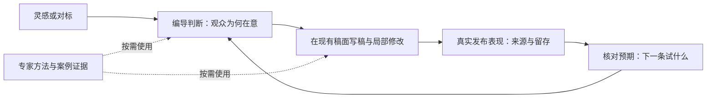

# T-954 编导内容判断与流量反馈

状态：代码接线与隔离工程回归已实施；真实模型同输入效果对照、保留样本迁移评价和安装版验收待完成。2026-09-11。

## 用户需求与授权

2026-09-11：用户明确回复“OK，你来把这个落地吧”，批准本方案三个现有界面与流量来源接入。

接入已在抖音创作者中心实测可读取的作品流量来源；参考薛辉与泛小识公开原始内容，提炼可复用内容方法，在较小改动下重新设计现有交互和逻辑。保留 Agent loop、任务恢复与上下文机制，不增加强制串行流程。用户提供的准确账号已通过主页核对。

## 结论

当前产品不缺内容类型或泛化写作原则，缺的是把判断、证据和实际创作动作连接起来。保留“脚本 → 复盘”主干，在现有选题卡、稿件助手和复盘页完成改造。专家方法作为可追溯、可检验的方法候选，按任务调用；不新增两个拟人专家 Agent，不训练权重，不重做执行引擎。

这是同一个 Agent 内的工作循环，不是用户要逐一闯关的五个页面。用户直接要求写稿时，Agent 内部完成必要判断并交付候选；只有会改变结论的关键事实缺失时才询问。

## 当前源码暴露的具体缺口

| 现有位置 | 已有能力 / 实际行为 | 本次修正 |
|---|---|---|
| `ai-worker/src/prompt/business-methods.ts` | 已有 traffic / trust / conversion、证据、因果写作、保真修改、对标方法 | 不再重复加一段“专业编导”总提示；增加有来源的适用案例与反例，检查节点实际消费 |
| `frontend/src/features/draft-workbench/topic-card.tsx` | 目标受众、内容目标、核心信息非空就显示“选题已定”；卡片默认收起 | 字段齐全不冒充用户已决定；简短呈现当前方向、选择理由与待证假设 |
| `frontend/src/features/draft-workbench/script-review-gate.tsx`、`ai-worker/src/prompt/templates/script-review.ts` | 主审核入口预填“违禁词/合规诊断”，报告以合规为主 | 保留合规入口；稿件质量诊断走现有编导聊天与局部修改工具，避免混成合规 block |
| `ai-worker/src/prompt/templates/review-insights.ts` | 要求从单条作品提炼 3–6 条方法论，schema 又要求至少一条 | 允许“目前不能下结论”；产出观察、假设和下一次验证，不强行归纳成功经验 |
| `backend/src/application/collection/douyin-work-detail.ts` | XLSX 已包含完播、5s 完播、2s 跳出、平均时长、主页访问、涨粉 | 复用留存指标，不重复新增；补作品流量来源及口径 |
| `frontend/src/server/ingestion/douyin-cdp.ts`、`backend/src/application/collection/self.ts` | 基础作品列表与导出明细链路；尚未逐作品接流量分析 | 独立补采流量明细，基本数据先可用；千条账号不能把逐条访问塞回分页主链 |

以上证明功能与提示存在，不证明当前模型写稿效果已达标。T-944 的真实同输入质量对照仍缺失。

## 原始样本与方法提炼

原始主页：

- [薛辉小清新](https://www.douyin.com/user/MS4wLjABAAAArN-F_6z5sOBta-sie_gVlYV4Q08XehEGl9caSE-Co5Q)
- [泛小识](https://www.douyin.com/user/MS4wLjABAAAAA3iY9QkWmqDffe8FK00s2-MES_Qi1ArEeBUSD-pHuH4)

已用匿名视频解析和本地 faster-whisper small 转写四条，元信息、临时全文路径与 SHA-256 见 [sources.json](../research/t954-director/sources.json)。机器转写存在错字；以下为概括，不作逐字引语。这四条仅形成初步方法卡，不代表完整蒸馏。无来源证据的扩展设计明确归于本项目建议。

### XH-01 从实际动机选题

来源：[会做生意就会做短视频](https://www.douyin.com/video/7684146173884653667)，117.7 秒。

作者用少儿街舞、编程的例子说明：服务名称与顾客实际想获得的结果可能不同。可借的方法是从生活情境理解购买动机，再决定内容要回应的问题。作者对家长动机的解释是案例判断，不是全体家长的事实。

落地：Agent 读取账号已有客户问题、评论、产品与经历，区分“产品做什么”和“观众为什么在意”。有真实证据就引用；只有推断就明确为假设。不要把“老板/宝妈”之类人口标签当成完整受众理解。

反例：不能从“家长想被认可”推导所有教育内容都应刺激攀比；也不能无采访依据编造客户内心想法。

### XH-02 用过程与验证建立信任

来源：[短视频和直播哪个获客更容易成交](https://www.douyin.com/video/7683145754588643304)，97.5 秒。

作者讨论直播的原生感，以及测评、展示过程如何影响信任。可迁移到短视频的是：把能力主张落实为观众能观察的过程，提前安排证据的呈现方式。不能把“直播更容易成交”当作所有行业都成立的结论。

落地：获客稿写作前优先核对可用的实测、案例、演示或操作过程；没有证明就缩小承诺或给待拍演示建议。知识讲解也可以依靠推理和可核对材料，不强制每条都拍测试。

反例：视频里的极端增长场景只是作者讨论中的假设，不能变成我们承诺的效果。不能伪造客户成绩来满足“需要证据”。

### FX-01 先查口径，再解释数据

来源：[推荐页占比减少13，计算真实的推荐比例](https://www.douyin.com/video/7682604200261487923)，22.8 秒；另查看视频画面，音频中的“这样计算”本身没有完整公式。

作者提醒投放、搜索及其他流量变化会干扰对推荐来源占比的直觉判断。可迁移的方法是先检查分母、构成和干扰因素，再提出原因假设。原始来源比例保持原样，任何重算值必须另起名称并说明分母。

落地：同时呈现播放量、来源构成、时间口径和投放信息是否已知；不从推荐页占比高低直接判断限流。缺投放或粉丝数据时说明无法排除该因素。

反例：不能直接写死作品里的粉丝占比阈值作为账号诊断规则；不能将重算比例命名为“平台真实推荐率”。

### FX-02 多指标观察，不反推私有评分公式

来源：[2026短视频的赛马分值②：多目标排序计算过程](https://www.douyin.com/video/7479430790355488040)，52.7 秒。

作者以公式解释多目标排序，并提及其他影响维度。它是创作者的算法解释，未获得抖音官方实现证据。可借鉴的是避免单一指标判断作品；具体公式、权重、账号评级机制不纳入产品计算规则。

反例：不根据一个“综合分”承诺播放量，不把作者推测显示为平台检测结果。

## 小改动交互：只调整三个已有位置

### 1. 选题卡展示“这条为什么值得做”

保留三种目的及可自由选择的表现形式。在现有卡片里显示三行可读信息，详细证据折叠：

- **给谁看 / 他正在遇到什么**：来自定位和真实素材，信息不足时标假设。
- **这条要让他获得什么**：一个主要目的及具体收益，不只显示“流量型”。
- **为什么由你讲**：真实经历、演示或可信材料；缺口明确提示。

目的未指定时，模型根据当前账号与对标推荐并说明理由；尊重用户已选目的。自动补全只生成候选，采用后复用现有项目服务保存。用户想直接写稿无需多点一次“确认判断”。

对标卡只突出“可借的表达机制”和“本账号必须换掉的事实”。高点赞不直接成为推荐理由，不把原作者经历带进新稿。

### 2. 稿面助手用内容问题驱动修改

沿用右侧聊天、读取最新稿件和局部修改工具。入口建议为“帮我判断这条值不值得做”“检查哪里留不住人”“把证据讲清楚”。点击前先保存当前稿，绑定真实项目与稿件版本，发送明确请求；已有主写稿入口继续保留。

诊断默认只说最重要的 1–3 个问题：指出具体句段、解释观众在此会缺什么信息、提供可采用的修改。例：开头承诺了一个操作演示，但正文前三段一直在讲行业趋势；建议提前展示结果，趋势解释后置。此例是项目设计示例，不是专家原话。

需要改稿时交付候选，可局部采纳、撤销；范围外文字保持。没有明确问题就说清理由，不为了凑数强改。合规检查仍是独立含义，不让审美建议成为渲染/发布的硬门。

### 3. 复盘回答“下一条怎么改”

单条作品显示播放与来源构成、留存及可获得的行为数据。正文为简短的三段：**实际发生了什么 → 哪些解释还只是猜测 → 下一条检验什么**。

示例：推荐来源占比高且 2 秒跳出高，只支持优先检查开头承诺、画面与受众匹配，不能直接宣布“开头是唯一原因”。下一条保持核心主题和目的，试一个具体变化，并保留原版对照。

没有数据仍允许内容诊断；没有可支持结论时不强行生成“经验”。经验候选附来源作品与适用条件，沿现有采纳机制进入后续上下文，不自动升级为账号永久规则。获客目标没有真实咨询/成交数据时，点赞、涨粉只能作为辅助观察。

## 工程接入范围与依赖

复用 Pi loop、Skill 配置与版本快照、现有候选采纳、稿件版本、执行任务与后端单写者。方法由 `method.topic` / `method.writing` / `method.review` 按需读取；模型决定使用什么，代码校验引用与权限。不要把所有专家材料塞入每次 system prompt。

方法卡最小内容：来源作品及位置、方法概括、适用场景、执行动作、反例、证据状态。账号覆盖保留；官方方法更新不覆盖用户自定义内容。冻结任务继续使用其原方法版本，避免重试期间换方法。

| 层 | 责任 / 变更边界 |
|---|---|
| `ai-worker` | 受管方法、内容判断与诊断；原始来源是资料，不是工具指令 |
| `backend/modules/ai-runtime` | 汇集当前定位、稿件、已采纳事实与有权限的指标；裁剪无关材料，冻结引用 |
| `backend/application/collection` | 编排基础采集和可恢复的流量明细补采，经 ingestion/analytics service 落库 |
| 浏览器 adapter | 在本人授权会话内读取实际作品详情，限速、超时、取消；不转交 Cookie 给第三方 |
| `contract` | 流量来源快照的明确口径和可空状态；内容诊断如需结构化字段须先完成契约回查 |
| `frontend` | 复用三个已有界面；呈现候选、来源、状态与真实动作 |

流量来源新增建议契约：accountId、publicationId、externalId、capturedAt、统计窗口原始标签、app 范围、entries（平台原始来源标签与百分数 0–100）、读取状态。未知来源保留，缺值为空，合法 0 保留。不要通过总和强制改成 100%，因为上游可能四舍五入或只显示部分来源。

落库是否完全复用现有 rawMetrics，需以读端能否保留窗口、来源完整性和独立新鲜度为准，不为少改动丢失口径。明细快照不能覆盖较新的基本数据，也不能冒充本次基础采集全成功。单作品展示优先；跨作品来源比例不得简单平均，分母不齐不汇总。

明细补采必须独立进度、幂等与恢复。优先当前复盘作品和近期缺失作品；千条历史作品按持久游标继续，不只采前若干条就宣称全部完成。作品失败保留其他成果；会话失效停止后续访问并显示待重新登录；取消释放浏览器，重启可续原任务。实际后台请求尚未验证，当前仅验证真实页面可读，不能把第三方文档中的 endpoint 当作已接通。

## 验收依据

- 同一组真实输入、同一模型设置，对照当前版与候选版；覆盖流量、信任、获客、资料不足、跨领域对标、局部修改。隐藏版本标签评价受众具体性、观看理由、证据、推进关系、口播与目的适配。
- 专家提炼用未参与提炼的作品做迁移检查；只有四条样本不足以声称体系完整。用反例验证不机械套模板。
- 合法旧写稿/渲染/发布路径仍可完成；缺策划、审美低分、未采明细不能新增整单失败。
- 当前稿变更、历史版本、重复采纳和跨账号请求验证引用与归属；候选失败不覆盖用户稿。
- 流量采集覆盖真实单作品回读、缺值/真零、未知来源、统计窗口不一致、超时/会话过期/取消，以及千条队列的中断恢复；隔离测试不访问真实数据库或媒体根。
- 检查最新指标确实进入复盘输入，方法快照确实进入执行；提示词字符串存在不算效果验收。

## 当前证据与待完成

已完成：两个账号身份核对、四条公开作品方法提炼、独立设计评审、选题卡/稿面/复盘接线、独立流量队列、真实单作品页面字段回读、1005 条隔离队列和真实页面冒烟。工程证据见 [验收记录](../research/t954-director/implementation-evidence.md)。

待完成：真实同输入模型盲评与保留作品迁移检查、真实千条账号全量运行、安装版验证。当前没有把这些记录为 PASS，T-954 保持进行中；本轮代码提交不代表已替换用户正在使用的安装包。全局工程基线问题归 T-916。

## 实施前独立评审（2026-09-11）

`t954_review` 只读评审：方向 PASS，以下约束纳入本次实施：空经验必须贯通模型 schema、候选投影、聊天结果和卡片；无数据诊断不作效果归因。聊天采纳带项目归属及来源，仍由用户采纳。新内容诊断严格保存须贯穿编辑器真实 rejection，成功后读取最新版本；失败保持稿面，不发旧稿诊断。流量使用独立 analytics 表，避免仅明细快照覆盖基础指标；同时进入页面与模型输入。补采只能针对当前账号已确认公开的作品，逐作品持久进度，登录失效暂停、单作品失败可继续、取消关闭浏览器。不得将部分采集标为全量完成。

## 实施决策

- `publication_traffic` 独立保存每条作品的来源、窗口、完整性和成功时间；迁移 `0094` 不更新基础指标或旧稿。失败时保留上次成功数据并标明状态。
- 新契约 `analytics.traffic.get/refresh`，只读取当前账号有归属的已发布抖音作品；未知来源保留、缺值 null、真实 0 保留。
- `self.traffic` 使用现有持久执行权，每批 20 条交还队列；逐作品结果落库作为断点，累计失败跨批保留。连续执行预算允许千条队列多次领取，暂停/重连恢复沿原任务；模型调用不是该任务能力。
- 系统作业先持久化再入队。跨日与并发触发复用原 task/run；持久轮询补偿完成瞬间入队的空窗，不擅自重启失败、取消、暂停或待登录任务。
- 稿面三个诊断动作先严格保存，再读取真实稿件版本；不强制 `script.patch`，不继承 URL 旧命令。诊断给建议，用户要求修改后才生成候选。
- 聊天与持久复盘共用含流量数据的 reader。空经验报告可保存和展示；采纳经验时后端检查项目归属，保存来源与适用条件；不自动入库。
