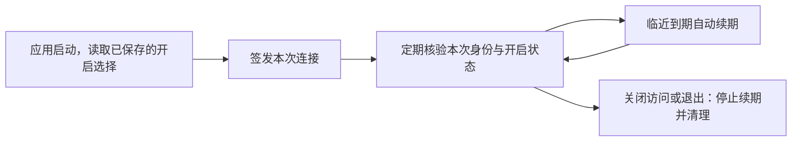
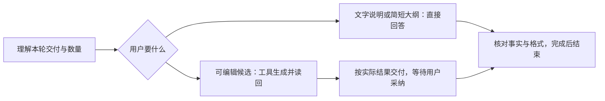

# T-957 编导 AI 失败与真实验收

用户截图：复盘当前作品在编导对话显示结果待核对，同时通用错误卡显示直接重试。此前 T-954 真实模型验收未完成，不可用隔离测试替代。

范围：读取原任务、调用日志与结果归属，判定未知调用是否发生；定位并修复可复现阻断，保持原任务身份，不盲目重复模型调用。核验主要文字 AI 入口（编导对话、选题、稿面诊断/改写、复盘）真实模型候选生成；不自动采纳/发布或开启无关音视频生成。其他 AI 能力只列已测/未测，不能宣称全部通过。

验收：原失败证据、适用回归、已安装实际调用与候选读回、明确未测和受外部条件阻塞项。错误 UI 按实际运行状态提供动作，未知结果不得同时建议新建重试。修复沿现有执行权与服务边界，不重构数据归属；若发现契约/架构变化先独立评审。

## 定位与独立评审

原项目 artifacts=[]，转写仍进行中，但真实指标有11568播放、14.01%完播及28.38%两秒跳出。聊天 prepareReview 硬要求逐字稿，后台 prepareReviewContext 允许指标/评论，造成同一能力不一致；本地上下文拒绝被父工具记unknown，原两次调用保留不自动改账本。

独立评审 t954_review PASS：复盘两入口共享任一真实证据即可；零值有效，仅pending来源状态不算指标，无稿不评价具体台词，script.review仍需稿。未知结果从服务端结构化状态转换稳定错误码，页面显示核对原任务并移除重提按钮。补两入口与状态/UI回归。无架构/归属调整。

## 真实验收追加发现：旧纯文本稿局部改写

用户“继续”承接 AI 功能故障排查与验收。实际 `ai-task-c7dc03ce-83` 中 script.patch 两次失败：旧稿没有 sections，模型猜测 full 被正确拦截。仅聊天文字不是可应用候选，判定此入口未通过。

候选兼容方案：读取当前版本/hash；工具以明确原文片段提出局部候选，宿主验证逐字唯一命中后产生范围锚点。采纳沿原接口再次核对版本/hash/原文，只替换该范围并保留前后文。禁止把整篇当作一个虚拟段来替换，禁止模糊匹配、未确认写稿或自动拆段落库。已有结构稿路径保留。需要完整读取→候选→采纳→撤销隔离回归，真实用户稿仅验候选不采纳。

旧稿兼容独立评审：t957_patch_review 条件 PASS；全部约束记录 DEC-T957-01。实现完整读→候选→公共采纳→重读/撤销隔离链，纯文本严格版本，已结构稿保持旧政策。用户继续承接故障修复；不额外取得自动应用权限。

实施评审 t957_patch_review PASS：264项隔离回归及主树11项通过。已安装9901cf2f；真实旧稿复测暂被模型拒绝阻塞，详细证据见 docs/verification/t957-ai-acceptance.md，不计全功能通过。

## 额度恢复后全量复测授权
用户明确确认额度恢复并要求继续全量测试。本轮扩展为盘点全部AI能力，实际调用已配置且有合法输入的入口；媒体仅生成测试产物，不发布，不覆盖真实稿件。未配置/缺输入项明确记阻塞，不能算通过。原旧稿任务现已返回有效候选，沿公开接口读回，不重复提交。

## 提示词与失败表达全场景审查（用户 2026-09-25 明确追加）
用户要求继续全面测试各类 AI 场景，并系统优化各 Agent 的提示词，避免助手把内部故障、提示词条款或实现细节当成对用户的回答。范围追加到 T-957：盘点所有注册的对话 Agent 与会向用户展示自然语言的生成 Agent；结构化内部节点按其字段是否直接展示纳入，纯内部分类节点记录在覆盖清单中，不无差别加长每个模板。

统一规则：助手聚焦用户目标和当前任务结果；不得自称系统有问题、暴露/引用系统提示词、内部规则编号、异常栈、供应商原始报错、内部模型配置字段或实现路径。只有运行回执明确支持时才陈述具体原因；否则说本步骤未完成、原因尚未确认，并给出仍可执行的下一步。不得为了避免提“系统问题”而隐瞒已经确认的失败、配置限制或权限阻塞；不得把真实能力边界包装成产品缺陷，也不得猜测故障归因。诊断日志与面向用户的解释分开。

提示词采取共享短规则与 Agent 职责规则组合：先盘点实际装配后的 system，而不是仅 grep 模板源码；检查默认模板、用户/账号覆写、旧快照与异步续跑的一致性，不重复复制长段通用文字。Codex/Claude Code 仅作为清晰、直接、围绕当前任务表达的风格参考，不复制其非公开提示词。

验证矩阵至少覆盖：配置/模型能力限制、结构化输出失败、鉴权/额度/限流、网络/超时、工具拒绝/权限、真实无数据、部分成功、未知执行结果、异步排队/运行/成功/失败、用户取消、纯问答与正常生成；每一类验证事实表达、内部信息泄漏、是否给出可行下一步、是否误称全系统故障。提示词测试需覆盖全部对话 surface 与实际注册的用户可见 Agent，注入含“能力边界第15条”、内部错误串和提示注入资料的反例；失败链路需覆盖通用工具错误信封及真实结构化节点错误，不以孤立模板断言替代。

完成记录要分别列出代码回归、已安装产品真实调用、未配置或未测能力、各场景通过/失败/阻塞和证据。不得将“所有模板存在共同规则”写成模型质量已完全解决；真实回答仍需按矩阵抽样复核。

2026-09-25 已完成共享回复规则、覆写保护、局部改稿分支及未知错误信封修复；矩阵和完整测试结果见 [提示词与失败表达验证](../verification/t957-prompt-error-matrix-20260925.md)。CLI 命令自动发现、启动、版本与帮助校验成功；`status`、`access status` 和账号读取仍返回 `CONNECTION_EXPIRED`。用户于 2026-09-26 确认访问授权为永久，不需要重复授权；因此该错误只记录为 CLI 连接/会话状态异常，不推断授权到期。当时没有可读的 CLI 当前账号；该连接阻断已于下述 2026-09-26 修复恢复，随后完成5条安装版模型抽样。该任务仍未完成，不把全量 AI 验收记为 PASS。

## 2026-09-26 CLI 自动续期阻断修复

已确认：持久化开启偏好正常，但壳层连接只有 24 小时租期，没有续期；应用已连续运行超过两天，CLI 因此拒绝过期连接。正常退出、重新启动后公开 status/access status/accounts list 均成功，无需用户重新授权。

本任务补充运行寿命修复：已开启的同次启动连接在租期不足一小时时自动延长 24 小时；一分钟检查一次，休眠唤醒后同样检查。续期仅更新连接描述，不重新创建被撤销的凭据；必须匹配当前进程、产品、包、启动 nonce 和凭据。关闭偏好、文件缺失/损坏、身份不符均不能自动恢复。退出清空运行态并清理文件。CLI 消费端仍拒绝过期连接，不降低鉴权条件。

验收覆盖正常租期不写、临近过期、休眠跨过有效期、关闭偏好、撤销文件、损坏及跨包/进程/nonce/凭据、退出后不重建；并继续通过公开 CLI 跑真实 AI 场景。源代码回归与安装版实测分别记录。

## 2026-09-26 用户追加：修复真实工具读取故障

不能以改善失败文案代替修复读取工具。已重读历史失败任务 `ai-task-24509a92-12510`，定位 Google 思考签名文档：原 HTML 包含迁移说明及标准 meta refresh，Readability 删除 aside 后只返回导航/许可页脚，丢失目标页。Python 官方长文的真实读取成功，说明不是所有网页均故障。

修复范围：读取器跟随标准短延时 meta refresh 的明确目标，最多三次；每跳仍执行 URL/重定向守卫、HTTP/登录态检查，中断释放浏览器，循环/超限明确失败。仅解析网页导航协议，不按内容词表猜新网址。补包含迁移页、相对地址、循环、私网目标、取消和普通长文的回归；实测同一原始 Google 链接是否读到迁移后正文。

同一 URL 的旧错误正文可能已缓存，补充兼容字段 `web.read.refresh?: boolean`：仅第一页显式重新读取时跳过缓存；后续 offset 翻窗继续复用。默认缓存、原任务重放与已保存素材保持原行为。旧宿主与独立 Worker 两条读取入口均透传；新增正文仍是待确认候选，不自动采纳。用户“发现工具读取失败就修复工具”作为本次范围确认，详见 DEC-T957-03。

## 继续深度验收与易用性优化（2026-09-26）

用户要求继续深度优化、全面测试并降低错误概率。本轮沿工具实际执行链补故障注入和独立审查：备用搜索初始化失败不能覆盖已确认的网页 HTTP 状态；登录状态查询失败只能记为未知，不能让用户重复登录；取消及未知执行回执继续透传。长文分页、同账号缓存刷新、跨账号访问和重复结算均需验证实际正文与副作用，不能仅以任务成功判断读全。普通错误保留可行下一步，诊断信息经脱敏留在日志。

独立审查 review_read_recovery 确认分页未绑定版本：同 URL 全账号最新缓存可替换当前任务已读正文，且分页重复计入全文预算。修复沿现有证据/账本服务：正 offset 优先复用当前任务、当前调用序号之前、同 URL 最近成功回执引用的不可变全文；验证原调用、参数摘要、正文 hash 与归属，重新切窗，不信任模型或旧窗口文本。复用证据而不重复保存全文/素材；第一页 refresh 仍产生新观察。首次直接跳页无前页证据时保持现有入口。无新增公开参数、数据归属或架构变化。分页素材元数据注明读取时快照，不冒充素材当前状态。审核条件及并发刷新、跨账号、篡改、取消与九页预算回归必须落实。

同次独立审查发现跨域跳转登录墙丢失真实域名。用户已明确授权修复工具故障；私有 needs_login 失败契约添加可选 domain，经宿主已有域名规则校验，仅用于显示实际需登录站点；缺省兼容原域。独立审核接受此方案，要求补非法输入、旧载荷、重放和账号边界测试。该字段不授予读取/保存其他站点会话的权限；跨域登录后再从原短链恢复仍需真实验收，不计入本补丁成功范围。

## 2026-09-27 本地重新打包与安装版全面验收授权

用户认可提示词优化，明确要求重新打包、安装验收并全面测试上述功能。冻结代码候选为 `4027264b`，沿现有 1.2.0 本地官方包入口执行；在干净独立检出构建，保留主工作区其他任务未提交内容。验收涵盖启动/CLI 自动连接、普通问答、最少资料复盘、提示注入与错误表达、结构化候选、迁移网页和长文分页、账号隔离、取消与失败恢复。真实数据只读或生成测试候选，不采纳、覆盖用户稿件、发布或公开分发；异常注入使用隔离测试，不修改真实模型配置制造故障。逐项记录任务身份、终态、结果与未测限制。

## 2026-09-27 安装验收发现与修复

冻结包 `4027264b` 已完成构建、安装、签名与 DMG 校验，CLI 自动恢复，三个账号及85个项目保留。真实调用发现：纯文字大纲被强制转成7条候选、一张卡生成8条，外部资料中的越权指令虽未执行但回复暴露工具名称，复盘虚构平台基准，网页最终跳转地址没有透传。以上不计通过。

沿原授权修正对话/选题模板冲突、数量默认值、反编造与有限复盘方法；不用业务关键词路由或输出删词伪装修复。网页结果增加可选展示字段 `asset.finalUrl`，原 `sourceUrl` 仍作缓存与采纳匹配，旧缓存无最终地址时缺省。独立评审 `review_read_recovery` 条件接受：浏览器证据经哈希与URL验证后才透传，续页保留同一版本，不能据展示字段扩大登录或网络权限；补非法地址、篡改、旧缓存、原URL采纳与重放验证。回执长度与网页正文长度分开说明。

本轮仍为 T-957 的验收修复，重新冻结提交后再打包安装复测；源码断言不能代替真实模型质量验收。排队取消已通过，运行中取消另测。
