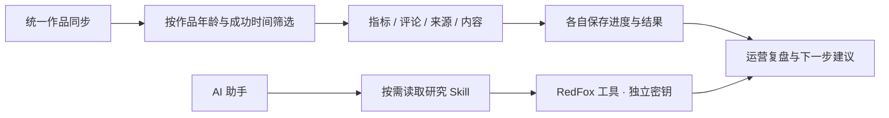

# T-962 运营同步与助手研究能力

用户确认范围：修复分享页冗长下方布局、自动化列表操作错位、打开设置导致明暗模式改变；作品指标、评论、流量来源和视频内容合为增量同步，近7天作品每2小时，7至30天每6小时，30天以上每天；内容雷达同步改2小时并提供编辑。研究专业运营复盘方法；RedFox接入AI助手，独立密钥配置兼容官方及自定义模型，内置场景Skill由Agent选择。

本次直接授权产品改动及频率策略。时间按Asia/Shanghai。凭据不回显、不入日志、不进模型上下文。原始数据/历史执行保留；既有停用意图不得被迁移强行开启。详情已有内容跳过、失败独立重试；每类数据以成功时间判到期，分页、断点、幂等和浏览器串行化复用现有内核。缺失数据不伪造，研究结论与原始观察分开。

先核查现有调用链和RedFox官方契约，再补充确定的设计与DEC并独立评审。验收包含主题稳定、无编辑按钮的操作对齐、时间分层边界/迁移/失败重试、密钥保护与两种模型配置下Agent工具调用、分享导出及二维码。

## 确定设计与评审

2026-09-13 独立只读评审 t962_review：方向及归属通过，补入以下约束后实施。
- 统一作业保留self.metrics稳定身份，原traffic内部队列和历史不删除。统一任务组合各能力，真实execution上下文贯穿；分批continue协议覆盖统一任务。
- 作品年龄[0,7天)、[7,30天)、>=30天分别2/6/24小时。无效/未来时间按最新档处理且记录异常，不永久漏采。每作品×能力持久成功时间；0评论也成功、截断不成功；失败不推进成功水位且有限退避。
- 目录发现与作品详情更新分开；全目录分页可恢复，不以遇到旧作品当全量结束；已有完整内容不重转写。旧comments/traffic关闭保存为统一作业能力开关，迁移不删除旧历史且幂等。
- 根布局监听系统外观及偏好变更，设置挂载只读。雷达允许编辑名称/描述/频率，锁定target/source。操作列固定宽度。
- RedFox采用独立integration密钥边界，按用户加密存储，仅返回hasSecret；与模型供应商无关。远程请求在worker工具运行，host仅提供受控服务端口，不加入宿主read工具。场景method.redfox.*由skill.read按需读取，模型判断是否调用；固定主机和官方操作白名单、类型/分页/超时/响应大小边界。异步提文案提交未知不得自动重提。

## 实现与验收记录（北京时间2026-09-13）

源代码已实现，尚未打包替换用户安装版。日报分享布局仍位于T-960网页预览，未宣称已建成自动生成日报的生产服务。

- 统一同步采用作品×能力成功水位；目录/XLSX仍需完整读取以发现新作品和权限变化，昂贵的详情、评论及来源请求按到期作品执行，不宣称上游支持逐条增量指标接口。已有完整稿件跳过重复提取。原任务ID及恢复协议保留。
- 迁移保留关闭意图和原历史，覆盖仅评论/仅来源/仅旧详情的孤儿任务及重复迁移。实际红测3项失败后修复；迁移6项通过。
- 新方法注册后遗漏聊天冻结目录的问题已修复：真实注册表→任务映射→快照→skill.read回归先失败后通过，三个聊天入口均能发现和读取新方法；不修改已冻结历史任务。
- 前端聚焦8文件145项通过，包含自动化、主题、设置和RedFox组件；后端聚焦11文件33项通过。最终迁移/冻结目录/真实Worker协议loop/原任务恢复合计5文件61项通过（与前述有重叠，不累计宣传）。Worker适配器6项通过，Worker构建及前端类型通过。
- 真浏览器验证见 [页面验证](../research/t962/ui-verification.md)：实际表单保存、刷新、主题切换、PNG导出与二维码通过。
- 未配置真实RedFox密钥，未验收付费API、真实模型账户或真实抖音采集。已用独立Worker子进程及HTTP协议fixture验证工具loop和官方/自定义两种配置接线；不能等同线上效果验收。

全局检查未全绿：reconcile仍233项既有漂移，boundary-scan7项/基线5（多出的live-chat-session.ts两项在本任务基线650f9423已存在且未修改），语义门仍报既有video-decisions-runner缺material.match，后端全量类型仍14项既有测试错误。本任务引入的绑定测试可选输入类型已修正。上述范围外债务保留T-916，不修改门卫基线或伪记PASS。研究Gate无开放项。

代码提交：24fdd047（RedFox）、f997ec7c（页面与装配）、ed3d5fc0（增量同步）、719c1802（孤儿迁移）。新增快照修复随本任务收尾提交。

过程进度工具未推进：progress done 被全仓既有未登记复杂度标记阻断（ipc、language_toolchain 等），保留实际 pending；未手改进度为通过。BACKLOG以taskctl附范围外债务证据收尾，T-916继续承接全局过程漂移。
