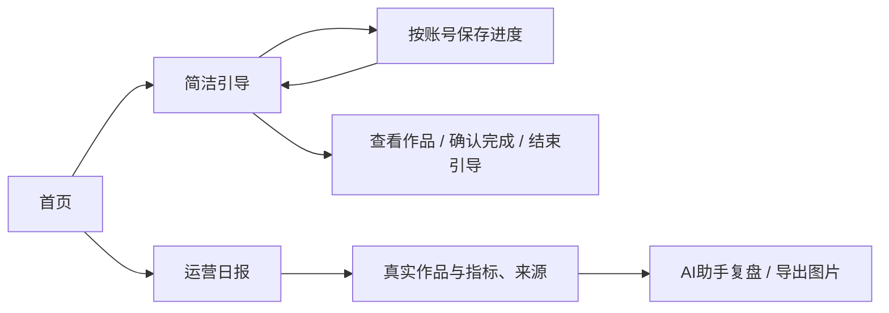

# T-964 上手引导与首页运营日报

用户实报：已完成引导重新出现，显示第6/7步却将绑定标为当前，第三步查看并确认无法完成或退出；安装版首页缺运营日报入口。

退出打包冻结，进入修复实现。先核对引导数据读取、账号作用域、状态转换和确认页面的完整链路；完成状态不得随临时数据加载回退，已完成/不再显示可持久保存；第三步查看与确认/跳过应真实有效且可返回。优化引导紧凑展示，避免老用户被大卡挡住首页。日报需要真实首页入口与可用页面，不硬编码127.0.0.1:7879开发服务或历史固定日期数据。按北京时间展示实际账号数据和空态，不伪造分析。

确定实现设计后补充DEC与独立评审；回归覆盖已完成再次进入、账号切换、异步加载、第三步确认/退出/跳过，以及首页到日报。完成后提交修复；安装包更新按已有用户授权沿官方Skill处理。

## 确定设计与评审

独立只读t964_review通过方向，实施补充：后端按可信userId+accountId授权，PATCH完成步原子集合并集；每次读写携带捕获accountId，账户切换丢弃迟到结果并禁止误写。旧全局偏好不跨账号反复迁移，存储失败明确提示重试。绑定里程碑与登录健康分离；不把无数据写成正在同步；引导为建议导航，不用不一致前置锁阻断正常功能。多作品账户须查完整信号。用户可显式结束引导，设置可重新查看，重看不清空完成状态。

日报为真实 /daily-report 路由，复用服务组合查询当前账号、北京时间昨日发布作品、最新累计指标与来源，缺数据显空。首页入口靠近问候区，不依赖临时端口；真实指标图表及当前数据PNG导出，二维码为既有购买站。语义分析通过已有AI助手loop与运营Skill按用户点击生成，不以写死规则生成运营结论。

## 实现与验收记录

已实现按账号授权的后端持久化与迁移0097、完成步原子并集、账号切换迟到结果丢弃、设置重开保留历史。绑定状态读取真实账号记录，不再依赖浏览器登录探测。默认仅展示下一步；查看作品只导航，单独确认才完成；结束引导可持久保存。

独立评审发现并修复：项目列表真实接口为全量读取，不能用假分页重复请求；账号切换时必须释放旧保存锁并防止旧finally影响新账号。包含1005条作品和异步切换回归。

前端集成7文件94项通过；最后引导与设置4文件71项通过；前端tsc通过。后端日报与查询相关2文件9项通过，另有独立PGlite引导迁移/授权/并集测试通过。未补造完整前置TDD证据。

隔离数据库、关闭后台驱动，在真实浏览器完成：查看历史作品返回不误确认；显式确认推进；结束后刷新不出现；设置重开保留3/7完成；首页日报入口导航成功；真实服务写入的隔离发布样本显示1条，未采集指标显示暂无；PNG实际下载。AI入口真实打开预填助手，未发起付费模型调用。本次未对真实用户作品创建或发布测试内容。

截图见 docs/research/t964/home.png 与 daily-report.png。日报按北京时间、选定发布日期作品的最新累计指标展示，不冒充当日增量；语义结论经AI助手生成，图表不伪造归因。

全局工程对账与历史边界债务沿T-916保留，不能将本次局部验证描述为全库全绿。打包及安装证据待补。
