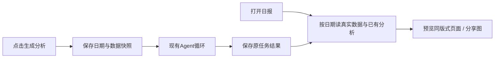

# T-965 运营日报预览一致性与打开性能

用户实报安装版日报每次打开很卡，实际页面和此前确认的预览完全不同。退出打包冻结，修复既有日报交付，不改变用户已确认的运营视角。以T-961/T-962预览作为设计参照，真实账号数据作为内容真相；核对首页入口、日报信息层次、作品/来源/复盘与分享布局，不能以简化数据面板冒充已确认效果。

先采集真实安装版查询/导航耗时，并对照预览与实现；独立评审确定修复边界后实现。缺指标与分析要诚实显示，不能把预览固定文案/旧日期植入真实页面。复盘需要现有Agent loop产出并展示真实结果，避免仅放跳转按钮造成产品缩水。验证首次与重复打开、切换日期/账号、缺数据、失败恢复、图表和导出一致性。完成后提交，并沿已有本机更新授权构建安装。

## 确定设计与独立评审

独立t965_review确认缩水：原DTO没有分析字段，跳转预填不等于生成日报；查询存在全账号列表读取和逐作品串行，页面未启用展示缓存。安装版真实CLI三次0.299/0.258/0.262秒，不能把该耗时当作完整导航体验。

查询改为发布服务按7天窗口筛选，再批量关联归属项目/指标；仅当日稿件与来源做有界并发。RSC按已验session+明确北京时间date+数据revision缓存，并加路由loading反馈。分析使用现有账号隔离conversation scope及持久chat任务，不新增执行权：点击才提交，打开只读原任务结果；按user/account/date/sourceMessage及输入快照绑定，完成JSON以正式schema验证，非结构化原文仍可阅读。模型输入明确限额与样本，不盲塞数百长稿；切号/日期只停止订阅，不误取消旧任务。t965_read_model独立审查要求已纳入。

## 用户追加：日期范围与中文日历

2026-09-13用户要求除单天外可选择日期范围，提供周/月快捷和单天选择，建议使用Ant Design开源日期组件。并入本任务：昨天/近7天/近30天快捷，单天/自然周（周一开始）/自然月/自定义范围；所有统计区间含起止日，按北京时间。contract保留date兼容并增加成对startDate/endDate且互斥校验，数据、分析作用域、缓存、导出均绑定同一范围。共享Ant日期组件中文与主题同步，按需加载，复用到截图的项目排期控件，保持原保存与只规划不自动发布语义。

## 实现与验证（本机安装前）

实现窄范围发布查询、批量归属/快照、有界4并发；缓存30秒并按账号/范围/revision隔离。恢复预览的信息结构和紧凑分享工具栏；报告分析复用review场景现有Agent任务，打开仅恢复，生成显式触发。补齐声明JSON来源校验、无效完成结果可重生成、unknown_result不盲目重发，以及提交与旧轮询竞争防护。

前端10文件41测试通过（日期真实Ant交互、排期保存、分析协议/恢复/竞态、渲染导出）；后端日报11测试通过，frontend tsc通过。实际浏览器测试自定义区间切自然月，最终URL为2026-09-01至2026-09-30；真实下载PNG2160×3747，Vision二维码识别为https://buy.aitongban.cloud/。截图使用独立布局验证账号/测试数据，不冒充用户真实抓取；安装版真实数据CLI此前单日读取0.299/0.258/0.262秒。开发环境重复范围GET97ms，仅是开发读页测量，不当作安装版整段性能。

真实dev接口已验证提交review场景、持久任务与失败恢复：隔离测试账号模型凭据不可用，任务失败后数据与导出仍可用。本轮未获得真实模型成功生成证据，不宣称AI端到端全绿。旧chat route测试在T964冻结工作树复跑同为29失败/21通过，与当前一致，属于既有测试迁移欠债。全局reconcile及边界既有债务仍按T916记录，不改旧断言洗绿。
