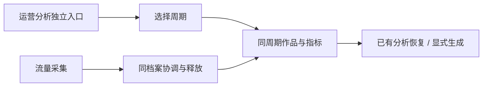

# T-966 运营周期与采集恢复

用户实测：分析返回前言加JSON围栏直接展示源码；作品表固定近7天；要求所有作品区域与留存选择跟随所选周期。运营从首页移至自动化上方独立导航。流量来源采集持续报“浏览器登录档案仍被其他操作占用”。

保持既有任务/账号/日期作用域与分析记录。读取已有输出，机械提取唯一明确协议JSON并严格校验归属；普通正文保留，歧义/错源不冒充当前分析。统一周期作品，禁止混入固定7天；指标口径待用户确认累计或期间新增，缺历史快照不伪造增量。导航调整使用现有daily-report路由，移除首页卡片。

采集先定位持锁者与锁释放链，再修复并发协调/释放；不得删除活动锁或关闭用户无关浏览器。验证真实调用链可运行及失败后可恢复，不能把改报错文案当修复。完成测试后提交并更新本机包。

## 独立评审与验证

周期UI独立评审确认保持daily-report路由，侧栏运营分析紧邻自动化上方，移除首页卡片；周期内作品与留存均使用report.works，产品Select替换原生select；累计口径不伪造增量。分析不再自动夹带固定7天参照。

浏览器独立评审复现宿主在Chromium guard排队前先acquire DB租约，导致并发立即Busy。改成最多60秒等待实际释放，支持Abort及真实停止后释放失败重试；不TTL抢锁、不关闭用户无关浏览器。20项真实PGlite/公共guard生命周期测试通过，含并发、取消、超时、跨宿主与关闭失败恢复。

真实安装版CLI重试用户原作品project-ed64285a-63成功：任务ai-task-147356b4-351 succeeded；traffic.get于2026-09-13T08:39:54.350Z读回推荐页90.3%、朋友页3.3%、主页3.1%、关注页2.5%、消息/搜索各0.4%。证明此次不是永久旧宿主锁。跨重启随机宿主遗留锁仍需停止证明，未扩大到无证据清锁。

通过公开CLI读回两份真实已生成分析（chat:ai-msg-147356b4-69、chat:ai-msg-147356b4-73），一份前言加裸JSON、一份前言加围栏JSON；新解析均通过账号/日期/源快照/作品ID校验并恢复1张作品卡，不发新模型请求。协议红测3失败后修复，前端10文件90测试通过，frontend tsc通过。原始用户全文仅存/tmp、不提交仓库。
