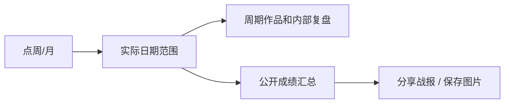

# T-967 周期切换与对外成绩战报

用户五项反馈：点击周仍只1作品且日期仍单日；移除左上首页面包屑；移除右上保存图片重复入口，保留分享战报；分享内容从内部复盘改朋友圈成绩汇总；去掉pub ID、profile_visits、Position、Hook等内部字段和编导黑话。

点击单天/周/月立即提交锚定现有日期的单日/自然周（周一至周日）/自然月，模式/URL/作品/分析scope同源。自定义只打开范围选择，页面有效周期始终清楚。历史导航也须匹配日期模式，旧单日分析不能冒充周分析。

分享战报完全不消费analysis/rawAnalysis/定位/稿件/诊断/实验内容，仅展示所选期间发布作品累计播放、作品带来关注、互动与作品亮点，真实缺值标暂无，部分覆盖说明，不伪造“爆款”判断。总关注是各作品follower_gain归因，不冒充账号净增。最多代表作品清单，可用明确的播放排序，不作内容优劣推断。二维码维持购买官网。预览与PNG共用绘制数据，保存仅分享页内一个入口。

分析提示词要求大白话、短标题和简短总结，ID仅出现在机器绑定字段，中文指标名，不由单一比例推断人群/冷启动或因果。现有结果中的精确标识符/字段做显示翻译，不能用关键词算法伪造运营判断；必要折叠详细分析保持页面可读，原记录不改。既有真实结果与真实周数据用于回归。

## 验证记录
- 周模式旧断言已先红测；修复后日/周/月切换、模式回读通过。完整daily-report 9文件36测试通过，前端tsc通过。
- Ego TaskSpace7真实点击周：单日9/12导航到startDate=2026-09-07&endDate=2026-09-13；标题/日期/分析scope同步，无面包屑和重复图片按钮。浏览器使用隔离布局账号，不冒充用户真实作品数。
- 安装版公共CLI真实账号读取9/7–9/13共5作品；9/1–9/13共6作品。证据/tmp/t967-real-week.json，不提交私有完整数据。
- 分享页真实点击保存获得2160×3636 PNG，已目视检查，Vision识别二维码为https://buy.aitongban.cloud/。公开模型及导出测试覆盖内部分析不泄漏、缺值/0区分、长标题。
- 旧分析机械标签翻译已测试；新提示词本轮未做真实模型效果验收，不将之描述为模型复盘质量已完全验收。
