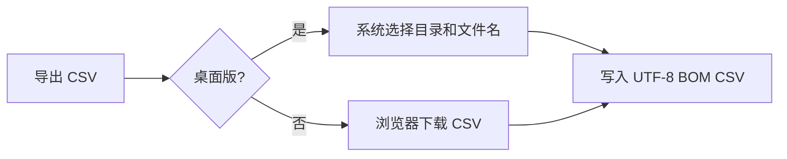

# T-968 日报导出与日期回归修复

用户反馈日报页首存在明显空白；“导出数据”不应下载 JSON，而应在 CreatorOS 桌面端打开系统保存对话框，让用户在 macOS 或 Windows 选择目录与文件名，并导出可直接打开的 CSV。网页环境没有系统目录选择能力时，只能使用浏览器下载作为明确降级。

项目排期在未设日期时打开日期控件出现 `Invalid Date`，根因是空字符串被传入 Dayjs。日期控件必须把空值当作未选择日期，以当天作为面板锚点，不能将无效日期渲染到月历。

日报继续使用同一份真实 report 数据。CSV 包含所选期间、账号、作品标题、发布时间及可用作品指标；空值保持为空，不伪造 0。保存取消不报错、不下载。PNG 战报不受影响。

## 验证

- 日期控件空字符串回归、排期保存链路、日报 CSV 内容与页面按钮共 26 项测试通过；前端 TypeScript 检查通过。
- 原生壳 `cargo check` 通过；保存面板和 CSV 写入在同一个受限原生命令内，桌面权限仅允许该命令。
- CSV 用 UTF-8 BOM、双引号转义和 CRLF 行结尾，空指标输出空单元格。系统保存面板取消时返回成功的“未保存”状态，不触发浏览器下载。
