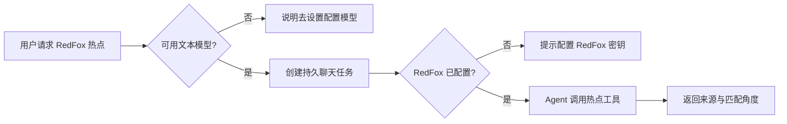

# T-969 修复 AI 助手 RedFox 热点任务空配置卡死

用户在 AI 助手输入“使用 RedFox 帮我分析今天的爆款内容，结合我的定位”后，页面显示“结果尚待核对”。原任务 `ai-task-4365279c-8993-4772-9c4e-9f1e29633faf` 经公共 CLI 回读为 `runtimeStatus=unknown_result`，但没有任何执行步骤、结果或模型开始时间，且 `modelKey` 为空。它没有实际发起 RedFox 查询，不能把它描述成 RedFox 上游未知结果。

修复目标：模型凭据在 Worker 取得前失败时，稳定映射为 `waiting_user`，不再把未发生模型调用的任务标为 `unknown_result`；已配置文本模型和 RedFox 密钥时，热点查询经 Agent 工具循环真实执行。RedFox 返回额度不足（3201）时，稳定映射为 `REDFOX_QUOTA_EXHAUSTED` 并要求用户补充额度，不误报“结果待核对”。工具失败保留原任务，不自动重提。RedFox 查询只读，不写入定位、选题或稿件。

## 验收

- 空模型配置不得进入 `unknown_result`；页面显示可恢复的模型设置引导，且不发起供应商调用。
- 模型可用但 RedFox 未配置时，不误报“结果待核对”。
- 已配置的真实调用只在用户原任务上恢复或读取，不新建重复请求。
- 相关前端、后端/Worker 和契约测试通过；真实调用只在配置可用后验证并保留任务 ID。
