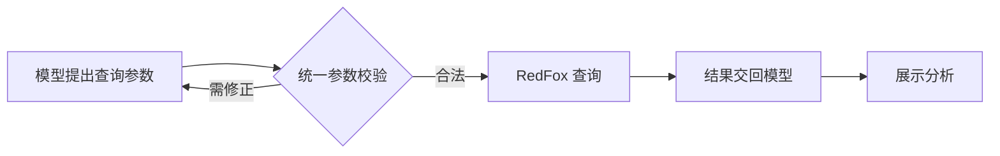

# T-970 RedFox 工具参数与聊天执行恢复

用户在新版再次提交热点请求仍中断。北京时间 2026-09-13 22:44:05 安装版日志明确记录 prepareChatRedfox 抛出 ZodError；原执行任务已有模型 checkpoint。T-969 用业务投影空字段推断未调用模型的结论撤回，成功聊天也存在这些空字段。

范围：核对模型工具声明与实际执行参数校验；在外部操作前将非法参数作为可修正工具反馈交回 Agent；保持账号、执行权、原任务与付费提交幂等边界。不得把参数失败冒充外部未知结果。无数据归属或架构调整。

验收：复现声明允许、执行拒绝的输入；统一契约并覆盖六种动作；验证参数错误可回到模型循环且没有外部请求；真实安装版同一用户意图返回工具结果与最终分析后才记成功。打包与启动不能代替聊天验收。

