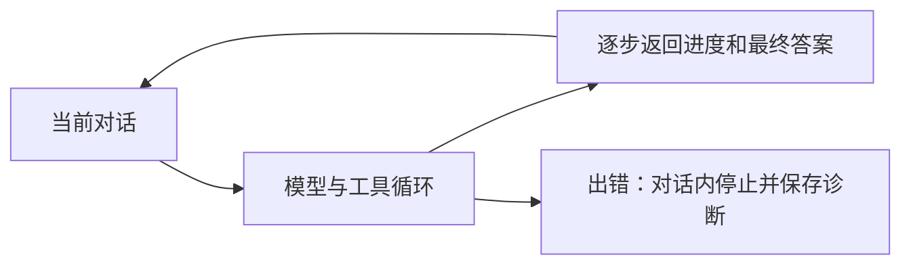

# T-976 AI 助手在对话内完成 RedFox 查询

用户明确要求不要做成异步任务交互。截图请求“结合redfox热点和我的定位，帮我推荐选题”再次变成结果待核对。

先核对本次安装版日志与原执行记录。修复真实故障、错误分类及当前对话内持续等待/流式结果/停止操作。用户不负责手动刷新对账。底层执行是否需调整以证据为准，不以改提示词假装修复。不得重复未知付费提交或覆盖内容。当前请求授权真实同意图功能验证。

验收：失败根因可复现；用同条请求验证热点工具与最终推荐都返回当前对话；失败显示可理解的真实原因；取消可终止等待；不以build/单元测试代替安装版完整调用验证。

## 已确认事实与修复范围

- 原执行 `execution-task-aab25131-7d60-4b9c-a4eb-a38bc2998eee` 第一轮模型约1.4秒后进入 `MODEL_RESULT_UNKNOWN`，无工具调用，尚未请求 RedFox。原供应商异常被 Pi 适配器转换成固定错误码，具体原因不能从历史记录恢复；不能编造为额度不足或密钥错误。
- 现配置连接测试、原输入首轮模型、安装版 Worker 首轮模型均成功。通过正在运行的安装版 `/api/chat` 重现同意图，真实 RedFox 热榜→评论→选题候选→最终文字完整结束，证据 `docs/research/evidence/t976/installed-chat.json`。
- 交互修复：按任务 kind 排除聊天的后台通知；未知模型回复在对话内显示中断，不要求手动刷新任务；保持当前 SSE 等待工具和最终答复，停止按钮仍提交取消命令。
- 诊断修复：Pi 异常日志保留脱敏原因、HTTP状态和是否已出流；不记录请求/密钥，不改变未知付费调用的自动重试边界。托管模型仍不公开供应商细节。
- 本次真测发现模型向热点查询误传 keyword；补充动作参数说明，热点查询与按关键词搜索职责明确，语义选择仍由模型负责。

## 验证记录

前端86测、Worker16测、RedFox工具3测通过，Worker与前端类型检查通过。真实调用成功发生在旧安装包，修复后安装包尚待构建及验收，不能混为同一证据。
物理边界检查仍有已有7条（基线5，live-chat-session.ts 的2项未触碰）；不以本任务洗绿。历史具体上游异常缺失，尚不能声称原始故障已根治。
