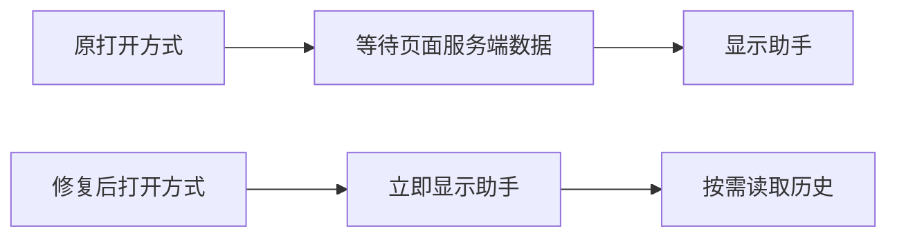

# T-977 AI 助手打开卡顿

用户反馈经常点击后卡半天打不开。先测真实安装版入口导航、会话与任务读取、历史渲染，按证据修复；不调用模型验证“打开速度”，不删除历史、不重提旧任务。属于既有交互性能缺陷修复，不改变架构和数据归属。

验收：打开及关闭不等待无关页面服务端数据；入口、键盘关闭、前进后退及专用入口参数仍可用；慢历史请求不挡助手框架，现有会话和正在生成内容保留。记录真实耗时及测试限制。

## 证据与实现

- 安装版浏览器点击侧栏入口确实产生 `?copilot=open...&_rsc=...` 请求。无账号数据的浏览器初测105ms；对RSC请求注入2000ms延迟后，助手2778ms才出现，证明弹窗被页面导航拖住。此为受控延迟实验，不冒充用户本次真实耗时。
- 将本次编译后的同页导航函数注入同一安装版浏览器（保持相同延迟），打开39ms、RSC请求0；返回关闭、前进重新打开均成功。实验后移除注入及额外请求头。尚未重新打包，因此不声称用户当前安装文件已改变。
- 同页助手链接改为native history更新URL，Next的useSearchParams仍同步；跨页、不同筛选、外链、组合键仍保留正常导航。关闭也不请求服务端。全局入口禁用预取。
- 工具详情展开后才序列化；Markdown按文本memo。完整历史和模型消息未裁剪、不丢会话。

## 验证

76项前端测试通过，包含打开导航规则、关闭与Escape、专用参数清理、工具折叠不读取输出、既有聊天交互；前端类型检查通过。浏览器实测是同一生产页面注入候选导航函数，非完整新安装包验收。测试未记录先红后绿，不补造红测。

全局reconcile仍为233项既有失败（与本轮前相同，主要为旧任务自主执行声明及项目门配置），本任务不声称全局全绿。代码修复与浏览器导航验证完成；安装包更新仍属于T-976未完成交付。
