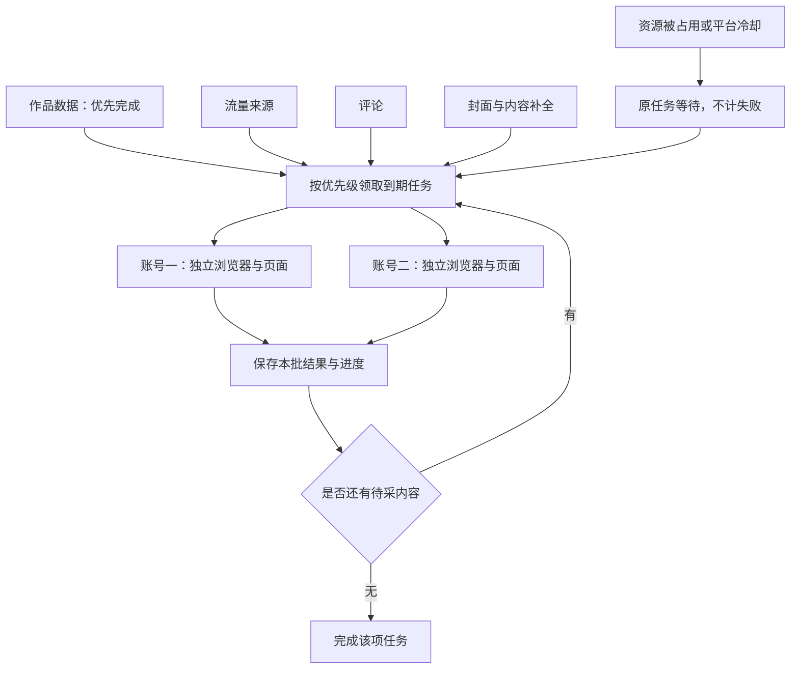
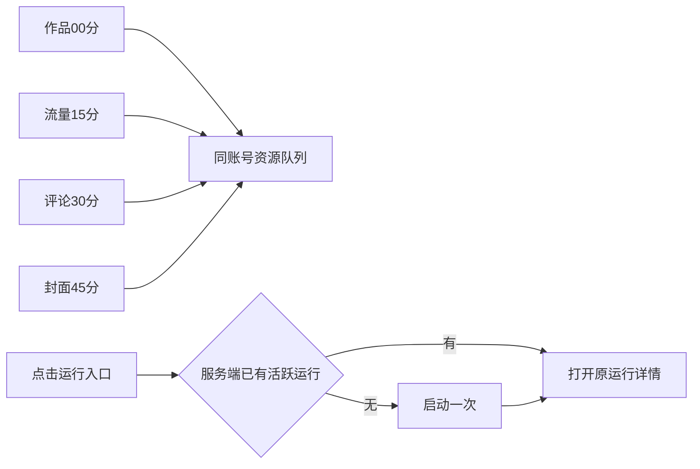

# T-983 根治自动采集调度与恢复连续失败

## 用户目标与已确认决定

2026-09-14 用户反馈升级后自动采集连续失败，要求同时检查用户日志与本机日志。T-982 已留存诊断证据。用户随后明确“不一定非要回退，要把问题根治”；再次明确“这种任务可以让它慢慢跑，不应该限时”，并要求从全局设计浏览器并发与资源管理。用户最终明确“还是得把任务拆开，任务是有优先级的……不能放一起”。据此保留已采数据和历史记录，前向迁移为四项独立任务，不整包回退。最终决定覆盖此前保留统一同步的中间方案。

采集作品多时允许持续分批运行，不因整项任务经过30分钟或固定次数而失败。保留成功进度，资源占用时原任务等待；用户可以停止，应用退出后可恢复。单次网络请求、浏览器启动仍可有超时，用于识别卡死，不把局部超时等同于整项失败。

## 根因与实施范围

- 活跃的持久采集被旧清扫器遗漏，运行超过30分钟误标失败。根据真实执行状态保护活跃运行，仅修复明确由 stale-run 造成的错误显示。
- 新计划去重到旧执行，却把旧执行绑定给新父计划，导致重复失败。跨计划跳过，同计划恢复原绑定；错误回退分支遵守相同规则。
- 流量定时运行丢失 scheduledFor；保留真实计划时间，手动运行仍为null。
- 旧任务缺少授权快照时应明确终止该不可恢复任务，保留结果，继续恢复其他合法任务；不能编造授权快照。
- 浏览器被占用属于资源等待：首个占用即保存进度并退避，不继续对整批作品逐一失败。恢复同一任务、执行、运行记录。
- 浏览器资源按账号与实际登录档案隔离，不是全系统只有一个浏览器。检查多账号并行、同账号会话复用、登录操作与采集协调、关闭释放及崩溃后恢复。新增资源架构需独立评审后实施，不能复制正在使用的档案冒充并行，不能按TTL抢占仍活跃的浏览器。

## 独立任务与资源调度

| 任务 | 默认优先级 | 独立执行范围 |
|---|---|---|
| 作品数据自动同步 | 100 | 作品列表及基础指标，不等待评论、封面或模型归因 |
| 流量来源自动同步 | 80 | 各作品来源详情，持久队列逐批继续 |
| 评论自动同步 | 40 | 每批最多20个作品，已完成作品按成功水位跳过 |
| 封面与内容补全 | 20 | 每批最多10张缺失封面；内容转写沿既有独立任务队列 |

四项各有开关、计划、运行记录与错误，默认每两小时唤醒。按作品年龄保留2/6/24小时增量策略。优先级决定下一批领取顺序，不强制中断正在读取的浏览器请求。每批完成或需要等待时交还槽位。不同账号最多两路并行；同账号避免后台任务互相抢页，探针和采集可共享浏览器但各用独立页面。登录操作在同账号借用队列排队；关闭失败不释放实际仍占用的档案。

迁移0098恢复被合并的四类作业，沿用旧ID、尊重当前总开关和能力开关，不复活用户主动关闭的未知历史任务。旧的已冻结合并执行不改输入；新独立任务正常入队，由同账号资源锁控制实际串行。拆分版本仅在新计划中排除旧合并运行的同作业去重，原计划重放及新独立任务自身在途去重保留；普通资源等待不挡其它新任务入队。手动请求仍经账号资源调度保护。新增cover成功/失败水位及数据库约束，坏封面有独立重试时间，不阻断其它作品与任务。

## 验收与边界

保留近7天每2小时、7至30天每6小时、30天外每天的成功水位策略、账号归属、开关与采集结果；通过前向迁移拆分配置，保留历史与原执行。真实执行未结束时不按任务总时长判失败。验证跨计划去重、同计划恢复、无效旧任务隔离、超过1000条作品分批恢复、资源等待不产生失败作品、等待退避后同ID续跑，以及多账号不共用同一物理档案。浏览器清理仅释放已确认实际停止的资源，不强杀其他活跃窗口。

最终拆分与浏览器资源方案已独立评审，源码复审和集成验收继续进行。记录实际落地与验证范围，不把设计当实现。跨宿主崩溃后遗留租约只允许依据确凿停止证据恢复，不按时间强抢。

针对改变的公共调用链运行回归与类型检查。真实采集、Mac/Windows真机、安装包发布分别记录验证状态，不以fixture替代真实采集。全局reconcile既有失败须如实记录。本次未授权自动发布新安装包。

## T985安装版实测遗留（待定位，不扩大T985修复）

T985在本地包b3fc63ae成功修复61张封面漏补、原租约占用与任务等待假进度。公开analytics.traffic.get回读69条记录：32条成功，37条失败均为page.waitForFunction: Timeout 15000ms exceeded.；独立流量实际新增更新21条后诚实失败，旧合并任务已落账到明确终态。需继续定位详情页数据就绪条件/单页等待边界，以真实作品验证；不能用增加整任务时限或重复提交掩盖。证据见docs/verification/t985-local-collection.md。T983保持未完成。

## 用户追加确认：详情超时、错峰和运行入口（2026-09-14）

用户明确要求修复T985留下的37条流量详情超时；两小时采集任务错峰；立即运行在已有活跃任务时查看原运行，无活跃任务时触发一次并打开运行情况。沿用T983，不新增并行任务真相。

默认每两小时：作品00分、流量15分、评论30分、封面45分（北京时间）。同账号按真实资源和优先级排队，不强制打断当前批次。新默认与由合并迁移形成的同刻2小时计划采用错峰；用户明确自定义的非默认计划不覆盖，关闭状态、作品2/6/24小时水位和历史不变。不得只改文案而真实调度仍同刻。

“立即运行”入口：读取当前服务端活跃run（含排队、资源等待）；有则打开运行详情且不重复触发，没有则幂等触发一次并立即打开详情。界面可以显示“查看运行”，但最终判定以服务端当前态为准；双击、多窗口和轮询过期不得创建重复运行或打开别的账号任务。慢请求限制在途，切换对象与卸载防回写，运行LED-047及相关回归。

详情页先通过真实失败作品确认数据就绪条件，分清请求中、无数据、登录或平台限制，不用统一15秒DOM等待把合法内容全判失败。保留已成功数据，实际恢复原失败作品后再验收。

本轮验收包括真实失败作品恢复、默认计划实际错峰、新老任务去重及运行详情入口公共链路回归，随后本地包实际验证，不公开发布。

真实页面取证：已登录Ego浏览器同账号对照两条旧作品（7648622692182134016、7644960189820489012）与近期作品7683770599029640448。旧作品流量分析选中且两张指标卡数据和“更新至”日期完整，没有流量来源卡/表；近期作品来源卡先出现、表格随后加载。兼容规则依据已观察到的页面结构，不按作品年龄猜测可用性。

契约增加unavailable，表示已确认平台页面未提供来源；保留历史data/capturedAt，尝试时间控制正常增量间隔，不计失败/新增数据。未知结构、加载中、来源卡已有但表未加载、登录/验证码仍不能降为unavailable。此范围为用户授权修复的必要状态表达，经独立审查边界通过。
