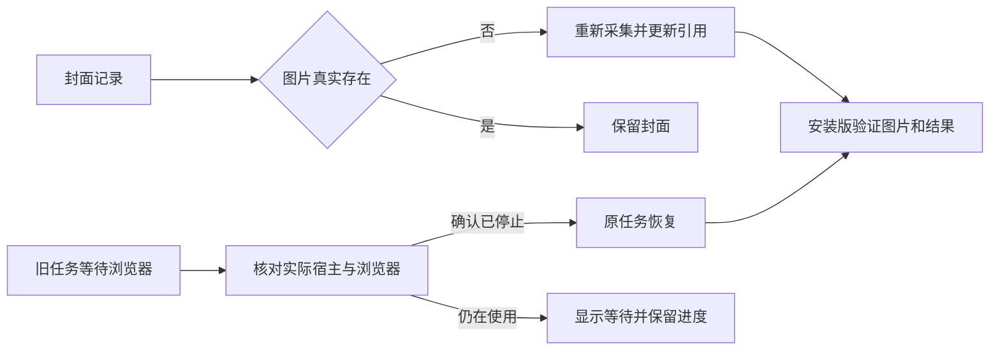

# T-985 修复失效封面漏补与旧采集任务恢复转圈

用户明确授权“那你修复啊 并自己验证修复好了”。继承T983的四任务拆分、优先级、同账号资源保护、无整任务总时限；只修复T984本机验收暴露的两类缺陷，不改其它产品功能、不发布。

证据见`docs/verification/t984-local-collection.md`：三个旧封面素材记录存在但公开图片HTTP404，新包回填候选0且标成功；旧合并执行持续fetch/queued并报浏览器档案占用。

## 行为与验收

封面检测必须覆盖记录存在但本地文件缺失，复用合法外部作品ID重采并更新引用，保留用户其它素材；每批计数和剩余任务要真实，不能用一批完成冒充全部完成。

浏览器仅基于明确实际停止证据回收旧宿主租约，不能按TTL强抢或杀未知进程；继续同一合法采集任务，等待状态不伪装抓取进度。升级后旧合并任务不能饿死独立任务。实现先证伪回归测试，经独立审查确认恢复边界后落实。

验证：针对失效封面、仍活跃浏览器不能抢占、旧宿主已结束可恢复、原任务等待和队列公平的公共链路回归；本地包启动后通过公开CLI核对真实账号、原任务终态与可打开封面，不能用fixtures代替本机验收。版本仍1.2.0，安装前保留备份。

## 2026-09-14 独立评审与实现记录

用户在本轮明确授权修复并实际验证。浏览器恢复仅在正式桌面宿主依据完整OS进程、启动身份和目标档案浏览器证据确认已停止后，用完整原租约receipt事务比对释放，不按时间强抢、不杀浏览器。封面探测复用Assets端口，未知逐项留待重试；当前版本CAS与账号约束避免覆盖用户刚修改的封面。

独立评审指出并修正单张存储故障阻断全批、CAS账号条件缺失。另以本机OS数据发现进程标题next-server不能当二进制路径，已按真实execPath与产品运行目录修正，独立终审通过。正式Next在业务初始化前改进程标题的部署证据纳入回归；全量OS探针确认11个CLI中继不会误挡。

源码验证：封面/出版/独立补全48项与封面runner17项通过；等待进度公共调用链66项、界面45项通过；frontend类型检查通过。后端14项既有测试类型债务保留。安装版结果另记真实验收，不由单测代替。

冻结前复核：浏览器58项、封面完整链50项独立复核与48项主测均通过；前10未知不阻断后2缺失的完整注入探针通过。打包预检42项通过。pmem sync完成，reconcile的LED-048通过，仍有233项既有全局流程漂移（模块write_set/verify缺失等），不得写为全局绿。
