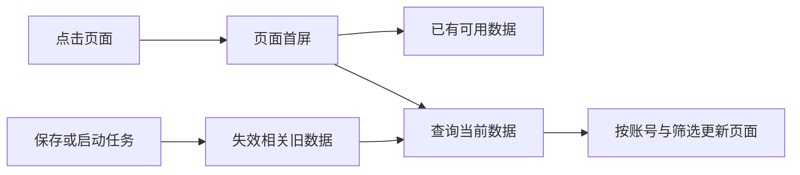

# T-987 主页面打开卡顿

用户反馈各页面打开仍卡顿，点名自动化、发布中心，怀疑缓存未复用。本轮聚焦页面导航和首屏读取，不改采集任务的执行策略、内容逻辑或数据归属。

## 目标与证据

先测当前安装版首次进入、离开后返回与业务查询耗时；区分路由等待、后端读放大、客户端渲染和缓存失效。结合现有T941/T977/T978/T983性能修复，复查共同导航与这两个页面的装配链。不得只加长缓存时间掩盖慢查询，或删除数据、历史、合法操作提速。

查明瓶颈后复用已有缓存与查询服务，按真实用户、账号、筛选范围隔离；业务写入后能及时失效，运行状态保持实时读取。重入请求限制在途、切换账号和筛选防过期回写。涉及服务契约或共享缓存生命周期变化，先补具体设计及独立复核。

验收包括实测前后耗时、重点页面真实查询、慢请求/返回导航/变更后刷新/账号隔离回归及LED047；证据不足的界面操作和平台不标为通过。必要时沿已授权本地打包入口更新安装版验证，不推送、不公开发布。全局既有流程漂移单独保留。

## 已定位与实现边界（2026-09-15）

真实安装版显式账号SSR读取：自动化84/33ms，发布中心276/122ms；CLI作业列表253/223/229ms（含CLI开销）。这些不是原生点击到可交互。源代码交叉检查确认：发布中心绕过展示缓存、七日趋势读取全部历史快照、客户端收到未使用的全量作品列表；自动化串行读作业与账号，运行分页为计数读全部历史ID。

采用最小组合：
- 发布中心只缓存作品表现汇总，复用现有页面缓存的容量、在途、版本前后核对及写入失效；key含用户、账号、时区与当天日期，最长30秒。日历及用户时区每次实时读取，配置/排期不依赖新增缓存；不增加新数据库或缓存层。
- 趋势SQL选择最近days+1个实际采样日及每作品每日最新快照，保留稀疏日期、漏采与差分语义；不把最近采样日偷换为now减七天。
- 自动化配置仍实时读，两路并行；运行记录计数使用SQL count。列表轮询隐藏时暂停、重新可见立即刷新，空闲15秒/运行中4秒；按钮仍向服务端确认真实运行。
- 发布中心按一次投影复用日期格式化器，只给客户端传使用字段；现有缓存不跨账号复用，失败/失效在途结果不回填。

独立只读复核：t971_controls与t985_task_diagnosis共同指出上述放大点。缓存方案动代码前再复核，不改变产品功能、数据归属、采集调度或公开契约。

## 实机复测发现的共同读放大（同一任务补充）

首轮候选16990165已本地安装，发布页温热返回中位数由132ms降至27.2ms，响应146564→89566字节；自动化25.5→30.3ms，未证明其首读提速。启动期间日志另有至少306条assets.usage.list慢读（380–635ms），此前测试未主动进入素材页。

源码确认素材页面一条素材发一次用料查询、Promise.all无并发界限；侧栏11个可见导航使用Next默认预取。预取是否解释该次启动全部查询仍待证，但这两个路径能制造不必要争用。补充最小修复：主导航禁用自动预取（保持真实导航/pending反馈）；素材用料历史复用已有materialLinks.list按100条分页，只保留当前画廊真实素材ID与asset类型，不改变权限、归属、公开契约或画廊完整性。无素材不查关联；关联读取失败不阻断画廊。用1000素材/跨3页关联测试及新安装版冷启动日志验收；不宣称已验证原生点击时延。

独立只读复核 t985_task_diagnosis：资产ID过滤与旧反查语义一致；按createdAt+id稳定排序防止同时间戳跨页遗漏。批量列表计数复用SQL count，不读取全部ID。
