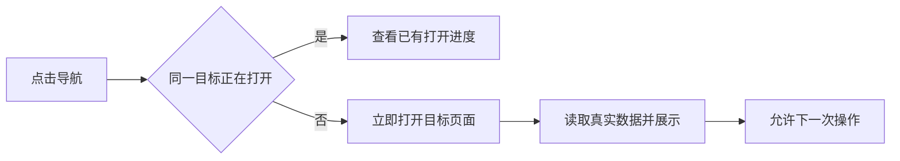

# T-988 首页等待与连续导航、用户文案

用户确认上一轮改善，同时反馈首页仍卡顿、连续点击更加卡，要求检查防抖，并清除“PATCH /me，真持久”等实现术语。本轮在T987安装版上复现首页真实导航，排查首页投影、二次装配、路由重复提交与状态反馈；不得以HTTP耗时代替界面可用证据。

按已确认功能修复，不改产品方向、数据归属、采集调度。首次点击应立即响应；同一目标在途点击合并，不用延迟每次点击的固定防抖增加等待。切换到不同目标仍可操作，失败或取消后可以重新进入；同路由不同筛选不可误吞。首页昂贵读取复用既有有界/按账号/数据变更失效机制，保留真实数据与操作。

用户文案只描述功能与结果，清理可见的HTTP方法、内部表名、真持久/fixture等开发说明；保留设置所需的API Key、服务地址等必要信息。复查设置和常用页面同类可见文案，不改变内部标识和接口。

验收：保存等真实行为不变；首页首次/返回、同目标连点、不同目标切换、错误后重试和账号隔离；针对请求次数/同一计算并发复用的确定性回归；LED047/049；按已有本地安装授权更新并验证，原生/WebView无法实测的部分明确保留未知；不发布不推送。性能重复反馈先做有界证据诊断，不能重复盲改缓存。

实现落点：主导航通过真实React过渡与完成token合并同目标请求，不依赖loading文案或固定延迟；不同目标替换当前意图，账号变更清理旧意图。首页最近发布在publishing service既有读取缝先按允许ID筛选与展示数量截断，再解析版本标题，当前版本/最高版本/作品名回退原样保留。首页同请求共享导入判据、独立读取并行；仅analytics汇总/趋势通过既有有界版本缓存复用，动态待办、排期、粉丝基线实时读取。内部service新增可选筛选参数，不改公共HTTP契约。可见话术清理覆盖设置、自动化、导入弹窗、知识图谱。
