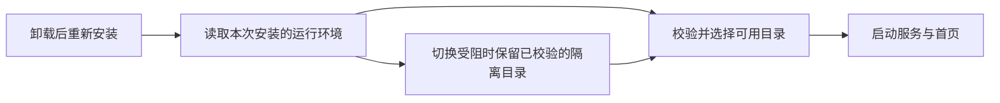

# T-992 Windows 升级启动运行环境切换拒绝访问

用户卸载旧版后安装 1.2.0，首次启动仍在 AppData/runtime/1.2.0/sidecar 的原子切换处收到 Windows 拒绝访问。解密 sidecar-2026-09-15.log.enc 后确认，失败发生在完整运行环境已经解压完成、准备把隔离目录切换为正式目录时。日志没有证据表明旧版进程仍在运行，因此不能把问题归因给用户，也不能靠重试安装解决。

修复后的启动规则：安装期仍必须把运行环境写入正式目录并完成严格校验；启动期若 Windows 暂时不允许目录改名，则保留本次已解压目录，重新校验入口哈希、完整性样本和版本标记后直接从该目录启动。后续启动优先复用已完成且重新通过校验的隔离目录，损坏或不完整的候选不会被采用。整个过程只处理可再生成的 runtime，不清理用户数据库、授权信息、素材或业务数据。

现有 T991 验收只覆盖干净目录的安装、启动和卸载。本任务增加已有 runtime、同版本重装、损坏候选、缺失指针和 Windows 原生文件占用回归。正式结论必须同时满足 Rust 全量测试、Windows 原生锁测试（需在 Windows 开发机上跑，不在发布流水线内）以及新安装包的安装、启动、首页加载和卸载验证。

## 本地验证

- `cargo test --manifest-path frontend/src-tauri/Cargo.toml --lib --no-default-features`：181 通过，1 项真实外部服务测试按原规则忽略。
- Windows 运行环境专项：15 项通过（macOS 本机；第 16 项原生独占文件句柄测试带 cfg(target_os = "windows")，本机不编译，未验证）。该组测试不进发布流水线——排在 sidecar 与 externalBin 产出之前会让 tauri_build 资源校验 panic（run 34942593764），守护改由本地 reconcile LED-057 承担。
- 桌面打包与签名契约：42 项通过。
