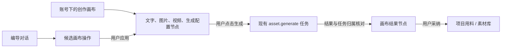
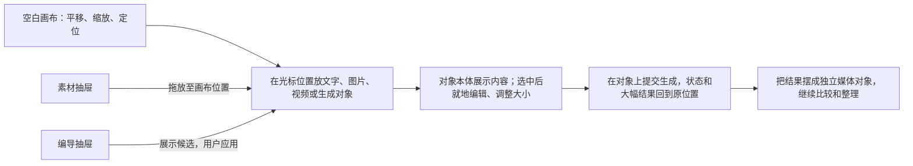

# T-993 · 编导智能体创作画布

状态：基础生成能力与账号独立画布归属均经用户 2026-09-28 确认；原方案独立复审 `PASS[REV:940cde16235e]`。用户批准的新评审周期已对 MIT 开源无限画布修订完成独立复核，第二轮 `PASS[REV:290c5bca2b4d]`；实施验收仍按下文逐项记录。日期：2026-09-29。

## 一句话

用户在同一张可保存的无限画布上摆放想法、图片和视频，向编导描述目标，查看编导提出的操作并自行应用；从节点发起的生图、生视频任务完成后，结果回到原节点，用户再决定是否纳入项目用料。

## 目标与边界

1. 画布属于当前账号，是一份独立、持久的创作文档；可选关联一个当前账号内的项目，用于带入编导上下文和后续采纳。没有项目时，仍可整理画布和生成素材。画布不是项目阶段、视频时间线或发布编辑器。
2. 从全局“创作画布”进入画布库；编导对话提供“在画布中打开”入口，带当前项目上下文时只预选项目，不暗建画布或自动提交生成。
3. 支持平移、缩放、拖动、框选、连接、删除、撤销/重做、节点重命名和保存状态。节点类型：文字说明、图片素材、视频素材、图片生成配置、视频生成配置。连线表示用户整理的来源/去向，不自动执行整张图。
4. 可从当前账号素材库把真实图片/视频插入画布；画布保存 `assetId` 与插入时观察到的 `fileId/checksum`，不保存浏览器 URL，也不复制媒体字节。预览时通过服务端当前文件读取并提示版本变化；生成提交时重新读取并冻结实际使用的文件 ID 与 checksum，执行时按该冻结版本取字节并复验，不用已变更的当前文件替代。
5. 基础设施先完整接通文生图、参考图生图、文生视频、首帧图生视频四种模式，然后画布复用同一任务链。每个模式只在所选模型与供应商适配器确实支持、图片引用可读取时开放；不能把图生图降级为文生图，也不能把图生视频降级为文生视频。显示当前模型、参数、成本提示（仅真实可取得时）、任务状态；都通过既有 `asset.generate`、执行账本、多模态适配器和候选素材链。
6. 任务以 `{accountId, canvasId, nodeId, taskId}` 绑定；结果可追溯到输入版本、模型、提示词和真实资产。任务结果只写归属索引与既有候选账本，不由异步回调修改画布文档或 revision。仍存在的配置节点从归属索引读取并展示结果；已删节点的结果留在画布生成历史，用户可显式重新插入。刷新或重启后从同一任务恢复。重复提交、晚到回调、删除节点和切换账号均不得把结果写入错误画布。
7. 编导仅产出带真实节点/素材引用的候选图操作和解释；候选绑定 `canvasId`、`baseRevision`、稳定 `proposalId` 和操作 ID。前端展示差异，用户点击“应用到画布”后由后端在一次事务中校验全部权限、版本、节点和素材引用，再一次性保存。重复应用返回同一结果；过期版本返回 409 并让用户重看候选。编导不直接写画布或项目用料。
8. 生成素材可先留在当前画布；“加入项目用料”须在关联项目内通过现有采纳入口执行。用户可显式导出/下载所选结果。删除画布时区分画布文档与已入库素材，不误删被其它项目引用的资产。

## 参考项目结论

| 来源 | 借鉴 | 在 CreatorOS 的落点 |
| --- | --- | --- |
| 媒措创流 `mccl/media-content-flow` | 账号物理隔离、助手渐进交互 | 复用 CreatorOS 当前账号归属守卫，不迁移其数据库或视觉风格；该项目当前没有可直接移植的画布模块。 |
| NomiFun `nomifun-desktop` 创意工坊 | 画布作为独立文档、revision CAS、节点任务归属、任务恢复、助手显式应用 | 借鉴数据和交互边界；不复制应用代码、品牌、资产和私有数据。CreatorOS 自有 schema/服务契约仍是唯一真相。 |
| [basketikun/infinite-canvas](https://github.com/basketikun/infinite-canvas) | MIT，图片创作、参考图编辑、生成结果连续迭代的媒体画布 | 选作广告营销画布的交互与前端组件来源；只移植明确可复用的画布层并保留原版权声明，接入 CreatorOS 原有账号、素材、生成任务与保存服务。 |
| [Loomic](https://github.com/fancyboi999/Loomic) | MIT，基于 Excalidraw 的图片/视频创作与 Brand Kit | 参考广告创意的构图、版本并排和视频嵌入；整套 Next/Supabase/Agent 不引入 CreatorOS。 |
| [gpt-image-canvas](https://github.com/mrslimslim/gpt-image-canvas) | GPT Image 2、参考图、画布规划的直接案例 | 参考 GPT Image 2 创作流程；其画布依赖 tldraw，生产部署需独立许可，不直接移植该画布代码。 |
| [React Flow](https://reactflow.dev/) | MIT，React 节点与连线交互 | 已实现的节点图可作为现有数据与回归基线；不再把它作为最终广告创意画布的视觉和交互答案。 |
| [Excalidraw](https://github.com/excalidraw/excalidraw) | MIT，成熟白板内核 | 可作为自由绘制能力候选；自定义媒体/生成对象需额外场景映射，目前不替代主要媒体工作区。 |
| [tldraw](https://tldraw.dev/community/license) | 功能完整的无限画布 SDK | 生产环境需相应许可；当前商业产品先不以其为基础。 |

## 领域模型与服务契约

新增 `creative_canvases`：`id`, `user_id`, `account_id`, `title`, `project_id?`, `document_json`, `revision`, `created_at`, `updated_at`, `archived_at?`。`document_json` 含 `schemaVersion`, `viewport`（旧数据/首次打开的初始视角）, `nodes`, `edges`；节点为判别联合，媒体节点用 `assetId` 引用，配置节点只存安全的模型标识与参数，不存密钥。节点含有界的可选画布尺寸，旧文档缺尺寸时由前端按类型显示默认值，不做破坏性迁移。节点和边数量、文本长度、尺寸、媒体引用数由 contract 限界。平移、缩放后的个人视角按 `userId/accountId/canvasId` 存在本机 UI 偏好中；它不属于画布共享内容，不走 `canvas.save`，不推进内容 revision。读取不到偏好时使用文档初始视角或适合内容；切换账号不得读取上一账号的偏好。

新增 `canvas_generation_links`：`user_id`, `account_id`, `canvas_id`, `node_id`, `attempt_id`, `task_id?`, `input_revision`, `input_digest`, `reference_file_id?`, `reference_checksum?`, `result_asset_id?`, `created_at`, `updated_at`。`attempt_id` 与非空 `task_id` 各自唯一。这里仅保存提交意图、归属和恢复索引；真实执行状态由现有 execution/AI task 账本拥有，不创造第二套执行权。异步完成只更新任务结果和此索引，不修改 `document_json` 或 `revision`。节点还在时，页面按 `canvasId + nodeId` 叠加显示多次生成历史和最新结果，并标出结果对应的旧输入版本；节点已删时，只在“生成历史”中显示。关联项目用料仍由现有采纳服务拥有。

**提交/恢复顺序**：`canvas.node.generate` 用客户端一次点击的稳定操作 ID 派生 `attemptId`。服务端先在事务里核实当前账号、节点、画布 revision、引用素材与输入摘要，并预留上述 link；再经 `ai-task-submission.submit` 以该 `attemptId` 创建原 `asset.generate` task；最后回填 `taskId`。任一步响应未知时，用 `findTaskByAttempt` 回读原任务并核对其 `accountId/canvasId/nodeId/inputDigest` 后补齐 link，不能生成新 attempt。预留后进程退出而任务尚未创建，原操作重试可继续；任务已创建但绑定未回填，由恢复流程按同键对账。候选结果仅消费既有 execution call 和 asset receipt，不能相信前端回传的 asset ID。

新增 `canvas_agent_proposals`：`id`, `user_id`, `account_id`, `canvas_id`, `base_revision`, `operations_json`, `status`, `applied_revision?`, `created_at`, `expires_at`。所有操作有稳定 ID；应用是一次事务，校验所有输入和同一 `base_revision` 后整体提交。失败不局部应用；相同 `proposalId` 重试只返回已记录的结果。

公共 RPC 候选：`canvas.list/get/create/rename/save/archive`、`canvas.node.generate`、`canvas.node.tasks`、`canvas.agent.apply`。编导侧只给现有 Pi 对话增加 `canvas.read` 和 `canvas.propose` 工具，不新建第二个模型循环；对话 `scope` 只控制展示，不能作为授权依据。`canvas.read` 通过后端 service 在执行当下取当前账号画布快照，给模型节点 ID、文本和可引用素材摘要；`canvas.propose` 只保存候选。操作判别联合为 `addNode/updateNode/moveNode/deleteNode/connect/disconnect`，每项携带稳定操作 ID，目标节点/边真实 ID；新增 ID 由后端分配并映射回候选，禁止模型指定可碰撞的持久 ID。每个读写从当前 `RequestContext` 取账号/用户，服务端重新核实 project/asset/canvas/node 归属。`save`/`apply` 带 `expectedRevision`，冲突返回可恢复的 409，不用最后写入覆盖。删除带在途生成的配置节点时，任务不取消，结果移入生成历史。模型调用留在 ai-runtime/worker，持久化经 backend service port。

**无项目 owner 契约**：Canvas 生成任务的扩展归属字段为 `canvas_node {accountId, canvasId, nodeId}`，AI task 的 `projectId` 固定为空；即使画布关联项目，也先产生当前账号的 `generated_asset` 候选，不自动绑项目。素材字节和 asset 行仍归当前账号。新结果先是 `pending`，画布历史可见，普通素材库列表不可见；用户点击“保留到素材库”调用既有 `ai.tasks.confirm` 激活为账号素材。点击“加入项目用料”时，先激活候选，再调用现有项目用料服务，以用户当下明确选择的项目 ID 核实同账号归属并幂等建立引用；不能指望无 body 的 `confirmTask` 事后指定项目。项目关联只用于编导上下文和预选，不是后续采纳的永久目标。删除画布不删除已激活素材或已有项目引用。`material.generate` 原有项目上下文行为保持；Canvas 从后端提交同一 `asset.generate` 执行链，只扩展可审计的画布归属字段，不另造生成器或绕过限额/审计。旧 AI task 无 canvas owner，按原口径读取。

**完整图片/视频基础契约（先于画布 UI）**：现有 `image.edit` 主要经封面生成使用，通用 `asset.generate` 的 `fields()` 当前只派生 `image.generate/video.generate`，没有参考图来源和冻结读取合同。扩展通用 `asset.generate` 输入为明确模式 `text_to_image/image_to_image/text_to_video/image_to_video`，图生图和图生视频含真实 `referenceAssetId`。准备阶段通过 assets service 核实当前账号、冻结 `fileId/checksum` 与输入摘要；按模式解析 `image.generate/image.edit/video.generate` 及供应商支持的首帧能力，执行阶段按冻结文件读取、复验字节并传入现有 worker。增加受控的 `readAssetReference` worker port，绑定原 execution call，不把任意文件路径、凭据或 Base64 塞进任务 JSON。生成结果仍走既有执行回执、对象存储、候选采纳和失败恢复。旧 task 没有 mode 时按原 `kind` 解释为文生图/文生视频，不重放旧供应商提交。

**供应商能力**：MiniMax 旧 `/v1/video_generation` 的 `first_frame_image` 接受图片 Data URL；H3 `/v2/video_generation` 的 `content` 接受 `image_url` 且 `role=first_frame`，首帧模式的画幅由图片决定。实现时分别按已配置模型使用对应接口，限制格式、体积、尺寸和时长；只有原任务恢复凭据可续查 provider job。OmniHi/Seedance 当前适配器明确拒绝 `firstFrame`；在取得该渠道正式首帧请求合同并落地前，不开放其图生视频按钮，也不能把首帧静默丢弃。各模型能力由实际供应商/配置声明，不按名称猜测。参见 [MiniMax v1 图生视频](https://platform.minimax.io/docs/api-reference/video-generation-i2v)、[MiniMax H3 视频生成](https://platform.minimax.io/docs/api-reference/video-generation-v2-create)。

## 界面与交互

- 画布库：真实列表、最近更新、关联项目、空态“新建画布”。
- 画布页：中央媒体优先的无限画布；素材与编导按需展开为抽屉，生成常用输入在对象本体内。项目可选，但账号不可跨选。详细交互以本节后面的“无限画布体验校正”为准。
- 图片/视频节点：直接预览真实缩略图/视频，失败或权限变化时给出可理解的错误，不显示伪占位结果。
- 配置节点：输入提示词/引用素材，模型能力与参数可见；可用模式的“生成”真实可用。提交后状态和任务 ID 可查看，完成后在原配置节点展示结果投影，不自动改文档。用户可把所选结果显式插入为媒体节点。
- 编导候选：逐项显示新增/修改/连接/删除，并给用户应用或取消；操作失败时保留输入和候选以便修复。
- 保存：编辑后自动保存并显示保存中/已保存/冲突；离开时对未落盘内容提示，冲突须用户重新载入或选择性合并，绝不静默覆盖。

## 无限画布体验校正（2026-09-28 用户预览反馈）

用户在本地预览指出：当前画布看起来是固定两侧栏夹着的小卡片流程图，不符合视觉创作的无限画布。现有 React Flow 已保存世界坐标和 viewport，具备平移、缩放的技术底座，但当前 `label()` 把所有媒体压成最高 112 px 的缩略图，生成描述只能在右侧编辑，四个入口固定占据左栏，无法在画布上直接看、摆、改、迭代作品。本节校正画布的产品形态；上文账号归属、任务账本、候选应用和四模式生成边界继续有效。

1. **画布优先**：中央工作区占可用窗口的主体；素材库和编导是可收起的抽屉，默认不同时常驻。画布上方只保留标题、保存状态、项目关联及少量文档动作。工具条悬浮在画布内，缩放百分比、适合内容、小地图在边角，不遮挡对象。
2. **内容就是对象**：图片和视频按真实画幅大幅预览，视频可在对象内播放；文字可在对象内编辑；生成对象同时呈现提示词、参考图、模型/模式、提交动作、任务状态和结果预览。右侧详情仅承载较少使用的完整参数和历史。未配置模型时在对象处讲清原因，不给可点击的假生成按钮。
3. **空间交互**：空白区域可平移，触控板滚动平移、捏合或 `Cmd/Ctrl + 滚轮` 缩放；空格或中键拖拽也能平移。点击选中、拖动对象、框选多个对象；多选状态必须能群组拖移、删除并形成一次撤销记录，不能被单选状态覆盖。悬浮连接点才显示连线，且必须真正能拖到另一对象并保存；连线仅表示整理关系，不暗示自动流水线。添加按钮、空白处快捷菜单或素材拖放，都在用户指向的世界坐标落点；没有落点时放在当前视口中心，避免节点堆到左上角。
4. **可整理的大图**：对象尺寸随画布文档保存，媒体对象保留画幅，允许用户调整大小；既有 v1 文档未记录尺寸时按类型/媒体画幅给安全默认值。编导 `canvas.propose` 的 `updateNode.patch` 同样允许有界 `size`，编导可以提出摆放尺寸建议，仍须用户应用。缩放和移动不改变媒体字节；资源只通过当前账号的真实 `assetId` 和服务端预览取用。提供“适合全部内容/回到内容”，用户平移到空白处后仍能找回作品。
5. **生成迭代**：图片/视频生成结果在原生成对象中显示大预览，并可显式插入为独立媒体对象，继续摆放、比较或作为下一次生成参考。输入图可以从账号素材库选，也可以把画布内真实图片对象拖到生成对象设为参考；执行前仍由服务端冻结真实文件版本。生成结果不会被前端自动当作已采纳素材，也不改变画布 revision。
6. **键鼠与小屏**：`Delete/Backspace` 删除所选对象、`Cmd/Ctrl+Z` 撤销、`Cmd/Ctrl+Shift+Z` 重做；输入框聚焦时这些快捷键不得劫持文字编辑。窄屏可折叠抽屉且能触达添加、预览、生成和保存；移动端手势等价性须按真实设备单独验收，不能只凭响应式布局宣称支持。
7. **性能与保存**：对象仅在可视范围附近渲染重媒体，离屏视频停止播放；对象拖动/缩放期间不发内容保存请求，结束后合并为一次 CAS 保存。视口移动只更新本机视角偏好，不更改文档和 revision，因此用户在收到编导候选后平移、缩放仍能应用原候选。刷新后恢复对象位置、尺寸、连线、未提交的生成草稿及当前设备视口；内容冲突时不静默覆盖。

**开源集成决策（2026-09-28 再校正）**：用户明确要求以 GPT Image 2 广告营销创作为目标，直接针对性集成开源项目。GPT Image 2 提供生成与编辑能力，空间画布由宿主产品实现。选用 MIT [basketikun/infinite-canvas](https://github.com/basketikun/infinite-canvas) 的媒体优先画布组件与交互作为集成源；其独立画布组件、媒体对象和素材迭代逻辑可逐项移植，保留上游 MIT 版权声明和来源版本。CreatorOS 的账号隔离、`assetId`、CAS、生成任务、模型配置和编导候选继续由现有 contract/backend/worker 拥有，不导入上游 Go/SQLite/凭据体系。集成完成的验收不是“代码已复制”，而是已保存的真实广告图片/视频能在视口中并排摆放、作为参考生成、看到原位结果，并通过账号隔离、刷新恢复和真实任务回归。先前 React Flow 实现是历史验证基线，最终交互需以新集成的浏览器验收为准。MIT [Loomic](https://github.com/fancyboi999/Loomic) 的 Excalidraw 视频嵌入方案作技术对照；[gpt-image-canvas](https://github.com/mrslimslim/gpt-image-canvas) 使用的 tldraw 在生产环境需许可证；[tigerowo/infinite-canvas](https://github.com/gitshop/tiger-infinite-canvas) 为 AGPL-3.0，两者不直接移植到当前闭源产品。

**上游锁定与移植合同**：集成来源固定为 `basketikun/infinite-canvas@dab19adc0847e32e39b7fc8ff90cb392561fb826`。`web/src/components/canvas/infinite-canvas.tsx` 的世界坐标变换、背景网格、指针平移及键盘临时工具构成 CreatorOS 视口组件；`canvas-connections.tsx` 的贝塞尔连线与活动连线投影构成连接层；`canvas-node.tsx` 和 `pages/canvas/project.tsx` 中的媒体对象、对象选择、框选、群组拖动、尺寸调整与拖线交互按具体函数移植为 CreatorOS 独立组件。上游页面是实现来源，不整页运行，也不导入其 Zustand/Ant Design 主题、图片存储、Go/SQLite、登录或生成请求。适配层只接受 CreatorOS 的 `CanvasDocument` 节点/边、当前账号授权媒体预览、`canvas.save` CAS、`canvas.node.generate` 和候选任务投影；它不得创建第二套持久化、模型密钥或供应商提交链。上游 `CanvasNodeData` 到本地判别联合的映射按 `id/type/position/size/assetId/edge` 保持双向不丢字段；旧 v1 无尺寸节点仍能读取，首次保存写入安全默认尺寸。源码文件头记录上游 URL、commit、源文件和改动；`THIRD_PARTY_NOTICES.md` 保存完整 MIT 许可和移植清单，并作为 macOS/Windows 桌面发行物资源随包交付。

**手势适配**：上游 `handleWheel` 把所有滚动当缩放，不能原样采用。画布空白处无修饰键双指滚动平移；`Cmd/Ctrl + 滚轮` 与触控板捏合缩放并锚定指针；滚轮事件不穿透导致页面滚动。输入框和弹层内部保持其原生滚动，空格临时平移不劫持文字输入。浏览器验收分别触发这些路径，不能只测按钮缩放。

**新增验收**：在空白画布不同位置添加/拖放至少三类对象并刷新，位置和尺寸不重置；旧 v1 无尺寸文档可读，新尺寸在重开后保持，编导可提出尺寸候选；真实图片/视频可在画布中大幅预览和播放；生成描述可就地编辑，任务与结果在原位置恢复；平移、缩放、框选后的群组移动/删除、从可见连接点拖线、适合内容、撤销/重做、折叠抽屉和键盘焦点行为通过浏览器交互验证。收到编导候选后只移动视口再应用，候选不得因 revision 变化而失效。不能仅凭 React Flow 组件已挂载或世界坐标已入库，就宣称无限画布体验完成。

**开源集成验收**：源码审查能从本地视口、节点和连线组件逐项追到上述固定上游源文件/函数，确认当前画布不再由 React Flow 承载主要编辑交互；构建产物及桌面安装包含完整 MIT notice。加载一份旧 v1 画布后往返保存并比较节点、边、尺寸、素材引用；用当前账号真实广告图片/视频完成摆放、群组移动、连接、参考图生成、原位结果与刷新恢复。另测无修饰键触控板平移、`Cmd/Ctrl + wheel` 与捏合缩放、内部滚动及不穿透；仅有相似外观、空壳移植或模拟生成均不算通过。

## 失败与兼容

### T-995 · 画布编导入口回归（2026-09-29）

安装版在画布 `ed2d959a-a273-4a4f-9cac-f423a04697e7` 连续五次提交同一提示，日志均显示 `context_preparation / SKILL_TASK_MAPPING_MISSING`。原因是 `chat.sync` 的有效 Skill 冻结白名单遗漏 `canvas` surface；页面和工具虽已接好，请求在模型执行前即被拒绝。原会话 `ai-conv-a84a135a-236` 有五条用户消息，没有助手回复；当时没有创建对应执行任务，也没有修改画布。

修复将画布注册为独立 `chatbox.canvas` Skill，并同步 `surface→Skill`、官方模板注册、有效快照白名单和工具范围。绑定画布时第一步强制调用 `canvas.read`，后续才可提出 `canvas.propose` 候选。该 Skill 明确把空节点当空内容，禁止猜测产品/品牌或声称已应用。`canvas.read` 和 `canvas.propose` 仍按既有 T-993 账号归属、revision 与人工应用契约执行，不扩展权限或自动生成。

当前画布读回：账号 `acct-ae1a8346-9`、revision 4、无关联项目；有一张空文字卡、一张空文生图配置卡和连接线。验收应覆盖此原会话的安全恢复、真实 `canvas.read` 回执、可逐项审核的建议、候选不自动应用、切账号拒读；不能用仅验证画布编辑页的 E2E 替代编导入口验收。

本地验收记录：画布 Skill 模板 18 项、有效快照与上下文 41 项通过，新增画布首读定向用例通过；AI Worker 和前端类型检查通过。`chat-assembly.test.ts` 的整套运行仍有既有失败，不能记为全绿。修复提交 `720d9207` 经官方本地入口重新打包并自动替换 `/Applications/CreatorOS.app`，DMG 位于 `/Users/zyongzhu/Downloads/CreatorOS-1.2.0.dmg`，SHA-256 为 `694289d5d7c11793cf47824e21ca64e27bee3ceeb99ea1f9d7af716d3497e947`；DMG 校验和安装版签名检查通过，安装版 CLI 已连接。安装后原会话仍只有五条失败的用户消息，候选列表为空，画布仍为 revision 4。安装版真实聊天重试尚未收到新回执，因此不能将模型执行和 `canvas.read` 记为通过。`pmem sync` 已执行；全局 `reconcile` 仍报 236 项既有漂移与教训 Gate 错误，本任务不宣称全局验收通过。

- 任务提交成功但页面未收到结果：按 `taskId` 在服务端归属索引中恢复，不重复计费提交；异步任务不回写画布文档。
- 页面刷新/窗口重开：读取画布、真实任务状态和结果并恢复，旧异步响应不得覆盖新画布。
- 节点删除时任务仍在执行：任务继续按账本结束，结果进入可找回的生成历史；不得复活已删除节点。可执行取消时由现有任务协议取消。
- 已关联项目被删除：解除可用关联，画布和素材仍按原账号归属读取，不携带过期项目 ID 执行。切换账号后旧账号画布完全不可见；回到原账号才可继续读取，不迁移数据。
- 旧版本没有画布数据，不迁移已有项目/聊天记录为虚构画布。新增表和 API 不改变现有聊天、生成、渲染和发布路径。

## 验收口径

1. 两个账号分别建画布，列表/直链/素材引用/任务回调均严格隔离；重启后位置、连接、节点和结果保持。
2. 空画布与无项目画布可用；带项目的画布可从编导进入并带入当前上下文，采纳只进入正确项目。
3. 图片和视频各跑一条真实已配置模型路径，进度、失败、重试、结果预览与来源可追溯；未配置能力提示真实原因。
4. 文生图、参考图生图、文生视频、首帧图生视频四种模式均从公共任务入口走真实已配置模型、执行账本、结果回收和采纳路径；供应商不支持的模式准确禁用并说明，不提交伪任务。
5. 编导建议只成候选；人工应用后持久化。多窗口编辑冲突、刷新恢复、重复点击、节点删除与账号切换均不得错写或重复计费。
6. 原有对话生图/生视频、素材库、项目用料、视频渲染和发布路径仍可完成。

## 已确认的产品/架构决定

用户 2026-09-28 确认采用“账号下独立画布、可选关联项目”，无需每个项目强制建画布；并确认优先接全图片与视频的公共生成基础设施。独立画布及无项目生成会扩展现有素材任务服务契约，按本 SPEC、独立复审和 DEC 执行。

## 2026-09-28 实施验收记录

- 公共生成与画布链路：后端相关 4 个文件共 24 项用例通过；Worker 图片/视频适配器与参考图读取 3 个文件共 62 项用例通过。覆盖四种模式的能力判断、首帧尺寸和时长校验、参考文件版本冻结、画布账号隔离、CAS、候选原子应用、同一 `attemptId` 的恢复。
- 浏览器：隔离 PGlite 的 Playwright 用例通过“无项目创建 → 编辑保存 → 重开 → 可选关联项目 → 未配置模型禁用生成 → 切账号 → 列表不可见且直链 404”。前端生产构建、contract/frontend/ai-worker 类型检查通过。
- 无限画布校正后：浏览器 4 项 E2E 通过，覆盖节点重开后可见与可选、尺寸手柄调整并在刷新后保留、视口缩放只存当前账号本地且不增加内容版本、双节点选择与群组移动、真实连接点拖线并在刷新后恢复、当前账号真实图片与视频文件上传后插入画布且重开仍可加载、账号隔离与无权直链提示。`creative-canvas.service.test.ts` 6 项通过；contract/frontend 类型检查和 `git diff --check` 通过。测试曾抓到受控 React Flow 节点缺少 `measured` 导致重开后隐藏，以及新素材节点先于自动保存请求预览而不再重试，均已修复并回归。四模式真实模型结果仍需继续验收，不将这 4 项 E2E 写成全部通过。
- 旧入口回归：制作台 B-roll 删除与发布中心排期 E2E 通过；原有语义素材生成 E2E 单独隔离运行通过，在四文件共享运行时曾失败一次，说明测试间仍有状态干扰。素材中心旧 E2E 单独运行仍失败：全新隔离数据库没有绑定账号，旧用例却直接期待已填充的素材画廊和详情面板；本任务未修改该页面或旧用例，失败归入既有测试基线债务 `T-916`，不能记作素材中心回归通过。
- 仍待真实模型验收：隔离测试库没有用户配置的供应商密钥，四种模式尚未用真实已配置模型完成计费提交、结果回收和采纳；不能把适配器模拟用例记作这项 PASS。原有渲染、发布公共链路也尚未完成本次发布回归。
- 本机配置探测（用户 2026-09-28 指定使用当前安装环境）：已授权 CLI `settings.models.list` 确认用户自配 `image.generate=openai/gpt-image-2`、`video.generate=minimax/MiniMax-H3`，两项均有已保存密钥。`settings.models.test` 生图真实生成最小测试图成功（`req-d6cb59c0-417`）；视频仅鉴权与端点可达（`req-d6cb59c0-419`），该测试按既有设计未实际生成视频。安装版模型配置导出 route 受启动级握手保护，独立开发进程请求返回 403；公开 CLI 不提供导出操作。四模式新代码的真实提交仍待通过安装版界面导出的本机加密配置导入隔离测试库，不能用本机旧版的连接测试冒充新链路验收。
- 全局既有红项：backend 全量 `tsc` 报旧测试文件类型错误；物理边界及语义边界扫描命中本任务未修改的旧文件。总 `reconcile` 返回 236 errors，首项为既有自治配置与模块 `write_set`/verify 漂移；根因任务已登记为 `T-916`。不能写成全绿。

## 2026-09-29 开源无限画布移植与验证

- 已按锁定 commit 移植世界视口、网格、手势、媒体节点、尺寸手柄、框选与群组拖动、连接曲线和拖线；`canvas-editor.tsx` 已切换到新组件，原 React Flow 节点文件只保留迁移核对，不承载当前页面。继续调用原账号素材预览、画布 CAS 保存和生成任务服务。无修饰键双指滚动平移，`Cmd/Ctrl + wheel` 缩放，输入内滚动不改变视口。旧文档无尺寸节点仍可读，保存时补默认尺寸。
- 上游完整 MIT notice 与来源版本写入根目录 `THIRD_PARTY_NOTICES.md`，副本加入 Tauri macOS/Windows `bundle.resources`；两份内容一致。当前只验证资源配置与文件一致性，尚未以实际 DMG/NSIS 安装包核验资源。
- 隔离 PGlite 的画布 E2E 共 6 项通过：账号隔离、保存重开、真实图片和视频预览、位置尺寸与连接持久化、群组拖动和连线移除、双指平移与组合键缩放、内部滚动、旧版无尺寸节点补齐、框选批量删除及撤销/重做。该回归暴露并修复了撤销栈异步闭包记录到变更后文档的问题。
- 旧链回归 3 项 E2E 通过：制作台 B-roll 删除、发布中心排期、原语义素材生成入口。前端 `tsc --noEmit` 与 Next 生产构建通过；`git diff --check` 通过。边界扫描仍有本任务未改的 `live-chat-session.ts` AI SDK 引用等旧欠债，语义边界仍命中旧 `video-decisions-runner.ts`；不能记作全局 Gate 通过。
- 新画布四模式真实计费任务仍未端到端验收：隔离开发进程无法读取安装版已配置的模型密钥，安装版配置导出受启动握手保护。没有绕过握手、读取私有凭据或把旧版模型连接测试冒充新画布生成。原渲染/发布全链全量回归与最终桌面安装包资源核验同样待做，T-993 不标记完成。
