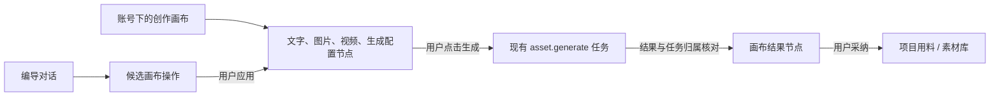

# T-993 · 编导智能体创作画布

状态：基础生成能力与账号独立画布归属均经用户 2026-09-28 确认；独立复审 `PASS[REV:940cde16235e]`，实施验收中。日期：2026-09-28。

## 一句话

用户在同一张可保存的无限画布上摆放想法、图片和视频，向编导描述目标，查看编导提出的操作并自行应用；从节点发起的生图、生视频任务完成后，结果回到原节点，用户再决定是否纳入项目用料。

## 目标与边界

1. 画布属于当前账号，是一份独立、持久的创作文档；可选关联一个当前账号内的项目，用于带入编导上下文和后续采纳。没有项目时，仍可整理画布和生成素材。画布不是项目阶段、视频时间线或发布编辑器。
2. 从全局“创作画布”进入画布库；编导对话提供“在画布中打开”入口，带当前项目上下文时只预选项目，不暗建画布或自动提交生成。
3. 支持平移、缩放、拖动、框选、连接、删除、撤销/重做、节点重命名和保存状态。节点类型：文字说明、图片素材、视频素材、图片生成配置、视频生成配置。连线表示用户整理的来源/去向，不自动执行整张图。
4. 可从当前账号素材库把真实图片/视频插入画布；画布保存 `assetId` 与插入时观察到的 `fileId/checksum`，不保存浏览器 URL，也不复制媒体字节。预览时通过服务端当前文件读取并提示版本变化；生成提交时重新读取并冻结实际使用的文件 ID 与 checksum，执行时按该冻结版本取字节并复验，不用已变更的当前文件替代。
5. 基础设施先完整接通文生图、参考图生图、文生视频、首帧图生视频四种模式，然后画布复用同一任务链。每个模式只在所选模型与供应商适配器确实支持、图片引用可读取时开放；不能把图生图降级为文生图，也不能把图生视频降级为文生视频。显示当前模型、参数、成本提示（仅真实可取得时）、任务状态；都通过既有 `asset.generate`、执行账本、多模态适配器和候选素材链。
6. 任务以 `{accountId, canvasId, nodeId, taskId}` 绑定；结果可追溯到输入版本、模型、提示词和真实资产。任务结果只写归属索引与既有候选账本，不由异步回调修改画布文档或 revision。仍存在的配置节点从归属索引读取并展示结果；已删节点的结果留在画布生成历史，用户可显式重新插入。刷新或重启后从同一任务恢复。重复提交、晚到回调、删除节点和切换账号均不得把结果写入错误画布。
7. 编导仅产出带真实节点/素材引用的候选图操作和解释；候选绑定 `canvasId`、`baseRevision`、稳定 `proposalId` 和操作 ID。前端展示差异，用户点击“应用到画布”后由后端在一次事务中校验全部权限、版本、节点和素材引用，再一次性保存。重复应用返回同一结果；过期版本返回 409 并让用户重看候选。编导不直接写画布或项目用料。
8. 生成素材可先留在当前画布；“加入项目用料”须在关联项目内通过现有采纳入口执行。用户可显式导出/下载所选结果。删除画布时区分画布文档与已入库素材，不误删被其它项目引用的资产。

## 参考项目结论

| 来源 | 借鉴 | 在 CreatorOS 的落点 |
| --- | --- | --- |
| 媒措创流 `mccl/media-content-flow` | 账号物理隔离、助手渐进交互 | 复用 CreatorOS 当前账号归属守卫，不迁移其数据库或视觉风格；该项目当前没有可直接移植的画布模块。 |
| NomiFun `nomifun-desktop` 创意工坊 | 画布作为独立文档、revision CAS、节点任务归属、任务恢复、助手显式应用 | 借鉴数据和交互边界；不复制应用代码、品牌、资产和私有数据。CreatorOS 自有 schema/服务契约仍是唯一真相。 |
| [React Flow](https://reactflow.dev/) | MIT，React 节点与连线交互，适合生成配置和媒体节点 | 推荐 `@xyflow/react` 只承担画布表现和交互；文档版本、权限、执行、持久化全部在 CreatorOS。 |
| [Excalidraw](https://github.com/excalidraw/excalidraw) | MIT，手绘白板 | 更适合自由涂画，生成任务节点与业务表单须大量定制，暂不作为主画布内核。 |
| [tldraw](https://tldraw.dev/community/license) | 功能完整的无限画布 SDK | 生产环境需相应许可；当前商业产品先不以其为基础。 |

## 领域模型与服务契约

新增 `creative_canvases`：`id`, `user_id`, `account_id`, `title`, `project_id?`, `document_json`, `revision`, `created_at`, `updated_at`, `archived_at?`。`document_json` 含 `schemaVersion`, `viewport`, `nodes`, `edges`；节点为判别联合，媒体节点用 `assetId` 引用，配置节点只存安全的模型标识与参数，不存密钥。节点和边数量、文本长度、媒体引用数由 contract 限界。

新增 `canvas_generation_links`：`user_id`, `account_id`, `canvas_id`, `node_id`, `attempt_id`, `task_id?`, `input_revision`, `input_digest`, `reference_file_id?`, `reference_checksum?`, `result_asset_id?`, `created_at`, `updated_at`。`attempt_id` 与非空 `task_id` 各自唯一。这里仅保存提交意图、归属和恢复索引；真实执行状态由现有 execution/AI task 账本拥有，不创造第二套执行权。异步完成只更新任务结果和此索引，不修改 `document_json` 或 `revision`。节点还在时，页面按 `canvasId + nodeId` 叠加显示多次生成历史和最新结果，并标出结果对应的旧输入版本；节点已删时，只在“生成历史”中显示。关联项目用料仍由现有采纳服务拥有。

**提交/恢复顺序**：`canvas.node.generate` 用客户端一次点击的稳定操作 ID 派生 `attemptId`。服务端先在事务里核实当前账号、节点、画布 revision、引用素材与输入摘要，并预留上述 link；再经 `ai-task-submission.submit` 以该 `attemptId` 创建原 `asset.generate` task；最后回填 `taskId`。任一步响应未知时，用 `findTaskByAttempt` 回读原任务并核对其 `accountId/canvasId/nodeId/inputDigest` 后补齐 link，不能生成新 attempt。预留后进程退出而任务尚未创建，原操作重试可继续；任务已创建但绑定未回填，由恢复流程按同键对账。候选结果仅消费既有 execution call 和 asset receipt，不能相信前端回传的 asset ID。

新增 `canvas_agent_proposals`：`id`, `user_id`, `account_id`, `canvas_id`, `base_revision`, `operations_json`, `status`, `applied_revision?`, `created_at`, `expires_at`。所有操作有稳定 ID；应用是一次事务，校验所有输入和同一 `base_revision` 后整体提交。失败不局部应用；相同 `proposalId` 重试只返回已记录的结果。

公共 RPC 候选：`canvas.list/get/create/rename/save/archive`、`canvas.node.generate`、`canvas.node.tasks`、`canvas.agent.apply`。编导侧只给现有 Pi 对话增加 `canvas.read` 和 `canvas.propose` 工具，不新建第二个模型循环；对话 `scope` 只控制展示，不能作为授权依据。`canvas.read` 通过后端 service 在执行当下取当前账号画布快照，给模型节点 ID、文本和可引用素材摘要；`canvas.propose` 只保存候选。操作判别联合为 `addNode/updateNode/moveNode/deleteNode/connect/disconnect`，每项携带稳定操作 ID，目标节点/边真实 ID；新增 ID 由后端分配并映射回候选，禁止模型指定可碰撞的持久 ID。每个读写从当前 `RequestContext` 取账号/用户，服务端重新核实 project/asset/canvas/node 归属。`save`/`apply` 带 `expectedRevision`，冲突返回可恢复的 409，不用最后写入覆盖。删除带在途生成的配置节点时，任务不取消，结果移入生成历史。模型调用留在 ai-runtime/worker，持久化经 backend service port。

**无项目 owner 契约**：Canvas 生成任务的扩展归属字段为 `canvas_node {accountId, canvasId, nodeId}`，AI task 的 `projectId` 固定为空；即使画布关联项目，也先产生当前账号的 `generated_asset` 候选，不自动绑项目。素材字节和 asset 行仍归当前账号。新结果先是 `pending`，画布历史可见，普通素材库列表不可见；用户点击“保留到素材库”调用既有 `ai.tasks.confirm` 激活为账号素材。点击“加入项目用料”时，先激活候选，再调用现有项目用料服务，以用户当下明确选择的项目 ID 核实同账号归属并幂等建立引用；不能指望无 body 的 `confirmTask` 事后指定项目。项目关联只用于编导上下文和预选，不是后续采纳的永久目标。删除画布不删除已激活素材或已有项目引用。`material.generate` 原有项目上下文行为保持；Canvas 从后端提交同一 `asset.generate` 执行链，只扩展可审计的画布归属字段，不另造生成器或绕过限额/审计。旧 AI task 无 canvas owner，按原口径读取。

**完整图片/视频基础契约（先于画布 UI）**：现有 `image.edit` 主要经封面生成使用，通用 `asset.generate` 的 `fields()` 当前只派生 `image.generate/video.generate`，没有参考图来源和冻结读取合同。扩展通用 `asset.generate` 输入为明确模式 `text_to_image/image_to_image/text_to_video/image_to_video`，图生图和图生视频含真实 `referenceAssetId`。准备阶段通过 assets service 核实当前账号、冻结 `fileId/checksum` 与输入摘要；按模式解析 `image.generate/image.edit/video.generate` 及供应商支持的首帧能力，执行阶段按冻结文件读取、复验字节并传入现有 worker。增加受控的 `readAssetReference` worker port，绑定原 execution call，不把任意文件路径、凭据或 Base64 塞进任务 JSON。生成结果仍走既有执行回执、对象存储、候选采纳和失败恢复。旧 task 没有 mode 时按原 `kind` 解释为文生图/文生视频，不重放旧供应商提交。

**供应商能力**：MiniMax 旧 `/v1/video_generation` 的 `first_frame_image` 接受图片 Data URL；H3 `/v2/video_generation` 的 `content` 接受 `image_url` 且 `role=first_frame`，首帧模式的画幅由图片决定。实现时分别按已配置模型使用对应接口，限制格式、体积、尺寸和时长；只有原任务恢复凭据可续查 provider job。OmniHi/Seedance 当前适配器明确拒绝 `firstFrame`；在取得该渠道正式首帧请求合同并落地前，不开放其图生视频按钮，也不能把首帧静默丢弃。各模型能力由实际供应商/配置声明，不按名称猜测。参见 [MiniMax v1 图生视频](https://platform.minimax.io/docs/api-reference/video-generation-i2v)、[MiniMax H3 视频生成](https://platform.minimax.io/docs/api-reference/video-generation-v2-create)。

## 界面与交互

- 画布库：真实列表、最近更新、关联项目、空态“新建画布”。
- 画布页：左侧素材与节点入口，中间无限画布，右侧节点配置与编导对话；小屏侧栏折叠。项目可选，但账号不可跨选。
- 图片/视频节点：直接预览真实缩略图/视频，失败或权限变化时给出可理解的错误，不显示伪占位结果。
- 配置节点：输入提示词/引用素材，模型能力与参数可见；可用模式的“生成”真实可用。提交后状态和任务 ID 可查看，完成后在原配置节点展示结果投影，不自动改文档。用户可把所选结果显式插入为媒体节点。
- 编导候选：逐项显示新增/修改/连接/删除，并给用户应用或取消；操作失败时保留输入和候选以便修复。
- 保存：编辑后自动保存并显示保存中/已保存/冲突；离开时对未落盘内容提示，冲突须用户重新载入或选择性合并，绝不静默覆盖。

## 失败与兼容

- 任务提交成功但页面未收到结果：按 `taskId` 在服务端归属索引中恢复，不重复计费提交；异步任务不回写画布文档。
- 页面刷新/窗口重开：读取画布、真实任务状态和结果并恢复，旧异步响应不得覆盖新画布。
- 节点删除时任务仍在执行：任务继续按账本结束，结果进入可找回的生成历史；不得复活已删除节点。可执行取消时由现有任务协议取消。
- 已关联项目被删除：解除可用关联，画布和素材仍按原账号归属读取，不携带过期项目 ID 执行。切换账号后旧账号画布完全不可见；回到原账号才可继续读取，不迁移数据。
- 旧版本没有画布数据，不迁移已有项目/聊天记录为虚构画布。新增表和 API 不改变现有聊天、生成、渲染和发布路径。

## 验收口径

1. 两个账号分别建画布，列表/直链/素材引用/任务回调均严格隔离；重启后位置、连接、节点和结果保持。
2. 空画布与无项目画布可用；带项目的画布可从编导进入并带入当前上下文，采纳只进入正确项目。
3. 图片和视频各跑一条真实已配置模型路径，进度、失败、重试、结果预览与来源可追溯；未配置能力提示真实原因。
4. 文生图、参考图生图、文生视频、首帧图生视频四种模式均从公共任务入口走真实已配置模型、执行账本、结果回收和采纳路径；供应商不支持的模式准确禁用并说明，不提交伪任务。
5. 编导建议只成候选；人工应用后持久化。多窗口编辑冲突、刷新恢复、重复点击、节点删除与账号切换均不得错写或重复计费。
6. 原有对话生图/生视频、素材库、项目用料、视频渲染和发布路径仍可完成。

## 已确认的产品/架构决定

用户 2026-09-28 确认采用“账号下独立画布、可选关联项目”，无需每个项目强制建画布；并确认优先接全图片与视频的公共生成基础设施。独立画布及无项目生成会扩展现有素材任务服务契约，按本 SPEC、独立复审和 DEC 执行。

## 2026-09-28 实施验收记录

- 公共生成与画布链路：后端相关 4 个文件共 24 项用例通过；Worker 图片/视频适配器与参考图读取 3 个文件共 62 项用例通过。覆盖四种模式的能力判断、首帧尺寸和时长校验、参考文件版本冻结、画布账号隔离、CAS、候选原子应用、同一 `attemptId` 的恢复。
- 浏览器：隔离 PGlite 的 Playwright 用例通过“无项目创建 → 编辑保存 → 重开 → 可选关联项目 → 未配置模型禁用生成 → 切账号 → 列表不可见且直链 404”。前端生产构建、contract/frontend/ai-worker 类型检查通过。
- 仍待真实模型验收：隔离测试库没有用户配置的供应商密钥，四种模式尚未用真实已配置模型完成计费提交、结果回收和采纳；不能把适配器模拟用例记作这项 PASS。原有渲染、发布公共链路也尚未完成本次发布回归。
- 全局既有红项：backend 全量 `tsc` 报旧测试文件类型错误；物理边界及语义边界扫描命中本任务未修改的旧文件。总 `reconcile` 返回 236 errors，首项为既有自治配置与模块 `write_set`/verify 漂移；根因任务已登记为 `T-916`。不能写成全绿。
