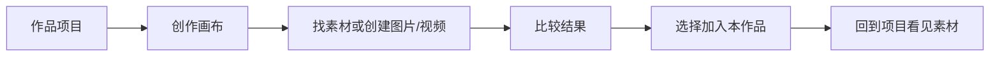

# T-994 · 创作画布、项目用料与素材创作交互打磨

状态：设计待独立评审；T-993 原有生成与账号隔离能力保持既有契约。

## 用户目标

从一个具体作品项目出发，能自然进入创作画布、看见可用素材、发起图片或视频创作、比较结果，并把明确选中的结果加入该项目。首次使用者不需要理解节点、任务 ID、模型内部状态或项目用料等实现概念，仍能知道下一步能做什么、进行到哪里、成果保存在哪里。

## 本轮审查范围

- 入口：全局画布库、项目页、编导入口如何让用户理解画布与作品项目的关系。
- 画布：空白态、工具条、添加素材、就地编辑、生成状态、结果操作、保存和导航反馈。
- 素材：素材中心到画布，以及画布结果到素材库/作品项目的双向路径。
- 屏幕尺寸与可达性：桌面常见窗口尺寸、键盘焦点、按钮命名、抽屉遮挡和错误恢复。

## 不变的产品与安全边界

- 画布仍按账号独立保存，可选关联项目；项目不能越账号选择。沿用 T-993 的 `canvas.*`、真实 `assetId`、CAS 保存和 AI 候选人工采纳。
- 生成任务仍走既有公共模型配置、执行账本和四种真实模式；界面不暗中提交、确认或加入项目。
- 不把真实资源显示为虚构占位，不用写死创作语义代替模型判断。不改视频时间线、发布工具或现有素材归属。

## 当前操作审查（2026-09-29）

在隔离数据环境的当前前端，依次打开画布库、新建画布、添加图片生成节点、打开素材库，再打开同账号作品项目。画布首屏和项目首屏均已做浏览器视觉及可达控件检查。

审查环境：`127.0.0.1:4188`，独立临时 PGlite、临时抖音账号 `@t994-design-audit`、项目“秋季新品广告”，界面为本地开发版 1.2.0；浏览器操作和截图见本任务会话工具回执。实施验收时将前后对照截图保存在 `docs/verification/t994/`，以其为可复查的持久证据，不把本段观察当成最终验收。

| 步骤 | 看得见的问题 | 用户受到的影响 |
| --- | --- | --- |
| 画布库空态 | 仅一行说明和“新建画布”，未解释独立画布与作品画布，项目入口没有被突出 | 不清楚该从哪里开始创作本作品图片/视频 |
| 新画布首屏 | 大面积空白，全部动作压成小字工具条，项目归属单独占一行 | 没有显眼的第一步；看不出成果会去哪里 |
| 图片生成节点 | 模型、提示词、生成混在一张紧凑卡片，禁用态原因字号极小 | 很难判断当前能否生成及下一步 |
| 素材库抽屉 | 仅文件名文本列，空态无可执行去处 | 难以识别图片/视频，也难以补素材 |
| 项目页 | “在画布中打开”只在右侧编导对话的项目胶囊；创作素材区只展示上传 | 项目创作入口与素材成果区断开 |
| 生成结果 | 保留与加入项目操作藏在默认关闭的“编导与详情”里，任务 ID 暴露 | 生成后不容易找到成果和正确采纳动作 |

此外，在未绑定账号的外部浏览器访问已安装版的画布直链时，画布读取失败和模型能力读取失败共用一个错误槽，最后只显示“模型能力读取失败”。本轮需区分主资源错误与附属数据错误，避免错误归因。

## 交互方案

1. **作品入口先明确**：在作品的“创作素材”区显示“打开创作画布”入口，说明这是图片和视频创作支路，原有上传文件、记资料、联网找资料继续可用。进入后画布库从既有 `canvas.list` 结果中仅展示 `item.projectId === 当前项目 ID` 的画布，并提供“查看当前账号全部画布”退路；独立或其他项目画布不计入该作品的空态。项目 ID 归属仍由后端校验。
2. **空白画布给第一步**：中央显示三张大尺寸动作卡：生成图片、生成视频、选用已有素材；清晰说明“创建后保存到当前账号，生成结果需主动加入作品”。任何节点出现后空态消失。
3. **建立操作层级**：顶部保留画布名称、保存状态、返回作品与归档；创作按钮和浏览/缩放按钮分组；把模型不可用提示展示在生成卡片上并给出真实可执行的设置入口或说明。
4. **素材挑选可视化**：抽屉展示真实缩略图、图片/视频类型、名称，支持对**已加载素材**即时搜索与类型筛选，并明确标注“搜索已加载的 N 件素材”；还有后续分页时保留“加载更多”入口，未命中不能误称账号全库无结果。无素材时可导航到素材中心上传。只从当前账号读取，沿用现有分页，不依赖任意全量下载。
5. **结果就近采纳和比较**：节点产出预览附近显示“放到画布”“保留到素材库”“加入当前作品”的明确动作。每组动作绑定同一条历史结果的真实 `taskId + assetId + inputRevision`，以真实历史顺序确定当前结果，不依赖列表首条恰好是最新；显示生成时间、模式、输入版本。多次生成后，历史里的每个结果都可插入独立媒体对象，在画布上并排比较；输入在生成后变动时标为“旧版本结果”，不自动选择为当前结果。加入作品按钮标出点击时的实际目标项目。加入作品要先经真实任务确认与后端素材关联；重复点选不得新增重复用料。若确认成功但关联失败，明确显示“已保留，加入作品失败”，只重试关联。生成历史保留在详情中，但状态用用户语言，内部任务 ID 收在可展开详情里。
6. **安全离开**：画布到画布库、到作品的导航先完成当前 CAS 保存；`dirty/saving` 等待保存完成，`error/conflict` 阻止离开并给出修复动作。既有浏览器关闭警告保留，但不依赖它保护应用内 Link 导航。
7. **尺寸与可达性**：窄桌面宽度工具区可换行但不能遮住主要画布；焦点可见，按钮有具体中文名称。空态和素材抽屉不能让画布无法平移、框选或编辑。

## 验收场景

- 从项目页点击画布入口，能看到该项目画布及“查看当前账号全部画布”；新建画布自动关联该项目，返回项目的路径明确；其他项目画布不混入。
- 独立画布、新建关联画布、无素材、有图片/视频素材、模型不可用、生成中、成功但未保留、已保留、已加入项目、加入失败分别呈现真实状态。
- 选择当前账号素材插入画布后能预览；搜索和类型过滤不会改变资源归属或删除节点。
- 成功生成的结果在节点旁可操作；重复“加入作品”有明确已加入反馈，不多建用料关联。
- 多次生成、修改提示词、切换关联项目后，采纳动作仍指向用户所见的对应结果与当前目标项目；历史多个结果能插入独立媒体对象并排比较；加入项目单步失败只重试关联。
- 修改标题或节点后立刻点“返回作品/画布库”，数据保存成功再导航；版本冲突时留在画布并展示冲突。
- 账号切换后画布与素材不串号；项目 ID 不存在或归属错误仍由后端拒绝，界面不伪造成功。
- 保存、重开、撤销/重做、连接、缩放、自动保存、项目素材回显仍可用。至少以现有 E2E 路径和新增重点场景复查，并做桌面视觉与键盘可达性检查。

## 实施边界与风险

本轮改现有前端画布库、画布编辑器、节点与项目素材入口；复用既有契约，不扩充数据库或新增模型供应商。大对象按需渲染和任务轮询上限保持不变。对已生成结果做就近操作时，以任务状态和真实 `assetId` 为准，不将画布中预览等同于已保留。附属数据加载失败只影响对应区域，不盖掉主资源真实错误。
