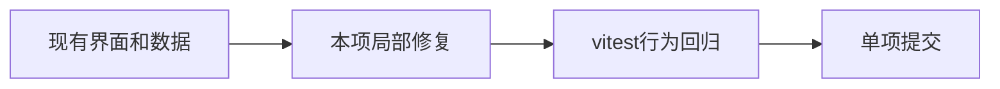

# T-1380 选题来源中文

> 当前任务编号：**T-1389**（原 UI 编号 T-1380）。2026-10-22 集成时消除历史重号；原路径、范围及实测证据保留。见 [编号映射](TASK_ID_MAPPING.md)。

## 范围与用户确认

2026-10-21 用户要求五个UI问题各一个中文commit，在 ui-fixes-2026-10-21 提交、不push；禁止修改授权、激活、verdict、签名代码。用户明确允许本次跳过缺失的 product-to-code-orchestrator 技能，其余规范照常。沿用 design-system/creatoros/MASTER.md 与既有tokens、组件。

## 验收

为本项补充vitest并运行相关回归；全部修复后在frontend运行pnpm typecheck。既有 draft-workbench-state.test.ts 的T-767失败单列；既有intelligence-workbench.tsx react-hooks/set-state-in-effect不在范围内。实测未发生不得记PASS。

## 实现约束

trend/benchmark/demand/idea/favorites全中文；未知来源显示未知来源，不泄露英文原值；既有明确sourceLabel保持优先。

## 实际结果

来源映射补 favorites=收藏，并约束完整枚举；使用 Object.hasOwn 防止未知值和 constructor 等原型属性漏出，统一显示未知来源。保留 sourceLabel 优先。新增用例先4例失败，修复后文件39例通过。

当前环境 .git 只读，无法创建 index.lock，尚未提交。
