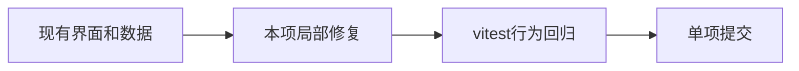

# T-1381 雷达升级入口去重

## 范围与用户确认

2026-10-21 用户要求五个UI问题各一个中文commit，在 ui-fixes-2026-10-21 提交、不push；禁止修改授权、激活、verdict、签名代码。用户明确允许本次跳过缺失的 product-to-code-orchestrator 技能，其余规范照常。沿用 design-system/creatoros/MASTER.md 与既有tokens、组件。

## 验收

为本项补充vitest并运行相关回归；全部修复后在frontend运行pnpm typecheck。既有 draft-workbench-state.test.ts 的T-767失败单列；既有intelligence-workbench.tsx react-hooks/set-state-in-effect不在范围内。实测未发生不得记PASS。

## 实现约束

卡片删除重复升级动作，保留选择作品、已有项目查看与任务状态/取消，详情04选定方案仍可升级。

## 实际结果

ItemCard 删除 onUpgrade/upgradeSubmitting 接线和重复升级按钮；保留选择详情、已有项目查看、任务说明与取消。详情04入口保持。T-937改为从详情升级，继续验证可加入第二个作品和重复点击保护。先2例失败，修复后46例通过。

当前环境 .git 只读，无法创建 index.lock，尚未提交。
