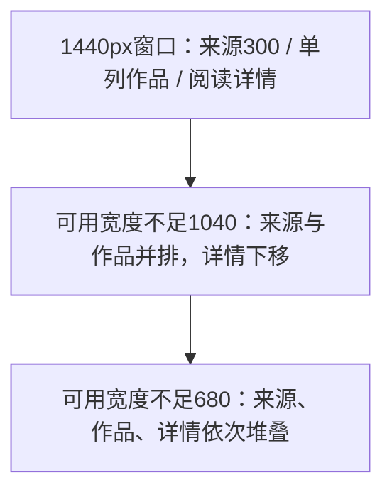

# T-1383 内容雷达布局调整

> 当前任务编号：**T-1392**（原 UI 编号 T-1383）。2026-10-22 集成时消除历史重号；原路径、范围及实测证据保留。见 [编号映射](TASK_ID_MAPPING.md)。

## 用户确认与阶段

2026-10-21 用户明确授权调整 /intelligence 及相关样式、补充 vitest、运行 frontend typecheck 与 intelligence 测试，当前 ui-fixes-2026-10-21 中文提交且不推送。缺失 product-to-code-orchestrator 本次可跳过；已核对两处安装路径不存在。沿 MASTER 和 pages/libraries.md，使用 ui-ux-pro-max；不涉及产品方向、架构或数据归属变更，当前为既有页面实现与回归阶段。

DEC-UI-20261021-06：三栏比例与响应规则按本次明确授权调整；原服务契约、信息分组、操作和所有权保持。代码范围不含授权、激活、verdict、签名。前置独立评审未发生，不补记 PASS。

## 问题与方案

源码确认 creatoros-studio.css 对雷达强制 180px 来源栏，覆盖组件原 220–260px；来源标题和同步共行、底行账号和三个操作共行，进一步挤压；作品在 xl 又强制两列。

布局由页面 CSS module 统一维护，移除共享样式中的旧雷达布局覆盖。按工作台实际可用宽度响应（容器查询），保持现有导航宽度：可用宽度至少1040px时来源300px、作品至少300px、详情至少360px；作品/详情余量按0.9/1.1分配，1440px窗口常规单列作品卡；至少1320px时保留320–640px详情拖动/键盘调宽，作品区自身足够宽才显示双列。680–1039px来源与作品两列、详情通栏下移；低于680px按来源/作品/详情堆叠。来源名自然换行，账号说明独立一行，同步/自动/移除/记录集中可换行操作行。

## 不变项与验收

- RadarCollectionGroup 图标、说明、真实计数徽标和真实空态完整保留；名称允许换行。
- 升级为项目仅出现在作品详情04选定方案；未知转写继续显示状态未知。
- 来源选择/筛选、同步、自动开关、删除确认、运行记录、内容选择、详情调宽与 sources-only 嵌入模式保留。
- vitest覆盖布局样式与全局覆盖消除、长来源名/操作分组和原交互。先运行新增断言记录真实红测，再实现。
- frontend/pnpm typecheck 与全部 src/features/intelligence 测试；boundary-scan、diff --check；原已知 T-767/contract SPEC §13 失败不扩范围修复。
- 保留改前源码基线。浏览器视觉尝试受 Computer Use 未获准使用 Chrome 阻断，不能以jsdom或源码判断冒充1440px截图实测；结果如实登记。
- pmem sync；完整 reconcile 延续现有T-1373未隔离CLI副作用阻断，不更改门禁或伪报全绿。

## 实际结果

已实现以上布局；来源操作回调未改。源码基线 HEAD `4557651d0a5f490cd079d242432eb0f0b2109155`，改前四份布局文件保存在 `/private/tmp/creatoros-radar-layout-2026-10-21/baseline/`。

- 实际红测：原组件45通过、3个新布局断言失败；同轮新增样式测试因读取路径错误未收集（不记业务红测），随后修正测试读取路径。完整原日志 red.log 保留。
- 最终 `cd frontend && pnpm exec vitest run src/features/intelligence --retry=0`：9文件、95用例全部通过（含4个新增样式契约用例）。原来源选择、同步、自动监控、删除保护、运行记录、sources-only、唯一升级入口、分组和未知状态回归通过。
- 最终 `cd frontend && pnpm typecheck`：退出0，路由类型生成和tsc通过。
- boundary-scan：退出0，无新增违规，既有5项基线保留。`git diff --check`通过。pmem sync已执行。
- 未触及LED-047弹层打开/懒渲染/轮询路径和LED-053执行预算，不额外运行这些门。已知T-767与contract SPEC §13未纳入本次雷达定向命令，不宣称修复；既有lint问题未改。
- 未运行完整reconcile：只读复核T-1373的未隔离真实CLI副作用仍在，本项不改门禁。没有全局全绿证据。
- Computer Use返回 `Computer Use was not approved to use Google Chrome`；浏览器1440px、窄屏、深色和实际几何验收未完成。jsdom样式契约与事件测试不等同于截图或真机验收。
- `git add -- frontend/src/features/intelligence/intelligence-workbench.tsx` 实际退出128：无法创建.git/index.lock，Operation not permitted。没有提交、没有推送。
- 补丁、仅本地提交脚本、逐文件摘要及完整日志位于 `/private/tmp/creatoros-radar-layout-2026-10-21/`。任务用taskctl block保留真实未验与提交阻断，不伪报完成。
