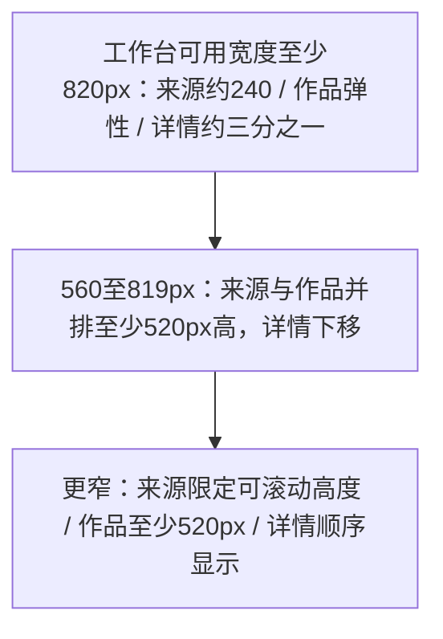

# T-1384 按真实密度重排内容雷达

## 范围、用户确认与阶段

2026-10-21 用户明确要求在 e9f41613 的填充开发数据（11来源、5分类、40作品）基础上重新设计 /intelligence，1440px/1280px三栏同时可用；使用 ui-ux-pro-max，本次允许跳过缺失 product-to-code-orchestrator。当前阶段为既有页面实现与回归，读取 T-1383、PROJECT、PROJECT_CONTEXT、SYSTEM_ARCHITECTURE、MASTER 与 libraries/lists 规则。前置独立评审未发生，不追记 PASS。

DEC-UI-20261021-07：本次用户授权替代 T-1383 的1040px工作台断点与300px来源列；保持主题、数据、服务契约、系统分组、真实操作和详情04唯一升级入口。未知转写保留状态未知。禁止改授权/激活/verdict/签名。无需另行产品方向或架构决策。

## 人话方案

缩小固定来源列，把高度用于看更多来源和作品。来源名称与作品标题统一最多两行并提供完整标题提示；来源异常带文字状态，管理操作按需展开；作品显示现有封面，升级状态并入摘要区。筛选三等列，每列标签在上、下拉在下，避免随机折行。详情紧凑但正文完整。

## 验收与证据边界

- 保留用户提供的两张截图和改前源码于 /private/tmp/creatoros-radar-density-2026-10-21/baseline。
- 新增或更新 vitest：三栏断点和窄窗高度、封面/空封面、长名称/标题提示、异常状态、分类层级、管理菜单、原操作与唯一升级入口。
- frontend 下运行 pnpm typecheck 及 src/features/intelligence 全部测试；boundary-scan 与 git diff --check。
- 实际浏览器核验1440/1280及窄窗，验证可见内容和滚动；工具不可用则明确记录未验。不把静态CSS断言当真实几何。
- 已知 T-767、contract SPEC §13 路由测试和既有 react-hooks/set-state-in-effect lint 不扩范围修复。完整reconcile沿T-1373安全阻断先检查，不能运行有已知未隔离副作用的真实CLI，更不能冒全绿。
- 收尾 pmem sync、taskctl 留审计；当前分支中文本地提交、不push；.git沙箱拒绝则输出完整补丁及仅本地提交脚本。

## 本轮实际结果

基线 HEAD：`e9f4161317bb632c0e0182ab94660db9ee8a698e`，分支 `ui-fixes-2026-10-21`，开工工作树干净。已读取用户给出的1440/1280截图，并复制到交付目录baseline，未修改开发库。

实现：工作台820px开始三栏（240 / min280 / min300），更窄布局给第一行至少520px，不再把作品挤成0；来源名称两行+完整提示、采集账号单行提示、同步直达及管理菜单、真实parentId目录层级；作品48px懒加载封面和失败占位、标题两行提示、指标与升级状态同区；筛选三等列、队列短摘要、详情间距压紧。系统分组与空态、详情唯一升级、未知转写、原回调与来源嵌入模式保留。

- 修改前新增断言实际红测：6失败、48通过；状态文字补充红测：4失败、52通过。原始日志分别red.log、status-red.log。一次误在仓库根执行vitest未启动，已改至frontend运行，不将启动错误冒业务红测。
- 最终 `cd frontend && pnpm exec vitest run src/features/intelligence --retry=0`：9文件、103例全部通过。新增8例组件测试，更新4例布局契约；覆盖封面成功/失败/缺失、200余字标题、真实0、父级分类、失败/受阻/暂停/取消/排队状态、需登录筛选、菜单键盘焦点、旧同步/取消/移除确认和唯一升级等。
- 最终 `cd frontend && pnpm typecheck`：退出0，route typegen与tsc通过。早期新增测试用了目标不支持的正则s标志，已修正后通过，原失败日志未充作成功。
- `node orchestrator/process/boundary-scan.mjs`：退出0，0新增违规，既有5条基线；`git diff --check`通过。`pmem sync`已执行。
- 额外定向eslint：1个既有react-hooks/set-state-in-effect错误和3个既有warning（未用Sparkles、两处hook依赖），未扩范围修改。T-767与contract SPEC §13不在本次定向命令内，不宣称修复或全库全绿。
- 未改超时预算、轮询、同页导航/弹层打开路径，新增管理菜单调用原本地打开回调，不触发真实同步、升级或删除。
- 完整reconcile未启动：当前reconcile.mjs仍直接execSync lesson检查，LED-053仍指向verify.mjs，hyperframes.test.mjs仍仅设置HYPERFRAMES_TELEMETRY=0；延续已登记T-1373的未隔离CLI副作用阻断，没有新的完整对账PASS。
- 浏览器验收未完成：Computer Use浏览器列表为空，原生Chrome返回`Computer Use was not approved to use Google Chrome`。已询问能否使用已安装Playwright只读核验，尚未收到回复，没有绕过权限用其它控制技术。**三种布局的真实几何、滚动、截图及暗色实测均未发生**，静态CSS与jsdom通过不能代签视觉；不宣称实际一屏条数已验证。
- `git add -- frontend/src/features/intelligence/intelligence-workbench.tsx`实际退出128：`.git/index.lock: Operation not permitted`。未创建commit、未push；按用户备用要求交付补丁和仅本地提交脚本。

交付目录：`/private/tmp/creatoros-radar-density-2026-10-21/`；包含基线、日志、`changes.patch`、`commit-local.sh`、`delivery.json`与`README.md`。后续若获准浏览器核验，应直接在现有开发数据上查看1440/1280以及不足1100窗口；如发现实际几何问题，修正后重新导出补丁与哈希。
