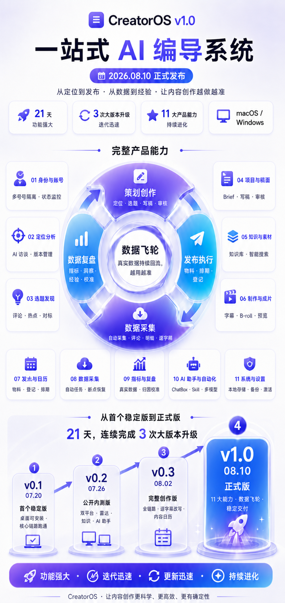

# CreatorOS v1.0 产品功能与版本迭代图

## 发布定位

**CreatorOS v1.0 正式版**  
**2026.08.10 正式发布**

主标题：`一站式 AI 编导系统`

价值主张：`从定位到发布 · 从数据到经验 · 让内容创作越做越准`

核心传播点：

- 功能强大：覆盖内容创作、制作、发布、采集、复盘与经验回流的完整链路。
- 迭代迅速：从 2026.07.20 的 v0.1 到 2026.08.10 的 v1.0 正式版，21 天完成三次大版本升级。
- 越用越准：真实发布数据持续回流，形成“创作→发布→采集→复盘→校准→再创作”的数据飞轮。

## 产品核心飞轮

### 策划创作

定位 · 选题 · 写稿 · 审核

### 发布执行

物料生成 · 排期发布 · 发布登记

### 数据采集

自动采集 · 评论 · 明细 · 逐字稿

### 数据复盘

指标 · 洞察 · 经验 · 校准

中心文案：

`数据飞轮`

`创作 → 发布 → 采集 → 复盘 → 校准 → 再创作`

`真实数据持续回流，让系统越用越准`

## 11 大产品能力

1. **身份与账号**：账号绑定与管理、多账号数据隔离、连接状态监控。
2. **定位分析**：AI 访谈生成定位、定位版本管理、账号定位洞察。
3. **选题发现**：评论需求挖掘、热点趋势雷达、对标内容分析。
4. **项目与稿面**：项目与 Brief 管理、AI 编导写稿、合同审核、盲预测与校准。
5. **知识与素材**：知识库管理、素材标签、跨域智能搜索、AI 分类整理。
6. **制作与成片**：受控视频成片、字幕与 B-roll、预览与入库。
7. **发布与日历**：发布物料生成、发布登记锚定、内容日历排期。
8. **数据采集**：手动与自动采集、指标/评论/明细、任务限流与断点恢复。
9. **指标与复盘**：真实数据指标、复盘洞察与记录、经验生成与回流、预测校准与归因。
10. **AI 助手与自动化**：AI 编导 ChatBox、可控执行与自愈、Skill 自定义、多模型配置。
11. **系统与设置**：本地存储、备份与导出、签名更新与激活、主题与偏好设置。

## 四版本迭代时间轴

### v0.1 · 2026.07.20 · 首个稳定版

- 桌面 App 可安装使用。
- 核心创作链路跑通。
- 本地数据、素材、知识与基础复盘可用。

日期口径：用户于 2026.08.09 明确纠正 v0.1 产品版本日期为 `2026.07.20`。Git tag `v0.1.0-pre-pi` 的 7 月 14 日只是内部稳定存档点，不作为对外版本日期。

### v0.2 · 2026.07.26 · 公开内测版

- macOS / Windows 双平台。
- 内容雷达、知识工作区、AI 助手能力增强。
- 自动化与长任务支持恢复。

证据：用户提供的 v0.2 更新图与 `release: prepare CreatorOS 0.2.0 public beta`。

### v0.3 · 2026.08.02 · 完整创作版

- 定位→雷达→选题→项目→写稿→制作→发布→复盘链路打通。
- 逐字稿对标改写、内容日历与排期。
- macOS / Windows 体验统一验证。

证据：用户提供的 v0.3 更新图；图上迭代区间为 `2026.07.26—2026.08.02`。

### v1.0 · 2026.08.10 · 正式版

- 11 大产品能力形成一站式 AI 编导系统。
- 数据飞轮完整闭环，真实反馈持续校准创作。
- 双平台正式交付，强调稳定、安全与持续进化。

发布日期由用户在 2026.08.09 明确确认为 `2026.08.10`。

## 海报重点数字

- `21 天`
- `3 次大版本升级`
- `11 大产品能力`
- `macOS / Windows`

## 底部传播语

`功能强大 · 迭代迅速 · 持续进化`

`更准 · 更快 · 更稳 · 更懂创作`

## 视觉方向

- 一张竖版发布长图，上部为产品功能地图，下部为四版本迭代时间轴。
- 以用户提供的白底产品功能图为主要版式参考，使用高端白底、紫蓝渐变、玻璃质感与发光数据飞轮。
- v0.2/v0.3 深色霓虹更新图只作为品牌色、版本节奏与信息来源参考；最终不使用密集黑底更新清单版式。
- 不放邀请码、价格、二维码、未完成任务或内部任务编号。

## 生成方式

使用内置 `imagegen` 生成。第一张用户参考图负责白底功能地图、中央数据飞轮与能力卡片布局；v0.2/v0.3 两张参考图只负责 CreatorOS 紫蓝品牌色与版本跃迁节奏。最终输出没有使用 CLI/API fallback。

## 朋友圈发布文案

🚀 **8 月 10 日，CreatorOS v1.0 正式发布！**

从 7 月 20 日的 v0.1，到今天的 v1.0——21 天，连续完成 3 次大版本升级。

CreatorOS 不是一个只会写文案的 AI 工具，而是一套真正的一站式 AI 编导系统：

✅ AI 定位、选题、写稿与审核  
✅ 知识库、素材管理与视频制作  
✅ 发布排期、数据采集与内容复盘  
✅ macOS / Windows 双平台支持

更重要的是，它把“创作 → 发布 → 采集 → 复盘 → 校准 → 再创作”真正连成了一个数据飞轮。每一次真实发布，都会让下一次定位更准、选题更准、内容也更准。

功能强大只是起点，快速迭代才是我们的底气。每一轮真实使用反馈，都会进入下一次更新。

**CreatorOS v1.0，正式出发。**  
让内容创作更科学、更高效，也更有确定性。

想了解或体验的朋友，欢迎私聊我。💜

## 内测群正式版通知

各位 CreatorOS 内测伙伴，大家好：

8 月 10 日，CreatorOS v1.0 将正式发布。

首先想认真感谢每一位参与内测的朋友。过去这段时间，大家提交的每一个问题、每一条建议，以及每一次真实使用，都在帮助我们发现不足、修正方向。正是因为有大家的支持，CreatorOS 才能在短时间内持续迭代，变得越来越完整、越来越稳定。

无论你是否购买正式版，这份帮助都是真实而宝贵的。每一次参与，都让产品在走向正式版之前，真正经受了用户使用和反馈的检验。

这次正式版，我们已经完成模型能力的统一集成：

- 支持国内外主流大模型，可根据自己的需求进行配置；
- 已接入语音转文字能力，让录音、视频内容更快进入创作流程；
- 已接入图片生成与视频生成能力，减少创作过程中在多个工具之间反复切换；
- 模型与创作流程打通，从定位、选题、写稿到素材与成片，使用体验更加连贯。

CreatorOS v1.0 不是终点，而是一个新的开始。接下来我们仍会持续听取大家的意见，把产品做得更准、更快、更稳，也更懂创作者。

再次感谢大家一路以来的内测支持。💜
