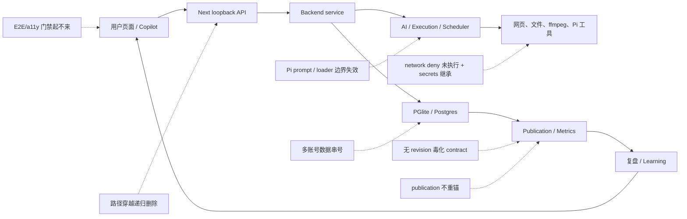

# CreatorOS 上线前全面工程与数据链路审查

> 日期：2026-07-15
>
> 审查任务：T-326
>
> 代码快照：`main@bffa82e`（审查期间 T-325 被另一工作流提交，报告以提交后的干净工作树复核）
>
> 范围：前端功能与 UX、contract/backend/数据库、AI Runtime/worker/自动化、本地执行、桌面打包、工程门禁
>
> 原则：文档仅作导航，结论以源码、依赖源码、迁移、调用链和实跑结果为准；本轮未修业务代码。

## 上线裁决

**NO-GO：当前版本不建议上线。**

共确认 **4 个 Blocker、26 个 High、22 个 Medium、1 个 Low**。最先要关的是：

1. Web Session 路径穿越可递归删除应用数据或更上级目录。
2. 日拉 imported publication 的 `currentRevisionId` 与 contract 冲突，可让发布资源解析失败。
3. 同一平台作品不会从 imported 空壳项目重锚到用户手建项目，发布、指标、复盘飞轮持续分叉。
4. 浏览器 E2E/a11y 门禁无法启动，所有页面级回归无法证明。
5. Pi 没收到 CreatorOS system prompt，默认 ResourceLoader 又会加载项目/用户 Pi 扩展，当前“工具白名单物理隔离”不成立。
6. Execution 的 `network: "deny"` 没有执行，子进程继承全部环境变量。
7. 多账号发布、指标、收藏与偏好仍会串号。
8. 构建过程会初始化真实持久层、回填 seed、扫任务并启动 cron，构建不是只读操作。

## 一、Blocker

### B-01 Web Session `domain` 路径穿越可递归删除目录

- 入口只检查 `domain` 非空：[route.ts](/Users/zyongzhu/Workbase/Thirdspace-creator/frontend/src/app/api/web-session/route.ts:80)。
- 路径直接 `path.join(webAuthDirBase, domain)`：[persistence-client.ts](/Users/zyongzhu/Workbase/Thirdspace-creator/frontend/src/server/persistence-client.ts:1307)。
- remove 调用 `rm(target, { recursive: true, force: true })`：[persistence-client.ts](/Users/zyongzhu/Workbase/Thirdspace-creator/frontend/src/server/persistence-client.ts:1753)。
- 非破坏性证明：`domain="../.."` 会从 `<appData>/.auth/web` 解析到 `<appData>`；更多 `../` 可继续向上。
- 影响：数据库、master key、浏览器 profile、日志和其他用户文件都可能被删。
- 上线门：hostname 白名单解析 + `resolve/relative` containment + realpath 复查 + Origin/Host/Content-Type/启动令牌；覆盖 `../`、反斜杠、绝对路径、编码分隔符测试。

### B-02 imported publication 违反非空 revision contract

- 导入发布明确写 `currentRevisionId: null`：[publishing.repository.ts](/Users/zyongzhu/Workbase/Thirdspace-creator/backend/src/modules/publishing/publishing.repository.ts:212)。
- transport 把 null 伪装为 `""`：[publishing.transport.ts](/Users/zyongzhu/Workbase/Thirdspace-creator/backend/src/modules/publishing/publishing.transport.ts:37)。
- contract 要求 `currentRevisionId` 是 `z.string().min(1)`：[publishing.ts](/Users/zyongzhu/Workbase/Thirdspace-creator/contract/src/resources/publishing.ts:8)、[primitives.ts](/Users/zyongzhu/Workbase/Thirdspace-creator/contract/src/primitives.ts:3)。
- client 对 envelope 做 Zod parse：[client.ts](/Users/zyongzhu/Workbase/Thirdspace-creator/contract/src/client.ts:26)。
- 影响：正常日拉一条作品后，publication list/detail 可能整体解析失败。
- 上线门：要么 contract 允许 null 并原样返回，要么导入时原子创建 revision-1；禁止空字符串占位，并加真实 client 集成测试。

### B-03 publication 被 imported 空壳项目抢锚后不会迁回手建项目

- `createImportedPublication` 按 external key 命中既有行即直接返回，不比较 `contentOutputId`：[publishing.service.ts](/Users/zyongzhu/Workbase/Thirdspace-creator/backend/src/modules/publishing/publishing.service.ts:481)。
- register 虽传手建 output，但只把请求 output 标已发布，没有迁移 publication：[publishing.transport.ts](/Users/zyongzhu/Workbase/Thirdspace-creator/backend/src/modules/publishing/publishing.transport.ts:150)。
- 后续日拉继续按旧 publication 的 output 归属指标：[ingestion.service.ts](/Users/zyongzhu/Workbase/Thirdspace-creator/backend/src/modules/ingestion/ingestion.service.ts:548)。
- 影响：同一作品永久形成 imported/manual 两个项目，指标、封面、复盘仍流向空壳项目；T-323 源码根因成立。
- 上线门：事务化 re-parent publication + 合并派生数据 + 归档 imported 空壳 + external key 唯一；覆盖“先日拉后登记”和并发登记。

### B-04 浏览器 E2E 与 a11y 门禁无法启动

- Playwright 要求 120 秒内拉起 Next 根路由：[playwright.config.ts](/Users/zyongzhu/Workbase/Thirdspace-creator/frontend/playwright.config.ts:122)。
- `pnpm test:e2e` 与独立端口 `pnpm test:a11y` 都停在 `Compiling / ...` 后超时。
- 编译同时报告 `douyin-cdp.ts Module not found: Can't resolve <dynamic>`，重依赖链从全局 shell 进入 `persistence-client`。
- 影响：路由、键盘、真实交互和页面错误回归都没有可执行发布证据。
- 上线门：拆掉全局同步重依赖/初始化阻塞，修根路由 readiness；完整跑绿 E2E、a11y、visual。

## 二、High：前端功能与用户体验

### FE-H01 制作页“后台运行，可离开”承诺不成立

- 决策轮询约十分钟后静默退出：[production-workbench.tsx](/Users/zyongzhu/Workbase/Thirdspace-creator/frontend/src/features/production/production-workbench.tsx:574)。
- 渲染轮询不处理 `failed`，会永久查询：[production-workbench.tsx](/Users/zyongzhu/Workbase/Thirdspace-creator/frontend/src/features/production/production-workbench.tsx:716)。
- 刷新恢复漏 `queued/running` decisions 与 failed render：[production-workbench.tsx](/Users/zyongzhu/Workbase/Thirdspace-creator/frontend/src/features/production/production-workbench.tsx:758)。
- 影响：进度丢失、重复发起付费任务、永久转圈、失败不可恢复。

### FE-H02 设置读取失败展示伪造 fixture

- 模型、存储读取错误被吞并回退 fixture：[settings/page.tsx](</Users/zyongzhu/Workbase/Thirdspace-creator/frontend/src/app/(creator)/settings/page.tsx:102>)。
- fixture 伪造模型、路径、18GB/64GB 占用：[settings.ts](/Users/zyongzhu/Workbase/Thirdspace-creator/frontend/src/fixtures/selectors/settings.ts:51)、[settings.ts](/Users/zyongzhu/Workbase/Thirdspace-creator/frontend/src/fixtures/selectors/settings.ts:171)。
- 影响：把不存在的模型和磁盘数据当真，直接违反“数据缺失诚实置 0”。

### FE-H03 通知读取失败可拖垮全部登录后页面

- creator layout 无降级地等待通知请求：[layout.tsx](</Users/zyongzhu/Workbase/Thirdspace-creator/frontend/src/app/(creator)/layout.tsx:51>)、[layout.tsx](</Users/zyongzhu/Workbase/Thirdspace-creator/frontend/src/app/(creator)/layout.tsx:115>)。
- 影响：一个次要铃铛功能可让首页、项目、素材、发布、设置一起不可用。

### FE-H04 日历“今天”写死为 2026-07-03

- 固定 `REFERENCE_INSTANT`：[content-calendar-page.tsx](/Users/zyongzhu/Workbase/Thirdspace-creator/frontend/src/features/content-calendar/content-calendar-page.tsx:49)。
- 过去/未来、默认月份和可点击日期都由它派生：[content-calendar-view.tsx](/Users/zyongzhu/Workbase/Thirdspace-creator/frontend/src/features/content-calendar/content-calendar-view.tsx:101)。
- 影响：2026-07-15 仍允许把 7 月 10 日当未来排期，断更判断与默认月份错误。

## 三、High：后端与数据链路

### DATA-H01 发布与指标读写未完整按 `accountId` 隔离

- publication 所有权和列表主要只按 `userId`：[publishing.repository.ts](/Users/zyongzhu/Workbase/Thirdspace-creator/backend/src/modules/publishing/publishing.repository.ts:148)、[publishing.repository.ts](/Users/zyongzhu/Workbase/Thirdspace-creator/backend/src/modules/publishing/publishing.repository.ts:239)。
- analytics 写入 stamp account，读取聚合却只传 user：[analytics.service.ts](/Users/zyongzhu/Workbase/Thirdspace-creator/backend/src/modules/analytics/analytics.service.ts:103)、[analytics.repository.ts](/Users/zyongzhu/Workbase/Thirdspace-creator/backend/src/modules/analytics/analytics.repository.ts:249)。
- 影响：两个抖音号的发布、趋势、dashboard 混读，更新也可能串号。

### DATA-H02 收藏与 topic preference 唯一键仍是用户级

- favorites 唯一键 `(user_id,name)` / `(user_id,aweme_id)`，不含账号：[0038_favorites_folders.sql](/Users/zyongzhu/Workbase/Thirdspace-creator/backend/drizzle/0038_favorites_folders.sql:29)。
- topic preference 唯一键与 conflict target 也不含账号：[0033_topic_preferences.sql](/Users/zyongzhu/Workbase/Thirdspace-creator/backend/drizzle/0033_topic_preferences.sql:33)、[candidate.repository.ts](/Users/zyongzhu/Workbase/Thirdspace-creator/backend/src/modules/candidate/candidate.repository.ts:677)。
- 影响：第二账号创建失败、复用或修改第一账号数据。

### DATA-H03 publishing 可用任意 `outputId` 建跨属主/悬空行

- create 前未通过 Projects service 校验 output 归属：[publishing.service.ts](/Users/zyongzhu/Workbase/Thirdspace-creator/backend/src/modules/publishing/publishing.service.ts:263)。
- schema 也没有 `content_output_id` FK：[publishing.ts](/Users/zyongzhu/Workbase/Thirdspace-creator/backend/src/schema/publishing.ts:85)。
- 影响：认证用户可构造跨属主或悬空 publication，外部发布成功后才暴露本地状态错误。

### DATA-H04 平台发布副作用与本地 rollup 不可恢复

- 先调用平台，再更新 publication，最后更新 output/project：[publishing.service.ts](/Users/zyongzhu/Workbase/Thirdspace-creator/backend/src/modules/publishing/publishing.service.ts:316)。
- 同状态重试直接返回，不能 reconciliation。
- 影响：可能重复发平台，或 publication 已 published 但项目永远没跃迁。

### DATA-H05 删除项目遗漏 production/analytics/attribution/learning

- 删除事务表集合不完整：[projects.repository.ts](/Users/zyongzhu/Workbase/Thirdspace-creator/backend/src/modules/projects/projects.repository.ts:384)。
- production、analytics、topic attribution、learning 都是无 FK 的软引用。
- 影响：留下制作、导出、指标、归因、经验孤儿，dashboard 仍可能聚合已删项目。

### DATA-H06 AI 批量采纳无事务、无逐项幂等

- material、learning_list、publication_drafts 都逐条落库，最后才标 task 成功：[ai.service.ts](/Users/zyongzhu/Workbase/Thirdspace-creator/backend/src/modules/ai/ai.service.ts:568)、[ai.service.ts](/Users/zyongzhu/Workbase/Thirdspace-creator/backend/src/modules/ai/ai.service.ts:848)。
- 影响：第 N 条失败后重试会重复前 N-1 条。

### DATA-H07 AI 生成资产在采纳前已成为 active

- runner 在生成阶段直接持久化资产：[asset-generate-runner.ts](/Users/zyongzhu/Workbase/Thirdspace-creator/backend/src/modules/ai-runtime/asset-generate-runner.ts:122)。
- 拒绝/失败没有清理，确认阶段只加 material link。
- 影响：绕过“AI 只产候选、人确认后落库”，产生永久孤儿资产和对象字节。

### DATA-H08 并发日拉在幂等 run 前先建重复项目

- 先 `ensureImportedProject`，后创建带幂等键的 run：[ingestion.service.ts](/Users/zyongzhu/Workbase/Thirdspace-creator/backend/src/modules/ingestion/ingestion.service.ts:748)。
- ensure 是先查后建，项目无外部键唯一约束。
- 影响：并发 refresh 可各建 imported project/output，publication 冲突也挡不住已产生的孤儿。

### DATA-H09 file-PGlite 把所有迁移/打开错误当“库损坏”并切空库

- `createDb` 捕获 file-PGlite 所有异常，把原目录改名 `.corrupt-*` 后创建空库：[db.ts](/Users/zyongzhu/Workbase/Thirdspace-creator/backend/src/db.ts:190)。
- 影响：普通迁移 SQL、权限、磁盘错误会表现为“数据全没了”；用户没有恢复入口。

## 四、High：Runtime、安全、自动化与桌面执行

### RT-H01 Loopback API 无真实鉴权/Origin/Host/CSRF 防护

- 无/坏 cookie 会回退本地主用户：[request-context.server.ts](/Users/zyongzhu/Workbase/Thirdspace-creator/frontend/src/lib/request-context.server.ts:36)。
- dispatch、chat、web-session 都未校验启动级 token 和精确 Origin：[dispatch route](/Users/zyongzhu/Workbase/Thirdspace-creator/frontend/src/app/api/v1/dispatch/route.ts:41)、[chat route](/Users/zyongzhu/Workbase/Thirdspace-creator/frontend/src/app/api/chat/route.ts:102)。
- 随机端口不是鉴权。与 B-01 组合时尤其危险。

### RT-H02 CreatorOS system prompt 未进入 Pi 会话

- executor 已构造 `input.systemPrompt`：[agentic-executor.ts](/Users/zyongzhu/Workbase/Thirdspace-creator/backend/src/modules/execution/agentic/agentic-executor.ts:153)。
- `createAgentSession` 没有受控 ResourceLoader，后续只 `session.prompt(input.goal)`：[pi-engine.ts](/Users/zyongzhu/Workbase/Thirdspace-creator/backend/src/modules/execution/agentic/pi-engine.ts:397)。
- Pi 实际从 ResourceLoader 构造 system prompt：[agent-session.js](/Users/zyongzhu/Workbase/Thirdspace-creator/node_modules/.pnpm/@earendil-works+pi-coding-agent@0.80.7_@modelcontextprotocol+sdk@1.29.0_zod@4.4.3__ws@8.21.0_zod@4.4.3/node_modules/@earendil-works/pi-coding-agent/dist/core/agent-session.js:708)。
- 影响：CreatorOS 的诚实、预算、角色和工具策略表面存在，实际模型收不到。

### RT-H03 Pi 默认 ResourceLoader 可旁路工具白名单

- Pi 声明明确：`noTools:"builtin"` 仅禁 builtin，保留 extension/custom tools：[sdk.d.ts](/Users/zyongzhu/Workbase/Thirdspace-creator/node_modules/.pnpm/@earendil-works+pi-coding-agent@0.80.7_@modelcontextprotocol+sdk@1.29.0_zod@4.4.3__ws@8.21.0_zod@4.4.3/node_modules/@earendil-works/pi-coding-agent/dist/core/sdk.d.ts:30)。
- 未传 loader 时扫描 cwd 与默认 `~/.pi/agent` 并 `reload()`：[sdk.js](/Users/zyongzhu/Workbase/Thirdspace-creator/node_modules/.pnpm/@earendil-works+pi-coding-agent@0.80.7_@modelcontextprotocol+sdk@1.29.0_zod@4.4.3__ws@8.21.0_zod@4.4.3/node_modules/@earendil-works/pi-coding-agent/dist/core/sdk.js:63)。
- extensions/custom tools 会进入 AgentSession：[sdk.js](/Users/zyongzhu/Workbase/Thirdspace-creator/node_modules/.pnpm/@earendil-works+pi-coding-agent@0.80.7_@modelcontextprotocol+sdk@1.29.0_zod@4.4.3__ws@8.21.0_zod@4.4.3/node_modules/@earendil-works/pi-coding-agent/dist/core/sdk.js:252)。
- 影响：项目或用户 Pi 扩展可执行代码、注册工具、注入上下文；现有测试只证明四个 builtin 不在集合。

### RT-H04 web reader/capture 存在 SSRF

- 只检查 http/https 后直接 `page.goto`：[web-reader.ts](/Users/zyongzhu/Workbase/Thirdspace-creator/frontend/src/server/ingestion/web-reader.ts:468)、[web-capture.ts](/Users/zyongzhu/Workbase/Thirdspace-creator/frontend/src/server/ingestion/web-capture.ts:174)。
- 没有解析 IP、私网/loopback/link-local/元数据地址阻断，也没有逐次重定向复检。

### RT-H05 不可信网页/本地文件内容可提示词注入驱动工具

- 网页正文作为原始 tool result 回模型：[chat-tools.ts](/Users/zyongzhu/Workbase/Thirdspace-creator/backend/src/modules/ai-runtime/chat-tools.ts:2281)。
- 同一会话拥有付费或有副作用的素材、封面、脚本、规划工具：[chat route](/Users/zyongzhu/Workbase/Thirdspace-creator/frontend/src/app/api/chat/route.ts:283)。
- 影响：恶意页面可诱导模型消耗额度或创建候选/推进流程。

### RT-H06 Execution `network: deny` 未执行，子进程继承 secrets

- contract 声明 network deny/allowlist：[execution.ts](/Users/zyongzhu/Workbase/Thirdspace-creator/contract/src/resources/execution.ts:32)。
- `runExecutionTask` 只消费 timeout/output，不消费 network：[run-execution-task.ts](/Users/zyongzhu/Workbase/Thirdspace-creator/backend/src/modules/execution/run-execution-task.ts:131)。
- video child 直接继承 `...process.env`：[executor.ts](/Users/zyongzhu/Workbase/Thirdspace-creator/backend/src/modules/execution/video-render/executor.ts:255)。
- 影响：所谓沙箱内代码仍可读模型 key、DB/S3 配置并联网外传。

### RT-H07 Agentic 对外端口含假成功/空结果/伪 pendingId

- 组合根注明真实端口仍属后续任务，却已注册公共工具：[persistence-client.ts](/Users/zyongzhu/Workbase/Thirdspace-creator/frontend/src/server/persistence-client.ts:6887)。
- web search/read 返回空、staging 造 pendingId、collection 固定成功且结果 0：[persistence-client.ts](/Users/zyongzhu/Workbase/Thirdspace-creator/frontend/src/server/persistence-client.ts:6912)。
- 违反“严禁假按钮/诚实置 0”；上线前应移除或明确 501。

### RT-H08 Scheduler 并发去重竞态

- 先查当日 run，再 create task/run/dispatch，缺数据库唯一约束：[scheduled-collection-scheduler.ts](/Users/zyongzhu/Workbase/Thirdspace-creator/backend/src/modules/ai-runtime/scheduled-collection-scheduler.ts:142)、[scheduling.ts](/Users/zyongzhu/Workbase/Thirdspace-creator/backend/src/schema/scheduling.ts:49)。
- 影响：两个 tick 可同时通过并重复运行、重复计费。

### RT-H09 ffmpeg/Whisper 没有可靠随桌面端打包

- Douyin 与 worker 默认硬编码 `/opt/homebrew/bin/ffmpeg`：[douyin-cdp.ts](/Users/zyongzhu/Workbase/Thirdspace-creator/frontend/src/server/ingestion/douyin-cdp.ts:565)、[multimodal-whisper-local.ts](/Users/zyongzhu/Workbase/Thirdspace-creator/ai-worker/src/runtime/multimodal-whisper-local.ts:230)。
- sidecar 打包脚本未打 ffmpeg。
- 影响：Intel Mac、Windows、无 Homebrew 用户的转录/音频提取稳定失败。

### RT-H10 Execution adoption 非原子、重试会重复资产

- 逐个读文件、创建 asset，最后才记 adoption/succeeded：[execution.service.ts](/Users/zyongzhu/Workbase/Thirdspace-creator/backend/src/modules/execution/execution.service.ts:211)。
- 第 N 个失败时前 N-1 个已落库，重试再创建。

## 五、High：工程与发布链

### ENG-H01 没有面向 main/PR 的验证 CI，且唯一 workflow Node 版本不合约束

- 唯一 GitHub workflow 是可写仓的 Autonomous Harness，固定旧分支 `feat/service-contract`，不跑 typecheck/test/build/lint/boundary：[harness.yml](/Users/zyongzhu/Workbase/Thirdspace-creator/.github/workflows/harness.yml:1)。
- workflow 用 Node 24，而根 `engines` 要求 Node `>=25 <26`：[package.json](/Users/zyongzhu/Workbase/Thirdspace-creator/package.json:4)。
- 影响：main 可在没有任何发布门禁的情况下进入分发；本地“跑过”无法替代可重复 CI。

### ENG-H02 `next build` 会改持久层并启动 cron

- 本次 build 日志实际出现 seed 回填、master-key dev 降级、cron 启动。
- persistence 构造时无 build guard 地 seed canonical user/课程和回填 tag：[persistence-client.ts](/Users/zyongzhu/Workbase/Thirdspace-creator/frontend/src/server/persistence-client.ts:6568)。
- stale sweep 也在构造时直接运行：[persistence-client.ts](/Users/zyongzhu/Workbase/Thirdspace-creator/frontend/src/server/persistence-client.ts:6013)。
- scheduler 的守卫只排除 test/VITEST/CI，不排除 Next production build：[scheduled-collection-scheduler.ts](/Users/zyongzhu/Workbase/Thirdspace-creator/backend/src/modules/ai-runtime/scheduled-collection-scheduler.ts:262)。
- 影响：打包/预渲染会连接和修改数据库、清扫任务、启动定时器；审查中的普通 build 已产生实际回填日志。

### ENG-H03 updater 允许带占位下载 URL 的 latest.json 成功产出

- 未设 `CREATOROS_UPDATE_BASE_URL` 时默认 `https://github.com/OWNER/REPO/...`，只打印 warning 不失败：[release.mjs](/Users/zyongzhu/Workbase/Thirdspace-creator/frontend/scripts/desktop/release.mjs:111)。
- 影响：签名更新包可以配出不可下载的正式元数据，客户端升级失败。

## 六、Medium：前端/UX

| ID | 问题 | 代码证据 | 用户影响 / 上线验收 |
|---|---|---|---|
| FE-M01 | 日历 click-only `
`，抽屉非 dialog | [content-calendar-view.tsx](/Users/zyongzhu/Workbase/Thirdspace-creator/frontend/src/features/content-calendar/content-calendar-view.tsx:196) | 键盘/读屏不可用；改原生 button + Dialog/Sheet + focus trap/Escape/恢复焦点 |
| FE-M02 | 日历增删改失败静默，要求手填 ISO | [content-calendar-schedule.tsx](/Users/zyongzhu/Workbase/Thirdspace-creator/frontend/src/features/content-calendar/content-calendar-schedule.tsx:47) | 用户不知道是否保存；加错误态、保留输入、`datetime-local` 与时区 |
| FE-M03 | `/calendar`/`accounts`/`search` 错高亮首页 | [sidebar.tsx](/Users/zyongzhu/Workbase/Thirdspace-creator/frontend/src/components/shell/sidebar.tsx:88) | 位置感与 `aria-current` 错；补路由映射或不选中 |
| FE-M04 | 首页虚假“全部处理完”、缺平台伪造“多平台” | [dashboard-page.tsx](/Users/zyongzhu/Workbase/Thirdspace-creator/frontend/src/features/dashboard/dashboard-page.tsx:108) | 错报任务清空/平台；聚合真实待办，缺值显示未设置 |
| FE-M05 | 全部已读乐观更新失败不回滚 | [notification-popover.tsx](/Users/zyongzhu/Workbase/Thirdspace-creator/frontend/src/components/shell/notification-popover.tsx:70) | 静默隐藏未读；`allSettled` + 失败回滚 |
| FE-M06 | Playwright 路由矩阵落后，a11y 未用 axe，Copilot 仍断言无 POST | [routes.ts](/Users/zyongzhu/Workbase/Thirdspace-creator/frontend/tests/fixtures/routes.ts:45)、[ai-copilot.spec.ts](/Users/zyongzhu/Workbase/Thirdspace-creator/frontend/tests/e2e/ai-copilot.spec.ts:68) | 新路由无保护、正确行为反而失败；重建真实路由矩阵 |
| FE-M07 | 真实项目阶段回退 fixture `research`/0% | [shell-router.tsx](</Users/zyongzhu/Workbase/Thirdspace-creator/frontend/src/app/(creator)/shell-router.tsx:236>) | 制作/复盘项目被显示为脚本阶段；layout 传真实 stage/progress |

## 七、Medium：后端/数据

| ID | 问题 | 证据 | 验收 |
|---|---|---|---|
| DATA-M01 | metric snapshot 与 value 子行非事务，冲突重试不补 value | [analytics.repository.ts](/Users/zyongzhu/Workbase/Thirdspace-creator/backend/src/modules/analytics/analytics.repository.ts:183) | 同事务或 child reconcile + 稳定唯一键 |
| DATA-M02 | revisionNumber “max+1” 并发竞争且无唯一约束 | [publishing.repository.ts](/Users/zyongzhu/Workbase/Thirdspace-creator/backend/src/modules/publishing/publishing.repository.ts:306)、[publishing.ts](/Users/zyongzhu/Workbase/Thirdspace-creator/backend/src/schema/publishing.ts:124) | 唯一键 + 事务/锁/CAS |
| DATA-M03 | register 输入 `publishedAt` 任意字符串，输出要求 ISO | [publishing.ts](/Users/zyongzhu/Workbase/Thirdspace-creator/contract/src/operations/publishing.ts:89) | 输入也用 iso8601；externalUrl 同步规范化 |

## 八、Medium：Runtime/安全/桌面

| ID | 问题 | 证据 | 验收 |
|---|---|---|---|
| RT-M01 | Pi 发生工具副作用后异常会整体 fallback，重放副作用 | [pi-engine.ts](/Users/zyongzhu/Workbase/Thirdspace-creator/backend/src/modules/execution/agentic/pi-engine.ts:491) | 仅零副作用时整体回退；否则 checkpoint + 幂等工具 |
| RT-M02 | Pi 异常路径未完整 dispose/remove abort listener | [pi-engine.ts](/Users/zyongzhu/Workbase/Thirdspace-creator/backend/src/modules/execution/agentic/pi-engine.ts:410) | 单一最外层 finally 清全部资源 |
| RT-M03 | execution timeout 放弃 Promise，子进程树可能继续 | [run-execution-task.ts](/Users/zyongzhu/Workbase/Thirdspace-creator/backend/src/modules/execution/run-execution-task.ts:70) | 进程组 kill，等退出后再清 sandbox |
| RT-M04 | 多模态 fetch/ffmpeg/Whisper 缺统一 timeout/大小/时长上限 | [multimodal-minimax.ts](/Users/zyongzhu/Workbase/Thirdspace-creator/ai-worker/src/runtime/multimodal-minimax.ts:69)、[douyin-cdp.ts](/Users/zyongzhu/Workbase/Thirdspace-creator/frontend/src/server/ingestion/douyin-cdp.ts:609) | AbortSignal deadline + 最大字节/时长/PCM |
| RT-M05 | 远程 prompt bundle 首次启动同步 fetch，无 timeout/body 上限 | [remote-prompt-bundle.ts](/Users/zyongzhu/Workbase/Thirdspace-creator/backend/src/modules/ai-runtime/remote-prompt-bundle.ts:107) | 3–5 秒硬超时、body 上限、已验缓存启动 |
| RT-M06 | local-read grants 默认放版本化 sidecar cwd，升级可能丢 | [local-read-grants.ts](/Users/zyongzhu/Workbase/Thirdspace-creator/frontend/src/server/local-read-grants.ts:39) | 固定 appData，目录 0700/文件 0600 |
| RT-M07 | sidecar stderr 先原样 `eprintln!` 再写脱敏日志 | [lib.rs](/Users/zyongzhu/Workbase/Thirdspace-creator/frontend/src-tauri/src/lib.rs:458) | 进入任何 sink 前统一脱敏 |
| RT-M08 | 端口选择 TOCTOU，健康检查只看 TCP | [lib.rs](/Users/zyongzhu/Workbase/Thirdspace-creator/frontend/src-tauri/src/lib.rs:192) | 继承 listener 或可信 IPC 报端口；nonce/version 健康检查 |
| RT-M09 | Tauri CSP 为 null | [tauri.conf.json](/Users/zyongzhu/Workbase/Thirdspace-creator/frontend/src-tauri/tauri.conf.json:11) | 严格 CSP，限制 script/connect/frame/object/local scheme |

## 九、Medium：工程门禁

| ID | 问题 | 证据 / 结果 | 验收 |
|---|---|---|---|
| ENG-M01 | `lint` 扫入 `src-tauri/sidecar` 生成物，产生 81,593 问题；排除生成物后源码仍 55 errors/153 warnings | [eslint.config.mjs](/Users/zyongzhu/Workbase/Thirdspace-creator/frontend/eslint.config.mjs:6) 未忽略 sidecar | lint scope 只含源码/脚本；源码 error 清零；CI 必跑 |
| ENG-M02 | boundary 棘轮“通过”仍保留 5 条架构违规 | [boundary-baseline.json](/Users/zyongzhu/Workbase/Thirdspace-creator/orchestrator/process/boundary-baseline.json:1) | 上线 gate 要求 0，至少生产源码不允许 baseline 豁免 |
| ENG-M03 | 依赖漏洞扫描不可执行 | 默认 registry 无 audit endpoint；npm 官方 quick/fallback 均返回 410 | 换支持 bulk advisory/OSV 的 SCA，并纳入 CI |

## 十、Low

### FE-L01 Finder 操作没有运行环境门控

- Web/非 macOS 仍渲染 Finder 按钮：[asset-detail-panel.tsx](/Users/zyongzhu/Workbase/Thirdspace-creator/frontend/src/components/resources/asset-detail-panel.tsx:140)。
- route 直接执行系统 `open`：[reveal route](/Users/zyongzhu/Workbase/Thirdspace-creator/frontend/src/app/api/v1/local/reveal/route.ts:66)。
- 验收：只在桌面壳、macOS、同机 runtime 显示，服务端同步拒绝不支持环境。

## 十一、验证结果

| 检查 | 结果 |
|---|---|
| CodeGraph | 强制重建后 1,343 files / 14,274 nodes / 28,709 edges；索引显示 up to date |
| 五包 typecheck | contract/backend/ai-worker/frontend/mcp-server 全部通过 |
| contract test | 23 files / 123 tests passed |
| mcp-server test | 2 files / 21 tests passed |
| ai-worker test | 31 files / 222 tests passed |
| frontend unit test | 194 files / 1,806 passed / 1 todo；大量 `--localstorage-file` 无效路径 warning |
| frontend build | exit 0；约 2.1 分钟编译 + 81 秒 TS；有 20 个动态追踪/Edge/依赖警告，并实际触发 seed、dev master key 降级和 cron 启动 |
| frontend lint | 默认 81,593 problems；剥离 sidecar 生成物后 55 errors / 153 warnings |
| boundary | exit 0，但只是“无新增”；仍有 R2=4、R3=1 |
| backend full test（默认并发） | 资源满载下多个 PGlite `beforeEach` 超时，未出现业务 assertion failure |
| backend full test（单 worker 复跑） | 188 files passed / 2 skipped；2,040 tests passed / 4 skipped；exit 0，耗时 564.09 秒 |
| browser E2E/a11y | Next 根路由 readiness 120 秒超时，失败 |
| dependency audit | pnpm registry endpoint 不支持；切 npm 官方端点也因 quick/fallback 410 失败 |

## 十二、已核对的正向控制

- 五个包类型系统能闭合，Next production build 最终能出路由产物。
- `ai-worker` 未发现 Drizzle/PGlite/PG 直连。
- Sandbox 已有 task ID 校验、path containment、只读输入、symlink 跳过、输出大小/数量上限。
- 本地文件读取已有 realpath 复查、敏感路径 denylist、二进制和 1MB 限制。
- 远程 prompt bundle 与 updater 都有签名验证。
- 新建项目会校验名称/方向；素材删除与日历删除都有确认 Dialog。
- 项目迁移 journal `0000..0039` 连续且匹配。
- Review → candidate learning → 人工 evaluate → suggestions 是显式双人工门。

## 十三、重新申请上线审查的最低门槛

1. 关闭 4 个 Blocker，并给每个根因加可执行回归测试。
2. 所有 API 引入启动级本机令牌；危险 filesystem 操作做严格 containment。
3. publishing/analytics/favorites/topic preference 全部完成 account scope 与数据库约束。
4. publication re-parent、项目删除、AI adoption、execution adoption、指标 snapshot 全部具备事务/幂等/补偿语义。
5. Pi 使用隔离 ResourceLoader、唯一 system prompt、完整 active tool allowlist；extension 数量必须为 0。
6. SSRF、提示词注入、execution 网络/环境变量边界由代码强制。
7. ffmpeg/Whisper 随包或启动硬预检；缺失时 UI 诚实禁用。
8. main/PR CI 使用 Node 25，强制 typecheck/test/build/lint/boundary/E2E/a11y/SCA。
9. build 过程不得连接或修改用户持久层，不得启动 scheduler/sweep。
10. 完整桌面包在干净机器跑：首启、升级、断网、缺 key、双账号、采集、发布、复盘、取消/失败恢复。
