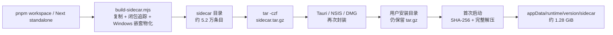
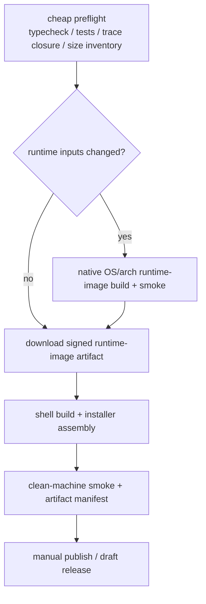

# T-487 桌面打包与首次启动体验调研：CreatorOS × skills-manager

> 日期：2026-07-23
> 范围：只读调研与设计，不触发本地打包，不触发 GitHub Actions。
> 目标：把 T-454 的“构建提速”与现有 Windows/macOS 打包、包体去重、首启白屏、运行时路径和失败恢复欠债合并为一个可验收任务。

## 0. 结论

CreatorOS 当前的问题不是单一的“压缩慢”，而是同一棵大运行时在四个阶段被反复处理：

1. 构建期从 pnpm/Next standalone 中递归复制并为 Windows 物化依赖；
2. 把约 5 万个条目压成 `sidecar.tar.gz`；
3. NSIS/DMG 再把这个大压缩包装进安装包；
4. 用户首次启动时再完整校验、完整展开到用户数据目录。

因此出现了三个同时成立的坏结果：

- CI 每次都做全量重活，Windows 最近一次成功构建约 53 分钟；
- 安装包以 sidecar 为绝对主体，本地样本 `sidecar.tar.gz` 为 406 MiB；
- 用户机器同时保存安装包内压缩副本与约 1.28 GiB 展开副本，首次启动还要写 5 万多个文件。

`skills-manager` 值得借鉴，但不能照抄。它快的根本原因是 **Tauri/Rust + Vite 静态前端，不携带 Next/Node sidecar、Chromium、ONNX、ffmpeg**。可迁移的是它的工程方法：

- 窗口先出现，非关键扫描/迁移转后台；
- 启动阶段逐段计时；
- 复制降级用内容哈希跳过未变化内容；
- 按 OS/arch 独立构建、缓存、签名与发布校验；
- 启动修复失败时保留可用数据并下次重试，不让窗口消失。

推荐的 CreatorOS 目标不是“换一个更快的 tar”，而是：

> **构建一次可复用的内容寻址 Runtime Image；macOS 直接从签名 App 资源运行；Windows 在安装器阶段一次性、可见进度地物化到用户选择的运行时位置；应用首启不再展开整棵 sidecar。**

同时先用低成本 RAT 验证 Windows 安装器 hook、生产依赖闭包和 macOS 直接运行三个硬问题；RAT 没过之前不得花钱跑正式双端包。

---

## 1. CreatorOS 现状证据

### 1.1 真实 CI 时间

GitHub Actions run [`29903305806`](https://github.com/zzyong24/Thirdspace-creator/actions/runs/29903305806)：

| 项目 | 时间 |
|---|---:|
| Windows build job | 08:16:04 → 09:09:30，约 53 分 26 秒 |
| 安装依赖 | 34 秒 |
| 安装 Playwright Chromium | 30 秒 |
| `release.mjs` 全链 | 08:19:03 → 09:08:37，约 49 分 34 秒 |
| 上传产物 | 39 秒 |

结论：主要瓶颈不是 checkout、依赖安装或上传，而是仓内全量打包链。

工作流当前把所有重活收进一个步骤，见：

- `.github/workflows/desktop-release.yml:82-109`
- `.github/workflows/desktop-release.yml:111-135`

### 1.2 本地包体与文件数样本

对 `frontend/src-tauri/sidecar.tar.gz` 做只读清单统计：

| 指标 | 结果 |
|---|---:|
| 压缩体积 | 425,950,940 bytes（约 406 MiB） |
| 展开体积 | 1,378,824,192 bytes（约 1.28 GiB） |
| tar 条目总数 | 52,212 |
| `node_modules` 条目数 | 49,816（95.4%） |
| `frontend` 条目数 | 2,309 |
| `backend` 条目数 | 54 |
| `lib` 条目数 | 25 |

这说明文件数问题主要来自 Node 依赖树，不是 CreatorOS 自己的业务文件。

### 1.3 当前打包链



关键代码：

- 全平台强制生成 tar：`frontend/scripts/desktop/build-sidecar.mjs:258-299`
- Windows 安装包强制只带 tar：`.github/workflows/desktop-release.yml:111-130`
- Rust 首启完整展开：`frontend/src-tauri/src/lib.rs:761-834`
- splash 只有阶段文案，无字节/文件进度：`frontend/src-tauri/src/lib.rs:837-850`
- 运行前同步等待解压：`frontend/src-tauri/src/lib.rs:881-916`

### 1.4 用户感知为何差

当前实现虽然先创建了原生窗口，但首启期间：

- 文案写死“约 1GB，5–10 分钟”，真实机器可到约 30 分钟；
- `tar::Archive::unpack` 没有进度回调，用户看不到已完成字节、文件数或剩余时间；
- 主业务 UI 必须等整棵 sidecar 解压、校验和 sidecar listen 后才能出现；
- 失败时虽会清理临时目录，但用户下一次只能整棵重来；
- 安装目录保留压缩副本，appData 再保存展开副本，磁盘压力翻倍；
- Windows 默认落在系统盘的用户目录，用户无法在安装阶段选择把约 1 GiB 运行时放到其他盘。

这违反产品宪法：

- 长任务必须可见、可恢复：`docs/产品定位.md:33-37`
- 异步运行不能无期限转圈：`docs/产品定位.md:328-336`
- 冷启动到可交互 P95 ≤ 5 秒：`docs/产品定位.md:370-376`
- 磁盘满、升级失败必须保留原数据并给恢复路径：`docs/产品定位.md:296-302`

### 1.5 已确认的配置漂移

T-454 把 Windows 从“直接目录资源”改回了“全平台 tar”，但三处旧契约没有同步：

| 位置 | 当前事实 | 漂移 |
|---|---|---|
| `build-sidecar.mjs:258-266` | Windows 也返回 `true`，生成 tar | 新事实 |
| `tauri.windows.conf.json:8` | Windows resource 是 `sidecar.tar.gz` | 新事实 |
| `build.rs:37-44` | Windows 仍把 `CREATOROS_SIDECAR_SHA256` 注入为空 | 旧逻辑 |
| `windows-runtime-config.test.mjs:11-23` | 仍断言 Windows 直接目录且不生成 tar | 旧测试 |
| `lib.rs:852-857` | 注释仍写 Windows 直接从安装目录运行 | 旧说明 |

风险：

- Windows 正式包可能只用 tar 文件大小作 stamp，而不是构建期 SHA-256；
- 测试若被执行会与生产配置相反；
- 后续修改者无法知道哪个契约才是真值。

这应作为 T-487 的 Wave 0 修复，但不能把“修漂移”误当成包体/体验治理已经完成。

---

## 2. skills-manager 参考项目

参考仓：`/Users/zyongzhu/Workbase/skills-manager`

### 2.1 为什么它的包小、构建快

| 项目 | skills-manager | CreatorOS |
|---|---|---|
| 前端 | Vite 静态资源 | Next.js standalone server |
| 本地服务 | Rust 命令 | Node sidecar + backend |
| 浏览器 | 系统 WebView | 系统 WebView + 随包 Chromium |
| AI/媒体 native runtime | 无 | ONNX、sharp、ffmpeg、ffprobe 等 |
| bundle resources | 无大型运行时 | `sidecar.tar.gz` |

依据：

- Vite build：`skills-manager/package.json:7-18`
- Tauri bundle 未声明大型 resources：`skills-manager/src-tauri/tauri.conf.json:39-53`

所以不能用“它 11 MiB，CreatorOS 也应 11 MiB”作为目标。

### 2.2 发行矩阵与缓存

`skills-manager/.github/workflows/release.yml:12-31` 一次覆盖：

- macOS arm64；
- macOS x64；
- Linux x64；
- Windows x64。

可借鉴点：

- action 固定 commit SHA：`:35-53`；
- Rust cache：`:51-60`；
- Windows 先做 `cargo check`：`:75-77`；
- Tauri build 与 updater 校验分 job：`:139-177`；
- Windows cache 保存会被锁文件误伤，因此显式 restore-only，而不是让成功包被 post-step 标红：`:54-60`。

v1.28.3 的公开结果：

| 产物 | 大小 |
|---|---:|
| Windows setup.exe | 11,509,301 bytes |
| Windows MSI | 15,872,000 bytes |
| macOS arm64 DMG | 19,542,420 bytes |
| macOS x64 DMG | 20,406,649 bytes |

发布 run [`29196364307`](https://github.com/xingkongliang/skills-manager/actions/runs/29196364307) 从 14:30:17 到 14:47:19，四平台并行 wall time 约 17 分钟。

### 2.3 启动性能治理

`skills-manager/src-tauri/src/lib.rs:771-834`：

- 记录 pre-builder、builder-to-setup 和 app state 初始化时间；
- logger 建好后输出各阶段耗时。

`skills-manager/src-tauri/src/lib.rs:843-862`：

- 曾有一个扫描并 hash 所有 skill 的修复逻辑，每次启动同步执行约 8 秒；
- 改为 UI 出现后 `spawn_blocking`；
- 修复函数本身还有“输入未变化则跳过”的幂等门。

`skills-manager/src-tauri/src/lib.rs:889-917`：

- 合并恢复、凭据迁移等工作放后台；
- 失败记录日志、下次再试，不阻塞窗口。

可直接迁移到 CreatorOS 的原则：

> 主窗口就绪路径只能保留“运行当前页面必需”的工作；修复、清理、迁移、更新和预热全部移出首屏关键路径，并且每项都有计时。

### 2.4 Windows 复制降级的哈希门

`skills-manager/src-tauri/src/core/scenario_service.rs:129-201` 的问题与 CreatorOS 有相似性：

- Windows symlink 创建失败后会降级为 Copy；
- 老实现每次启动都会再次尝试并整棵复制；
- 新实现记录 `source_hash`，内容未变化且目标存在时跳过重复复制。

可迁移的是“内容哈希 + 幂等跳过”，不可照抄的是链接策略：

- skills-manager 的 link 指向用户机器上长期存在的 central repo；
- CreatorOS 构建期 pnpm junction 指向 GitHub runner 的绝对路径；
- 把该 junction 带到用户机器一定断裂。

因此 CreatorOS 应产生 **自包含、零构建机绝对链接的 Runtime Image**，而不是复用构建机 node_modules 链。

---

## 3. 现成方案与候选路径

### 3.1 Next.js `output: standalone`（继续使用，但收紧）

官方说明：standalone 通过 Output File Tracing 复制生产运行需要的文件与部分 `node_modules`，避免把完整依赖集带入部署；monorepo 需要明确 tracing root。
参考：[Next.js output 配置](https://nextjs.org/docs/15/app/api-reference/config/next-config-js/output)。

CreatorOS 已经使用 standalone，但又额外做了多套闭包补齐和递归物化。下一步不是重复开启 standalone，而是：

1. 生成“官方 trace 声明需要的集合”；
2. 记录“CreatorOS 因动态加载额外补入的集合”；
3. 每个额外包必须有功能/测试证据；
4. 禁止无归属的整棵 node_modules anchor。

### 3.2 `pnpm deploy --prod`（RAT 候选）

官方 `pnpm deploy` 会在目标目录生成自包含、可移动的 isolated `node_modules`，并可用 `files` / `.npmignore` 控制文件集。
参考：[pnpm deploy](https://pnpm.io/cli/deploy)。

它可能替代一部分 `pkgNameOfEntry`、`resolveEntryPkgDir` 和递归嵌套物化，但不能直接认定适用：

- Next standalone 已经是一次部署裁剪；
- CreatorOS 有动态加载、原生 `.node`、Pi/Xenova/Playwright 特例；
- Windows 必须验证目标目录没有指向 workspace/store 的 junction；
- 需要用功能闭包 smoke 证明扫码、转录、渲染、AI 四条主链均可运行。

结论：进入 RAT，不直接替换生产链。

### 3.3 Tauri 标准 NSIS + installer hooks（Windows 候选）

Tauri v2 官方支持：

- 自定义 NSIS template；
- `NSIS_HOOK_PREINSTALL` / `POSTINSTALL` 等 installer hooks；
- `installMode` 和资源文件；
- 安装依赖后清理临时资源。

参考：[Tauri Windows Installer](https://v2.tauri.app/distribute/windows-installer/)。

进一步核对 Tauri 官方 NSIS 模板后确认：标准交互安装本来就有 `MUI_PAGE_DIRECTORY` 安装目录页。更简单的首选候选不是另造 runtime 选盘 UI，而是让 runtime 跟随用户选择的 `$INSTDIR`；当前大文件仍落 C 盘，是 CreatorOS 自己在 Rust 中解到 `%APPDATA%`，不是 Tauri 强制。

这使“安装阶段一次性解 runtime payload + 删除安装目录 payload”有官方扩展面，不必让应用首次启动做 30 分钟工作。但 hook 只是扩展点，不是现成的大 runtime 事务/进度系统，仍需 RAT 验证：

- hook 能否稳定更新 NSIS 进度条/详情；
- 失败退出码是否阻止安装完成；
- 用户选择的数据盘如何安全落 registry/config pointer；
- updater `/UPDATE` 是否沿用已选 runtime root；
- 卸载是否只删 runtime，不碰 DB/素材。

若 stock NSIS + hooks 不能持续显示真实进度或安全保留 `lastGood`，才进入 custom template RAT；不能把“官网支持 hook”写成“官网已经证明本方案可行”。完整核对见：[Tauri 官方 Windows 打包最佳实践核对](2026-07-23-tauri-windows-packaging-official-practices.md)。

### 3.4 直接把整个 Next 应用变成单二进制（暂不采用）

Node SEA、`pkg`、esbuild/ncc 都可能减少文件数，但 CreatorOS 同时依赖：

- Next 动态路由与 server chunks；
- `.jsc` 字节码；
- 原生 `.node`；
- Playwright 浏览器；
- ONNX/sharp；
- 动态工具/provider。

在没有全功能 spike 之前，把它当成既定方案会制造新的“构建绿、用户机坏”。因此只保留为中长期 HARD-PKG-04，不进入第一阶段承诺。

---

## 4. 推荐架构

### 4.1 一个逻辑 Runtime Image，按能力分层

```text
runtime-manifest.json
├── core       Next standalone + backend + launcher（应用启动必需）
├── browser    Chromium + Playwright bridge（采集/渲染需要）
├── media      ffmpeg + ffprobe（音视频需要）
└── local-ai   ONNX/Xenova/native bindings（本地 AI 需要）
```

每层有：

- `id = sha256(platform + arch + dependency inputs + file manifest)`；
- 路径、大小、文件数、SHA-256；
- OS/arch、Node ABI、Chromium revision；
- 能力 owner 与最小 smoke；
- 是否启动必需。

第一阶段仍默认离线全量随包，不把问题转嫁为“首启联网下载”。分层先用于缓存、验证、增量更新和可观察性；是否拆成可选下载是未来独立产品决策。

### 4.2 macOS

目标：

- 把已组装好的只读 Runtime Image 注入 `.app/Contents/Resources/runtime/`；
- 保留必要相对 symlink；
- 注入后重新 codesign 并硬校验；
- sidecar 直接从 App resource 启动；
- appData 只存 DB、素材、日志和可再生缓存，不再复制完整 runtime。

这消除首次启动整包解压和安装目录/运行目录双副本。

### 4.3 Windows

目标：

- 安装包仍只携带少量 runtime payload 文件，避免 NSIS 构建遍历数万文件；
- 首选复用 Tauri 标准安装目录页，由用户选择 C/D 盘；
- NSIS hook 在安装阶段把 payload 解到 `$INSTDIR/runtime-images/.staging/<id>`；
- 安装页显示真实 bytes/files/elapsed，1 秒至少更新一次；
- 校验后原子切换 `current` pointer；
- 完成后删除 `$INSTDIR/resources/runtime-payload-*`，安装目录不再保留第二份大 payload；
- 首次启动只验证 manifest/current pointer，不再全量解压。

路径：

- shell 与只读 runtime 默认一起安装到 `%LOCALAPPDATA%\Programs\CreatorOS`，并允许通过标准目录页整体选到其他本地 NTFS 盘；
- DB、素材、日志等可写用户数据继续使用 canonical dataRoot；
- 只有 updater/回滚 RAT 证伪 `$INSTDIR/runtime-images` 时，才引入独立 runtimeRoot 与自定义选盘页；
- DB、素材位置变更仍走应用内受控迁移，不由卸载器擅自搬动。

### 4.4 CI



核心变化：

- Runtime Image 与 shell/installer 解耦缓存；
- key 必须包含 lockfile、Next config、sidecar scripts、native ABI、browser revision、OS/arch；
- 普通 PR 只跑 cheap preflight；
- 正式包只在手动选择单平台或 tag 发布时跑；
- 双平台并行，不让 Windows 问题拖 mac；
- 失败产出阶段时间、体积清单与重复文件报告，不再只给“release.mjs 失败”。

---

## 5. T-454 合并关系

| 旧任务/欠债 | 合并后归属 |
|---|---|
| T-454 sccache、构建提速 | T-487 CI 缓存与 runtime-image 复用 |
| T-454 `cpSync` 不可盲改 | T-487 production closure RAT + 内容清单 |
| T-446/T-454 tar/direct 反复切换 | T-487 按平台安装策略 |
| T-437 mac 首启白屏 | T-487 mac 直接资源运行 + clean-machine gate |
| T-372 Windows junction 物化 | T-487 Windows 零外链 Runtime Image |
| T-284 Chromium 随包 | T-487 browser layer，继续离线随包 |
| T-485 统一路径 | T-487 runtimeRoot/dataRoot 安装契约 |

T-451 的授权/反逆向属于安全信任边界，不并入本任务；T-487 只确保打包重构不绕过其 smoke 和完整性门。

---

## 6. 先做的低成本 RAT

在任何正式付费打包前，必须完成：

1. **RAT-PKG-01 production closure**：在现有构建产物上生成文件 owner/来源/大小/hash 清单；比较 current、Next trace、`pnpm deploy --prod` 三种闭包，选出零断链且重复最少的一种。
2. **RAT-PKG-02 Windows installer hook**：用 100–500 MiB 伪数据包验证进度、路径选择、磁盘不足、取消、失败清理、升级复用；不构建 CreatorOS 正式 sidecar。
3. **RAT-PKG-03 mac direct runtime**：在临时 `.app` fixture 注入带 symlink + dylib 的小 runtime，重签后在隔离环境直起；不跑全业务包。
4. **RAT-PKG-04 cache correctness**：修改 shell-only 文件应命中 runtime cache；修改 lockfile/native/browser revision 必须失效。
5. **RAT-PKG-05 contract drift**：修正 Windows tar/hash/test 漂移并让静态契约测试先绿。

任一 RAT blocker 未解决，不进入正式 Windows/mac 双端构建。

---

## 7. 量化目标建议

以当前证据为 baseline：

| 指标 | 当前 | T-487 目标 |
|---|---:|---:|
| Windows 成功 build job | 53m26s | runtime cache 命中时 ≤ 20 分钟 |
| `release.mjs` 单步 | 49m34s | 拆段；任一阶段可单独定位，最长阶段 ≤ 15 分钟 |
| 首次启动展开 | 用户报告约 30 分钟 | 0 次整包展开；冷启动可交互 P95 ≤ 5 秒 |
| 首屏进度 | 静态文案 | 不可避免的安装准备每 ≤1 秒更新真实进度 |
| 本地 runtime 双副本 | tar + 展开目录 | 安装完成后大 payload 副本为 0 |
| 包内条目 | 52,212 | 先建立预算；相对 baseline 文件数至少下降 30% |
| byte-identical 重复 | 未自动统计 | 重复 bytes 相对 baseline 至少下降 80% |
| 构建付费浪费 | 每次全链 | 正式 runner 启动前 cheap gate 全绿；默认单平台 |

包体压缩大小不承诺“像 skills-manager 一样 20 MiB”，因为 Chromium/ONNX/媒体能力是 CreatorOS 的真实产品成本。第一阶段承诺：

- 不允许相对 baseline 增长超过 5% 而无 DEC；
- 去掉可证明的重复文件；
- 每个大于 10 MiB 的 layer/file 都有 owner 和功能依据；
- RAT 完成后用真实 manifest 再冻结绝对 MiB 预算。

---

## 8. 调研结论的边界

- 本文没有执行任何 CreatorOS 构建；
- 本地 tar 是 2026-07-20 的 macOS 样本，Windows 新包文件数/展开体积需由 manifest gate 自动采集；
- skills-manager 的包体只用于解释架构差异，不能作为 CreatorOS 绝对体积验收；
- Windows NSIS hook 与 macOS 直接资源运行虽然有官方/技术入口，但必须先过 RAT；
- macOS Intel 只有在 x64 原生 Node/native/browser runtime 的 clean-machine smoke 通过后才能宣称支持；不能用 arm 构建产物或交叉编译假装兼容。
