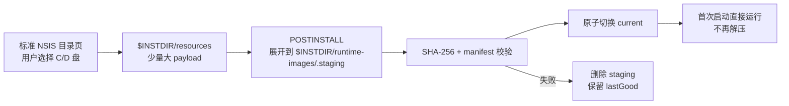

# T-487 Tauri 官方 Windows 打包最佳实践核对

> 状态：PLAN 研究证据，不是已确认架构，不授权正式构建。
> 调研日期：2026-07-23。
> 口径：只使用 Tauri 官方文档、官方配置参考和 Tauri 官方仓库中的 NSIS 模板，与 CreatorOS 当前代码逐项核对。

## 1. 大白话结论

CreatorOS 不需要另造一套完全脱离 Tauri 的 Windows 安装器。更符合 Tauri 官方能力边界、也更简单的候选路径是：

1. 继续用 **Windows 原生 runner + NSIS**；
2. 继续让安装包只携带少量大 payload，不让 NSIS 在构建时枚举 5 万多个小文件；
3. 优先复用 Tauri 标准 NSIS 的安装目录页，让用户直接选择 C/D 盘；
4. 安装器在 `NSIS_HOOK_POSTINSTALL` 中把 runtime 解到所选 `$INSTDIR` 下的只读 runtime 目录；
5. 解压、校验、失败清理和升级保留必须先用 fixture 验证；仅靠 hook 做不出真实进度时，再升级为自定义 NSIS template；
6. 应用首次启动只验证并启动 runtime，不再复制或解压；
7. 用户数据仍留在 canonical dataRoot，不能跟着卸载器删除。

当前“用户选 D 盘但大文件仍写 C 盘”的根因，不是 Tauri 强制装 C 盘，而是 CreatorOS 在 Rust 中明确把 runtime 解到 `app_data_dir()/runtime/<version>`。



## 2. 官方事实

### 2.1 Windows 应由 Windows 原生环境构建

Tauri 官方明确说：

- Windows 支持 NSIS `-setup.exe` 与 WiX `.msi`；
- MSI 只能在 Windows 上构建；
- 从 Linux/macOS 交叉构建 NSIS 存在 caveat，测试覆盖也较少，只应作为本地 VM 或 CI 都不可用时的最后手段；
- Tauri 正式支持的是 MSVC Windows target。

来源：[Tauri Windows Installer](https://v2.tauri.app/distribute/windows-installer/)。

对 CreatorOS 的裁决：

- 保留 `windows-latest` 原生 runner；
- 不用 macOS 云主机交叉编译替代 Windows 发布证据；
- 本地 macOS 只做静态检查和 fixture，不宣称 Windows 包可用。

### 2.2 标准 NSIS 已有安装目录页

Tauri 官方 NSIS 模板包含 `MUI_PAGE_DIRECTORY`。正常交互安装时，用户可以选择安装目录；passive/update 模式会跳过该页面。

来源：[Tauri 官方 NSIS 模板](https://github.com/tauri-apps/tauri/blob/dev/crates/tauri-bundler/src/bundle/windows/nsis/installer.nsi)。

这意味着：

- 首次安装不必为了“选 D 盘”就先写整套自定义安装器；
- runtime 若随 `$INSTDIR` 放置，标准目录页已经能决定它落在哪个盘；
- 更新不能再次询问目录，必须恢复旧安装位置并复用既有 runtime location；
- 当前 CreatorOS 把 runtime 解到 `%APPDATA%`，绕过了用户选择的 `$INSTDIR`，才导致大文件继续落 C 盘。

### 2.3 `installMode` 只决定安装范围，不等于数据盘策略

Tauri 默认 `currentUser`：

- 不需要管理员权限；
- 默认安装到 `%LOCALAPPDATA%`。

`perMachine` 安装到系统范围并要求管理员权限；`both` 允许选当前用户/所有用户，但官方说明安装器会要求管理员权限。

来源：[Tauri Windows Installer - Install Modes](https://v2.tauri.app/distribute/windows-installer/#install-modes)。

CreatorOS 当前为：

```json
{
  "nsis": {
    "compression": "zlib",
    "installMode": "both"
  }
}
```

影响：

- 当前安装天然引入 UAC；
- “both”解决的是用户范围，不解决 runtime/data 写到哪个盘；
- 消费级 CreatorOS 若没有明确的全机共享需求，候选默认应回到 `currentUser`；
- 是否保留 `both` 属于发布体验变更，最终定案前需用户确认。

### 2.4 installer hook 是官方扩展面，但不是大 runtime 的现成事务系统

Tauri 官方提供：

- `NSIS_HOOK_PREINSTALL`
- `NSIS_HOOK_POSTINSTALL`
- `NSIS_HOOK_PREUNINSTALL`
- `NSIS_HOOK_POSTUNINSTALL`

官方示例会在 `POSTINSTALL` 检查系统依赖、执行安装器、检查退出码并清理临时文件。

来源：[Tauri Windows Installer - Extending the Installer](https://v2.tauri.app/distribute/windows-installer/#extending-the-installer)。

可以确认：

- payload 作为 Tauri resource 后可从 `$INSTDIR/resources` 使用；
- postinstall 可以执行 helper、判断 exit code、删除临时 payload；
- uninstall hook 可以清理 runtime。

不能仅凭官网确认：

- 5 万文件展开时能否连续提供 bytes/files 真实进度；
- hook 失败能否完全恢复安装器事务；
- updater `/UPDATE` 触发卸载/覆盖时如何保留 `lastGood`；
- 取消时能否做到 staging 零残留；
- antivirus 锁文件时是否能重试并安全回滚。

所以 RAT-PKG-02 仍是 blocker；若 hook 只能显示一条静态文案，应改用自定义 NSIS template/helper IPC，不能把重活重新塞回应用首启。

### 2.5 NSIS 压缩应按真实 payload 测，不凭感觉改

Tauri 支持 `zlib`、`bzip2`、`lzma`、`none`：

- 默认 `lzma` 压缩率高、构建较慢；
- `zlib` 更快；
- `none` 不再压缩。

来源：[Tauri Configuration - NsisCompression](https://v2.tauri.app/reference/config/#nsiscompression)。

CreatorOS 已选 `zlib`，说明它已经偏向构建速度，而不是默认的最高压缩率。但 `sidecar.tar.gz` 自身已压缩，再被 NSIS `zlib` 包一层可能收益很小。

正确动作不是直接改成 `none`，而是在同一 fixture 上记录：

- installer 构建时间；
- setup.exe 大小；
- 安装复制/展开时间；
- 峰值临时磁盘；
- Windows Defender 开启时的结果。

只有总体验更优才改。

### 2.6 WebView2 必须显式形成发布口径

Tauri Windows 安装器默认使用 `downloadBootstrapper`：目标机器没有 WebView2 时联网下载。官方还支持：

| 模式 | 是否要求联网 | 官方给出的包体增量 | 适用口径 |
|---|---:|---:|---|
| `downloadBootstrapper` | 是 | 约 0 MiB | 默认、小包 |
| `embedBootstrapper` | 是 | 约 1.8 MiB | 启动器随包，但安装仍需联网 |
| `offlineInstaller` | 否 | 约 127 MiB | 真正离线安装 |
| `fixedVersion` | 否 | 约 180 MiB | 自己固定 WebView 版本 |
| `skip` | 否 | 0 MiB | 官方不推荐；缺 WebView2 时应用无法工作 |

Windows 10 较新版本和 Windows 11 通常随系统提供 WebView2，但不能以“通常有”替代缺失处理。

来源：[Tauri Windows Installer - WebView2 Installation Options](https://v2.tauri.app/distribute/windows-installer/#webview2-installation-options)。

CreatorOS 当前未显式配置 `webviewInstallMode`，因此使用默认联网 bootstrapper。当前候选 SPEC 又写“第一阶段全量离线随包”，两者存在口径缺口。

需要用户最终确认：

- 主安装包是否允许“仅在系统缺 WebView2 时联网补齐”；
- 若要求完全离线，是否接受约 127 MiB 的额外包体，或另发离线安装包；
- 不采用 `skip`。

### 2.7 更新必须有可见进度，不能 quiet

Tauri updater 在 Windows 的默认和推荐模式是 `passive`：

- 显示小型进度窗口；
- 不要求用户逐步操作；
- `quiet` 无进度，且不能自行请求管理员权限，官方不推荐。

Tauri v2 的 Windows updater 直接复用 NSIS/MSI 安装器并生成对应 `.sig`；updater 签名是强制信任链。

来源：[Tauri Updater - installMode on Windows](https://v2.tauri.app/plugin/updater/#installmode-on-windows)。

CreatorOS 当前 updater endpoints 为空，客户端实际不自动更新；但发布脚本仍生成签名 updater artifact。若将来恢复自动更新：

- 明确配置 `windows.installMode = "passive"`；
- 更新安装器必须复用原 `$INSTDIR` 和 runtime state；
- postinstall hook 必须在 `/UPDATE` 路径跑同一套校验/回滚；
- 不能把 updater minisign 当成 Windows Authenticode。

### 2.8 Windows 对外发布要有 Authenticode

Tauri 官方说明 Windows code signing 用于避免浏览器下载后的 SmartScreen 不信任警告，也是 Microsoft Store 分发要求。Tauri 支持证书 thumbprint、SHA-256、timestamp URL 或自定义/云签名命令。

来源：[Tauri Windows Code Signing](https://v2.tauri.app/distribute/sign/windows/)。

CreatorOS 当前：

- `certificateThumbprint: null`；
- release 记录诚实写“未 OS 签名”；
- updater minisign 已存在。

因此：

- 内测包可以继续明确标“未签名”；
- 正式对外 Windows 发布必须把 Authenticode + timestamp 作为 release gate；
- updater minisign 保护更新包来源，不能消除 SmartScreen，两者不是替代关系。

### 2.9 `externalBin` 适合 launcher，不会自动解决 SSR 文件树

Tauri 官方 Node sidecar 示例建议将 sidecar 构造成按 target triple 命名的单个外部二进制，并通过 `bundle.externalBin` 带入。

来源：[Tauri Node.js as a sidecar](https://v2.tauri.app/learn/sidecar-nodejs/)。

CreatorOS 已把 Node runtime 当 `externalBin` launcher，但 Next SSR、native addon、Chromium、ffmpeg、ONNX 仍需要真实文件树。官方 sidecar 文档没有提供自动收集这棵生产依赖树的机制，所以：

- `externalBin` 继续负责 launcher；
- Runtime Image/production closure 仍由 T-487 解决；
- 不能因为官网示例是单二进制，就直接把 CreatorOS 动态资产删掉。

## 3. CreatorOS 当前配置核对

| 项目 | 当前事实 | 官方对照 | 判定 |
|---|---|---|---|
| Tauri CLI / Rust crate | CLI 2.11.4；`tauri` 2.11.5 | 同一 2.11 minor | 可用；发布清单应记录两者 |
| Windows target | 仅 `nsis` | NSIS/WiX 都支持 | 当前先保留 NSIS，避免多产一份无价值 MSI |
| 原生 runner | `windows-latest` | 官方优先原生 Windows | 对齐 |
| installMode | `both` | 默认/低权限为 `currentUser`；`both` 要 UAC | 需 RAT + 用户确认 |
| 安装目录页 | 标准 Tauri template | 官方已有 | 应优先复用 |
| runtime 路径 | Rust 解到 `%APPDATA%/.../runtime` | 非 Tauri 强制 | C 盘问题根因 |
| NSIS compression | `zlib` | 快于默认 LZMA | 不直接改；对比 `none` |
| WebView2 | 未配置，走默认在线 bootstrapper | 官方默认 | 与“完全离线”口径冲突 |
| updater UI | 未显式设 Windows mode；endpoints 为空 | 默认 passive；当前未启用客户端自动更新 | 保留签名产物，恢复时显式 passive |
| Windows OS 签名 | 未签名 | 对外发布建议/Store 要求签名 | 正式发布 blocker |
| sidecar | launcher 用 `externalBin`；资产用 tar resource | 官方 externalBin 只管 binary | 合理，但首启解压位置错误 |
| 配置/测试一致性 | Windows 实际 tar，测试仍断言 direct directory | 官方无关，属于本仓 drift | RAT-PKG-05 已观察 FAIL |

## 4. 对候选架构的修订

### 4.1 Windows 默认候选：runtime 跟随 `$INSTDIR`

优先验证：

```text
$INSTDIR/
├── CreatorOS.exe
├── creatoros-server.exe
├── runtime-images/
│   ├── <runtimeId>/
│   ├── current.json
│   └── last-good.json
└── resources/
    └── runtime-payload-<runtimeId>.tar.zst  # 安装成功后删除
```

优点：

- 用户用 Tauri 标准目录页选 D 盘后，大 runtime 真正跟到 D 盘；
- 不需要再做一套 runtimeRoot 选择页；
- 应用目录只读、用户数据目录可写，职责清楚；
- 首次启动没有整包复制。

前提：

- `currentUser` / `perMachine` 两种权限下都能在 installer hook 中完整物化；
- updater 能恢复原 `$INSTDIR`；
- update uninstall 不会提前删除唯一 `lastGood`；
- full uninstall 能删 runtime，但默认不删用户项目/数据库/密钥；
- antivirus 锁文件时不会留下“安装成功但 runtime 不完整”。

### 4.2 备用候选：独立 runtimeRoot

只有以下任一事实成立时，才保留单独 runtimeRoot 选择页：

- Tauri updater 无法安全保留 `$INSTDIR/runtime-images/lastGood`；
- 产品明确要求 shell 与 runtime 分盘；
- 企业 perMachine 与多用户共享 runtime 是确定需求；
- 标准目录页不能满足磁盘空间/权限提示。

这一路径需要自定义页面、registry pointer、迁移和卸载语义，复杂度明显更高，不应作为无证据默认。

## 5. RAT-PKG-02 应新增的验证矩阵

全部使用 100–500 MiB fixture，不生成 CreatorOS 正式安装包：

| 维度 | 组合/故障 | 必须记录 |
|---|---|---|
| 安装模式 | `currentUser`、`both` | UAC、默认路径、D 盘选择、升级复用 |
| runtime 位置 | `$INSTDIR/runtime-images`、独立 runtimeRoot | 首启时间、卸载、更新、回滚复杂度 |
| NSIS 压缩 | `zlib`、`none` | 构建时间、包体、安装时间、峰值磁盘 |
| WebView2 | 系统已有、缺失且在线、缺失且离线 | 用户提示、退出码、可恢复动作 |
| 安装状态 | 首装、覆盖升级、降级拒绝、取消、磁盘满 | current/lastGood/staging |
| 安全软件 | Defender 开启，注入一次文件占用 | 重试、错误文案、残留 |
| updater | `/UPDATE` + passive | 原路径、进度、用户数据不变 |
| uninstall | 普通卸载、用户主动勾选清数据 | runtime 与用户数据边界 |

采用门：

- stock NSIS + hooks 全部满足：不用 custom template；
- 只有真实进度/状态恢复做不到：允许进入 custom template RAT；
- custom template 仍不满足：回 PLAN 选独立 bootstrapper，不回退首启白屏。

## 6. 当前需要用户确认、但本轮不替用户决定

1. `DEC-PKG-02`：优先验证 runtime 跟随 `$INSTDIR`；只有 RAT 证伪才采用独立 runtimeRoot。
2. `DEC-PKG-03`：CreatorOS 消费版是否改用 `currentUser`，取消默认 UAC。
3. `DEC-PKG-04`：主包允许缺 WebView2 时联网补齐，还是承担约 127 MiB 做完全离线。
4. `DEC-PKG-05`：Windows 正式对外发布前是否购买/接入 Authenticode；未接入前只能标内测未签名。

这些确认都不等于授权付费构建。先用本地 fixture 收集证据，再请求最终架构确认。
