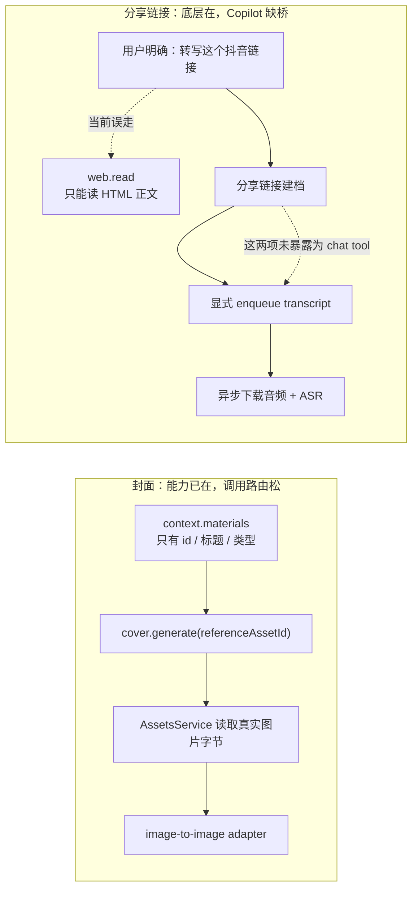

# Copilot 封面参考图与抖音分享链接转写路由诊断

> 日期：2026-07-24  
> 任务：T-508  
> 范围：CreatorOS 桌面 APP 的 Copilot 工具编排；本轮只读诊断，不改生产代码。  
> 隐私：未读取或输出 Cookie、API Key。

## 一句话结论

两条反馈不是同一个问题：

1. **封面图生图底层已经接通，Copilot 本轮没有按已有工具协议执行。**语言模型通过
   `context.materials` 只能看到 `id/title/kind`，所以它确实不能自己描述图片；但用户要的是
   生成，不需要它先“看懂”。它应该直接把 asset id 传给 `cover.generate`，后台会读取真实
   图片字节并交给生图模型。让用户在 A/B 中再确认一次属于多余摩擦。
2. **任意抖音分享链接的“建档→显式转写”底层链存在，但没有暴露给 Copilot。**
   Copilot 目前只有通用 `web.read` 和“已有自己项目”的 `project.transcribe`，没有
   `intelligence.items.importDouyinShare` / `intelligence.transcripts.enqueue` 对应的聊天工具，
   所以模型错误地用网页正文读取视频页，拿不到音轨后只能拒绝。

## 1. 封面参考图链

### 已存在的真能力

| 链段 | 代码证据 | 判断 |
|---|---|---|
| 找参考素材 | `backend/src/modules/ai-runtime/chat-tools.ts:473-478,3177-3196` | `context.materials` 只回 `id/title/kind`，不是视觉读取工具 |
| 工具入参 | `backend/src/modules/ai-runtime/chat-tools.ts:1819-1844,2887-2910` | `cover.generate` 已有 `referenceAssetId`，描述明确要求直接传参考图 |
| 对话透传 | `backend/src/modules/ai-runtime/chat-runner.ts:1401-1435` | asset id 会进入 cover task |
| 读取图片 | `frontend/src/server/persistence-client.ts:4477-4482` | host 用 `assetsService.getAssetBytes` 做 user-scoped 字节读取 |
| runner | `backend/src/modules/ai-runtime/cover-runner.ts:283-325` | 读取成功后构造 `referenceImage` 交给统一生图工厂 |
| OpenAI-compatible | `ai-worker/src/runtime/multimodal-openai-images.ts:108-153` | 参考图走 `/v1/images/edits` multipart |
| MiniMax | `ai-worker/src/runtime/multimodal-minimax.ts:72-99` | 参考图进入 `subject_reference` |

定向测试：

- `backend/src/modules/ai-runtime/cover-runner.test.ts`：12/12 通过；
- `ai-worker/src/runtime/multimodal-openai-images.test.ts` +
  `multimodal-minimax.test.ts`：17/17 通过。

打包 sidecar 历史日志也记录过真实调用：

- `2026-07-17 16:21/16:22`：只调用 `context.materials` 后结束，复现“查到了但没生成”；
- `2026-07-17 16:23`：用户继续推动后才调用 `cover.generate`，说明工具可用但模型多问了一轮。

### 真正缺口

1. 当前主要依赖工具 description 和“顺手能做就直接做”的 system prompt，没有确定性的
   “最新封面参考生成”路由门；弱模型可能把“我不能视觉预览”误推导成“系统不能图生图”。
2. `context.materials` 没有 preview URL/视觉摘要，因此语言模型如果要先解释构图、颜色、字体，
   确实没有可用的视觉读取工具。现有 `asset.classify` 能看图，但只做后台标签和一句话描述，
   没有暴露给 Copilot，也不满足封面风格拆解。
3. `image.generate` 配置目前没有单独声明/测试 `image.edit` 或 reference-image 能力；
   OpenAI-compatible adapter 会直接尝试 `/images/edits`。中转站或模型只支持纯文生图时，
   连接测试通过仍可能在图生图阶段失败。
4. MiniMax 的 `subject_reference` 适合主体参考，是否能稳定保持“构图、配色、字体风格”必须用
   真实 Key 做 provider 级 RAT；当前代码注释也明确记录该字段未经过真 Key 验证，不能承诺
   像素级复刻。

### 最小修复边界

- 对“以最新/某张封面为参考生成”意图增加确定性编排：查到唯一 image asset 后直接调用
  `cover.generate(referenceAssetId)`；只有 0 条或多条歧义才问用户；
- 返回结果必须显示“已使用参考图 / 参考图读取失败后未使用”，禁止静默降为纯文生图；
- T-501 的 provider capability 增加 `image.edit/referenceImage` 探针与状态；不支持时在执行前说明；
- 若用户要求先分析风格，再增加只读 `asset.visual.inspect`，复用现有 vision 字节读取能力；
  单纯图生图不应强制多配一个视觉模型。

## 2. 抖音分享链接转写链

### 已存在的真能力

内容雷达已有完整的两步、持久异步链：

| 链段 | 代码证据 | 判断 |
|---|---|---|
| 分享链接建档 contract | `contract/src/operations/intelligence.ts:375-405` | `intelligence.items.importDouyinShare` 和 `intelligence.transcripts.enqueue` 是两个明确操作 |
| 建档不自动转写 | `backend/src/modules/intelligence/intelligence.service.ts:2577-2813` | 分享链接创建/复用分类→博主→作品，`transcriptQueued:false`，符合用户此前口径 |
| 手动异步转写 | `backend/src/modules/intelligence/transcript-runner.ts:61-158` | 用户 enqueue 后持久任务 claim、ASR、写回 transcript，失败有结构化状态 |
| 真音频与 ASR | `frontend/src/server/persistence-client.ts:6094-6150` | 按 externalId 取抖音视频源、下载音频，走云 ASR 或本地 Whisper |
| UI 入口 | `frontend/src/features/intelligence/intelligence-workbench.tsx:1400-1455` | 内容雷达已经能粘分享文本并异步“识别并建档” |

定向测试：

- 默认 5 秒超时下，PGlite 初始化较慢导致 2 个用例 timeout，不能伪报全绿；
- 用只读验证参数 `--testTimeout=30000` 重跑：
  `shared-item-import.test.ts` + `transcript-runner.test.ts` 为 3/3 通过；
- 这证明领域链可执行，但也暴露测试默认超时对当前机器不稳定。

### Copilot 为什么说没有工具

`ALL_CHAT_TOOL_NAMES` 有：

- `web.read`：读网页 HTML 正文；
- `project.transcribe`：只对已经关联抖音的“自己的项目”按 projectId 转写。

但没有：

- 分享文本解析/建档 chat tool；
- 针对 intelligence item 的 transcript enqueue chat tool；
- 接收任意抖音分享链接并串联上述两步的组合工具。

同时 `web.read` 的描述是“用户粘链接要读取时优先调用”，却没有排除抖音视频链接，所以模型按现有
工具定义调用 `web.read` 并不意外。sidecar 历史日志也只出现连续 `web.read`，没有
`project.transcribe`；截图中的“只读到账号简介”是 HTML 抽取结果，不是 ASR 结果。

### 正确工作流

用户只粘链接但没有要求转写时：

1. 只做“分类→自动创建/复用博主→作品建档”；
2. 不自动下载音频、不自动 ASR。

用户明确说“提取逐字稿/ASR/转写这个链接”时，这本身就是手动授权：

1. 新增 Copilot 组合工具接收 `shareInput` 和可选 `collectionId`；
2. 幂等 enqueue 分享建档；
3. 建档得到 itemId 后自动串联一次 `intelligence.transcripts.enqueue`；
4. 对话立即返回持久任务卡，不阻塞 1–3 分钟；
5. 卡片展示排队/运行/完成/登录失效/ASR 未配置/无口播，并允许完成后查看逐字稿；
6. 刷新或重试不得重复下载、重复 enqueue。

这不是让 Copilot 直接抓 Cookie 或直连数据库；它只调用 backend service port，复用内容雷达的
归属、幂等与持久任务真值。

## 3. 当前裁决

- “为什么不能预览”：语言模型只能拿到素材元数据，不能视觉描述；但图生图 runner 能读取真实
  图片，所以它不应该因此拒绝生成。
- “生图模型可以图生图吗”：代码支持，但需要 provider/model 真正支持 reference image；
  当前缺少独立能力探针，不能把纯文生图测试通过等同于图生图可用。
- “分享链接可以直接提逐字稿吗”：内容雷达底层可以，Copilot 当前不可以；缺的是 chat tool
  编排桥，不是 ASR runner。
- 实现时应把封面确定性路由与抖音分享链接组合工具一起收口，避免再靠模型猜该调哪个工具。
