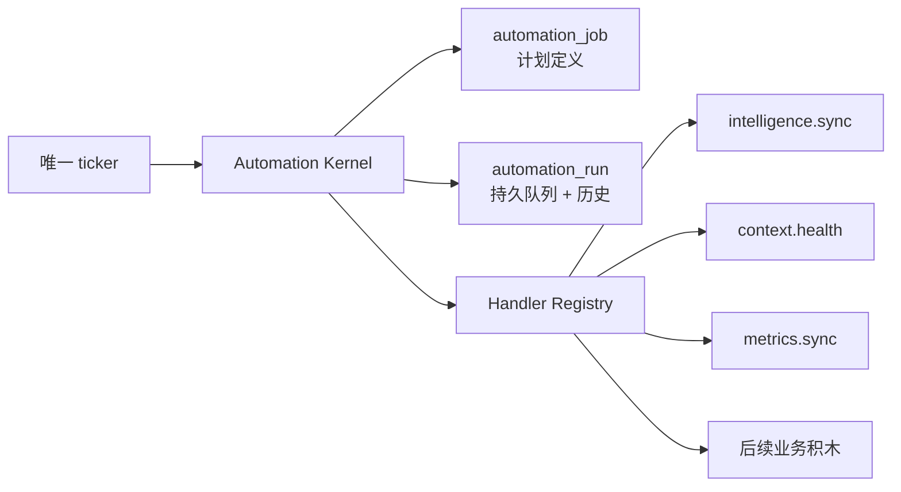

# CreatorOS Automation Kernel 开源方案取经与轻量底座建议

> 日期：2026-07-24  
> 任务：T-517  
> 状态：研究完成，作为 replacement PRODUCT SPEC 的输入；未授权修改生产代码  
> 结论：借鉴成熟队列/调度器的状态模型与原子语义，但不直接引入外部调度服务、Redis 或完整工作流引擎。

## 一句话结论

CreatorOS 需要的不是 Temporal 级工作流平台，也不是继续扩展现有“采集专用 scheduler”，而是一个
内置、数据库持久化、单进程可恢复的轻量 Automation Kernel。所有业务只注册 handler 和 typed
payload；唯一调度时钟、run 生命周期、幂等、重试、补跑、账号隔离和运行回显全部由 Kernel 持有。



## 1. 现有实现为什么不是合格底座

现有模块名称叫 scheduling，但核心模型仍是采集业务模型：

1. `scheduled_job` 强制 `source_kind/target/tool_grants/recipe`，不是通用 handler envelope：
   `backend/src/schema/scheduling.ts:28-50`。
2. `scheduledJobSourceKind` 是六个采集枚举；加新业务必须改共享枚举：
   `contract/src/primitives.ts:179-187`。
3. 触发器固定创建 `ai_task`，taskType 固定为 `scheduled.${sourceKind}`：
   `backend/src/modules/ai-runtime/scheduled-collection-scheduler.ts:170-212`。
4. run 的核心结果是 `itemsNew/itemsUpdated/needs_reconnect`，仍是采集语义：
   `contract/src/resources/scheduling.ts:62-75`。
5. cron 以进程本地时间匹配，幂等却使用 UTC 自然日；没有统一 timezone、misfire 和 overlap policy：
   `backend/src/modules/ai-runtime/scheduled-collection-scheduler.ts:104-123,323-355`。
6. 执行顺序为 task→run→fire-and-forget dispatch，三者没有原子持久边界；崩溃可能留下孤儿 task/run。

裁决：旧系统作为“六类定时采集器”曾经合理，但不能继续冒充系统基础设施。继续给它增加
`sourceKind` 会把每个新业务都绑到采集语义，并让旧 wire/UI 越来越难兼容。

## 2. 开源方案对照

| 方案 | 值得借的设计 | 不直接采用的原因 | CreatorOS 裁决 |
|---|---|---|---|
| [pg-boss](https://github.com/timgit/pg-boss) | PostgreSQL 持久队列、事务内 enqueue、`SKIP LOCKED` claim、singleton、retry/backoff、cron | 面向独立 PostgreSQL 连接与完整队列 schema；在 PGlite/Drizzle/Tauri 组合下没有现成兼容证据，功能面也超出当前需要 | 借“run 本身就是 durable queue、事务内入队、唯一键幂等”，不装库 |
| [Graphile Worker](https://worker.graphile.org/) | task identifier + typed payload、task executor registry、cron backfill、Postgres 事务、命名 queue 限并发 | 自带 worker schema/SQL functions/LISTEN-NOTIFY 与成功即删 job 的默认生命周期；CreatorOS 需要长期用户可见 run 历史 | 借 handler registry、job key、按 queue key 串行与离线补跑 |
| [Graphile job key](https://worker.graphile.org/docs/job-key) | 稳定 job key 支持 replace、preserve runAt、debounce/throttle | 完整语义过多，CreatorOS 不需要通用合并 payload | 只保留 scheduled occurrence/requestKey 两类稳定幂等键 |
| [BullMQ Job Schedulers](https://docs.bullmq.io/guide/job-schedulers) | scheduler 是“按计划生产 run 的工厂”；稳定 scheduler ID 用 upsert 管理；job template 与 schedule 分离 | 必须引入 Redis，主要面向分布式高吞吐 worker；桌面本地产品运维成本不合理 | 借 job definition 与 produced run 分离、稳定 ID upsert |
| [Temporal](https://docs.temporal.io/) | crash-proof durable execution、显式 workflow/activity 边界、恢复语义完整 | 需要 Temporal Service/worker，运行模型和部署成本远超单机 CreatorOS | 只借“状态必须先持久化再执行、恢复从持久状态开始” |
| [DBOS](https://docs.dbos.dev/architecture) | 使用现有 Postgres 保存 checkpoint，无需独立 orchestration server | 引入 durable workflow 编程模型、checkpoint runtime 与控制面，超出当前定时任务/后台动作需求 | 暂不引入；若未来出现跨天多步骤 workflow 再重新评估 |
| [Agenda](https://github.com/agenda/agenda) | handler define、锁、progress、持久 lifecycle log | 默认 Mongo/可插拔 backend；仍需引入一套通用 scheduler runtime | 借 handler manifest、lock/progress 语义 |
| [Bree](https://jobscheduler.net/) | 轻量、worker thread 隔离、cron 与 graceful shutdown | 持久化和恢复不是核心，不能解决当前假成功/僵尸/重启问题 | 不采用 |

PGlite 是内嵌 Postgres，并支持事务及 `LISTEN/NOTIFY` API：
[PGlite about](https://pglite.dev/docs/about)、
[PGlite API](https://pglite.dev/docs/api)。但它不是普通远程 PostgreSQL server；因此不能仅凭 SQL
语法相似就宣称 pg-boss/Graphile Worker 可直接接入。采用本仓 Drizzle schema 与 PGlite 真实
integration test，风险更低。

## 3. 推荐的“够用”Kernel

### 3.1 只保留两个持久核心实体

补充仓内核查发现：CreatorOS 已有 `execution_tasks`，并实现了账号归属、幂等 enqueue、条件
claim、lease、heartbeat、checkpoint、attempt 与 expired lease recovery：
`backend/src/schema/intelligence.ts:129-151`、
`backend/src/modules/execution/persistent-task.service.ts:24-136,267-338,452-536,665-728`。
因此目标不是在它旁边永久新建第三套队列，而是把这套可靠基元从内容雷达历史归属中上收，
演进/迁移为下述唯一 `automation_run`。旧 contract/表名可在兼容期映射，但不得成为第二 writer。

`automation_job`：计划定义，不保存业务结果。

- `id,user_id,account_id`
- `handler_key,payload,payload_version`
- `schedule_kind,cron,timezone,next_run_at`
- `enabled`
- `overlap_policy: skip | queue_one`
- `misfire_policy: run_once | skip`
- `retry_policy: {maxAttempts,backoffMs,multiplier}`
- `timeout_ms`
- `managed_by: system | user`
- `created_at,updated_at`

`automation_run`：既是 durable queue，也是用户可见运行历史；它是现有 `execution_tasks` 的目标态
演进，不是与之并存的第二状态机。

- `id,user_id,account_id,job_id,handler_key`
- `trigger_kind: scheduled | manual | startup_recovery | retry`
- `scheduled_for,request_key,dedupe_key`
- `status: queued | running | succeeded | failed | blocked | cancelled`
- `attempt,max_attempts`
- `process_epoch,claimed_at,heartbeat_at`
- `progress,result_summary`
- `error_code,error_message,retryable`
- `started_at,finished_at,created_at`

不新增通用 DAG、workflow step 表、事件总线或 Redis。某个业务已有自己的持久子任务时，
`result_summary` 只保存 typed reference；Kernel 不复制业务真值。

### 3.2 静态 Handler Registry

```ts
type AutomationHandlerManifest<TPayload> = {
  key: string;
  payloadVersion: number;
  inputSchema: ZodType<TPayload>;
  defaultPolicy: {
    overlap: "skip" | "queue_one";
    misfire: "run_once" | "skip";
    maxAttempts: number;
    timeoutMs: number;
  };
  presentation: {
    title: string;
    description: string;
    settingsHref: string | null;
  };
  execute(ctx: RequestContext, run: AutomationRunContext<TPayload>):
    Promise<AutomationRunResult>;
};
```

- registry 由 composition root 只读装配，不允许数据库存任意脚本。
- handler 只经 backend service port 读写领域数据，不能跨 repository。
- handler 是否调用 AI 由业务决定；Kernel 绝不强制每个 run 创建 `ai_task`。
- 自动化页从 manifest 取得展示信息，不根据 `sourceKind` 猜业务。

### 3.3 唯一执行真相

1. app 内只有一个 ticker，每分钟查询 `next_run_at <= now` 的 enabled job。
2. 同一数据库事务内：
   - 用 `(user_id,account_id,job_id,scheduled_for)` 唯一键创建 queued run；
   - 根据 timezone 计算并推进 job.nextRunAt。
3. dispatcher 只 claim 已提交的 queued run；run 本身就是 durable dispatch，不需要第二张通用
   execution task/outbox。
4. handler 成功/失败只经 Kernel runtime 收终态；业务不能自己伪造 run=succeeded。
5. app 重启时，旧 processEpoch 的 running run 按 handler policy 重入 queued 或收 interrupted；
   不能只靠“超过 30 分钟”猜僵尸。
6. APP 完全退出期间不假装后台常驻；重新打开后按 misfire policy 最多补一轮，不重放每个错过分钟。

### 3.4 幂等与并发只做必要能力

- 计划触发：unique `(userId,accountId,jobId,scheduledFor)`。
- 手动触发：unique `(userId,accountId,jobId,requestKey)`。
- 同 job 默认只允许一个 queued/running；`queue_one` 最多保留一个后继，不堆无限重复。
- claim 使用数据库条件更新；一个 run 只能由一个 processEpoch 获得。
- retry 创建新 attempt/run 或在同 run 增 attempt，必须选择一种单一语义；推荐同 run 增 attempt，
  用户看到一条运行记录和完整尝试次数。

## 4. 业务如何往底座上堆积木

| handler | 业务职责 | Kernel 不关心的内容 |
|---|---|---|
| `intelligence.sync` | 扫描当前账号到期来源并创建 source_sync | 博主、关键词、RSS、收藏、登录阻断 |
| `context.health` | 零 LLM 读取 canonical facts、生成 report/issues | 定位字段、publication eligibility、修复候选 |
| `metrics.sync` | 采集账号/作品真实指标 | 抖音 adapter、作品映射、增量游标 |
| `topic.daily` | 生成每日候选 | 模型、候选数量、Skill 与采纳门 |

自动化页只管理 job 级启停、频率、最近运行和错误；业务页面管理来源/候选/报告等领域细节。

## 5. 迁移建议：一次换底座，不双触发

1. 新建 `automation_job/run` 与 Kernel，先关闭 ticker，只允许迁移/测试。
2. 先把现有 `execution_tasks` 的 lease/recovery 能力上收为 `automation_run`，更新领域引用或提供
   单写 compatibility adapter；目标态不允许两套通用 running/attempt/error 真相。
3. 把六类旧 scheduled job 映射为 handler，并回填历史 run；旧表保留只读校验，不再作为触发源。
4. 现有 `scheduledJobs.* / jobRuns.*` 暂作为 compatibility adapter，只返回 collection handler 的旧
   wire 形状；新业务只走 `automation.*`。
5. 在同一发布切换点停旧 scheduler、启 Kernel；任何时刻全仓只有一个 ticker。
6. 内容雷达自建 timer 同时删除，`intelligence.sync` 成为首个新 handler。
7. 迁移完成后旧表只作为已迁移审计，不允许写；新旧计数/hash 对账通过后才允许清理。

这个顺序是同一任务内的工程依赖，不是削减范围。验收必须覆盖旧任务零丢失、零重复触发、旧 UI
可读、离线补跑、双账号隔离和回滚到迁移前数据备份。

## 6. 明确不做

- 不引入 Redis、Mongo、Temporal Service、独立云控制面。
- 不做任意用户脚本、DAG、跨机器 worker 编排。
- 不追求“exactly once 业务副作用”；Kernel 提供 at-least-once claim + stable idempotency，
  handler 的领域写入仍必须幂等。
- 不让业务模块新增 timer/cron/启动扫描器或平行 run history。
- 不把所有后台任务都塞进自动化页；只有有计划、用户可管理或需要运行历史的 job 才注册。

## 7. 下一步 Gate

T-517 应产出 replacement PRODUCT SPEC，而不是在 T-516 CONTRACT 里继续改旧 scheduling union。
SPEC 至少定义：

- Automation Kernel 的产品边界与用户可见范围；
- job/run/handler 的字段级模型和状态机；
- 本地 APP 关闭/重启语义；
- 旧六类任务与内容雷达 timer 的完整迁移；
- account ownership、幂等、claim/retry/misfire/overlap；
- compatibility adapter 与单 ticker Gate；
- `intelligence.sync`、`context.health` 两个代表 handler 的可行性证明。

独立评审与用户确认通过前，不修改生产 scheduler。
